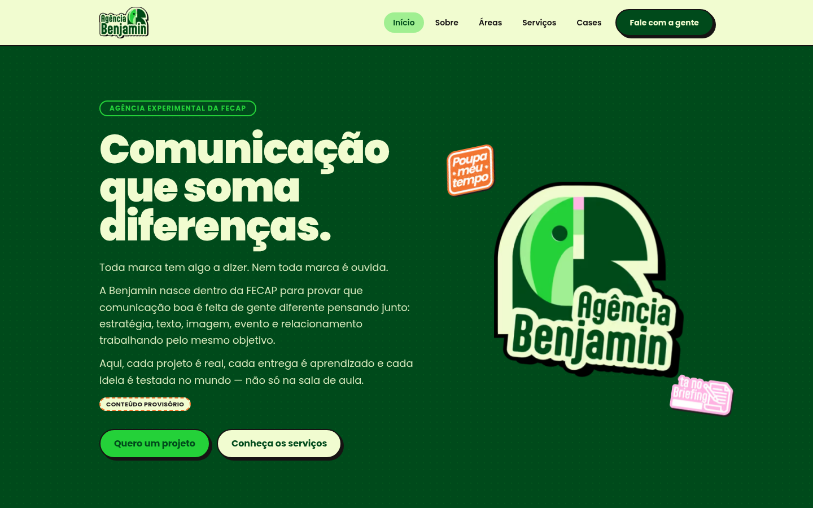
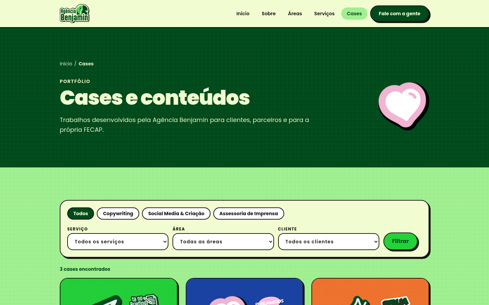
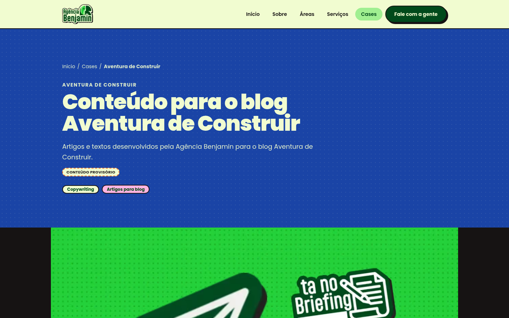
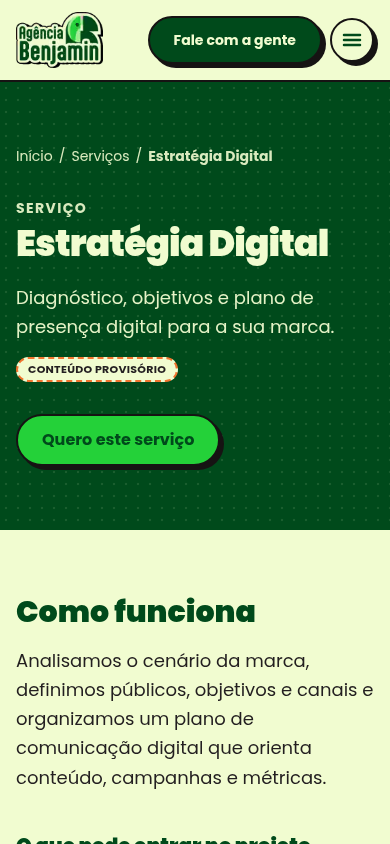
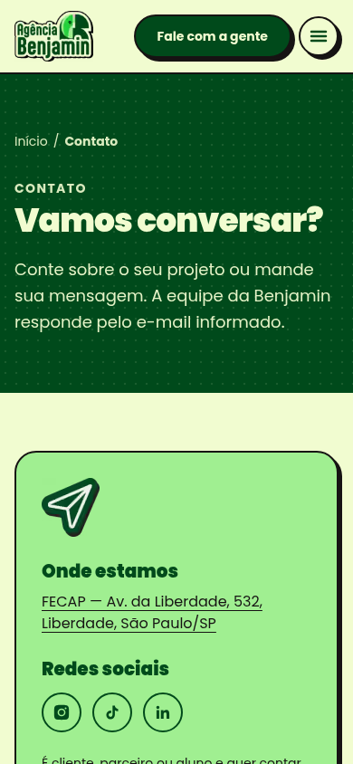
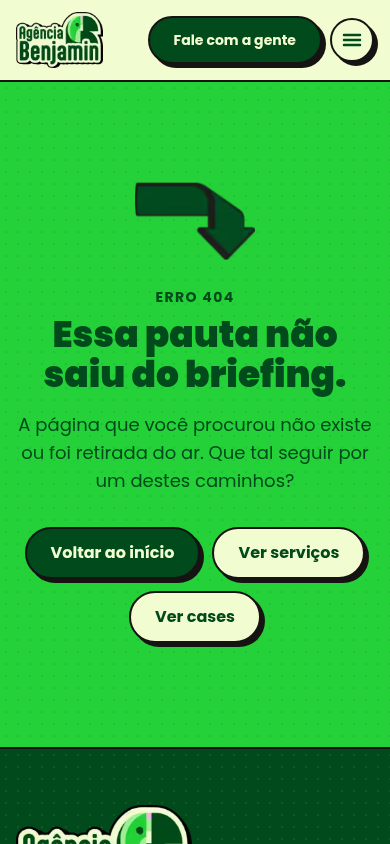
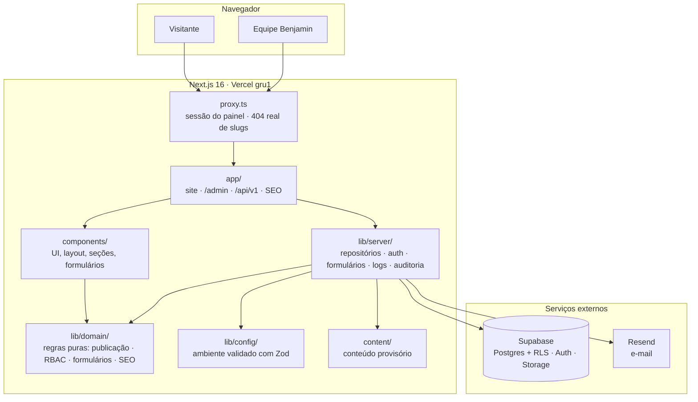
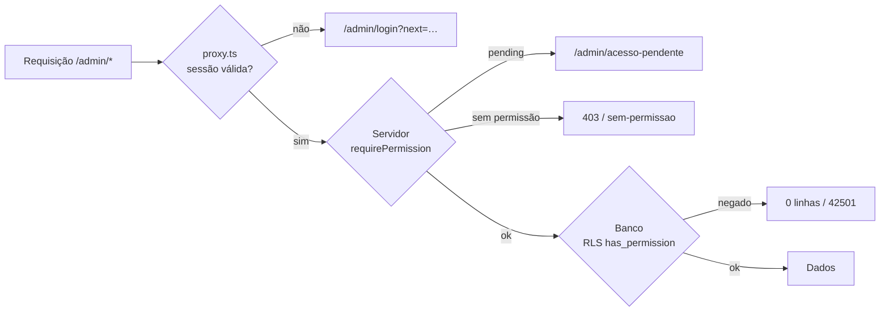
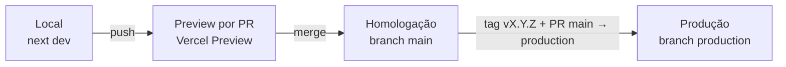
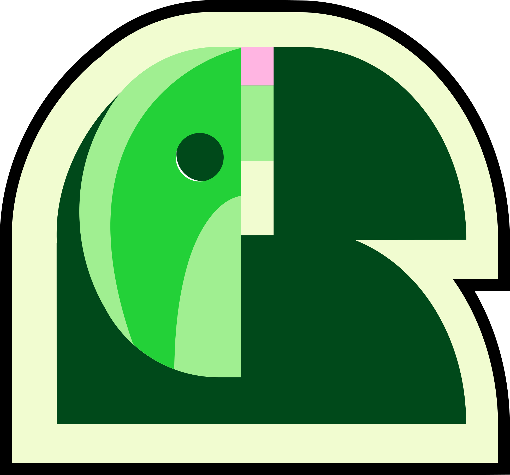

<div align="center">


# Plataforma Institucional — Agência Benjamin

**Comunicação que soma diferenças.**

Site institucional, portfólio de cases e painel de conteúdo da **Agência Benjamin**, a agência
experimental de comunicação da FECAP. O projeto é desenvolvido pelo **NúcleoTech**, o Núcleo de
Tecnologia da FECAP.

<p>
  
  
  
  
  
  
</p>
<p>
  
  
  
  
  
</p>

[**Project (backlog)**](https://github.com/users/NucleoTechFecap/projects/4) ·
[**Issues**](https://github.com/NucleoTechFecap/landing-agencia-benjamin/issues) ·
[**Documentação**](docs/README.md) ·
[**Arquitetura**](docs/arquitetura/documentacao-tecnica.md) ·
[**Como contribuir**](CONTRIBUTING.md)

<br />



</div>

---

## Sumário

- [Sobre o projeto](#sobre-o-projeto)
- [Destaques](#destaques)
- [Telas](#telas)
- [Stack](#stack)
- [Arquitetura](#arquitetura)
- [Começando](#começando)
- [Variáveis de ambiente](#variáveis-de-ambiente)
- [Scripts](#scripts)
- [Estrutura de pastas](#estrutura-de-pastas)
- [Rotas e APIs](#rotas-e-apis)
- [Segurança e LGPD](#segurança-e-lgpd)
- [SEO e descoberta por IA](#seo-e-descoberta-por-ia)
- [Qualidade e testes](#qualidade-e-testes)
- [Deploy e operação](#deploy-e-operação)
- [Documentação](#documentação)
- [Como contribuir](#como-contribuir)
- [Roadmap](#roadmap)
- [Equipe](#equipe)
- [Licença e créditos](#licença-e-créditos)

---

## Sobre o projeto

A **Agência Benjamin** é a agência experimental de comunicação da FECAP. Nela, estudantes atendem
clientes reais em estratégia, conteúdo, criação, eventos e assessoria de imprensa. Esta
plataforma é a vitrine da agência e também a ferramenta de trabalho da equipe. Ela permite:

- **apresentar** a agência, as áreas de atuação, os serviços e os cases com a identidade visual
  do brandbook;
- **captar** pedidos de projeto, mensagens de contato e feedbacks, com tratamento adequado à LGPD;
- **publicar** conteúdo por um painel próprio, para que a equipe da Benjamin atualize o site sem
  depender do NúcleoTech;
- **ser encontrada** por mecanismos de busca, redes sociais e assistentes de IA.

| | |
| --- | --- |
| **Cliente** | Agência Benjamin · FECAP |
| **Desenvolvimento** | NúcleoTech · Núcleo de Tecnologia da FECAP |
| **Primeira versão (MVP)** | 04/11/2026 |
| **Documentos de origem** | Ata NT-ATA-2026-003 e relatório de projeto NT-PRJ-2026-001 |

> [!NOTE]
> O site público funciona **sem banco configurado**. Nesse caso ele usa o conteúdo provisório
> versionado em [`content/`](content/), marcado com o selo "Conteúdo provisório". O gate de
> release (`npm run release:check`) impede a publicação enquanto existir conteúdo provisório.

---

## Destaques

<table>
  <tr>
    <td width="50%" valign="top">

### 🎨 Site institucional

- Home com manifesto, prévia da agência, serviços em destaque e CTA final
- Páginas **Sobre**, **Áreas**, **Serviços** e **Cases**, com páginas de detalhe
- Portfólio com **filtros** por categoria, serviço, área e cliente
- Identidade do brandbook: paleta, Poppins, ícones e *stickers* da marca
- Layout responsivo, menu mobile acessível, *skip link* e foco visível
- Páginas de erro e 404 com a linguagem da agência

    </td>
    <td width="50%" valign="top">

### 📨 Formulários e captação

- **Novo projeto**, **contato** e **feedback**, validados com Zod no servidor
- Envio **idempotente**: `submissionId` e impressão digital HMAC
- Antispam com *honeypot*, tempo mínimo de preenchimento e *rate limit*
- O envio é gravado antes da notificação, com reenvio e *backoff*
- Notificação por e-mail via **Resend**, com destinatários por tipo
- Retenção e anonimização definidas por formulário

    </td>
  </tr>
  <tr>
    <td valign="top">

### 🔐 Painel e acesso

- Autenticação com **Supabase Auth**: login, recuperação e nova senha
- **RBAC** com 5 papéis × 13 recursos × 8 ações, negando por padrão
- Três barreiras: `proxy.ts` → guardas no servidor → **RLS** no banco
- Matriz de permissões em código espelhada no SQL e conferida por teste
- **Trilha de auditoria** *append-only* para operações críticas
- Máquina de estados de publicação: rascunho → publicado → arquivado

    </td>
    <td valign="top">

### 🔎 SEO, performance e operação

- Metadados por página, *canonical*, **Open Graph** e Twitter Cards
- Imagens OG geradas por rota com `next/og`
- **JSON-LD** (Organization, WebSite, Service, CreativeWork, BreadcrumbList)
- `sitemap.xml`, `robots.txt`, `manifest` e **`llms.txt` / `llms-full.txt`**
- **Cache Components** com `'use cache'`, `cacheTag` e invalidação por *tag*
- API pública versionada (`/api/v1`) e logs estruturados sem dados pessoais

    </td>
  </tr>
</table>

---

## Telas

<table>
  <tr>
    <td align="center"><br /><sub><b>Serviços</b></sub></td>
    <td align="center"><br /><sub><b>Cases com filtros</b></sub></td>
  </tr>
  <tr>
    <td align="center"><br /><sub><b>Detalhe do case</b></sub></td>
    <td align="center"><br /><sub><b>Imagem Open Graph gerada</b></sub></td>
  </tr>
</table>

<table>
  <tr>
    <td align="center"><br /><sub><b>Home</b></sub></td>
    <td align="center"><br /><sub><b>Serviço</b></sub></td>
    <td align="center"><br /><sub><b>Contato</b></sub></td>
    <td align="center"><br /><sub><b>404</b></sub></td>
  </tr>
</table>

---

## Stack

| Camada | Tecnologia | Por quê |
| ------ | ---------- | ------- |
| Framework | **Next.js 16.4** (App Router, Cache Components, `proxy.ts`) | SSR e streaming, cache por *tag*, SEO nativo e deploy simples na Vercel |
| UI | **React 19.3** · **Tailwind CSS v4** (`@theme` com os tokens da marca) | Server Components, `useActionState` e estilos consistentes com o brandbook |
| Linguagem | **TypeScript 5** (modo estrito) | Contratos tipados de ponta a ponta |
| Validação | **Zod 4** | O mesmo esquema valida formulários, APIs e o ambiente |
| Dados | **Supabase**: Postgres, Auth, Storage e RLS (`@supabase/ssr`) | Banco, autenticação e mídia gerenciados, com regras de acesso no próprio banco |
| E-mail | **Resend** (API REST com `Idempotency-Key`) | Notificações de formulários sem envio duplicado |
| Hospedagem | **Vercel**, região `gru1` (São Paulo) | Previews por PR, homologação na `main`, Cron e baixa latência no Brasil |
| Testes | **Vitest 5** · **Playwright** | Testes unitários, de integração e E2E em desktop e mobile |
| Qualidade | ESLint (flat config do Next) · Prettier · `tsc` · checagem de cabeçalhos | Um gate único: `npm run verify` |

As justificativas e alternativas consideradas estão no
[ADR-0002 — Stack de desenvolvimento](docs/adr/0002-stack-de-desenvolvimento.md).

> [!IMPORTANT]
> Esta versão do Next.js traz APIs novas, como `proxy.ts` no lugar de `middleware`,
> `'use cache'`, `cacheLife`, `updateTag` e os tipos `PageProps` e `RouteContext` gerados por
> `next typegen`. Antes de escrever código, consulte a documentação instalada em
> `node_modules/next/dist/docs/` (veja [`AGENTS.md`](AGENTS.md)).

---

## Arquitetura

O projeto é um **monólito modular** em Next.js, com camadas de responsabilidade bem definidas. O
ESLint (`no-restricted-imports`) faz cumprir essas camadas: um componente de UI não importa código
de servidor, e o domínio não conhece o framework.



| Camada | Pode importar | Responsabilidade |
| ------ | ------------- | ---------------- |
| `app/` | tudo | Rotas, layouts, Server Actions, Route Handlers e metadados |
| `components/` | `lib/domain`, `lib/config` | Apresentação; **nunca** importa `lib/server` |
| `lib/server/` | `lib/domain`, `lib/config`, `content` | I/O: Supabase, e-mail, cache, logs e auditoria (`server-only`) |
| `lib/domain/` | apenas ele mesmo | Regras de negócio puras e testáveis (sem Next, sem I/O) |
| `lib/config/` | — | Variáveis de ambiente validadas e navegação |

Para aprofundar:

- [ADR-0001 — Arquitetura da plataforma](docs/adr/0001-arquitetura-da-plataforma.md)
- [ADR-0003 — Limites de domínio](docs/adr/0003-limites-de-dominio.md)
- [ADR-0006 — Cache e invalidação](docs/adr/0006-cache-e-invalidacao.md)
- [Documentação técnica consolidada](docs/arquitetura/documentacao-tecnica.md)

---

## Começando

### Pré-requisitos

- **Node.js ≥ 20.9**; o recomendado é o 22 LTS, definido em [`.nvmrc`](.nvmrc)
- **npm 10+** e **Git**
- Opcional: [Supabase CLI](https://supabase.com/docs/guides/cli), para subir um banco local
- Opcional: Google Chrome instalado, para os testes E2E (o Playwright usa `channel: "chrome"`)

### Instalação

```bash
git clone https://github.com/NucleoTechFecap/landing-agencia-benjamin.git
cd landing-agencia-benjamin

nvm use                      # opcional: usa a versão do .nvmrc
npm ci                       # instala exatamente o package-lock.json
cp .env.example .env.local   # ajuste os valores conforme a seção abaixo

npm run dev                  # http://localhost:3000
```

### O que funciona em cada modo

| Recurso | Sem Supabase | Com Supabase |
| ------- | :----------: | :----------: |
| Site público, SEO, `llms.txt`, API `/api/v1` | ✅ conteúdo de `content/` | ✅ conteúdo do banco |
| Formulários | ✅ armazenamento em memória e notificação via log | ✅ gravação no banco e e-mail |
| Painel `/admin` | 🔒 bloqueado por padrão | ✅ login e RBAC |
| Mídia | imagens de `public/brand` | ✅ bucket `media` com RLS (upload pelo painel no ADM-09) |

### Banco de dados (opcional)

As migrations versionadas ficam em [`supabase/migrations/`](supabase/migrations/). Elas criam
perfis, a tabela de permissões (148 regras), a trilha de auditoria e a tabela de envios de
formulário, tudo com RLS.

```bash
supabase link --project-ref <ref-do-ambiente>   # ex.: benjamin-dev
supabase db push                                # aplica as migrations pendentes
```

O primeiro administrador é criado com o script de provisionamento. O passo a passo está em
[`docs/operacao/administrador-inicial.md`](docs/operacao/administrador-inicial.md).

---

## Variáveis de ambiente

O modelo completo, com comentários, está em [`.env.example`](.env.example). Nunca commite valores
reais: todos os arquivos `.env*` são ignorados pelo Git, exceto o `.env.example`.

| Variável | Escopo | Descrição |
| -------- | ------ | --------- |
| `NEXT_PUBLIC_SITE_URL` | público | Origem canônica usada em *canonical*, OG, sitemap e `llms.txt` |
| `NEXT_PUBLIC_SITE_ENV` | público | `development` · `preview` · `homologation` · `production`. Fora de `production`, o site envia `noindex` |
| `NEXT_PUBLIC_SUPABASE_URL` / `NEXT_PUBLIC_SUPABASE_ANON_KEY` | público | Projeto Supabase do ambiente |
| `SUPABASE_SERVICE_ROLE_KEY` | servidor | Ignora a RLS. Usada só no servidor e em scripts operacionais |
| `SUBMISSION_HASH_SECRET` | servidor | HMAC de IP e impressão digital dos envios (mín. 32 caracteres) |
| `NOTIFY_PROVIDER` | servidor | `log` (padrão em dev) ou `resend` |
| `RESEND_API_KEY` · `NOTIFICATION_FROM` | servidor | Credencial e remetente das notificações |
| `LEAD_` / `CONTACT_` / `FEEDBACK_NOTIFICATION_TO` | servidor | Destinatários por tipo de envio (separados por vírgula) |
| `LOG_LEVEL` | servidor | `debug` · `info` · `warn` · `error` |
| `CONTENT_REVALIDATE_SECRET` | servidor | Protege `POST /api/internal/revalidate` |
| `CRON_SECRET` | servidor | *Bearer* do Vercel Cron para os jobs internos |

A matriz por ambiente (local, preview, homologação e produção) e as regras de rotação estão em
[`docs/ambientes/variaveis-de-ambiente.md`](docs/ambientes/variaveis-de-ambiente.md).

---

## Scripts

| Comando | O que faz |
| ------- | --------- |
| `npm run dev` | Servidor de desenvolvimento (Turbopack) |
| `npm run build` | Build de produção |
| `npm run start` | Sobe o build de produção |
| `npm run lint` | ESLint, incluindo as regras de camadas |
| `npm run format` | Formata o código com o Prettier (altera os arquivos) |
| `npm run format:check` | Confere a formatação sem alterar nada (roda dentro do `verify`) |
| `npm run typecheck` | `next typegen` + `tsc --noEmit` |
| `npm run test` | Testes unitários e de integração (Vitest) |
| `npm run test:watch` | Vitest em modo *watch* |
| `npm run test:e2e` | Jornadas ponta a ponta com Playwright, em desktop e mobile (requer `npm run build`) |
| `npm run check:headers` | Valida o cabeçalho padrão dos arquivos de código |
| `npm run headers:write` | Insere o cabeçalho padrão nos arquivos que ainda não o têm |
| `npm run verify` | **Gate de PR:** cabeçalhos → formatação → tipos → lint → testes → build |
| `npm run check:release-content` | Falha se houver conteúdo provisório publicado |
| `npm run release:check` | **Gate de release:** `verify` + conteúdo provisório ([GO-01](docs/operacao/release-e-rollback.md)) |

---

## Estrutura de pastas

```text
.
├── app/
│   ├── (site)/                  # Site público: Home, Sobre, Áreas, Serviços, Cases, Contato, Feedback, Privacidade
│   ├── admin/                   # Painel: login, recuperação de senha, callback e área protegida (painel)
│   ├── api/
│   │   ├── v1/                  # API pública somente leitura (health, settings, áreas, serviços, categorias, cases)
│   │   └── internal/            # Revalidação de cache e jobs agendados (protegidos por segredo)
│   ├── llms.txt/ · llms-full.txt/   # Descoberta por assistentes de IA
│   ├── sitemap.ts · robots.ts · manifest.ts
│   └── opengraph-image.tsx · twitter-image.tsx
├── components/
│   ├── ui/                      # Container, Section, Badge, ButtonLink, Sticker, Breadcrumbs…
│   ├── layout/                  # Header, menu mobile, footer, redes sociais, skip link
│   ├── sections/                # Hero, prévia "Sobre", processo, filtros de cases, CTA final
│   ├── cards/                   # Cards de serviço, case e área
│   ├── forms/                   # Campos e formulários de lead, contato e feedback
│   ├── seo/                     # JSON-LD e card OG
│   └── admin/                   # Formulários de autenticação do painel
├── content/                     # Conteúdo provisório versionado (fallback até o CMS)
├── lib/
│   ├── config/                  # Ambiente público/servidor validado e navegação
│   ├── domain/                  # content · auth (RBAC) · forms · media · api · audit · seo
│   └── server/                  # content · forms · auth · supabase · logger · errors · http · og · llms
├── public/brand/                # Logos em SVG (e PNG para OG/JSON-LD), ícones (14 × 6 cores), stickers e capas
├── assets/fonts/                # Poppins (OFL) para as imagens OG
├── assets/brand/                # Pacote oficial da marca: brandbook, .ai, .psd e exportações (fora do deploy)
├── supabase/migrations/         # Perfis, RBAC, auditoria e envios de formulário
├── scripts/                     # Cabeçalhos, seed RBAC e provisionamento do administrador
├── tests/                       # Integração (jornadas) e E2E (Playwright)
├── docs/                        # Requisitos, ADRs, segurança, negócio, operação e roadmap
├── proxy.ts                     # Sessão do painel e 404 real para slugs inexistentes
└── instrumentation.ts           # onRequestError → logger estruturado
```

As pastas [`components/`](components/README.md), [`lib/`](lib/README.md),
[`content/`](content/README.md), [`scripts/`](scripts/README.md),
[`supabase/`](supabase/README.md) e [`assets/brand/`](assets/brand/README.md) têm README próprio
com as convenções locais.

---

## Rotas e APIs

<details open>
<summary><b>Site público</b></summary>

| Rota | Página |
| ---- | ------ |
| `/` | Home: manifesto, sobre, serviços em destaque, cases e CTA |
| `/sobre` | A agência, como ela funciona e as áreas que trabalham juntas |
| `/areas` | Áreas de atuação |
| `/servicos` · `/servicos/[slug]` | Catálogo de serviços e detalhe com cases relacionados |
| `/cases` · `/cases/[slug]` | Portfólio com filtros e detalhe do case |
| `/contato` | Formulários de novo projeto e de contato |
| `/feedback` | Formulário de feedback |
| `/privacidade` | Aviso de privacidade |

</details>

<details>
<summary><b>Painel administrativo</b></summary>

| Rota | Acesso |
| ---- | ------ |
| `/admin/login` · `/admin/recuperar-senha` | Público |
| `/admin/auth/callback` · `/admin/nova-senha` | Fluxo de recuperação de senha |
| `/admin` | Painel com os módulos filtrados pelo papel |
| `/admin/acesso-pendente` · `/admin/sem-permissao` | Avisos para conta `pending` e falta de permissão |

</details>

<details>
<summary><b>API pública <code>/api/v1</code> (somente leitura)</b></summary>

| Método e rota | Retorno |
| ------------- | ------- |
| `GET /api/v1/health` | `{ status, service, apiVersion }` |
| `GET /api/v1/settings` | Contato institucional e redes sociais |
| `GET /api/v1/areas` | Áreas de atuação |
| `GET /api/v1/services?featured=` | Serviços |
| `GET /api/v1/services/{slug}` | Serviço com os cases relacionados |
| `GET /api/v1/categories` | Categorias de cases |
| `GET /api/v1/cases?category=&service=&area=&client=&page=&pageSize=` | Cases paginados com `meta` |
| `GET /api/v1/cases/{slug}` | Case completo |

Todas as respostas seguem o envelope `{ data, meta? }`. Os erros vêm como `{ error: { code, message, requestId } }`.
O contrato completo está em [`docs/api/contratos.md`](docs/api/contratos.md).

</details>

<details>
<summary><b>Rotas internas e de descoberta</b></summary>

| Rota | Uso |
| ---- | --- |
| `POST /api/internal/revalidate` | Invalida o cache público por *tag* (`Bearer CONTENT_REVALIDATE_SECRET`) |
| `GET /api/internal/jobs/notificacoes` | Reenvia notificações pendentes (Vercel Cron, `Bearer CRON_SECRET`) |
| `/sitemap.xml` · `/robots.txt` · `/manifest.webmanifest` | Indexação e PWA básico |
| `/llms.txt` · `/llms-full.txt` | Resumo e conteúdo completo para assistentes de IA |
| `/opengraph-image` · `/twitter-image` | Imagens de compartilhamento padrão (há também uma por serviço e por case) |

</details>

---

## Segurança e LGPD



- **Negar por padrão:** um papel nulo, desconhecido ou `pending` não tem nenhuma permissão. Veja
  a [matriz RBAC](docs/seguranca/matriz-rbac.md) e os
  [perfis](docs/seguranca/perfis-e-permissoes.md).
- **O papel vem do banco** a cada requisição. Nada enviado pelo cliente define permissões.
- **Minimização:** leads e feedbacks ficam visíveis apenas para `admin`. O IP é guardado só como
  HMAC, e os logs mascaram dados pessoais automaticamente.
- **Retenção:** cada formulário tem prazo de exclusão ou anonimização
  ([TECH-08](docs/seguranca/ciclo-de-vida-dados-pessoais.md)).
- **Cabeçalhos de segurança** em todas as respostas, `poweredByHeader` desativado e `noindex`
  fora de produção e sempre no `/admin`.
- **Auditoria** *append-only* das operações críticas
  ([TECH-10](docs/seguranca/trilha-de-auditoria.md)).

Base legal e finalidade de cada dado coletado:
[`docs/seguranca/tratamento-de-dados-formularios.md`](docs/seguranca/tratamento-de-dados-formularios.md).

---

## SEO e descoberta por IA

| Recurso | Implementação |
| ------- | ------------- |
| Metadados | `buildMetadata()` por página, com título, descrição, *keywords*, *canonical* e *alternates* |
| Compartilhamento | Open Graph e Twitter Cards, com imagem gerada por `next/og` (Poppins embutida) |
| Dados estruturados | JSON-LD: `Organization`, `WebSite`, `Service`, `CreativeWork`, `BreadcrumbList` |
| Indexação | `sitemap.xml` com as rotas publicadas, `robots.txt` por ambiente e `X-Robots-Tag` |
| IA | `llms.txt` (resumo navegável) e `llms-full.txt` (conteúdo completo em Markdown) |
| 404 real | `proxy.ts` responde **404** para slugs não publicados, sem *soft 404* durante o *streaming* |
| Performance | Cache Components, `cacheLife("hours")`, imagens AVIF/WebP e *prefetch* parcial |

A estratégia completa está em [`docs/seo/estrategia-de-seo.md`](docs/seo/estrategia-de-seo.md).

---

## Qualidade e testes

| Nível | Ferramenta | O que cobre |
| ----- | ---------- | ----------- |
| Unitário | Vitest | Domínio (publicação, integridade, RBAC, formulários, SEO), servidor (logger, erros, guardas, serviço de envio), API e scripts |
| Contrato | Vitest | Compatibilidade dos DTOs da API e consistência entre o RBAC em código e o seed SQL |
| Integração | Vitest | Jornadas de **publicação** e de **lead**, de ponta a ponta no servidor |
| E2E | Playwright | Jornada do visitante em **desktop e mobile**: navegação, filtros, 404 e formulário |
| Estático | ESLint · Prettier · `tsc` · cabeçalhos | Camadas, formatação, tipos e padrão de cabeçalho |

```bash
npm run verify       # gate obrigatório antes de abrir PR
npm run build && npm run test:e2e
npm run release:check   # antes de publicar em produção
```

> [!TIP]
> Os PRs que tocam autenticação, RBAC, dados pessoais, migrations ou cache seguem o checklist de
> [revisão de PRs críticos](docs/qualidade/revisao-de-prs.md).

---

## Deploy e operação

| Etapa | Documento |
| ----- | --------- |
| Ambientes e acessos | [Matriz de ambientes](docs/ambientes/matriz-de-ambientes.md) |
| Provisionamento de produção (Vercel + Supabase + Resend) | [GO-02](docs/operacao/provisionamento-producao.md) |
| Domínio, DNS e HTTPS | [GO-03](docs/operacao/dominio-dns-https.md) |
| Checklist de release e rollback | [GO-01](docs/operacao/release-e-rollback.md) |
| Decisão de go/no-go | [TECH-14](docs/operacao/go-no-go.md) |
| Publicação do MVP | [GO-06](docs/operacao/publicacao-mvp.md) |
| Handoff e manutenção | [GO-09](docs/operacao/handoff-e-manutencao.md) |



Cada ambiente tem o próprio projeto Supabase e as próprias chaves. O deploy usa a integração
GitHub → Vercel, na região `gru1`:

- cada PR gera um *preview*;
- o merge na `main` atualiza a **homologação**;
- a **produção** só recebe uma *tag* aprovada, por PR `main → production`.

Para fazer rollback, promova um deploy anterior na Vercel (*Instant Rollback*). Não é preciso
gerar um novo build.

---

## Documentação

Todo o conhecimento do projeto está versionado em [`docs/`](docs/README.md):

| Área | Conteúdo |
| ---- | -------- |
| 📋 [Requisitos](docs/requisitos/mapa-de-requisitos.md) | Mapa de requisitos e rastreabilidade com as issues |
| 🏛️ [ADRs](docs/adr/README.md) | 7 decisões de arquitetura: stack, domínios, logs, mídia, cache e versões |
| 🧭 [Gestão](docs/gestao/) | Ownership por issue e critérios de aceite |
| 📐 [Negócio](docs/negocio/) | Fluxo de publicação, máquina de estados, integridade e campos do case |
| 🔐 [Segurança](docs/seguranca/) | Perfis, RBAC, autenticação, proteção de rotas, LGPD e auditoria |
| 📨 [Formulários](docs/formularios/) | Matriz de campos, roteamento, idempotência e falhas |
| 🔌 [API](docs/api/) | Contratos, erros, paginação e compatibilidade |
| 🔎 [SEO](docs/seo/estrategia-de-seo.md) | Metadados, OG, JSON-LD e `llms.txt` |
| ✅ [Qualidade](docs/qualidade/) | Jornadas E2E e revisão de PRs |
| 🚀 [Operação](docs/operacao/) | Release, produção, domínio, go/no-go, publicação e handoff |
| 🗺️ [Roadmap](docs/roadmap/) | Evolução para CRM e integrações externas |

---

## Como contribuir

O guia completo está em [`CONTRIBUTING.md`](CONTRIBUTING.md). Em resumo:

1. Pegue uma issue no [Project](https://github.com/users/NucleoTechFecap/projects/4) e mova-a
   para **In progress**.
2. Crie a branch a partir da `main`: `<tipo>/<id-da-issue>-<descricao>`, por exemplo
   `feat/adm-06-crud-servicos`.
3. Faça commits no padrão **Conventional Commits em português**, com o ID da issue no escopo:

   ```text
   feat(ADM-06): implementa listagem de serviços no painel
   ```

4. Rode `npm run verify` e abra o PR para a `main` com `Closes #<issue>`, usando o
   [template](.github/pull_request_template.md).
5. Aguarde a revisão dos responsáveis definidos em [`CODEOWNERS`](.github/CODEOWNERS).

### Cabeçalho padrão dos arquivos

Todo arquivo de código começa com o cabeçalho do projeto. O `npm run check:headers` valida a
presença dele, e o `npm run headers:write` cria o bloco automaticamente:

```text
/*
════════════════════════════════════════════════════════════════════════════════
 Sistema      : Agência Benjamin Landing Page
 Módulo       : Components
 Arquivo      : site-header.tsx
 Descrição    : Cabeçalho do site com logo, navegação e CTA principal.

 Desenvolvedor: Nome Sobrenome

 Projeto      : Agência Benjamin Landing Page
 Versão       : 1.0.0
 Criado em    : 13/10/2026
 Modificado em: 13/10/2026
════════════════════════════════════════════════════════════════════════════════

 Histórico
 ──────────────────────────────────────────────────────────────────────────────
 Data        Autor                     Descrição
 ──────────────────────────────────────────────────────────────────────────────
 13/10/2026 Nome Sobrenome           Criação inicial (ID-DA-ISSUE).
──────────────────────────────────────────────────────────────────────────────
*/
```

Ao alterar um arquivo, acrescente uma linha no **Histórico** e atualize o campo **Modificado em**.

---

## Roadmap

- [x] Arquitetura, stack, ADRs e governança do repositório
- [x] Site público completo com conteúdo provisório e identidade da marca
- [x] SEO técnico, Open Graph, JSON-LD, sitemap e `llms.txt`
- [x] Formulários com idempotência, antispam, retenção e notificação
- [x] Autenticação, RBAC em três camadas e trilha de auditoria
- [x] API pública `/api/v1`, cache com invalidação por *tag* e testes E2E
- [ ] Modelagem de conteúdo no banco e CRUD do painel (ADM-05 a ADM-11)
- [ ] Biblioteca de mídia e listagem de leads e feedbacks no painel
- [ ] Conteúdo definitivo aprovado pela Agência Benjamin
- [ ] Publicação do MVP no domínio oficial: **04/11/2026**
- [ ] Pós-MVP: [evolução para CRM](docs/roadmap/evolucao-crm.md) e
      [integrações externas](docs/roadmap/integracoes-externas.md)

O acompanhamento em tempo real está no [GitHub Project](https://github.com/users/NucleoTechFecap/projects/4).

---

## Equipe

<table>
  <tr>
    <th align="left">Função</th>
    <th align="left">Pessoas</th>
  </tr>
  <tr><td>Coordenação</td><td>Flávio Santos</td></tr>
  <tr><td>Coordenação técnica</td><td>Vinícius Nishimura Reis</td></tr>
  <tr><td>Vice-coordenação</td><td>Vinícius Binda</td></tr>
  <tr><td>Design</td><td>Vinícius Cardoso de Lima</td></tr>
  <tr><td>Desenvolvimento</td><td>Caio Moraes · Gustavo Duarte Güering · Julia Damasio · Murilo Ribeiro Vasconcellos · Rafael Morais Rocha</td></tr>
  <tr><td>Agência Benjamin</td><td>Melissa Namie · Renan Hida</td></tr>
</table>

---

## Licença e créditos

Este repositório **não declara licença de código aberto**. O código, os textos e a identidade
visual pertencem à **Agência Benjamin / FECAP** e são de uso restrito ao projeto. A fonte
**Poppins**, incluída em [`assets/fonts/`](assets/fonts/), é distribuída sob a
[SIL Open Font License](assets/fonts/OFL.txt).

<div align="center">

<br />



**Agência Benjamin · FECAP** — *somando diferenças*

Desenvolvido com 💚 pelo **NúcleoTech** · © 2026

</div>
