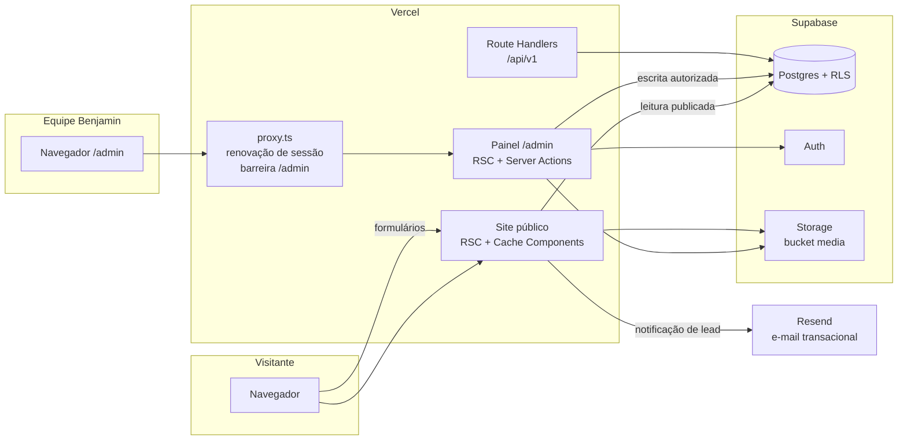

# ADR-0001 — Arquitetura da plataforma e critérios de decisão

| Campo        | Valor                                                     |
| ------------ | --------------------------------------------------------- |
| Issue        | ARC-01 (#42)                                              |
| Status       | **Aceita** — coordenação técnica                          |
| Data         | 13/10/2026                                                |
| Decisor      | Vinícius Nishimura Reis (`@Vinishireis`)                  |
| Consultados  | Vinícius Binda (`@VinnizzZ`), Flávio Santos               |
| Depende de   | GOV-02 — [mapa de requisitos](../requisitos/mapa-de-requisitos.md) |

## Contexto

A Agência Benjamin precisa de um site institucional com portfólio, captação de leads, feedback e
um painel para editar conteúdo sem depender do NúcleoTech (RNF-11). O prazo é curto
(primeira versão em **04/11/2026**, ~3 semanas de desenvolvimento), o time é formado por
estudantes com dedicação parcial e o NúcleoTech assume front-end, back-end, banco, segurança,
infraestrutura e deploy (ATA §4.8).

## Critérios de decisão

| #  | Critério | Peso | Por quê |
| -- | -------- | ---- | ------- |
| C1 | Prazo do MVP | 5 | 04/11/2026 é data-alvo institucional |
| C2 | Conhecimento do time | 5 | Reduz curva de aprendizado; projetos FECAP Cases e Núcleo Tech já usam a mesma base |
| C3 | Segurança por padrão (auth, RLS, segredos) | 5 | Dados pessoais de leads e feedbacks (RNF-06/07) |
| C4 | SEO e desempenho do site público | 4 | Captação de clientes depende de descoberta orgânica (RNF-04/05) |
| C5 | Autonomia editorial (CMS) | 4 | Objetivo central do projeto (ATA §4.4) |
| C6 | Custo de operação | 3 | Projeto acadêmico, sem orçamento recorrente formalizado |
| C7 | Manutenção e handoff | 3 | Rotatividade natural de integrantes |
| C8 | Evolução (CRM, newsletter, integrações) | 2 | Previsto como pós-MVP (PRJ §57) |

## Opções avaliadas

| Opção | Descrição | C1 | C2 | C3 | C4 | C5 | C6 | C7 | C8 | Total |
| ----- | --------- | -- | -- | -- | -- | -- | -- | -- | -- | ----- |
| **A** | **Monólito modular Next.js (App Router) + Supabase (Postgres, Auth, Storage, RLS) + Vercel** | 5 | 5 | 4 | 5 | 4 | 4 | 4 | 4 | **138** |
| B | Site estático (SSG) + CMS headless SaaS (ex.: Sanity/Contentful) + formulário terceirizado | 4 | 2 | 4 | 5 | 4 | 3 | 3 | 2 | 108 |
| C | SPA React + API REST própria (Express/Nest) + Postgres gerenciado | 2 | 3 | 3 | 2 | 3 | 3 | 2 | 4 | 83 |
| D | WordPress com tema customizado | 3 | 1 | 2 | 3 | 5 | 3 | 2 | 2 | 81 |

*Notas de 1 a 5 multiplicadas pelo peso.*

## Decisão

Adotar a **opção A**: um **monólito modular** em Next.js 16 (App Router) com fronteiras explícitas
entre domínios (detalhadas em ADR-0003, issue TECH-01), usando Supabase como
plataforma de dados/autenticação/arquivos e Vercel para hospedagem.

### Responsabilidades por camada

| Camada | Responsabilidade | Não faz |
| ------ | ---------------- | ------- |
| `proxy.ts` | Renovar cookies de sessão e negar cedo `/admin` sem sessão | Autorização fina (fica no servidor e no banco) |
| Site público (`app/(site)`) | Renderizar conteúdo **publicado**, formulários, SEO | Ler rascunhos, consultar leads |
| Painel (`app/admin`) | Edição, publicação, mídia, consulta de leads/feedbacks | Ser indexado; confiar no cliente para autorizar |
| Server Actions | Mutações (formulários públicos e operações do CMS) com validação Zod e checagem de permissão | Expor dados além do necessário |
| Route Handlers `/api/v1` | Leitura pública versionada (integrações, `llms.txt`, healthcheck) | Escrita sem autenticação |
| Camada de domínio (`lib/domain`) | Regras puras: estados de publicação, integridade, RBAC, formulários | Acessar rede/banco diretamente |
| Camada de servidor (`lib/server`) | Repositórios, clientes Supabase, logs, auditoria, cache | Renderizar UI |
| Supabase | Persistência, RLS (segunda barreira), Auth, Storage | Regras de apresentação |

### Estratégia de renderização

- **Site público:** prerenderização com Cache Components (`'use cache'` + `cacheTag`) e
  invalidação por tag ao publicar no CMS (detalhe em TECH-09). Páginas dinâmicas por slug usam
  `generateStaticParams` + ISR com App Shell.
- **Painel:** renderização por requisição (lê sessão), sempre atrás de `<Suspense>`.
- **Formulários:** Server Actions com aprimoramento progressivo (funcionam sem JavaScript).

## Consequências e trade-offs

**Positivas**

- Um único repositório e deploy: menos integração entre times e menos superfície de falha.
- Mesma base do FECAP Cases (referência citada na ATA §4.5): reuso de padrões de RLS e publicação.
- SEO/desempenho altos com HTML prerenderizado e invalidação sob demanda.
- RLS no banco funciona como segunda barreira caso uma checagem no servidor falhe.

**Negativas / riscos**

| Risco | Mitigação |
| ----- | --------- |
| Acoplamento entre site e painel no mesmo deploy | Fronteiras de domínio + revisão de PRs críticos (TECH-13) |
| Dependência de fornecedores (Vercel, Supabase) | Postgres padrão e Storage compatível com S3 permitem migração; nada de recurso proprietário no domínio |
| Limites/termos de planos gratuitos (pausa de projeto inativo no Supabase Free; uso comercial no Vercel Hobby) | Decidir plano/conta institucional antes de GO-02 (registrado em ADR-0002) |
| APIs novas do Next.js 16 (Cache Components, `proxy.ts`) pouco conhecidas | Documentação versionada em `node_modules/next/dist/docs` + exemplos no repositório |

## Revisão

Reavaliar esta decisão se: (a) o MVP exigir CRM completo (FUT-01), (b) o volume de mídia
ultrapassar o plano contratado, ou (c) a Benjamin precisar de multi-idioma.
