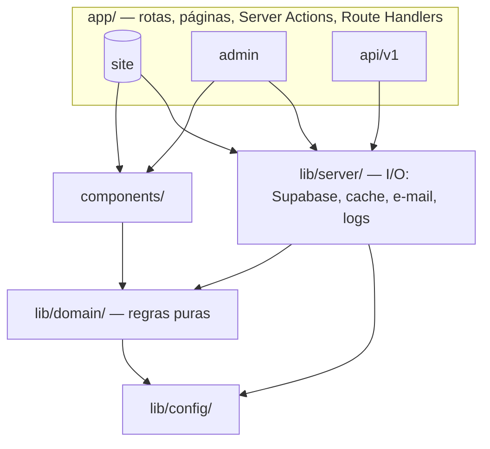

# ADR-0003 — Limites de domínios e responsabilidades

| Campo        | Valor                                                              |
| ------------ | ------------------------------------------------------------------ |
| Issue        | TECH-01 (#54)                                                      |
| Status       | **Aceita** — coordenação técnica                                   |
| Data         | 13/10/2026                                                         |
| Decisor      | Vinícius Nishimura Reis (`@Vinishireis`)                           |
| Depende de   | [ADR-0001](0001-arquitetura-da-plataforma.md), [ADR-0002](0002-stack-de-desenvolvimento.md) |

## Contexto

O monólito modular (ADR-0001) só se mantém sustentável se cada domínio tiver fronteira clara:
quem é dono, o que expõe, o que pode importar e quais dados pode ler. Sem isso, rotas públicas
acabam lendo rascunhos, formulários passam a depender de componentes do painel e regras de
permissão se espalham pela interface.

## Decisão

### Domínios

| Domínio | Responsabilidade | Código | Dono (GOV-07) |
| ------- | ---------------- | ------ | ------------- |
| **Site público** | Renderizar conteúdo publicado, SEO, navegação, CTAs | `app/(site)/**`, `components/{layout,sections,ui,seo}` | Caio Moraes |
| **Conteúdo (CMS)** | Modelos (páginas, áreas, serviços, cases, CTAs), integridade, estados de publicação, leitura publicada e invalidação de cache | `lib/domain/content`, `lib/server/content`, `content/` | Murilo Vasconcellos (CMS) · Vinícius Binda (dados) |
| **Formulários e leads** | Esquemas de contato/prospecção/feedback, idempotência, persistência, notificação e consulta interna | `lib/domain/forms`, `lib/server/forms`, `components/forms`, ações em `app/(site)/**/actions.ts` | Gustavo Duarte Güering (backup: Vinícius Nishimura Reis) |
| **Identidade e acesso** | Autenticação, sessão, papéis, RBAC, guardas de rota e de ação | `proxy.ts`, `lib/domain/auth`, `lib/server/auth`, `app/admin/login` | Vinícius Nishimura Reis |
| **Mídia** | Política de upload (tipo, tamanho, nome), armazenamento e URLs | `lib/domain/media`, `lib/server/media` | Vinícius Binda |
| **Plataforma** | Configuração, logs, erros, auditoria | `lib/config`, `lib/server/{logger,errors,audit}` | Vinícius Nishimura Reis |
| **Painel administrativo** | Interface do CMS; orquestra os domínios acima | `app/admin/(painel)/**`, `components/admin` | Caio Moraes (shell) · Murilo Vasconcellos (CRUDs) |

### Camadas e regra de dependência

| Camada | Pode importar | Não pode importar | Garantido por |
| ------ | ------------- | ----------------- | ------------- |
| `lib/domain/**` | `lib/config/public-env`, `zod` | `lib/server`, `next/*`, `react`, `@supabase/*`, `components` | ESLint (`no-restricted-imports`) |
| `lib/server/**` | `lib/domain`, `lib/config`, `next/*`, `@supabase/*` | `components`, `app` | ESLint + `import "server-only"` |
| `components/**` | `lib/domain` (tipos e funções puras), `lib/config/public-env` | `lib/server`, `lib/config/server-env`, `@supabase/*` | ESLint |
| `app/**` | Todas as camadas acima | — | Revisão de PR |

Componentes recebem dados por **props**. Formulários (Client Components) recebem a Server Action
por prop, a partir da página que a importa.

### Contratos entre domínios

| Consumidor | Fornecedor | Contrato | Regra |
| ---------- | ---------- | -------- | ----- |
| Site público | Conteúdo | `lib/server/content` (`getSiteSettings`, `listServices`, `getServiceBySlug`, `listCases`, `getCaseBySlug`, …) | Só retorna itens visíveis publicamente (TECH-04) |
| Site público | Formulários | Server Actions `submitLead`, `submitContact`, `submitFeedback` → `FormActionState` | Validação no servidor; resposta sem dados internos |
| Painel | Identidade e acesso | `requireUser()`, `requirePermission(recurso, ação)` | Chamado em toda página/ação do painel (ADM-03) |
| Painel | Conteúdo | Mutações + `invalidateContent(entidade)` | Toda escrita publicada invalida cache por tag (TECH-09) |
| Painel | Formulários | Listagem de leads/feedbacks | Somente papéis com `leads:view`/`feedback:view` (TECH-03/08) |
| Conteúdo, Formulários, Identidade | Plataforma | `logger`, `AppError`, `recordAuditEvent` | Sem PII em log/auditoria (ARC-09, TECH-10) |
| API pública v1 | Conteúdo | Mesmas funções do site + envelope de resposta (TECH-02) | Somente leitura |

### Regras de acesso a dados

| Dado | Site público | Painel | Banco (RLS) |
| ---- | ------------ | ------ | ----------- |
| Conteúdo publicado | Leitura | Leitura | `anon` lê somente publicado |
| Rascunhos/arquivados | **Nunca** | Leitura/escrita conforme papel | Só `authenticated` com permissão |
| Leads e feedbacks | Somente inserção (via ação) | Leitura conforme papel | `anon` sem `select`; inserção via função controlada |
| Usuários e papéis | — | `super_admin` | Só o próprio perfil ou `super_admin` |
| Auditoria | — | `super_admin`/`admin` leitura | Inserção somente por função `security definer` |

### Componentes compartilhados

`components/ui` (design system) e `components/layout` são compartilhados entre site e painel e não
podem conter regra de negócio nem chamadas de dados. Mudanças nesses componentes exigem revisão
de quem é dono da frente de estrutura (LAY).

## Consequências

- Regras puras ficam testáveis sem banco (Vitest em `lib/domain`).
- Trocar a fonte do conteúdo (seed provisório → Supabase) afeta só `lib/server/content`.
- Violações de camada aparecem no `npm run lint`, antes da revisão humana.
- Toda nova pasta em `lib/` precisa ser enquadrada em uma camada nesta ADR.
