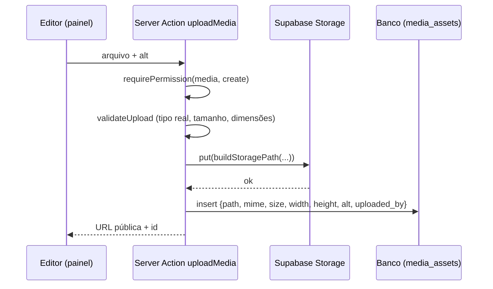

# ADR-0005 — Armazenamento e otimização de arquivos de mídia

| Campo        | Valor                                                             |
| ------------ | ----------------------------------------------------------------- |
| Issue        | ARC-10 (#51)                                                      |
| Status       | **Aceita** — coordenação técnica                                  |
| Data         | 13/10/2026                                                        |
| Decisor      | Vinícius Nishimura Reis (`@Vinishireis`)                          |
| Código       | `lib/domain/media/policy.ts` + testes · `next.config.ts` (`images`) |

## Contexto

O CMS precisa receber imagens de serviços e cases (capas, galerias, peças de social media) e
documentos de assessoria de imprensa (releases, clippings em PDF). A Benjamin enviará arquivos
pesados (exports do Illustrator/Photoshop), e o site precisa continuar rápido em mobile (RNF-04).

## Decisão

### Storage

| Item | Decisão |
| ---- | ------- |
| Serviço | **Supabase Storage**, bucket `media` por ambiente (dev/hml/prd) |
| Leitura | Bucket **público** para leitura; caminhos com UUID (não enumeráveis) |
| Escrita | Somente usuários com `media:create` (RLS em `storage.objects` usando `has_permission`) |
| Exclusão | Somente `media:delete` (`admin`, `super_admin`); bloqueada se o arquivo estiver em uso |
| Conteúdo proibido | Documentos com dados pessoais, contratos, planilhas de leads — o bucket é público |
| Vídeo | Não armazenado: entra como link externo (YouTube, Vimeo, Instagram, TikTok) |
| Assets da marca | Logos, ícones e stickers oficiais ficam versionados em `public/brand` (não no bucket) |

### Formatos e limites

| Tipo | MIME | Limite | Observação |
| ---- | ---- | ------ | ---------- |
| JPG | `image/jpeg` | 5 MB | Fotos |
| PNG | `image/png` | 5 MB | Peças com transparência |
| WebP | `image/webp` | 5 MB | Formato preferido para exportação |
| AVIF | `image/avif` | 5 MB | Opcional |
| PDF | `application/pdf` | 10 MB | Releases e clippings |
| SVG | — | **recusado** | Pode conter script (XSS) |

- Maior lado da imagem ≤ **4000 px**; exportação recomendada: **2400 px** de largura (UX-14).
- O tipo real é conferido pela **assinatura dos bytes** (`sniffMimeType`), não pela extensão.
- Texto alternativo é obrigatório para publicar (regra R12 de TECH-05).

### Nomes e URLs

```text
media/AAAA/MM/<uuid>-<nome-normalizado>.<ext>
https://<projeto>.supabase.co/storage/v1/object/public/media/2026/10/6f1c…-capa-meridiano.webp
```

`buildStoragePath()` gera o caminho; `publicMediaUrl()` monta a URL. O banco guarda o **caminho**
(não a URL completa), permitindo trocar de projeto/CDN sem migrar dados.

### Otimização

- `next/image` com `formats: ["image/avif", "image/webp"]` e `remotePatterns` restrito a
  `/storage/v1/object/public/media/**` do projeto do ambiente (`next.config.ts`).
- Sempre informar `sizes` nas grades (ex.: `(min-width: 1024px) 33vw, 100vw`) e `priority` apenas
  na imagem principal acima da dobra.
- Imagens decorativas da marca (halftone, stickers) em WebP com `alt=""`.

## Fluxo de upload (ADM-09)



## Demonstração em homologação (pendente)

O critério de aceite exige upload e recuperação demonstrados em homologação. Depende de:
projeto Supabase `benjamin-hml` (GO-02), bucket/políticas (migration de ADM-03) e tela de
upload do CMS (ADM-09). Roteiro de verificação:

1. Entrar como `editor` em homologação e enviar `capa.webp` (≤ 5 MB) com texto alternativo.
2. Confirmar a URL pública e a exibição otimizada (`/_next/image?...`) em um case de teste.
3. Tentar enviar `logo.svg` e um `.png` renomeado como `.jpg` → ambos recusados.
4. Como `editor`, tentar excluir a mídia → negado; como `admin` → permitido se não estiver em uso.
