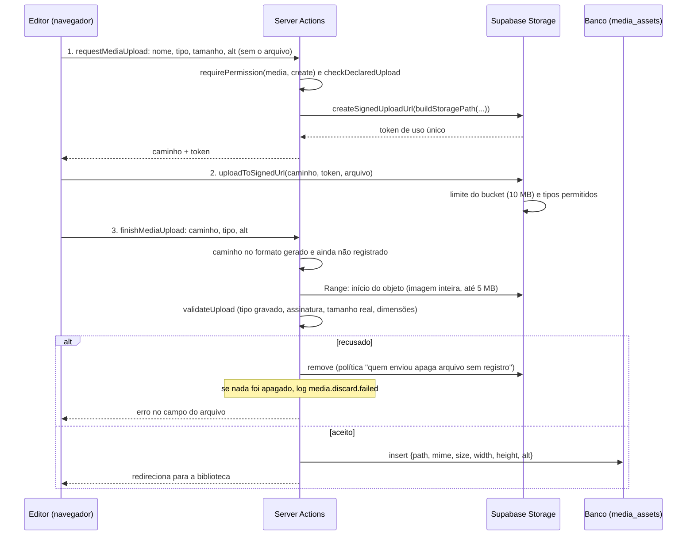

# ADR-0005 — Armazenamento e otimização de arquivos de mídia

| Campo        | Valor                                                             |
| ------------ | ----------------------------------------------------------------- |
| Issue        | ARC-10 (#51)                                                      |
| Status       | **Aceita** — coordenação técnica                                  |
| Data         | 13/10/2026                                                        |
| Decisor      | Vinícius Nishimura Reis (`@Vinishireis`)                          |
| Código       | `lib/domain/media/policy.ts` + testes · `lib/server/cms/media-service.ts`, `media-storage.ts` · `next.config.ts` (`images`) |

## Contexto

O CMS precisa receber imagens de serviços e cases (capas, galerias, peças de social media) e
documentos de assessoria de imprensa (releases, clippings em PDF). A Benjamin enviará arquivos
pesados (exports do Illustrator/Photoshop), e o site precisa continuar rápido em mobile (RNF-04).

## Decisão

### Storage

| Item | Decisão |
| ---- | ------- |
| Serviço | **Supabase Storage**, bucket `media` por ambiente (dev/hml/prd) |
| Leitura | Bucket **público**: cada arquivo abre pela URL pública, com caminho que leva UUID. **Listar** o bucket exige `media:view` (só o painel); com a chave anon a listagem vem vazia (TECH-13) |
| Escrita | Somente usuários com `media:create` (RLS em `storage.objects` usando `has_permission`) |
| Limpeza | Quem enviou pode apagar o próprio arquivo enquanto ele não estiver registrado na biblioteca (envio que falhou no meio). Arquivo registrado exige `media:delete` (TECH-13) |
| Exclusão | Somente `media:delete` (`admin`, `super_admin`); bloqueada se o arquivo estiver em uso |
| Conteúdo proibido | Documentos com dados pessoais, contratos, planilhas de leads — o bucket é público |
| Vídeo | Não armazenado: entra como link externo (YouTube, Vimeo, Instagram, TikTok) |
| Assets da marca | Logos (SVG), ícones e stickers oficiais ficam versionados em `public/brand` (não no bucket); o pacote original da agência fica em `assets/brand`, fora do deploy |

### Formatos e limites

| Tipo | MIME | Limite | Observação |
| ---- | ---- | ------ | ---------- |
| JPG | `image/jpeg` | 5 MB | Fotos |
| PNG | `image/png` | 5 MB | Peças com transparência |
| WebP | `image/webp` | 5 MB | Formato preferido para exportação |
| AVIF | `image/avif` | 5 MB | Opcional |
| PDF | `application/pdf` | 10 MB | Releases e clippings |
| SVG | — | **recusado** | Pode conter script (XSS) |

**Envio pelo painel: direto ao Storage (TECH-13, #313).** O arquivo não passa pela Server Action,
porque a Vercel recusa corpo acima de 4,5 MB antes de a action rodar. O navegador envia os bytes
direto ao bucket, com um token de uso único emitido pelo servidor, e os limites acima valem também
pelo painel. Efeito colateral: enviar arquivo no painel exige JavaScript.

- Maior lado da imagem ≤ **4000 px**; exportação recomendada: **2400 px** de largura (UX-14).
- O tipo real é conferido pela **assinatura dos bytes** (`sniffMimeType`), não pela extensão.
- Texto alternativo é obrigatório para publicar (regra R12 de TECH-05).

### Nomes e URLs

```text
media/AAAA/MM/<uuid>-<nome-normalizado>.<ext>
https://<projeto>.supabase.co/storage/v1/object/public/media/2026/10/6f1c…-capa-meridiano.webp
```

`buildStoragePath()` gera o caminho; `publicMediaUrl()` monta a URL. O banco guarda o **caminho**
(não a URL completa), permitindo trocar de projeto/CDN sem migrar dados.

### Otimização

- `next/image` com `formats: ["image/avif", "image/webp"]` e `remotePatterns` restrito a
  `/storage/v1/object/public/media/**` do projeto do ambiente (`next.config.ts`).
- Sempre informar `sizes` nas grades (ex.: `(min-width: 1024px) 33vw, 100vw`) e `priority` apenas
  na imagem principal acima da dobra.
- Imagens decorativas da marca (halftone, stickers) em WebP com `alt=""`.

## Fluxo de upload (ADM-09, TECH-13)



O que o navegador declara no passo 1 só serve para recusar cedo: a palavra final é do passo 3, sobre
o que chegou. Enquanto o passo 3 não termina, o arquivo já está acessível pela URL pública, mas com
caminho imprevisível e só nos tipos permitidos pelo bucket.

**Risco aceito:** quem pede o token e não conclui (fechou a aba no meio do envio) deixa um arquivo
sem registro no bucket. Não há limpeza automática no MVP. Para encontrá-los, comparar
`storage.objects` com `media_assets`.

**Arquivo recusado que não sai do bucket (SEG-05).** Quem envia vê o motivo da recusa, e a falha da
limpeza vai para o log, como `media.discard.failed`. O Storage não acusa quando nada foi apagado: sem
permissão ou com o objeto ausente, responde sucesso com lista vazia. Por isso `remove` só conta como
removido o que voltou nessa lista. O log traz só o UUID do caminho (`objectId`), sem o nome do arquivo,
que pode ter dado pessoal. Para apagar à mão no painel do Supabase, o caminho sai de:

```sql
select name from storage.objects where bucket_id = 'media' and name like '%<objectId>%';
```

### Riscos residuais (SEG-05)

Levantados na revisão de SEG-05 e ainda sem mitigação. **Mitigar ou aceitar é decisão da coordenação
técnica, ainda não tomada.**

| Risco | Efeito | Mitigação possível |
| ----- | ------ | ------------------- |
| **EXIF não é removido** | Foto enviada como veio fica pública com os metadados: localização GPS, aparelho, data e às vezes autor. É dado pessoal se a foto for de pessoa ou feita por ela | Recodificar no envio; até lá, orientar a equipe a exportar sem metadados |
| **Sem recodificação** | Só a assinatura, o tamanho e as dimensões são conferidos, e o arquivo é guardado byte a byte. Um arquivo válido pode carregar conteúdo extra depois da imagem (poliglota). O impacto é limitado: o Storage serve com o tipo gravado, em outra origem | Recodificar no envio |
| **AVIF sem limite de dimensão** | `readImageDimensions` devolve `null` para AVIF (`dimensions.ts`), então o limite de 4000 px não é aplicado. Um AVIF de até 5 MB com dimensões muito grandes é aceito, e o custo de abri-lo cai sobre o otimizador do `next/image` | Ler o cabeçalho do AVIF, ou recusar imagem sem dimensões legíveis |
| **Cabeçalho truncado ou ilegível sem limite de dimensão** | JPEG, PNG ou WebP com a assinatura certa e o cabeçalho cortado ou fora do esperado também devolve `null`: o envio continua, sem dimensões e sem o limite. O arquivo pode nem abrir no site | Recusar imagem sem dimensões legíveis |
| **PDF não é inspecionado** | Só a assinatura é conferida. Um PDF pode conter JavaScript ou links, executados pelo leitor de quem abrir. Ele abre pela URL do Storage, em outra origem, nunca embutido no site | Conferência manual na publicação |

Quem envia já é da equipe autenticada, com `media:create`: nenhum desses caminhos está aberto ao
visitante.

## Exclusão e edição (ADM-09)

`deleteMedia` exige `media:delete`, recusa arquivo em uso e lista os usos. A foto do bloco "Nosso time"
fica em JSON, sem FK: só essa busca a enxerga, então uma exclusão direta pela API, por quem tem
`media:delete`, ou uma foto escolhida entre a busca e a gravação escapam dela. Capa, galeria e imagem de
serviço têm também a FK `restrict`.

O registro sai antes do arquivo. Se o Storage falhar, sobra um arquivo sem registro: o painel avisa e o log
traz `media.delete.file_left` com o `objectId`, para apagar à mão como descrito acima. A ordem inversa poderia tirar do ar uma imagem em uso. Arquivo com caminho em `/public` não passa pelo
Storage.

`updateMediaDetails` exige `media:edit` e usa versão otimista. A foto do bloco "Nosso time" guarda uma
cópia do texto alternativo, atualizada quando o bloco é salvo de novo; o painel avisa. Editar não gera
evento de auditoria, porque o catálogo só tem `media.uploaded` e `media.deleted`.

## Demonstração em homologação (pendente)

O critério de aceite exige upload e recuperação demonstrados em homologação. Depende de:
projeto Supabase `benjamin-hml` (GO-02), bucket/políticas (migration de ADM-03) e tela de
upload do CMS (ADM-09). Roteiro de verificação:

1. Entrar como `editor` em homologação e enviar `capa.webp` com texto alternativo, um PDF de 8 MB e uma imagem de 5 MB (critério de #313: só se prova na Vercel).
2. Confirmar a URL pública e a exibição otimizada (`/_next/image?...`) em um case de teste.
3. Tentar enviar `logo.svg` e um `.png` renomeado como `.jpg` → ambos recusados.
4. Como `editor`, tentar excluir a mídia → negado; como `admin` → permitido se não estiver em uso.
