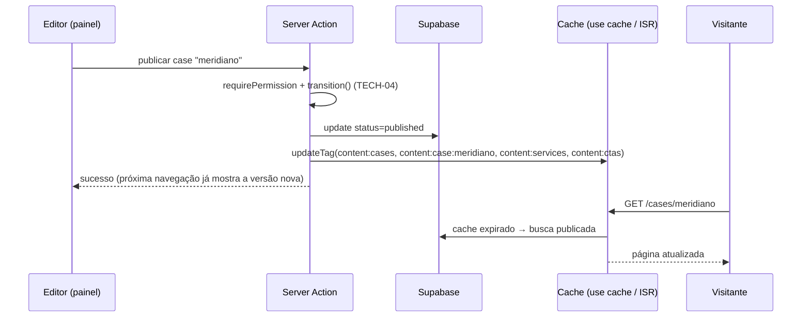

# ADR-0006 — Cache, invalidação e consistência após publicação no CMS

| Campo           | Valor                                                                  |
| --------------- | ---------------------------------------------------------------------- |
| Issue           | TECH-09 (#110)                                                         |
| Status          | **Aceita** — coordenação técnica                                       |
| Data            | 13/10/2026                                                             |
| Decisor         | Vinícius Nishimura Reis (`@Vinishireis`)                               |
| Revisão técnica | Vinícius Binda (`@VinnizzZ`)                                           |
| Depende de      | [ADR-0003](0003-limites-de-dominio.md) (TECH-01), [máquina de estados](../negocio/maquina-de-estados-publicacao.md) (TECH-04) |
| Código          | `lib/server/content/{repository,cache-tags,invalidate}.ts`, `app/api/internal/revalidate/route.ts` + testes |

## Contexto

O site precisa ser rápido e indexável (HTML prerenderizado), mas a Benjamin quer ver a alteração
publicada no ar sem depender de deploy (RNF-11). O risco oposto também existe: cache que
preserva conteúdo desatualizado após arquivar algo, ou — pior — que expõe rascunho.

## Decisão

### 1. Leitura

- Todo dado público passa pelo **repositório público** (`lib/server/content/repository.ts`), com
  funções `'use cache'` que declaram **tags** (`cacheTag`) e vida útil `cacheLife("hours")`
  (revalida em 1 h; expira em 1 dia — rede de segurança se uma invalidação falhar).
- O repositório filtra `isPubliclyVisible()` **antes** de cachear: rascunho nunca entra no cache
  público (invariante I1). A pré-visualização do painel lê direto da fonte, sem cache.
- Páginas de detalhe usam `generateStaticParams` com os slugs publicados (prerender no build) e
  ISR com App Shell para slugs publicados depois.
- A API `/api/v1` usa o mesmo repositório e `Cache-Control: s-maxage=300, stale-while-revalidate=3600`.

### 2. Tags

| Tag | Quem lê |
| --- | ------- |
| `content` | Tudo (purga total) |
| `content:settings` | Header, footer, Home, contato, metadados |
| `content:areas` | Página de áreas, Sobre, detalhe de serviço |
| `content:services` / `content:service:<slug>` | Listas e detalhe de serviços, detalhe de case |
| `content:categories` | Filtros do portfólio |
| `content:cases` / `content:case:<slug>` | Portfólio, destaques da Home, detalhe de serviço/case |
| `content:ctas` | CTAs da Home |

### 3. Publicação e invalidação

| Origem da alteração | Mecanismo | Semântica |
| ------------------- | --------- | --------- |
| Server Action do painel | `invalidateContentFromAction()` → `updateTag` | Expira e recarrega na mesma requisição (read-your-writes) |
| Webhook do banco / rotina / correção manual | `POST /api/internal/revalidate` (Bearer `CONTENT_REVALIDATE_SECRET`) → `revalidateTag(tag, { expire: 0 })` | Expira imediatamente; próxima visita busca da fonte |
| Falha em ambos | `cacheLife("hours")` | No pior caso, conteúdo novo em até 1 h |

`tagsForChange()` define quais tags cada alteração afeta, inclusive **listas relacionadas**
(case altera serviços e CTAs) e **slug antigo** quando o slug muda.

### 4. Latência-alvo

| Situação | Meta |
| -------- | ---- |
| Publicação/edição/arquivamento pelo painel | **≤ 5 s** para refletir no site (próxima requisição) |
| Alteração fora do painel com webhook | **≤ 60 s** |
| Pior caso (invalidação falhou) | ≤ 1 h (revalidate do `cacheLife`) |
| CDN da API `/api/v1` | ≤ 5 min (`s-maxage=300`) |

### 5. SEO

- `sitemap.xml`, `llms.txt` e metadados leem o mesmo repositório (tags compartilhadas): ao
  arquivar um case ele sai do sitemap na mesma invalidação.
- Robôs recebem HTML completo com metadados no `<head>` (o Next renderiza dinamicamente para
  crawlers que não lidam com streaming).
- Slug alterado: URL antiga invalidada e redirecionamento 301 (DB-08).

### 6. Falha de cache

| Falha | Comportamento |
| ----- | ------------- |
| Cache vazio/evitado (nova instância, novo deploy) | Renderiza a partir da fonte; caches são por deploy |
| Fonte (Supabase) fora do ar com cache válido | Serve o cache (stale) até expirar |
| Fonte fora do ar sem cache | Página de erro amigável + `next.request_error` no log (ARC-09) |
| Invalidação não executada | Revalidação horária; `POST /api/internal/revalidate {"entity":"case"}` corrige manualmente |

## Testes

- Automatizados: `invalidate.test.ts` (mapa de tags, slug antigo, `updateTag` em ação e
  `revalidateTag({expire:0})` em rota), `repository.test.ts` (somente publicados).
- Previstos para QA-04/TECH-12 em homologação:
  1. **Publicação** — publicar rascunho e abrir a URL em ≤ 5 s → visível; sitemap contém o slug.
  2. **Edição** — editar resumo de item publicado → texto novo na listagem e no detalhe.
  3. **Arquivamento** — arquivar case → URL retorna 404, some da listagem, do sitemap e dos CTAs (fallback).
  4. **Rascunho** — criar rascunho e confirmar ausência em site, API e sitemap.
  5. **Webhook** — `curl -X POST /api/internal/revalidate` sem/ com token → 401 / 200 com tags.
