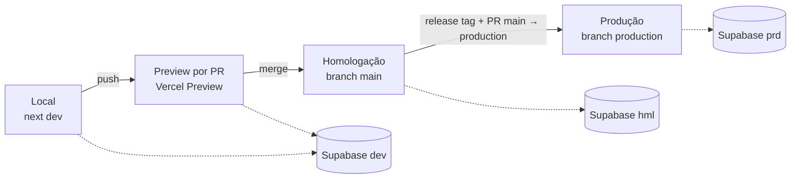

# Ambientes de desenvolvimento, homologação e produção

| Campo        | Valor                                                           |
| ------------ | --------------------------------------------------------------- |
| Issue        | ARC-06 (#47)                                                    |
| Responsável  | Vinícius Nishimura Reis (`@Vinishireis`)                        |
| Versão       | 1.0.0                                                           |
| Data         | 13/10/2026                                                      |
| Depende de   | ARC-02 — [ADR-0002](../adr/0002-stack-de-desenvolvimento.md)    |
| Status       | Aprovado pela coordenação técnica                               |

## 1. Visão geral

## 2. Matriz de ambientes

| Item | Desenvolvimento | Preview por PR | Homologação | Produção |
| ---- | --------------- | -------------- | ----------- | -------- |
| Objetivo | Codar e testar localmente | Revisão visual de cada PR | Validação da Benjamin (QA-08/09) | Público final |
| Origem do código | Branch local | Branch do PR | `main` | `production` (protegida) |
| Hospedagem | `next dev` (máquina do dev) | Vercel Preview (URL automática) | Vercel Preview com domínio fixo da branch `main` | Vercel Production |
| URL | `http://localhost:3000` | `*-nucleotechfecap.vercel.app` | `https://hml-agencia-benjamin.vercel.app` (a confirmar no GO-02) | Domínio oficial da Benjamin (CON-11/GO-03) |
| Banco/Auth/Storage | Supabase `benjamin-dev` **ou** Supabase CLI local | Supabase `benjamin-dev` | Supabase `benjamin-hml` | Supabase `benjamin-prd` |
| Dados | Seed fictício (ARC-11) | Seed fictício | Seed fictício + conteúdo provisório aprovado | Somente dados reais; nunca copiados para outros ambientes |
| E-mail (Resend) | Desligado (`NOTIFY_PROVIDER=log`) | Desligado | Ligado, destinatário de teste da equipe | Ligado, destinatário institucional (CON-10) |
| Indexação | — | `noindex` | `noindex` (`NEXT_PUBLIC_SITE_ENV=homologation`) | Indexável |
| Logs | Console | Vercel (Preview) | Vercel (Preview) | Vercel (Production), retenção do plano |
| Deploy | Manual | Automático a cada push | Automático no merge em `main` | Manual: tag `vX.Y.Z` + PR `main → production` aprovado (GO-01) |

## 3. Matriz de acesso

Princípio do menor privilégio. Acesso de produção é nominal e revisado a cada release.

| Recurso | Desenvolvimento | Homologação | Produção |
| ------- | --------------- | ----------- | -------- |
| GitHub (repositório) | Write: time NúcleoTech | — | Merge em `production`: Vinícius Nishimura Reis, Vinícius Binda |
| Vercel | Member: time NúcleoTech | Member: time NúcleoTech | Owner: conta NúcleoTech; Member: Vinícius Nishimura Reis, Vinícius Binda |
| Supabase (dashboard) | Developer: time NúcleoTech | Developer: Vinícius Nishimura Reis, Vinícius Binda, Murilo Vasconcellos | Owner: conta NúcleoTech; Admin: Vinícius Nishimura Reis, Vinícius Binda |
| Supabase `service_role` | Devs (local) | Somente variáveis da Vercel | Somente variáveis da Vercel (ninguém copia localmente) |
| Resend | — | Vinícius Nishimura Reis | Vinícius Nishimura Reis, Vinícius Binda |
| Painel `/admin` | Usuários de teste | Equipe NúcleoTech + Melissa e Renan (homologação) | Usuários indicados pela Benjamin (INT-08) + 1 `super_admin` do NúcleoTech |
| DNS do domínio | — | — | Agência Benjamin (CON-11); NúcleoTech recebe apenas os registros a criar |

## 4. Regras

1. Cada ambiente tem **seu próprio projeto Supabase e suas próprias chaves**; nenhuma chave é
   reaproveitada entre ambientes.
2. Variáveis de ambiente são cadastradas na Vercel por ambiente (Development/Preview/Production) e
   descritas em `.env.example` (ARC-05).
3. Migrations entram primeiro em homologação; produção só recebe migrations já aplicadas e
   validadas em homologação (GO-01, GO-04).
4. Dados pessoais de produção (leads, feedbacks) não saem de produção — nem para debug.
5. Homologação e previews enviam `X-Robots-Tag: noindex` e `robots.txt` bloqueando indexação.
6. Acesso removido no mesmo dia em que um integrante sai do projeto (checklist de handoff, GO-09).

## 5. Pendências de provisionamento (GO-02)

- Definir conta/plano institucional da Vercel e do Supabase (ver riscos na ADR-0002).
- Criar projetos `benjamin-dev`, `benjamin-hml` e `benjamin-prd` no Supabase.
- Criar a branch `production` com proteção (somente PR aprovado, sem force push).
