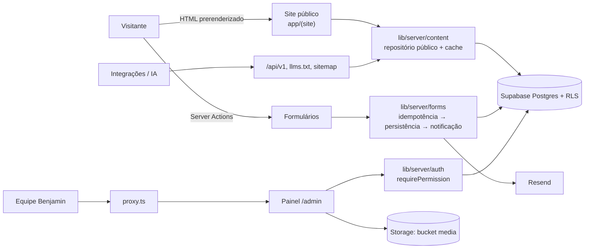

# Documentação técnica — Plataforma Institucional Agência Benjamin

| Campo        | Valor                                                                 |
| ------------ | --------------------------------------------------------------------- |
| Issue        | ARC-12 (#53)                                                          |
| Responsável  | Vinícius Nishimura Reis (`@Vinishireis`)                              |
| Versão       | 1.0.0                                                                 |
| Data         | 13/10/2026                                                            |
| Depende de   | [ADR-0001](../adr/0001-arquitetura-da-plataforma.md) (ARC-01), [ADR-0002](../adr/0002-stack-de-desenvolvimento.md) (ARC-02) |
| Público      | Integrantes do NúcleoTech que desenvolvem, revisam, publicam ou mantêm a plataforma |

## 1. Visão geral

Monólito modular em **Next.js 16 (App Router, Cache Components, Partial Prefetching)** com
**Supabase** (Postgres + Auth + Storage + RLS), hospedado na **Vercel**, com e-mail transacional
pela **Resend**. O site público é prerenderizado e invalidado por tags quando o CMS publica; o painel
é renderizado por requisição e protegido em três barreiras (proxy, servidor e banco).

## 2. Rotas

### Site público (`app/(site)`)

| Rota | Arquivo | Renderização | Conteúdo |
| ---- | ------- | ------------ | -------- |
| `/` | `page.tsx` | Estática (cache por tag) | Manifesto, quem é, áreas, serviços e cases em destaque, CTAs |
| `/sobre` | `sobre/page.tsx` | Estática | Agência experimental, proposta, modelo, FECAP |
| `/areas` | `areas/page.tsx` | Estática | 6 áreas com âncoras e serviços relacionados |
| `/servicos` | `servicos/page.tsx` | Estática | Serviços publicados + etapas de trabalho |
| `/servicos/[slug]` | `servicos/[slug]/page.tsx` | `generateStaticParams` + ISR | Detalhe, cases relacionados, CTA com serviço pré-selecionado |
| `/cases` | `cases/page.tsx` | Shell estático + filtros por `searchParams` (Suspense) | Portfólio filtrável |
| `/cases/[slug]` | `cases/[slug]/page.tsx` | `generateStaticParams` + ISR | Detalhe do case |
| `/contato` | `contato/page.tsx` | Shell estático + abas por `searchParams` | Formulários de projeto e contato |
| `/feedback` | `feedback/page.tsx` | Estática | Formulário de feedback |
| `/privacidade` | `privacidade/page.tsx` | Estática | Aviso de privacidade (minuta) |
| 404 | `app/not-found.tsx` | — | HTTP 404 real via `proxy.ts` para slugs inexistentes |

### Painel (`app/admin`)

| Rota | Acesso | Função |
| ---- | ------ | ------ |
| `/admin/login`, `/admin/recuperar-senha`, `/admin/auth/callback` | Público | Login, recuperação, retorno dos e-mails |
| `/admin/nova-senha` | Sessão | Definir senha (convite/recuperação) |
| `/admin/acesso-pendente`, `/admin/sem-permissao` | Sessão | Avisos de acesso |
| `/admin` (grupo `(painel)`) | `dashboard:view` | Início do painel; módulos CRUD em ADM-04…ADM-11 |

### APIs e arquivos especiais

| Rota | Método | Autenticação | Uso |
| ---- | ------ | ------------ | --- |
| `/api/v1/health` | GET | — | Monitoramento e smoke test |
| `/api/v1/{settings,areas,services,categories,cases}` (+ `/{slug}`) | GET | — | Leitura pública versionada (TECH-02) |
| `/api/internal/revalidate` | POST | Bearer `CONTENT_REVALIDATE_SECRET` | Invalidação de cache (TECH-09) |
| `/sitemap.xml`, `/robots.txt`, `/manifest.webmanifest` | GET | — | SEO |
| `/llms.txt`, `/llms-full.txt` | GET | — | Descoberta por assistentes de IA |
| `/opengraph-image`, `/twitter-image`, `…/[slug]/opengraph-image` | GET | — | Imagens de compartilhamento |

## 3. Camadas e pastas

| Pasta | Responsabilidade | Regras |
| ----- | ---------------- | ------ |
| `app/` | Rotas, páginas, Server Actions, Route Handlers, metadados | Pode usar todas as camadas |
| `components/` | UI (ui, layout, sections, cards, forms, seo, admin) | Sem acesso a `lib/server` (ESLint) |
| `content/` | Conteúdo provisório versionado (fallback até o CMS) | Itens `provisional` bloqueiam o go-live |
| `lib/config/` | Variáveis validadas (`public-env`, `server-env`), navegação | — |
| `lib/domain/` | Regras puras: conteúdo, publicação, integridade, RBAC, formulários, mídia, auditoria, SEO | Sem framework/I/O (ESLint) |
| `lib/server/` | Repositórios, Supabase, auth, logs, erros, auditoria, cache, HTTP | `import "server-only"` |
| `supabase/migrations/` | SQL versionado | RLS obrigatória |
| `scripts/` | Cabeçalhos, seed RBAC, provisionamento | — |
| `docs/` | Requisitos, ADRs, regras, segurança, operação | Índice em `docs/README.md` |

Fronteiras detalhadas: [ADR-0003](../adr/0003-limites-de-dominio.md).

## 4. Segurança (resumo)

| Tema | Implementação | Documento |
| ---- | ------------- | --------- |
| Autenticação | Supabase Auth (convite, senha ≥ 12, cookies httpOnly, renovação no proxy) | [autenticacao.md](../seguranca/autenticacao.md) |
| Autorização | RBAC em código (`rbac.ts`) + `has_permission()` no banco + guardas | [matriz-rbac.md](../seguranca/matriz-rbac.md), [protecao-de-rotas.md](../seguranca/protecao-de-rotas.md) |
| Dados pessoais | Minimização, RLS por tipo, retenção, IP só em HMAC | [ciclo-de-vida-dados-pessoais.md](../seguranca/ciclo-de-vida-dados-pessoais.md) |
| Auditoria | `audit_log` append-only, eventos críticos abortam sem registro | [trilha-de-auditoria.md](../seguranca/trilha-de-auditoria.md) |
| Logs | JSON estruturado com mascaramento de PII | [ADR-0004](../adr/0004-logs-e-tratamento-de-erros.md) |
| Formulários | Zod no servidor, honeypot, tempo mínimo, limite por origem, idempotência | [idempotencia-e-falhas.md](../formularios/idempotencia-e-falhas.md) |
| Mídia | Tipos/limites, assinatura de bytes, SVG recusado | [ADR-0005](../adr/0005-armazenamento-de-midia.md) |
| Cabeçalhos | nosniff, Referrer-Policy, X-Frame-Options, Permissions-Policy, HSTS, `X-Robots-Tag` fora de produção | `next.config.ts` |
| Segredos | `.env*` fora do Git, validação por ambiente | [variaveis-de-ambiente.md](../ambientes/variaveis-de-ambiente.md) |

## 5. Banco de dados

| Migration | Objetos |
| --------- | ------- |
| `20261013000100_auth_profiles.sql` | `app_role`, `profiles`, trigger `handle_new_user`, `current_app_role()`, `touch_updated_at()` |
| `20261013000200_rbac_permissions.sql` | `role_permissions` (148), `has_permission()`, `assign_role()`, `set_profile_active()`, bucket `media` + policies |
| `20261013000300_audit_log.sql` | `audit_log` append-only, `record_audit_event()`, auditoria de papéis |
| `20261013000400_form_submissions.sql` | `form_submissions` (leads, contatos, feedbacks) com RLS por tipo |
| `20261025000100_cms_content.sql` | `publish_status`, `is_valid_slug()`, `stamp_updated_by()`, `pages`, `blocks`, `areas`, `services`, `service_areas`, `case_categories`, `cases`, `case_services`, `case_media`, `ctas`, `media_assets`, `site_settings` com RLS por RBAC — ver [dicionário de dados](../banco/dicionario-de-dados.md) |

Aplicação: `supabase link --project-ref <ref> && supabase db push` (homologação antes de produção).

## 6. Cache e publicação

Leitura pública com `'use cache'` + `cacheTag` (`content:*`) + `cacheLife("hours")`; publicação no
CMS chama `invalidateContentFromAction()` (`updateTag`); fontes externas usam
`POST /api/internal/revalidate`. Detalhes e latências-alvo: [ADR-0006](../adr/0006-cache-e-invalidacao.md).

## 7. Deploy

| Opção | Situação | Observação |
| ----- | -------- | ---------- |
| **Vercel** (recomendada) | Padrão do projeto | Preview por PR, `main` → homologação, `production` → produção (ARC-06); suporte nativo a Cache Components, ISR, Image Optimization e cron |
| Node próprio (`next build && next start`) em VM/Render/Railway | Alternativa | Exige cache handler persistente para ISR em múltiplas instâncias e configuração manual de HTTPS/CDN |
| Docker (`output: "standalone"`) | Alternativa | Mesmo cuidado com cache; útil se a FECAP exigir infraestrutura própria |

Passo a passo de produção: GO-02 (provisionamento), GO-03 (DNS/HTTPS), GO-01 (release e rollback),
GO-06 (publicação).

## 8. Qualidade

| Comando | Verifica |
| ------- | -------- |
| `npm run check:headers` | Cabeçalho padrão em todos os arquivos de código |
| `npm run typecheck` | `next typegen` + `tsc` |
| `npm run lint` | ESLint (inclui fronteiras de camadas) |
| `npm run test` | Vitest (domínio, servidor, conteúdo, consistência SQL) |
| `npm run build` | Build de produção (valida regras de Cache Components) |
| `npm run verify` | Todos acima |
| `npm run check:release-content` | Bloqueia go-live com conteúdo provisório |

## 9. Manutenção

- Atualizações do Next.js: ler `node_modules/next/dist/docs/` da nova versão (ver `AGENTS.md`) e rodar `npm run verify`.
- Nova tabela: migration com RLS + `has_permission`, atualização do contrato (TECH-02) e testes.
- Novo papel/permissão: alterar `rbac.ts`, regenerar o seed (`node scripts/print-rbac-seed.mjs`) em nova migration e atualizar a matriz.
- Novo evento de auditoria: `AUDIT_EVENTS` + `check` do banco (teste de consistência).
