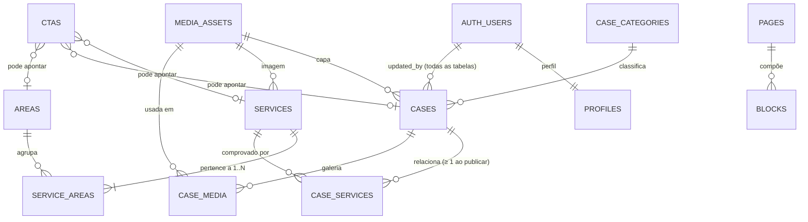

# Modelo de dados do CMS: dicionário, cardinalidades e convenções de integridade

| Campo           | Valor                                                                        |
| --------------- | ---------------------------------------------------------------------------- |
| Issues          | DB-01 (#57), DBX-01 (#112), DB-02 (#58)                                      |
| Responsável     | Vinícius Binda (`@VinnizzZ`)                                                 |
| Revisão técnica | Vinícius Nishimura Reis (`@Vinishireis`)                                     |
| Versão          | 1.0.0                                                                        |
| Data            | 25/10/2026                                                                   |
| Migration       | `supabase/migrations/20261025000100_cms_content.sql`                         |
| Reversão        | `supabase/rollbacks/20261025000100_cms_content.down.sql`                     |
| Testes          | `supabase/tests/database/cms_content.test.sql` (pgTAP, 84 testes) e `lib/server/content/content-sql.test.ts` (SQL × regras de domínio) |
| Insumos         | [integridade](../negocio/integridade-de-conteudo.md), [campos do case](../negocio/campos-do-case.md), [fluxo de publicação](../negocio/fluxo-de-publicacao.md), [proteção de rotas](../seguranca/protecao-de-rotas.md), [ADR-0005](../adr/0005-armazenamento-de-midia.md) |

## 1. Visão geral

O banco tem três grupos de tabelas. Este documento cobre o grupo de conteúdo e referencia os demais.

| Grupo | Tabelas | Migration |
| ----- | ------- | --------- |
| Usuários e acesso | `profiles`, `role_permissions`, `audit_log` | 0100, 0200, 0300 |
| Formulários (leads, contatos, feedbacks) | `form_submissions` | 0400 |
| **Conteúdo do CMS** | `pages`, `blocks`, `areas`, `services`, `service_areas`, `case_categories`, `cases`, `case_services`, `case_media`, `ctas`, `media_assets`, `site_settings` | **20261025000100** |

Decisões que orientaram o modelo:

- **Usuários** não têm tabela própria: `profiles` (1:1 com `auth.users`) guarda nome, papel e status.
  O papel nunca é gravado pelo cliente; muda só por `assign_role()`.
- **Leads, contatos e feedbacks** ficam todos em `form_submissions`, gravados só pelo servidor depois
  da validação, do antispam e da idempotência. São três tipos de envio (`kind`) com o mesmo ciclo de
  atendimento e de retenção, e a leitura é separada por permissão (`lead:*` × `feedback:*`).
- **Depoimentos públicos** estão fora do MVP. Se a Agência Benjamin pedir, serão uma entidade nova,
  curada a partir de feedbacks com consentimento, e nunca a própria `form_submissions`.
- **Exclusão lógica** é o estado `archived`. Não existe `deleted_at`. A exclusão definitiva só vale
  para item arquivado e só para quem tem `<recurso>:delete` (admin ou super_admin).

## 2. Diagrama entidade-relacionamento



## 3. Cardinalidades

| Relação | Cardinalidade | Implementação | Regra de exclusão | Obrigatoriedade |
| ------- | ------------- | ------------- | ----------------- | --------------- |
| Serviço × Área | N:M | `service_areas` (PK composta) | `cascade` nos dois lados | Serviço precisa de ≥ 1 área (R03, na aplicação) |
| Case × Serviço | N:M | `case_services` (PK composta) | `cascade` nos dois lados | Case publicado precisa de ≥ 1 serviço publicado (R07, na aplicação) |
| Case × Categoria | N:1 | `cases.category_id` | `restrict` (não exclui categoria em uso) | Case publicado exige categoria (constraint) |
| Case × Área | Derivada | — | — | União das áreas dos serviços; não é gravada |
| Case × Capa | N:1 | `cases.cover_media_id` | `restrict` (não exclui mídia em uso) | Case publicado exige capa (constraint) |
| Case × Galeria | N:M ordenada | `case_media` | case `cascade`, mídia `restrict` | Até 20 itens (na aplicação) |
| Serviço × Imagem | N:0..1 | `services.image_media_id` | `restrict` | Opcional |
| Página × Bloco | 1:N | `blocks.page_id` | `cascade` | Bloco segue o estado da página |
| CTA × Destino | N:0..1 | `ctas.target_*_id` | `set null` (órfão usa fallback e o CMS sinaliza R04) | Coluna coerente com `target_kind` (constraint) |
| Usuário × Perfil | 1:1 | `profiles.id` → `auth.users` | `cascade` | Criado por trigger |
| Conteúdo × Editor | N:0..1 | `updated_by` → `auth.users` | `set null` (o histórico fica no `audit_log`) | Preenchido por trigger |

## 4. Convenções de integridade

| Tema | Convenção | Justificativa |
| ---- | --------- | ------------- |
| Nomes | `snake_case`, tabelas no plural; FK = `<entidade>_id`; mídia = `<uso>_media_id` | Padrão do Postgres e das migrations existentes |
| PK | `uuid default gen_random_uuid()`; junções com PK composta | Ids não enumeráveis em URLs/API; junção sem duplicata |
| Texto | `text` com `check (char_length(...))` em vez de `varchar(n)` | Limite explícito e alterável sem reescrever a coluna; mesmo padrão de `profiles` |
| Slug | `not null unique check (public.is_valid_slug(slug))` | Mesma regra de `validateSlug()`: kebab-case, 3–80 caracteres, sem palavras reservadas; único por tipo |
| Estados | enum `publish_status` (`draft`, `published`, `archived`), padrão `draft` | Fonte única em `publication-status.ts`; o teste falha se divergirem |
| Publicação | `check (status <> 'published' or published_at is not null)` | Invariante de `checkInvariants()` (TECH-04) |
| Arquivamento | `check ((status = 'archived') = (archived_at is not null))` | Arquivado tem data; restaurar limpa a data |
| Campos para publicar | `check (status <> 'published' or (...))` por tabela | Mínimo de `validateForPublish` garantido no banco |
| Visibilidade pública | `status = 'published' and published_at <= now()` | RN-01: rascunho, arquivado e publicação futura nunca aparecem |
| Timestamps | `created_at`/`updated_at` `not null default now()`; `touch_updated_at()` no update | Concorrência otimista (`expectedUpdatedAt`) e ordenação |
| Autor da gravação | `updated_by` preenchido por `stamp_updated_by()` com `auth.uid()` | Não depende do cliente; `service_role` mantém o valor enviado |
| Listas simples | `text[]` (`highlights`, `examples`, `team`, `keywords`) | Sem identidade própria nem consulta por item |
| Estruturas | `jsonb` com check de tipo (`external_links` é lista de `{label, url https}`) | Estrutura validada no banco e em Zod |
| Ordenação | `sort_order integer not null default 0 check (>= 0)` | `order` é palavra reservada em SQL; empate por nome/título na aplicação |
| Mídia | Guarda o **caminho** (bucket ou `public/`), nunca a URL; MIME, extensão e tamanho coerentes | ADR-0005: trocar de projeto/CDN sem migrar dados |
| Privilégios | `revoke all` de `anon`/`authenticated`; `anon` só `select`; `authenticated` só DML | Retira `TRUNCATE`, que não passa por RLS |
| RLS | Habilitada em toda tabela da mesma migration; escrita por `has_permission(recurso, ação)` | Autorização no servidor (TECH-03); o teste falha se faltar RLS |

### 4.1 Políticas RLS por entidade publicável

| Operação | Quem | Condição |
| -------- | ---- | -------- |
| `select` | `anon`, `authenticated` | Publicado e com `published_at <= now()` |
| `select` | `authenticated` | `<recurso>:view` (painel vê rascunhos e arquivados) |
| `insert` | `authenticated` | `<recurso>:create` e `status = 'draft'` (todo item nasce rascunho) |
| `update` | `authenticated` | `<recurso>:edit`; virar `published` exige `:publish`; virar `archived` exige `:archive` |
| `delete` | `authenticated` | `<recurso>:delete` e `status = 'archived'` |

Recursos: `page` (inclui `blocks`), `area`, `service` (inclui `service_areas`), `category`, `case`
(inclui `case_services` e `case_media`), `cta`, `media` e `settings`. Junções, blocos e mídia **não
têm estado próprio**: o visitante só os vê quando a entidade "pai" está visível. Assim, um rascunho
não vaza pelos blocos, pela galeria nem pela biblioteca de mídia.

## 5. Dicionário de dados

Campos de controle **comuns** às entidades publicáveis (`areas`, `services`, `case_categories`,
`cases`, `ctas`, `pages`), omitidos nas tabelas abaixo:

| Coluna | Tipo | Nulo | Padrão | Regra | Campo no código |
| ------ | ---- | ---- | ------ | ----- | --------------- |
| `id` | `uuid` | Não | `gen_random_uuid()` | PK | `id` |
| `status` | `publish_status` | Não | `draft` | Transições em TECH-04 | `status` |
| `provisional` | `boolean` | Não | `false` | Texto provisório: selo + bloqueio do go-live | `provisional` |
| `published_at` | `timestamptz` | Sim | — | Obrigatório se publicado; mantido ao republicar | `publishedAt` |
| `archived_at` | `timestamptz` | Sim | — | Presente se e somente se arquivado | `archivedAt` |
| `created_at` | `timestamptz` | Não | `now()` | — | — |
| `updated_at` | `timestamptz` | Não | `now()` | Trigger no update | `updatedAt` |
| `updated_by` | `uuid` | Sim | trigger | FK `auth.users` `set null` | — |

### `areas` — áreas de atuação (PRJ §9)

| Coluna | Tipo | Nulo | Regra | Campo no código |
| ------ | ---- | ---- | ----- | --------------- |
| `slug` | `text` | Não | Único, `is_valid_slug` | `slug` |
| `name` | `text` | Não | 2–120 | `name` |
| `summary` | `text` | Sim | ≤ 200; obrigatório para publicar | `summary` |
| `description` | `text` | Sim | ≤ 4000; obrigatório para publicar | `description` |
| `highlights` | `text[]` | Não | `{}` | `highlights` |
| `icon` | `text` | Sim | Chave kebab-case do brandbook | `icon` |
| `sort_order` | `integer` | Não | ≥ 0 | `order` |

### `services` — serviços (PRJ §10)

| Coluna | Tipo | Nulo | Regra | Campo no código |
| ------ | ---- | ---- | ----- | --------------- |
| `slug` | `text` | Não | Único, `is_valid_slug` | `slug` |
| `name` | `text` | Não | 2–120 | `name` |
| `summary` | `text` | Sim | ≤ 200; obrigatório para publicar | `summary` |
| `description` | `text` | Sim | ≤ 4000; obrigatório para publicar | `description` |
| `examples` | `text[]` | Não | `{}` | `examples` |
| `icon` | `text` | Sim | Chave kebab-case | `icon` |
| `image_media_id` | `uuid` | Sim | FK `media_assets` `restrict` | `image` |
| `featured` | `boolean` | Não | `false`; até 6 na Home (R11, aviso) | `featured` |
| `sort_order` | `integer` | Não | ≥ 0 | `order` |

### `service_areas` — vínculo serviço × área

| Coluna | Tipo | Nulo | Regra | Campo no código |
| ------ | ---- | ---- | ----- | --------------- |
| `service_id` | `uuid` | Não | PK, FK `services` `cascade` | `Service.areaIds` |
| `area_id` | `uuid` | Não | PK, FK `areas` `cascade`; índice | `Service.areaIds` |

### `case_categories` — categorias do portfólio (PRJ §12)

| Coluna | Tipo | Nulo | Regra | Campo no código |
| ------ | ---- | ---- | ----- | --------------- |
| `slug` | `text` | Não | Único, `is_valid_slug` | `slug` |
| `name` | `text` | Não | 2–120 | `name` |
| `description` | `text` | Sim | ≤ 4000 | `description` |
| `sort_order` | `integer` | Não | ≥ 0 | `order` |

### `cases` — cases do portfólio (PRJ §13, CASE-11)

| Coluna | Tipo | Nulo | Regra | Campo no código |
| ------ | ---- | ---- | ----- | --------------- |
| `slug` | `text` | Não | Único, `is_valid_slug` | `slug` |
| `title` | `text` | Não | 2–120 | `title` |
| `client_name` | `text` | Sim | 2–120; obrigatório para publicar | `client` |
| `category_id` | `uuid` | Sim | FK `case_categories` `restrict`; obrigatório para publicar | `categoryId` |
| `delivery_type` | `text` | Sim | ≤ 60 | `deliveryType` |
| `summary` | `text` | Sim | ≤ 280; ≥ 30 para publicar | `summary` |
| `challenge`, `solution`, `results` | `text` | Sim | ≤ 4000 cada | `challenge`, `solution`, `results` |
| `cover_media_id` | `uuid` | Sim | FK `media_assets` `restrict`; obrigatório para publicar | `cover` |
| `external_links` | `jsonb` | Não | `[]`; até 10 `{label, url}` com `https://` | `externalLinks` |
| `reference_month` | `date` | Sim | Dia 1 do mês (AAAA-MM-01) | `date` (AAAA-MM) |
| `team` | `text[]` | Não | `{}`; até 20 | `team` |
| `featured` | `boolean` | Não | `false`; até 6 na Home (R11, aviso) | `featured` |
| `sort_order` | `integer` | Não | ≥ 0 | `order` |

### `case_services` — vínculo case × serviço

| Coluna | Tipo | Nulo | Regra | Campo no código |
| ------ | ---- | ---- | ----- | --------------- |
| `case_id` | `uuid` | Não | PK, FK `cases` `cascade` | `CaseStudy.serviceIds` |
| `service_id` | `uuid` | Não | PK, FK `services` `cascade`; índice | `CaseStudy.serviceIds` |

### `case_media` — galeria do case

| Coluna | Tipo | Nulo | Regra | Campo no código |
| ------ | ---- | ---- | ----- | --------------- |
| `case_id` | `uuid` | Não | PK, FK `cases` `cascade` | `CaseStudy.gallery` |
| `media_id` | `uuid` | Não | PK, FK `media_assets` `restrict`; índice | `gallery[].src/alt` |
| `sort_order` | `integer` | Não | ≥ 0 | posição na lista |

### `media_assets` — biblioteca de mídia (ADR-0005)

| Coluna | Tipo | Nulo | Padrão | Regra | Campo no código |
| ------ | ---- | ---- | ------ | ----- | --------------- |
| `id` | `uuid` | Não | `gen_random_uuid()` | PK | — |
| `path` | `text` | Não | — | Único; chave do bucket (`AAAA/MM/<uuid>-<nome>.<ext>`) ou caminho em `public/`; nunca URL nem `..` | `MediaRef.src` (via `publicMediaUrl`) |
| `mime_type` | `text` | Não | — | JPG, PNG, WebP, AVIF ou PDF (sem SVG); extensão coerente | — |
| `size_bytes` | `integer` | Sim | — | Imagem ≤ 5 MB, PDF ≤ 10 MB; nulo para arquivo de `public/` | — |
| `width`, `height` | `integer` | Sim | — | 1–4000 px; nulos em PDF | `width`, `height` |
| `alt_text` | `text` | Sim | — | ≤ 160; obrigatório para publicar quem usa a imagem (R12, na aplicação) | `alt` |
| `decorative` | `boolean` | Não | `false` | Imagem decorativa dispensa `alt` | — |
| `created_at`, `updated_at`, `updated_by` | — | — | — | Controle | — |

### `ctas` — chamadas para ação (TECH-05)

| Coluna | Tipo | Nulo | Regra | Campo no código |
| ------ | ---- | ---- | ----- | --------------- |
| `label` | `text` | Não | 2–40 | `label` |
| `placement` | `text` | Não | `home-hero`, `home-highlight`, `footer`, `service-detail`, `case-detail` | `placement` |
| `target_kind` | `text` | Não | `internal`, `external`, `service`, `case`, `area`, `contact` | `target.kind` |
| `target_path` | `text` | Sim | Presente se e somente se `internal`; começa com `/`, nunca `//` | `target.path` |
| `target_url` | `text` | Sim | Presente se e somente se `external`; `https://` | `target.url` |
| `target_service_id` | `uuid` | Sim | Só em `service`/`contact`; FK `set null` | `target.serviceId` |
| `target_case_id` | `uuid` | Sim | Só em `case`; FK `set null` | `target.caseId` |
| `target_area_id` | `uuid` | Sim | Só em `area`; FK `set null` | `target.areaId` |
| `sort_order` | `integer` | Não | ≥ 0 | `order` |

A validação das rotas internas conhecidas (R10) fica na aplicação, porque a lista de rotas vive no
código.

### `pages` e `blocks` — páginas editáveis (DB-01)

| Tabela | Coluna | Tipo | Nulo | Regra |
| ------ | ------ | ---- | ---- | ----- |
| `pages` | `slug` | `text` | Não | Único, `is_valid_slug` |
| `pages` | `title` | `text` | Não | 2–120 |
| `pages` | `description` | `text` | Sim | ≤ 300 (meta description) |
| `blocks` | `id` | `uuid` | Não | PK |
| `blocks` | `page_id` | `uuid` | Não | FK `pages` `cascade`; índice `(page_id, sort_order)` |
| `blocks` | `type` | `text` | Não | kebab-case, ≤ 40 |
| `blocks` | `content` | `jsonb` | Não | Objeto JSON; o schema de cada `type` é validado em Zod |
| `blocks` | `sort_order` | `integer` | Não | ≥ 0 |
| `blocks` | `created_at`, `updated_at`, `updated_by` | — | — | Controle |

**Catálogo de blocos (DB-03).** `type` aceito pelo site e formato de `content`, validados em
[`lib/domain/content/blocks.ts`](../../lib/domain/content/blocks.ts). Só texto puro e listas: o
site nunca renderiza HTML vindo do banco. Bloco de tipo desconhecido ou com conteúdo inválido é
descartado na leitura (o restante da página continua no ar) e registrado em log.

| `type` | `content` |
| ------ | --------- |
| `rich-text` | `{ title?, paragraphs: string[1..12] }` |
| `list` | `{ title?, items: { title, text? }[1..12] }` |
| `team` | `{ title?, members: { name, role?, photo?: { src, alt } }[1..40] }` — foto exige autorização de imagem |
| `cta` | `{ title, text?, label, href }` — `href` é rota pública conhecida (R10) ou `https` |

**Páginas × rotas fixas.** No MVP as rotas do site são fixas. Uma página cujo slug coincide com uma
rota pública (`sobre`, `areas`, `servicos`, `cases`, `contato`, `privacidade` — `PAGE_ROUTES`)
acrescenta seus blocos depois das seções fixas daquela rota (renderização: INT-03). Páginas com
outro slug ficam salvas, mas sem rota pública até uma decisão de produto sobre páginas livres.

### `site_settings` — configuração institucional (ADM-10)

Linha única (`id boolean primary key default true check (id)`).

| Coluna | Tipo | Nulo | Regra | Campo no código |
| ------ | ---- | ---- | ----- | --------------- |
| `name` | `text` | Não | 2–120 | `name` |
| `short_name` | `text` | Não | 2–40 | `shortName` |
| `tagline` | `text` | Não | ≤ 120 | `tagline` |
| `description` | `text` | Não | ≤ 300 | `description` |
| `manifesto`, `about`, `contact`, `socials` | `jsonb` | Não | Objeto JSON | mesmos nomes em `SiteSettings` |
| `keywords` | `text[]` | Não | `{}` | `keywords` |

Leitura pública (o conteúdo é institucional) e escrita só com `settings:edit`.

## 6. Regras que ficam na aplicação

Estas regras envolvem outras tabelas ou listas do código. O banco garante o mínimo, e
`findIntegrityIssues` / `validateForPublish` cobrem o resto antes de gravar:

| Regra | Motivo de não ser constraint | Onde reforçar depois |
| ----- | ---------------------------- | -------------------- |
| R03 — serviço com ≥ 1 área | Serviço e vínculos são gravados em requisições separadas | RPC transacional (ADM-07) ou trigger *deferrable* (DBX-04) |
| R05/R06/R07 — dependências publicadas | Depende do estado de outra tabela | Trigger de publicação (DBX-04) |
| R10 — rota interna conhecida | A lista de rotas está em `integrity.ts` | — |
| R11 — até 6 destaques | É aviso, não erro | — |
| R12 — `alt` ao publicar | O `alt` está na mídia, não na entidade | Trigger de publicação (DBX-04) |
| Transições de estado (TECH-04) | O RLS checa a permissão, não o estado anterior | Trigger de transição (DBX-04) |
| Mês de referência não futuro | `now()` não pode ir em check | — |

## 7. Pendências para decisão

- [x] **Catálogo de tipos de bloco** e relação de `pages` com as rotas fixas — definido no DB-03
  (§5, `pages` e `blocks`).
- [ ] **Depoimentos públicos:** fora do MVP até a Benjamin decidir (exige consentimento).
- [ ] **Redirecionamento de slug** alterado após publicar: tabela própria em DB-08.
- [ ] **Índices de listagem e filtros** do portfólio: DBX-03 (esta migration só indexa as FKs).
- [ ] **Seeds** do conteúdo provisório de `content/`: DBX-02. Os ids textuais viram UUID, e as capas
  de `public/brand` entram em `media_assets` com o caminho público.

## 8. Evidências de validação

| Verificação | Resultado |
| ----------- | --------- |
| `npx supabase db reset` (stack local, Postgres 17.11): migrations 0100 → 20261025000100 em base limpa | Aplicadas sem erro |
| `npx supabase test db`: 84 testes pgTAP. Cobrem dados inválidos (slug, estados, campos de publicação, links, CTA, mídia), integridade referencial (restrict/cascade/set null) e RLS por papel (`anon`, `pending`, `viewer`, `editor`, `admin`) | `Files=1, Tests=84, Result: PASS` |
| Reversão: o `.down.sql` é bloqueado se houver conteúdo; confirmado, deixa só as 4 tabelas de 13/10; `migration repair` + `migration up` reaplicam; testes passam de novo | Ciclo completo sem erro |
| `content-sql.test.ts`: enum × `PUBLICATION_STATUSES`, `is_valid_slug` × `validateSlug`, mídia × `MEDIA_RULES`, RLS em toda tabela | Passa no `npm test` |
| `rows.test.ts` (DB-03): toda coluna que o site seleciona existe na migration | Passa no `npm test` |
| `npm run test:supabase` (DB-03): leitura pública de configuração, páginas e CTAs com a RLS real — rascunho, página agendada e blocos de rascunho não vazam; visitante não grava | 6 testes, `PASS` |
| `npm run test:supabase` (DB-04): serviços publicados com imagem e só vínculos com área publicada; área e serviço em rascunho fora; mídia usada só por rascunho invisível; checagem de slug do proxy | 4 testes, `PASS` |

## 9. Como aplicar, testar e reverter

```bash
# Banco local limpo (Docker): aplica todas as migrations em ordem
npx supabase start
npx supabase db reset
npx supabase test db          # testes pgTAP de supabase/tests/
npm run test:supabase         # integração do código com a RLS real (tests/integration/supabase)

# Ambiente remoto (dev/hml/prd): só migrations, nunca o seed
npx supabase link --project-ref <ref>
npx supabase db push --dry-run
npx supabase db push
```

**Reversão.** O Supabase CLI não executa reversões. Cada migration de conteúdo tem um
`supabase/rollbacks/<migration>.down.sql`, aplicado à mão (SQL Editor ou `psql`) em ordem inversa
e só depois de backup (GO-01). Se houver conteúdo cadastrado, o script para. Para descartar o
conteúdo de propósito, rode antes, na mesma sessão, `set benjamin.confirmar_rollback = 'sim';`.
Depois, registre a reversão no histórico:

```bash
npx supabase migration repair --status reverted 20261025000100      # remoto (projeto linkado)
npx supabase migration repair --status reverted 20261025000100 --local
```
