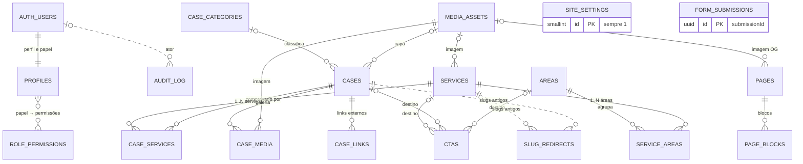

# Estrutura do banco de dados — Plataforma Agência Benjamin

| Campo        | Valor |
| ------------ | ----- |
| Issues       | DB-01 (#57), DB-02 (#58), DB-08 (#64), DB-10 (#66), ARC-11 (#52), DBX-01 a DBX-06 (#112–#117) |
| Responsável  | Vinicius Binda (`@VinnizzZ`) |
| Revisão      | Vinícius Nishimura Reis (`@Vinishireis`) |
| Versão       | 0.1 — proposta para revisão |
| Data         | 14/10/2026 |
| Parte de     | 4 migrations já na `main` (`supabase/migrations/20261013000100…0400`) |
| Regras-fonte | [TECH-03 RBAC](../seguranca/matriz-rbac.md) · [TECH-04 estados](../negocio/maquina-de-estados-publicacao.md) · [TECH-05 integridade](../negocio/integridade-de-conteudo.md) · [CASE-11 campos do case](../negocio/campos-do-case.md) · [ADR-0005 mídia](../adr/0005-armazenamento-de-midia.md) · [ADR-0006 cache](../adr/0006-cache-e-invalidacao.md) · [TECH-08 dados pessoais](../seguranca/ciclo-de-vida-dados-pessoais.md) |

> **Situação do SQL deste documento.** As 7 migrations do [Apêndice A](#apêndice-a--sql-das-migrations)
> foram testadas num Postgres 17 da imagem oficial do Supabase (`supabase/postgres:17.11`). Elas
> aplicam por cima das 4 migrations da `main`, revertem com os scripts do [Apêndice B](#apêndice-b--rollback)
> e aplicam de novo sem erro. O roteiro do [Apêndice C](#apêndice-c--roteiro-de-testes) passou nos
> **55 testes** (visibilidade, constraints, transições, vínculos, slugs, RLS por papel e retenção).
> É uma proposta: ajuste o que fizer sentido antes de abrir o PR da DB-02.

## Sumário

1. [Visão geral](#1-visão-geral)
2. [Convenções](#2-convenções-dbx-01)
3. [Diagrama entidade-relacionamento](#3-diagrama-entidade-relacionamento)
4. [Dicionário de dados](#4-dicionário-de-dados)
5. [Integridade: banco × aplicação](#5-integridade-banco--aplicação-dbx-04)
6. [Segurança: grants e RLS](#6-segurança-grants-e-rls-dbx-06)
7. [Slugs e URLs](#7-slugs-e-urls-db-08)
8. [Consultas, índices e gravação](#8-consultas-índices-e-gravação-dbx-03)
9. [Formulários e retenção](#9-formulários-e-retenção-dbx-05)
10. [Migrations, rollback e seeds](#10-migrations-rollback-e-seeds-db-02--dbx-02--arc-11)
11. [Testes](#11-testes)
12. [Backup e recuperação](#12-backup-e-recuperação-db-10)
13. [Integração com o código](#13-integração-com-o-código)
14. [Decisões em aberto](#14-decisões-em-aberto)
15. [Checklist por issue](#15-checklist-por-issue)

---

## 1. Visão geral

O banco é o **Supabase** (Postgres + Auth + Storage), um projeto por ambiente:
`benjamin-dev`, `benjamin-hml` e `benjamin-prd` ([ARC-06](../ambientes/matriz-de-ambientes.md)).
O site público lê com a **chave anônima**, e a RLS só devolve o que está publicado. O painel lê e
grava com a **sessão do usuário**, e a RLS aplica a matriz RBAC. A `service_role` fica restrita ao
servidor: gravação de formulários e rotinas operacionais.

| Grupo | Tabelas | Situação |
| ----- | ------- | -------- |
| Acesso | `profiles`, `role_permissions` | ✅ na `main` (ADM-02/ADM-03) |
| Auditoria | `audit_log` | ✅ na `main` (TECH-10) |
| Formulários | `form_submissions` | ✅ na `main` (TECH-06/07) · **ajustes propostos** para retenção (§9) |
| Mídia | `media_assets` + bucket `media` | Bucket ✅ na `main` · tabela **proposta** |
| Taxonomia | `areas`, `services`, `service_areas`, `case_categories` | **Proposta** |
| Portfólio | `cases`, `case_services`, `case_media`, `case_links` | **Proposta** |
| Institucional | `ctas`, `site_settings`, `pages`, `page_blocks` | **Proposta** |
| URLs | `slug_redirects` | **Proposta** (DB-08) |
| Pós-MVP | `content_versions` | Fora do MVP ([ADR-0007](../adr/0007-historico-de-versoes.md), FUT-04) |

**Ponto de partida:** o modelo espelha os tipos de `lib/domain/content/types.ts`, que hoje
alimentam o site a partir de `content/`. Quando as tabelas existirem, só a camada de dados muda
(`loadSnapshot()` no repositório); o domínio, as páginas e a API continuam iguais (§13).

---

## 2. Convenções (DBX-01)

| Item | Convenção |
| ---- | --------- |
| Schema | `public` para tabelas expostas via API. `private` para funções internas de migration, sem acesso pela API |
| Nomes | `snake_case`, tabelas no plural (`cases`, `case_media`). Junções: `<pai>_<filho>` |
| Chave primária | `uuid default gen_random_uuid()`. Exceções: `audit_log` (`bigint identity`), `site_settings` (linha única `id = 1`) e junções (PK composta) |
| Ordenação | Coluna `sort_order` (o domínio chama de `order`, que é palavra reservada no SQL) |
| Datas | `timestamptz`. `updated_at` truncado em **milissegundos** para casar com o `Date` do JS (§8.4) |
| Autoria | `created_at/created_by` (imutáveis) e `updated_at/updated_by`, preenchidos pelo trigger `stamp_row()` a partir de `auth.uid()` |
| Estado editorial | Domínio `publication_status` (`draft`, `published`, `archived`) + `published_at` + `archived_at` |
| Slug | Domínio `slug`: kebab-case, 3–80 caracteres, sem as palavras reservadas, único por tabela |
| Links externos | Domínio `https_url`: somente `https://`, até 2 048 caracteres |
| Textos | `text` + `check (char_length(...))`, sem `varchar(n)`. Os limites seguem os schemas Zod |
| Listas simples | `text[]` com limite de `cardinality` (destaques, exemplos, equipe, palavras-chave) |
| Listas com estrutura ou ordem | Tabela filha (galeria e links do case) |
| Conteúdo provisório | `provisional boolean`: o site mostra o selo e o gate de release bloqueia ([GO-01](../operacao/release-e-rollback.md)) |
| Exclusão | **Não há soft delete.** O arquivamento (`archived`) faz esse papel; a exclusão definitiva só vale para item arquivado |
| Constraints | Sempre **nomeadas** (`cases_publish_requires_fields`), para a aplicação traduzir o erro em mensagem de campo |
| Erros próprios | SQLSTATE da classe `BJ` (tabela abaixo) |

### 2.1 Erros do banco → erros da API (TECH-02)

| SQLSTATE | Quando acontece | `ErrorCode` (`lib/server/errors.ts`) | HTTP |
| -------- | --------------- | ------------------------------------ | ---- |
| `23505` | Slug ou valor único repetido | `VALIDATION_FAILED` com `fieldErrors.slug` | 422 |
| `23514` | Violação de `check` (formato, limite, campos para publicar) | `VALIDATION_FAILED` (o nome da constraint indica o campo) | 422 |
| `23503` | Exclusão bloqueada: mídia, categoria ou destino de CTA em uso | `INVALID_TRANSITION` com mensagem "em uso" | 409 |
| `42501` | RLS ou grant negou | `FORBIDDEN` | 403 |
| `BJ001` | Transição de estado inválida (ex.: arquivado → publicado) | `INVALID_TRANSITION` | 409 |
| `BJ002` | Excluir item que não está arquivado | `INVALID_TRANSITION` | 409 |
| `BJ003` | Publicado sem vínculo obrigatório (serviço sem área, case sem serviço) | `VALIDATION_FAILED` | 422 |
| `22023` | Parâmetro inválido em função RPC (ex.: galeria com mais de 20 imagens) | `VALIDATION_FAILED` | 422 |
| 0 linhas no `update` | `updated_at` esperado diferente (concorrência) ou RLS de `using` negou | `CONFLICT` (a guarda do servidor já verificou a permissão antes) | 409 |

---

## 3. Diagrama entidade-relacionamento



| Relação | Cardinalidade | Regra |
| ------- | ------------- | ----- |
| Serviço × Área | N:M (`service_areas`) | Serviço **publicado** precisa de ≥ 1 área (trigger no COMMIT) |
| Case × Serviço | N:M (`case_services`) | Case **publicado** precisa de ≥ 1 serviço (trigger). Que o serviço esteja publicado é verificado na aplicação (R07) |
| Case × Categoria | N:1 | Obrigatória para publicar. FK `restrict`: não se exclui categoria com cases |
| Case × Área | **Derivada** | União das áreas dos serviços do case; não é gravada (evita inconsistência) |
| Case × Mídia | Capa N:1 e galeria N:M ordenada | FK `restrict`: mídia em uso não pode ser excluída |
| CTA × Destino | N:0..1, tipado | Exatamente as colunas do tipo escolhido; FK `restrict` |
| Página × Bloco | 1:N | Bloco único por `(page_id, block_key)` |
| Slug antigo × Item | N:1, polimórfica | Sem FK (aponta para `services` ou `cases`); limpeza por trigger |

---

## 4. Dicionário de dados

Legenda: **O** obrigatório sempre · **P** obrigatório para publicar · Op opcional.

### 4.1 Campos de controle (todas as tabelas publicáveis)

`areas`, `services`, `case_categories`, `cases`, `ctas` e `pages` têm estes campos e recebem,
pela função `private.setup_publishable_table()`, os mesmos grants, as mesmas políticas RLS e os
mesmos triggers.

| Coluna | Tipo | Regra |
| ------ | ---- | ----- |
| `status` | `publication_status` | Padrão `draft`. Pelo painel, todo item **nasce rascunho** (RLS) |
| `published_at` | `timestamptz` | Preenchido na **primeira** publicação e imutável depois (SEO). Data futura = agendado (o painel não expõe isso no MVP) |
| `archived_at` | `timestamptz` | Preenchido ao arquivar e limpo ao restaurar. `check`: arquivado ⇔ data preenchida |
| `provisional` | `boolean` | Conteúdo provisório (selo + gate de release) |
| `created_at`, `created_by` | `timestamptz`, `uuid` | Imutáveis |
| `updated_at`, `updated_by` | `timestamptz`, `uuid` | A cada gravação. `updated_at` é a **versão otimista** |

Triggers aplicados: `stamp_row` (autoria e datas), `enforce_publication` (transições permitidas e
datas de controle) e `prevent_delete_unless_archived`.

### 4.2 `areas` — áreas de atuação (PRJ §9 · ADM-07)

| Coluna | Tipo | Nulo | Regra | Domínio (`Area`) |
| ------ | ---- | :--: | ----- | ---------------- |
| `id` | `uuid` | O | PK | `id` |
| `slug` | `slug` | O | Único | `slug` |
| `name` | `text` | O | 2–80 | `name` |
| `summary` | `text` | P | ≤ 200 | `summary` |
| `description` | `text` | P | ≤ 2 000 | `description` |
| `highlights` | `text[]` | O | ≤ 12 itens (padrão `{}`) | `highlights` |
| `icon` | `text` | Op | Nome do ícone do brandbook (`seta-curva`, `megafone`…), validado na aplicação | `icon` |
| `sort_order` | `integer` | O | ≥ 0 | `order` |

### 4.3 `services` e `service_areas` — serviços (PRJ §10 · ADM-06)

| Coluna | Tipo | Nulo | Regra | Domínio (`Service`) |
| ------ | ---- | :--: | ----- | ------------------- |
| `id`, `slug`, `name` | — | O | Como em `areas` | `id`, `slug`, `name` |
| `summary` | `text` | P | ≤ 200 | `summary` |
| `description` | `text` | P | ≤ 4 000 | `description` |
| `examples` | `text[]` | O | ≤ 12 itens | `examples` |
| `icon` | `text` | Op | Nome do ícone | `icon` |
| `image_media_id` | `uuid` → `media_assets` | Op | FK `restrict` | `image` |
| `featured` | `boolean` | O | Destaque na Home (máx. 6 é aviso R11, na aplicação) | `featured` |
| `sort_order` | `integer` | O | ≥ 0 | `order` |

`service_areas (service_id, area_id)`: PK composta, as duas FKs com `on delete cascade`. É o
`areaIds` do domínio.

### 4.4 `case_categories` — categorias do portfólio (PRJ §12 · CASE-08/09/10)

| Coluna | Tipo | Nulo | Regra |
| ------ | ---- | :--: | ----- |
| `id`, `slug` | — | O | Como acima |
| `name` | `text` | O | 2–60 |
| `description` | `text` | Op | ≤ 400 |
| `sort_order` | `integer` | O | ≥ 0 |

Categorias iniciais: Copywriting · Social Media & Criação · Assessoria de Imprensa.

### 4.5 `cases` e tabelas filhas — portfólio (PRJ §13 · CASE-11 · ADM-08)

| Coluna | Tipo | Nulo | Regra | Domínio (`CaseStudy`) |
| ------ | ---- | :--: | ----- | --------------------- |
| `id`, `slug` | — | O | Como acima | `id`, `slug` |
| `title` | `text` | O | 2–120 | `title` |
| `client` | `text` | P | 2–120. Filtro sem diferenciar maiúsculas (índice em `lower(client)`) | `client` |
| `category_id` | `uuid` → `case_categories` | P | FK `restrict` | `categoryId` |
| `delivery_type` | `text` | Op | ≤ 60 (ex.: "Artigos para blog") | `deliveryType` |
| `summary` | `text` | P | ≤ 280; **≥ 30 para publicar** | `summary` |
| `challenge`, `solution`, `results` | `text` | Op | ≤ 4 000 cada | idem |
| `cover_media_id` | `uuid` → `media_assets` | P | FK `restrict`. O `alt` vem da mídia | `cover` |
| `reference_month` | `date` | Op | Sempre dia 1 (`AAAA-MM-01`). "Não futuro" fica na aplicação | `date` (`AAAA-MM`) |
| `team` | `text[]` | O | ≤ 20 nomes | `team` |
| `featured` | `boolean` | O | Destaque na Home | `featured` |
| `sort_order` | `integer` | O | ≥ 0 | `order` |

- `case_services (case_id, service_id)`: PK composta, cascade nas duas FKs. É o `serviceIds`.
- `case_media (case_id, media_id, sort_order)`: galeria ordenada, até 20 imagens (validado na
  função `set_case_gallery`). Mídia com FK `restrict`. É o `gallery`.
- `case_links (id, case_id, label, url, sort_order)`: `label` com 2–80 caracteres, `url` do tipo
  `https_url`, sem URL repetida no mesmo case, até 10 links (validado em `set_case_links`). É o
  `externalLinks`.

> **Diferença em relação à sugestão do CASE-11:** a capa virou `cover_media_id` (FK para
> `media_assets`) em vez de `cover_path` + `cover_alt`. Com FK, o banco impede excluir uma imagem
> em uso (ADR-0005) e o `alt` fica num lugar só.

### 4.6 `media_assets` — biblioteca de mídia (ARC-10 · ADM-09)

| Coluna | Tipo | Nulo | Regra |
| ------ | ---- | :--: | ----- |
| `id` | `uuid` | O | PK |
| `path` | `text` | O | Único. Formato de `buildStoragePath()`: `AAAA/MM/<uuid>-<nome>.<ext>` |
| `mime_type` | `text` | O | `image/jpeg`, `image/png`, `image/webp`, `image/avif`, `application/pdf` (SVG recusado) |
| `size_bytes` | `integer` | O | Imagem ≤ 5 MB; PDF ≤ 10 MB |
| `width`, `height` | `integer` | Op | 1–4 000 px |
| `alt` | `text` | O* | 1–160 caracteres. *Obrigatório para imagem não decorativa (R12) |
| `decorative` | `boolean` | O | Imagem decorativa usa `alt=""` no site |
| `original_name` | `text` | Op | ≤ 255, só para a equipe reconhecer o arquivo |
| `checksum_sha256` | `text` | Op | Hex de 64 caracteres; permite avisar sobre upload repetido |
| `created_*`, `updated_*` | — | O | `created_by` é quem enviou (o `uploaded_by` do ADR-0005) |

O banco guarda o **caminho**, nunca a URL. A URL sai de `publicMediaUrl()`, o que permite trocar de
projeto ou CDN sem migrar dados. Ao excluir: apague primeiro a linha (a FK barra se estiver em
uso) e só depois o objeto no Storage. Se a remoção do objeto falhar, registre no log; um job de
limpeza remove objetos sem linha correspondente.

### 4.7 `ctas` — chamadas para ação (TECH-05 · ADM-11)

| Coluna | Tipo | Nulo | Regra |
| ------ | ---- | :--: | ----- |
| `label` | `text` | O | 2–40 |
| `placement` | `text` | O | `home-hero`, `home-highlight`, `footer`, `service-detail`, `case-detail` |
| `target_kind` | `text` | O | `internal`, `external`, `service`, `case`, `area`, `contact` |
| `target_path` | `text` | — | Só para `internal`: começa com `/` e não com `//`; ≤ 200 |
| `target_url` | `https_url` | — | Só para `external` |
| `service_id`, `case_id`, `area_id` | `uuid` | — | Só o do tipo escolhido. `contact` aceita `service_id` opcional (serviço pré-selecionado) |
| `sort_order` | `integer` | O | Ordem dentro do `placement` |

A constraint `ctas_target_shape` garante que **só** as colunas do tipo estejam preenchidas. As FKs
são `restrict`: o banco não deixa excluir um serviço, case ou área que um CTA usa. O CMS mostra o
impacto antes (`assessRemovalImpact`). A regra "caminho interno pertence às rotas públicas" (R10)
fica na aplicação.

### 4.8 `site_settings` — configuração institucional (ADM-10)

Linha única (`id = 1`), criada pela migration com nome, tagline e descrição atuais. Não tem
rascunho: salvar publica e gera auditoria `settings.updated`. Só `admin` e `super_admin` editam
(`settings:edit`).

| Coluna | Regra |
| ------ | ----- |
| `name`, `short_name`, `tagline`, `description` | Obrigatórios (2–80 · 2–30 · 2–120 · 50–300) |
| `contact_email`, `contact_phone`, `address`, `maps_url` | Opcionais e validados (formato de e-mail, telefone, https) |
| `instagram_url`, `tiktok_url`, `linkedin_url` | `https` e domínio da rede correta (ADM-15) |
| `keywords` | `text[]`, ≤ 30 |

### 4.9 `pages` e `page_blocks` — páginas e textos institucionais (ADM-05 · HOME-07)

`pages` guarda as **rotas fixas** do site, criadas pela migration como `published` e
`is_system = true` (uma página de sistema não pode ser arquivada nem excluída): `home`, `sobre`,
`areas`, `servicos`, `cases`, `contato`, `feedback` e `privacidade`. Colunas: `key`, `path`,
`title`, `seo_title` (≤ 70), `seo_description` (≤ 160) e `og_image_media_id`.

`page_blocks` guarda o texto editável de cada página: `block_key` único na página, `block_type`,
`content jsonb` (objeto de até 16 KB), `visible`, `provisional` e `sort_order`.

**Por que separar de `site_settings`:** a matriz RBAC dá `page:edit` ao `editor`, mas só
`settings:view`. Manifesto e "Sobre" são editados pela equipe de conteúdo; contato e redes, pela
coordenação ([ADM-01](../seguranca/perfis-e-permissoes.md)).

Catálogo inicial de blocos (a ser fechado com a Julia na ADM-05). O `content` de cada tipo deve
ter um schema Zod em `lib/domain/content/blocks.ts`:

| Página | `block_key` | `block_type` | `content` | Origem hoje |
| ------ | ----------- | ------------ | --------- | ----------- |
| `home` | `manifesto` | `manifesto` | `{ title, paragraphs[1..5] }` | `content/site.ts` → `manifesto` |
| `sobre` | `sobre` | `about` | `{ title, intro, valueProposition, howWeWork, fecapRelation }` | `content/site.ts` → `about` |
| `servicos` | `processo` | `steps` | `{ steps: [{ icon, title, text }] }` (3–6 passos) | Fixo em `components/sections/process-steps.tsx` |
| `privacidade` | `aviso` | `rich-text` | `{ markdown }` | Fixo em `app/(site)/privacidade/page.tsx` |
| qualquer | `<secao>` | `section-heading` | `{ eyebrow?, title, subtitle? }` | Títulos de seção fixos nas páginas |

**Semântica:** editar um bloco salva e publica na hora, com validação e auditoria, como na edição
de item publicado (ADM-12). A prévia (ADM-14) renderiza o formulário **antes de salvar**, sem
gravar nada. Se um bloco não existir no banco, o site usa o conteúdo de `content/` marcado como
provisório, e o gate de release barra a publicação.

### 4.10 `slug_redirects` — URLs antigas (DB-08)

| Coluna | Regra |
| ------ | ----- |
| `entity_type` | `service` ou `case` |
| `old_slug` | `slug`. PK composta com `entity_type` |
| `entity_id` | Id do item atual. Aponta para o id, não para o slug novo: várias trocas seguidas nunca formam cadeia |
| `created_at` | Data do registro |

A tabela é preenchida **só por trigger** (§7). Ninguém grava nela pela API.

### 4.11 Tabelas que já estão na `main`

| Tabela | Resumo | Ajuste proposto |
| ------ | ------ | --------------- |
| `profiles` | Papel (`app_role`) e `active` de cada conta. Nasce `pending` por trigger | — |
| `role_permissions` | 148 linhas geradas de `rbac.ts` (`node scripts/print-rbac-seed.mjs`); o teste `rbac-sql.test.ts` compara | — |
| `audit_log` | *Append-only*, sem PII, gravado por `record_audit_event()` | Sugestão: incluir `media.updated` na lista de eventos (edição de `alt`) |
| `form_submissions` | Leads, contatos e feedbacks; `id` = `submissionId` | `last_activity_at`, `legal_hold`, `anonymized_at`, `handled_by` e índices (§9) |
| Todas as funções antigas | `has_permission`, `current_app_role`, `assign_role`… | **Correção de grants** (§6.3) |

---

## 5. Integridade: banco × aplicação (DBX-04)

O banco garante a **estrutura**. A aplicação garante regras que dependem de várias linhas ou de
contexto (`findIntegrityIssues`, `transition()`, schemas Zod). As duas camadas usam os mesmos
limites.

| Regra | Banco | Aplicação |
| ----- | ----- | --------- |
| R01 slug válido | Domínio `slug` | `validateSlug()` (mensagem amigável antes de gravar) |
| R02 slug único por tipo | `unique` por tabela | `uniqueSlug()` sugere `-2`, `-3`… |
| R03 serviço com ≥ 1 área | Trigger adiado (`BJ003`) para **publicado** | Erro no CMS também em rascunho |
| R04 referência existente | FKs | — |
| R05 serviço publicado sem área publicada | — | Aviso |
| R06 case publicado com categoria publicada | Categoria obrigatória (`check`) | Categoria **publicada** |
| R07 case publicado com serviço publicado | ≥ 1 serviço (trigger adiado) | Serviço **publicado** |
| R08 CTA com destino não publicado | — | Aviso + fallback (`resolveCtaHref`) |
| R09 link externo `https` | Domínio `https_url` | `isValidExternalUrl()` |
| R10 caminho interno conhecido | Começa com `/`, não com `//` | `isValidInternalPath()` |
| R11 máx. 6 destaques | — | Aviso |
| R12 imagem com `alt` | `media_assets_image_alt` | Mensagem no formulário |
| I1 público só vê publicado | RLS `anon` com `is_publicly_visible()` | `isPubliclyVisible()` no repositório |
| I2/I3 datas de controle | `check` + trigger `enforce_publication` | `transition()` |
| I4 excluir só arquivado | Trigger `BJ002` + RLS | Tabela de transições |
| Transições permitidas | Trigger `BJ001` | `TRANSITIONS` |
| Nasce rascunho | RLS de `insert` exige `draft` | Formulário de criação |
| Publicar exige campos | `*_publish_requires_fields` (mínimo estrutural) | `validateForPublish` (completo) |
| Concorrência | `updated_at` em ms | `update … where updated_at = esperado` → `CONFLICT` |

> **Dica:** como a transição é validada no banco, `UPDATE` direto pelo SQL Editor do Supabase
> também respeita as regras. Para corrigir dados como `postgres`, use uma transação e prefira
> restaurar → editar → publicar a desligar triggers.

---

## 6. Segurança: grants e RLS (DBX-06)

### 6.1 Matriz banco × papel

| Tabela | `anon` (site) | `authenticated` (painel) | `service_role` (servidor) |
| ------ | ------------- | ------------------------ | ------------------------- |
| Publicáveis (6 tabelas) | `select` só de publicado | `select` publicado ou com `<recurso>:view`; `insert` só rascunho com `create`; `update` com `edit` e o novo estado conforme `edit`/`publish`/`archive`; `delete` só arquivado com `delete` | Ignora RLS |
| `service_areas`, `case_services` | `select` se os dois lados estiverem visíveis | `insert`/`delete` com `service:edit` / `case:edit` | Ignora RLS |
| `case_media`, `case_links` | `select` se o case estiver visível | Tudo com `case:edit` | Ignora RLS |
| `media_assets` | `select` **só** da mídia usada por conteúdo visível | `view`/`create`/`edit`/`delete` de `media` | Ignora RLS |
| `site_settings` | `select` | `select`; `update` com `settings:edit` | Ignora RLS |
| `page_blocks` | `select` dos blocos visíveis de página visível | `select` (pela página); escrita com `page:edit` | Ignora RLS |
| `slug_redirects` | `select` | `select` | Escrita por trigger |
| `form_submissions` | **Nada** | Conforme `lead:*` / `feedback:*` | Gravação dos envios |
| `audit_log` | **Nada** | `select` com `audit:view` | — |

### 6.2 Modelo de políticas (aplicado pela função `setup_publishable_table`)

```sql
create policy "services: público lê publicados" on public.services
  for select to anon using (public.is_publicly_visible(status, published_at));
create policy "services: painel lê" on public.services
  for select to authenticated
  using (public.is_publicly_visible(status, published_at) or (select public.has_permission('service', 'view')));
create policy "services: cria rascunho" on public.services
  for insert to authenticated
  with check (status = 'draft' and (select public.has_permission('service', 'create')));
create policy "services: edita" on public.services
  for update to authenticated
  using ((select public.has_permission('service', 'edit')))
  with check (public.can_write_status('service', status));
create policy "services: exclui arquivados" on public.services
  for delete to authenticated
  using (status = 'archived' and (select public.has_permission('service', 'delete')));
```

- `(select public.has_permission(...))` entre parênteses faz o Postgres avaliar a função **uma
  vez por consulta**, e não uma vez por linha (recomendação do Supabase).
- Políticas `to anon` **nunca** chamam `has_permission` (depois da §6.3, o `anon` não pode
  executá-la).
- Nas tabelas filhas, a política usa `exists (select 1 from public.cases c where c.id = case_id)`.
  A RLS de `cases` vale dentro do `exists`, então o visitante só enxerga filhos de case publicado
  sem repetir a regra.
- `media_assets` não é pública por inteiro: a lista revelaria `alt` e nomes de arquivos de cases
  ainda em rascunho. O bucket continua público para leitura (caminhos com UUID não são
  enumeráveis).

### 6.3 Correção encontrada nas migrations atuais

As migrations da `main` fazem `revoke execute on function ... from anon`, mas **o Postgres concede
EXECUTE a `PUBLIC` por padrão**. No teste, o ACL estava como `{=X/postgres, …}` e o `anon`
executou `has_permission()` normalmente. Não há brecha, porque as funções conferem `auth.uid()` e
o `anon` não tem papel. Mesmo assim, o endurecimento pretendido não acontece. A migration base
proposta corrige isso:

```sql
revoke execute on function public.has_permission(text, text) from public, anon;
revoke execute on function public.current_app_role() from public, anon;
-- … idem para assign_role, set_profile_active e record_audit_event
```

Regra para as próximas funções: **`revoke ... from public, anon`** e `grant ... to authenticated`
quando for chamada pelo painel.

### 6.4 Cuidados

- **Views:** se criar alguma, use `with (security_invoker = true)`. Sem isso, a view roda com o
  dono e **ignora a RLS**.
- **Funções `security definer`:** só para triggers que precisam enxergar todas as linhas
  (verificação de vínculos, `slug_redirects`). Sempre com `set search_path = ''` e nomes
  qualificados (`public.tabela`).
- **`service_role`:** só em `lib/server/supabase/admin.ts` (já é `server-only`) e em scripts
  operacionais. Nunca em Route Handler público, nunca no navegador.
- **Teste de isolamento (DBX-06):** com a chave anônima, `select` em `form_submissions` precisa
  dar `42501`, e um rascunho precisa voltar com 0 linhas (testes 1.x do Apêndice C).

---

## 7. Slugs e URLs (DB-08)

| Situação | Comportamento |
| -------- | ------------- |
| Item em rascunho que **nunca** foi publicado | Slug livre: trocar não gera redirecionamento |
| Item que **já foi publicado** troca de slug | Trigger grava `old_slug → entity_id` em `slug_redirects` |
| Slug antigo acessado | `resolve_public_slug()` devolve o slug atual → **301** |
| Slug volta a ser usado por um item vivo | O trigger apaga o redirecionamento com esse nome (o item vivo vence) |
| Item excluído | O trigger apaga os redirecionamentos dele → **404** |
| Item arquivado ou em rascunho | `resolve_public_slug()` devolve `null` (a RLS esconde) → **404** |

Integração no `proxy.ts`, substituindo `publishedSlugExists()`:

```ts
const { data: current } = await supabase.rpc("resolve_public_slug", { p_entity: "case", p_slug: slug });
if (!current) return rewrite404();
if (current !== slug) return NextResponse.redirect(new URL(`/cases/${current}`, request.url), 301);
return NextResponse.next();
```

Na invalidação de cache, `tagsForChange()` já trata o **slug antigo** (ADR-0006). O sitemap e o
`llms.txt` passam a listar só o slug novo na mesma invalidação.

---

## 8. Consultas, índices e gravação (DBX-03)

### 8.1 Índices

| Tabela | Índice | Serve para |
| ------ | ------ | ---------- |
| Todas as publicáveis | `unique (slug)` / `unique (key)` | Detalhe por slug e unicidade |
| `areas`, `services`, `case_categories`, `cases` | `(sort_order, nome) where status = 'published'` | Listagens públicas já ordenadas |
| `services`, `cases` | `(sort_order, …) where status = 'published' and featured` | Destaques da Home |
| `areas`, `services`, `cases` | `(status, updated_at desc)` | Tela de gerenciamento (ADM-18) |
| `cases` | `(category_id)`, `(lower(client)) where published` | Filtros do portfólio |
| `service_areas`, `case_services` | `(area_id)`, `(service_id)` | Lado inverso das junções (a PK cobre o outro) |
| `case_media`, `case_links` | `(case_id, sort_order)` | Galeria e links na ordem |
| FKs para mídia e destinos de CTA | Índices parciais `where … is not null` | Checagem rápida do `restrict` ao excluir |
| `ctas` | `(placement, sort_order) where published` | CTAs por posição |
| `slug_redirects` | PK `(entity_type, old_slug)` + `(entity_type, entity_id)` | Resolver 301 e limpar ao excluir |
| `media_assets` | `(created_at desc)`, `(checksum_sha256)` | Biblioteca e aviso de duplicado |

Com o seed de desenvolvimento carregado, rode `explain analyze` nas consultas do repositório e
registre o plano no PR da DBX-03. Com poucas linhas, o Postgres prefere *seq scan*, e isso é
esperado.

### 8.2 Leitura pública com `supabase-js` (para DB-03/04/05)

A RLS já filtra o que é público. A consulta só escolhe colunas e relações:

```ts
// Lista de serviços publicados com áreas e imagem
supabase
  .from("services")
  .select("id, slug, name, summary, description, examples, icon, featured, sort_order, published_at, image:media_assets!services_image_media_id_fkey(path, alt, width, height, decorative), service_areas(area:areas(slug, name))")
  .order("sort_order")
  .order("name");

// Portfólio com filtros (categoria, serviço, área derivada, cliente) e paginação
supabase
  .rpc("search_cases", { p_category: "copywriting", p_service: null, p_area: null, p_client: null })
  .select("slug, title, client, delivery_type, summary, reference_month, featured, category:case_categories(slug, name), cover:media_assets!cases_cover_media_id_fkey(path, alt, width, height)", { count: "exact" })
  .order("sort_order")
  .order("title")
  .range(0, 11);
```

Use a dica de FK (`!cases_cover_media_id_fkey`) no embed da capa: `cases` chega a `media_assets`
por dois caminhos (capa e galeria via `case_media`) e, sem a dica, o PostgREST recusa o embed
como ambíguo.

`search_cases()` roda como `security invoker`: a RLS de quem chama vale, e um case ligado só a
serviço em rascunho não aparece para o visitante. O retorno é `setof cases`, então o PostgREST
continua permitindo `select` com relações, `order`, `range` e `count`.

### 8.3 Gravação de vínculos: uma chamada, uma transação

Cada chamada do `supabase-js` é uma transação. Se o painel apagar os vínculos em uma chamada e
recriar em outra, o COMMIT da primeira falha com `BJ003` quando o item está publicado. Por isso
os vínculos são trocados por funções RPC atômicas:

| Função | Faz |
| ------ | --- |
| `set_service_areas(service_id, area_ids[])` | Mantém as áreas da lista e remove as demais |
| `set_case_services(case_id, service_ids[])` | Idem, com no máximo 9 serviços |
| `set_case_gallery(case_id, media_ids[])` | Galeria na ordem do array, com no máximo 20 imagens |
| `set_case_links(case_id, links jsonb)` | Substitui os links (`[{label, url}]`), com no máximo 10 |

Fluxo de "Salvar case" no painel: `requirePermission` → validação Zod → `update cases … where
updated_at = esperado` → `set_case_services` / `set_case_gallery` / `set_case_links` → auditoria →
`updateTag`. Se depois quiserem atomicidade total, essas chamadas podem virar um único
`save_case(...)`.

### 8.4 Concorrência otimista

```ts
const { data, error } = await supabase
  .from("cases")
  .update(patch)
  .eq("id", id)
  .eq("updated_at", expectedUpdatedAt) // valor exatamente como veio do banco
  .select("updated_at")
  .maybeSingle();
if (!error && !data) throw new AppError("CONFLICT"); // alguém salvou antes
```

O trigger grava `updated_at` truncado em **milissegundos**. Sem isso, um `updated_at` com
microssegundos (`…12.345678`) que passasse por `new Date(...).toISOString()` (`…12.345Z`) nunca
casaria, e **todo** salvamento daria conflito.

---

## 9. Formulários e retenção (DBX-05)

Ajustes propostos em `form_submissions` (migration `…0700`):

| Coluna/índice | Por quê |
| ------------- | ------- |
| `last_activity_at` | "Último andamento" da regra de retenção. **Não** use `updated_at`: ele muda a cada tentativa de notificação (`updateNotification`) e adiaria o descarte indefinidamente |
| Trigger `touch_submission_activity` | Atualiza `last_activity_at` e `handled_by` só quando o `status` muda |
| `legal_hold` | Suspende a retenção (virou contrato, pedido judicial) — `RetentionSubject.legalHold` |
| `anonymized_at` | Registra a anonimização de feedback identificado |
| `handled_by` | Quem mudou o status por último (painel de leads, FORM-09) |
| Índice `(kind, last_activity_at) where not legal_hold` | Varredura mensal da retenção |
| Índice `(protocol)` **não único** | Busca por protocolo no painel |

> ⚠️ **Não torne `protocol` único.** Ele é derivado do `submissionId` (`AB-XXXXXX`). Uma colisão
> geraria `23505`, que o `SupabaseSubmissionStore` trata como "envio duplicado", e um **lead real
> seria descartado em silêncio**.

Rotina de retenção (Vercel Cron → Route Handler protegido por `CRON_SECRET`, com `service_role`):

```sql
-- Sujeitos para planRetention()
select id, kind, last_activity_at,
       (kind = 'feedback' and (payload ? 'name' or payload ? 'email')) as identified,
       legal_hold
from public.form_submissions
where not legal_hold and anonymized_at is null;

-- Anonimização (FEEDBACK_PERSONAL_FIELDS)
update public.form_submissions
set payload = payload - 'name' - 'email', anonymized_at = now()
where id = any($1) and kind = 'feedback';

-- Exclusão
delete from public.form_submissions where id = any($1);
```

Registre **só a contagem e os ids** em `retention.executed`. Os prazos dependem de aprovação
institucional (⏳ SEG-02).

---

## 10. Migrations, rollback e seeds (DB-02 · DBX-02 · ARC-11)

> **Superado em 28/10/2026 (DBX-02).** As migrations `20261014…` desta proposta não foram
> adotadas: o conteúdo entrou em `20261025000100_cms_content.sql`. O procedimento em vigor
> (ordem, rollback de todas as migrations, seed gerado de `content/` com trava de produção e
> `npm run test:migrations`) está no [dicionário de dados](dicionario-de-dados.md) §9.

### 10.1 Arquivos (continuação da sequência da `main`)

| Ordem | Arquivo | Conteúdo |
| ----- | ------- | -------- |
| 1 | `20261014000100_cms_base.sql` | Domínios, `is_publicly_visible`, `can_write_status`, triggers comuns, `setup_publishable_table`, correção de grants |
| 2 | `20261014000200_media_assets.sql` | Biblioteca de mídia |
| 3 | `20261014000300_cms_taxonomia.sql` | `areas`, `services`, `service_areas`, `case_categories` + vínculo obrigatório |
| 4 | `20261014000400_cms_cases.sql` | `cases`, `case_services`, `case_media`, `case_links` + leitura pública de mídia |
| 5 | `20261014000500_cms_institucional.sql` | `ctas`, `site_settings`, `pages`, `page_blocks` + linhas iniciais |
| 6 | `20261014000600_slugs_e_consultas.sql` | `slug_redirects`, `resolve_public_slug`, `search_cases`, RPCs de vínculo |
| 7 | `20261014000700_form_submissions_retencao.sql` | Ajustes de retenção |

Todas levam o cabeçalho padrão do projeto, como as quatro migrations atuais.

### 10.2 Comandos

```bash
supabase init                                  # uma vez: cria supabase/config.toml (commitar)
supabase start                                 # banco local (Docker)
supabase db reset                              # recria o banco local: migrations + supabase/seed.sql
supabase link --project-ref <ref> && supabase db push   # dev/hml/prd: só migrations, nunca o seed
supabase gen types typescript --local > lib/server/supabase/database.types.ts
```

O arquivo de tipos gerado precisa do cabeçalho padrão (o `check:headers` exige) ou de uma entrada
em `IGNORED_FILES` de `scripts/file-headers.mjs`.

### 10.3 Rollback

O Supabase CLI não executa migrations de reversão. A proposta é versionar um
`supabase/rollbacks/<migration>.down.sql` por migration ([Apêndice B](#apêndice-b--rollback)),
aplicado manualmente em ordem inversa e só depois de backup. Teste no PR: `db reset` → aplicar os
`down` em ordem inversa → confirmar que sobram as 4 tabelas originais → `db reset` de novo. Isso
foi feito neste documento e funcionou.

Regras: nenhum `drop` de tabela com dados reais sem backup e plano aprovado (GO-01). Mudança
destrutiva em produção é feita em duas etapas: primeiro a coluna nova, depois a remoção da antiga
em outra release.

### 10.4 Seed de desenvolvimento (ARC-11)

- **`supabase/seed.sql`**: dados **fictícios**, rodados só por `supabase db reset` (local). O
  `db push` não executa o seed, então ele não chega a hml/prd por acidente.
- Fonte sugerida: gerar o SQL a partir de `content/` com um script
  `scripts/print-content-seed.mjs` (mesmo padrão de `print-rbac-seed.mjs`). Assim o seed e o
  fallback do site não divergem.
- Tudo dentro de `begin; … commit;`: os vínculos obrigatórios são verificados no COMMIT, e inserir
  um serviço publicado antes da área em comandos separados falharia.
- Inclua um rascunho, um arquivado e uma mídia sem uso, para exercitar a RLS e as telas do painel.
- Usuários de teste: crie pelo Auth local e use `scripts/provision-admin.mjs` para o
  `super_admin`. Nunca crie senha no seed.
- Produção não tem seed de conteúdo: a Benjamin cadastra pelo painel (INT-04/INT-05). As linhas
  de `pages` e `site_settings` são estrutura e vêm das migrations.

---

## 11. Testes

| Tipo | Onde | O que cobre |
| ---- | ---- | ----------- |
| SQL (pgTAP) | `supabase/tests/*.sql`, rodando `supabase test db` | Portar o roteiro do [Apêndice C](#apêndice-c--roteiro-de-testes): visibilidade anônima, constraints, transições, vínculos, slugs, RLS por papel e retenção |
| Consistência TS × SQL | `lib/server/content/schema-sql.test.ts` (novo) | Palavras reservadas do domínio `slug` = `RESERVED_SLUGS`; estados = `PUBLICATION_STATUSES`; MIME e limites = `MEDIA_RULES`. Mesmo padrão do `rbac-sql.test.ts` |
| Repositório | `repository.test.ts` com Supabase local | Lista vazia e populada (critério da DB-05), somente publicados |
| QA-04 / QA-06 | Homologação | Roteiros de CMS e de acesso indevido (N01–N13 da matriz RBAC) |

Para simular usuário num teste SQL: `set local role authenticated;` e
`set local request.jwt.claim.sub = '<uuid>';`. O `auth.uid()` do Supabase lê essa configuração.

---

## 12. Backup e recuperação (DB-10)

| Item | Proposta |
| ---- | -------- |
| Banco | Backups diários automáticos do Supabase. **Confirmar o plano contratado**: os backups diários começam no plano Pro, e o *point-in-time recovery* é adicional |
| Cópia própria | `supabase db dump` (schema) + `supabase db dump --data-only` semanal, criptografado e guardado fora do Supabase com acesso nominal |
| Storage | **Os backups do banco não incluem os arquivos do bucket.** Cópia periódica do bucket `media` via API S3 do Supabase |
| Restauração | Restaurar em um projeto **novo** → aplicar a rotina de retenção antes de liberar acesso (TECH-08) → apontar a Vercel → `POST /api/internal/revalidate` |
| Teste | Restaurar o dump de **homologação** num projeto descartável e comparar contagens por tabela. Registrar o resultado na DB-10 |
| Proibido | Copiar dados de produção para dev/hml (ARC-06) |

---

## 13. Integração com o código

### 13.1 Domínio ↔ banco

| Domínio (`types.ts`) | Banco |
| -------------------- | ----- |
| `order` | `sort_order` |
| `publishedAt`, `archivedAt`, `updatedAt` | `published_at`, `archived_at`, `updated_at` (ISO 8601) |
| `Service.areaIds` | `service_areas` |
| `Service.image` / `CaseStudy.cover` (`MediaRef`) | `image_media_id` / `cover_media_id` → `media_assets` (`src = publicMediaUrl(path)`, `alt = decorative ? "" : alt`) |
| `CaseStudy.categoryId`, `serviceIds` | `category_id`, `case_services` |
| `CaseStudy.gallery` | `case_media` ordenada → `media_assets` |
| `CaseStudy.externalLinks` | `case_links` ordenada |
| `CaseStudy.date` (`AAAA-MM`) | `reference_month` (`AAAA-MM-01`) |
| `Cta.target` (união tipada) | `target_kind` + `target_path` / `target_url` / `service_id` / `case_id` / `area_id` |
| `SiteSettings.contact`, `socials`, `keywords`… | `site_settings` |
| `SiteSettings.manifesto`, `about` | `page_blocks` das páginas `home` e `sobre` |

### 13.2 O que muda em cada lugar

| Arquivo | Mudança | Issue |
| ------- | ------- | ----- |
| `lib/server/content/repository.ts` | `loadSnapshot()` lê do Supabase com `createPublicClient()` (anônimo) e mapeia linha → domínio. O resto do arquivo não muda | DB-03/04/05 |
| `lib/server/content/published-slugs.ts` + `proxy.ts` | Trocar por `resolve_public_slug` com 301 (§7) | DB-08 |
| `lib/server/errors.ts` | Função `fromPostgresError()` com a tabela da §2.1 | DB-09 |
| `lib/domain/content/blocks.ts` (novo) | Schemas Zod dos blocos de página | ADM-05 |
| `lib/server/forms/supabase-store.ts` | Nada obrigatório; a retenção usa as colunas novas | DBX-05 |
| `scripts/print-content-seed.mjs` (novo) | Gera `supabase/seed.sql` a partir de `content/` | ARC-11 |

---

## 14. Decisões em aberto

| # | Decisão | Proposta deste documento | Quem decide |
| - | ------- | ------------------------ | ----------- |
| 1 | `alt` por arquivo ou por uso | Por arquivo (`media_assets.alt`). Se algum caso pedir texto diferente no mesmo arquivo, adicionar `alt_override` em `case_media` | Binda + Rafael (ADM-09) |
| 2 | Catálogo final de blocos de página | §4.9 como ponto de partida | Julia (ADM-05) |
| 3 | FKs de CTA com `restrict` | O banco impede CTA órfão (o TECH-05 previa sinalizar órfãos em R04). Mais seguro e já coberto pelo aviso de impacto | Binda + Vinishireis |
| 4 | Versão otimista por `updated_at` (ms) ou por coluna `version integer` | `updated_at`, como no TECH-04, com a truncagem em ms | Binda |
| 5 | `save_case` único ou RPCs de vínculo separadas | RPCs separadas no MVP | Murilo (ADM-06/08) |
| 6 | Plano do Supabase em produção | Pro (backups diários) | Coordenação (GO-02) |
| 7 | Prazos de retenção | Os de `RETENTION_RULES`, pendentes de aprovação | Institucional (SEG-02) |

---

## 15. Checklist por issue

| Issue | Critério de aceite | Onde este documento atende |
| ----- | ------------------ | -------------------------- |
| DB-01 | Modelo lógico e convenções documentados e revisados | §2, §3, §4 · revisão no PR |
| DB-02 | Migrations aplicam e revertem em ambiente limpo | Apêndices A e B · §10.3 (testado) |
| DB-08 | URLs previsíveis, únicas e com alterações sem colisão | §7 · `slug_redirects` · testes 5.x |
| DB-10 | Restore descrito e validado com dados de teste | §12 (executar a restauração em hml) |
| ARC-11 | Novo ambiente sobe com dados de teste consistentes | §10.4 |
| DBX-01 | DER e dicionário versionados e revisados | §3, §4 (versionar este arquivo em `docs/banco/`) |
| DBX-02 | Banco limpo sobe por comando; rollback testado; seed não roda em produção | §10 |
| DBX-03 | Índices fundamentados; planos revisados; paginação e filtros testados | §8 · `explain analyze` no PR |
| DBX-04 | Banco rejeita valores estruturais inválidos; testes de integridade | §5 · testes 2.x, 3.x, 4.x |
| DBX-05 | Runbook de retenção, restauração e descarte | §9, §12 |
| DBX-06 | Matriz banco × papel; dados pessoais não consultáveis anonimamente | §6 · testes 1.x e 6.x |

Ordem sugerida: **DB-01** (revisar este documento) → **DB-02/DBX-04** (migrations + pgTAP) →
**ARC-11** (seed) → liberar **DB-03/04/05** para o Murilo trocar o `loadSnapshot()` → **DB-08**
(proxy) → **DBX-03** (planos com o seed) → **DBX-05/DB-10** (runbooks).

---

## Apêndice A — SQL das migrations

Testado em Postgres 17 (`supabase/postgres:17.11`) depois das 4 migrations da `main`. Antes de
commitar, acrescente o **cabeçalho padrão** do projeto no topo de cada arquivo, como nas
migrations atuais.

### `supabase/migrations/20261014000100_cms_base.sql`

```sql
-- Base do CMS: tipos, funções de visibilidade, carimbos e máquina de estados (DB-01/DB-02/DBX-04).

create schema if not exists private;
revoke all on schema private from public, anon, authenticated;

-- Slug: espelho de lib/domain/content/slug.ts (SLUG_PATTERN, 3–80, RESERVED_SLUGS).
create domain public.slug as text
  constraint slug_format check (
    char_length(value) between 3 and 80
    and value ~ '^[a-z0-9]+(-[a-z0-9]+)*$'
    and value not in ('admin', 'api', 'novo', 'nova', 'editar', 'new', 'edit', 'preview',
                      'rascunho', 'todos', 'filtro', 'pagina')
  );

-- Estados de publicação: espelho de PUBLICATION_STATUSES.
create domain public.publication_status as text
  constraint publication_status_values check (value in ('draft', 'published', 'archived'));

-- Link externo: somente https (regra R09).
create domain public.https_url as text
  constraint https_url_format check (char_length(value) <= 2048 and value ~ '^https://[^\s/?#]+\.[^\s/?#]+([/?#]\S*)?$');

-- Regra única de visibilidade pública: espelho de isPubliclyVisible() (RN-01 / TECH-04 I1).
create function public.is_publicly_visible(p_status text, p_published_at timestamptz)
returns boolean
language sql
stable
set search_path = ''
as $$
  select p_status = 'published' and p_published_at is not null and p_published_at <= now();
$$;

-- Permissão para gravar o item no estado pedido (defesa em profundidade da transição — TECH-04).
create function public.can_write_status(p_resource text, p_status text)
returns boolean
language sql
stable
set search_path = ''
as $$
  select case p_status
    when 'draft' then public.has_permission(p_resource, 'edit')
    when 'published' then public.has_permission(p_resource, 'publish')
    when 'archived' then public.has_permission(p_resource, 'archive')
    else false
  end;
$$;

-- created_* imutáveis; updated_* a cada gravação. Milissegundos para casar com Date do JS
-- (o updated_at é a versão otimista usada no CONFLICT 409).
create function public.stamp_row()
returns trigger
language plpgsql
set search_path = ''
as $$
begin
  new.updated_at := date_trunc('milliseconds', now());
  new.updated_by := coalesce((select auth.uid()), new.updated_by);
  if tg_op = 'INSERT' then
    new.created_at := new.updated_at;
    new.created_by := coalesce((select auth.uid()), new.created_by);
  else
    new.created_at := old.created_at;
    new.created_by := old.created_by;
  end if;
  return new;
end;
$$;

-- Transições permitidas (TRANSITIONS de publication.ts) e campos de controle (I2/I3).
create function public.enforce_publication()
returns trigger
language plpgsql
set search_path = ''
as $$
begin
  if tg_op = 'UPDATE' then
    if not (
      (old.status = 'draft' and new.status in ('draft', 'published', 'archived'))
      or (old.status = 'published' and new.status in ('published', 'draft', 'archived'))
      or (old.status = 'archived' and new.status = 'draft')
    ) then
      raise exception 'Transição inválida: % → %.', old.status, new.status using errcode = 'BJ001';
    end if;
    -- Data da primeira publicação é estável (SEO).
    new.published_at := coalesce(old.published_at, new.published_at);
  end if;

  if new.status = 'published' then
    new.published_at := coalesce(new.published_at, date_trunc('milliseconds', now()));
  end if;

  if new.status = 'archived' then
    if tg_op = 'INSERT' or old.status <> 'archived' then
      new.archived_at := date_trunc('milliseconds', now());
    end if;
  else
    new.archived_at := null;
  end if;
  return new;
end;
$$;

-- Exclusão definitiva só a partir de arquivado (I4).
create function public.prevent_delete_unless_archived()
returns trigger
language plpgsql
set search_path = ''
as $$
begin
  if old.status <> 'archived' then
    raise exception 'Somente itens arquivados podem ser excluídos.' using errcode = 'BJ002';
  end if;
  return old;
end;
$$;

-- Aplica grants, RLS, políticas e triggers padrão a uma tabela de conteúdo publicável.
create function private.setup_publishable_table(p_table text, p_resource text)
returns void
language plpgsql
set search_path = ''
as $$
begin
  execute format('alter table public.%I enable row level security', p_table);
  execute format('revoke all on public.%I from anon, authenticated', p_table);
  execute format('grant select on public.%I to anon', p_table);
  execute format('grant select, insert, update, delete on public.%I to authenticated', p_table);

  execute format($p$create policy "%1$s: público lê publicados" on public.%1$I
    for select to anon using (public.is_publicly_visible(status, published_at))$p$, p_table);
  execute format($p$create policy "%1$s: painel lê" on public.%1$I
    for select to authenticated
    using (public.is_publicly_visible(status, published_at) or (select public.has_permission(%2$L, 'view')))$p$,
    p_table, p_resource);
  execute format($p$create policy "%1$s: cria rascunho" on public.%1$I
    for insert to authenticated
    with check (status = 'draft' and (select public.has_permission(%2$L, 'create')))$p$, p_table, p_resource);
  execute format($p$create policy "%1$s: edita" on public.%1$I
    for update to authenticated
    using ((select public.has_permission(%2$L, 'edit')))
    with check (public.can_write_status(%2$L, status))$p$, p_table, p_resource);
  execute format($p$create policy "%1$s: exclui arquivados" on public.%1$I
    for delete to authenticated
    using (status = 'archived' and (select public.has_permission(%2$L, 'delete')))$p$, p_table, p_resource);

  execute format('create trigger %1$s_stamp before insert or update on public.%1$I
    for each row execute function public.stamp_row()', p_table);
  execute format('create trigger %1$s_publication before insert or update on public.%1$I
    for each row execute function public.enforce_publication()', p_table);
  execute format('create trigger %1$s_delete_guard before delete on public.%1$I
    for each row execute function public.prevent_delete_unless_archived()', p_table);
end;
$$;

-- Correção de endurecimento: o Postgres concede EXECUTE a PUBLIC por padrão, então
-- "revoke ... from anon" sozinho não tem efeito. Vale também para as funções antigas.
revoke execute on function public.can_write_status(text, text) from public, anon;
revoke execute on function public.has_permission(text, text) from public, anon;
revoke execute on function public.current_app_role() from public, anon;
revoke execute on function public.assign_role(uuid, public.app_role) from public, anon;
revoke execute on function public.set_profile_active(uuid, boolean) from public, anon;
revoke execute on function public.record_audit_event(text, text, text, text, jsonb, text) from public, anon;
grant execute on function public.can_write_status(text, text) to authenticated;
```

### `supabase/migrations/20261014000200_media_assets.sql`

```sql
-- Biblioteca de mídia (ARC-10 / ADR-0005 / ADM-09). O arquivo fica no bucket "media";
-- o banco guarda o caminho (nunca a URL completa) e os metadados.

create table public.media_assets (
  id uuid primary key default gen_random_uuid(),
  path text not null
    constraint media_assets_path_key unique
    constraint media_assets_path_format
      check (path ~ '^\d{4}/(0[1-9]|1[0-2])/[0-9a-f-]{36}-[a-z0-9]+(-[a-z0-9]+)*\.(jpg|png|webp|avif|pdf)$'),
  mime_type text not null
    constraint media_assets_mime check (mime_type in ('image/jpeg', 'image/png', 'image/webp', 'image/avif', 'application/pdf')),
  size_bytes integer not null constraint media_assets_size check (size_bytes > 0 and size_bytes <= 10485760),
  width integer constraint media_assets_width check (width is null or width between 1 and 4000),
  height integer constraint media_assets_height check (height is null or height between 1 and 4000),
  alt text constraint media_assets_alt_length check (alt is null or char_length(btrim(alt)) between 1 and 160),
  decorative boolean not null default false,
  original_name text constraint media_assets_original_name check (original_name is null or char_length(original_name) <= 255),
  checksum_sha256 text constraint media_assets_checksum check (checksum_sha256 is null or checksum_sha256 ~ '^[0-9a-f]{64}$'),
  created_at timestamptz not null default now(),
  created_by uuid references auth.users (id) on delete set null,
  updated_at timestamptz not null default now(),
  updated_by uuid references auth.users (id) on delete set null,
  -- Imagens até 5 MB; PDF até 10 MB (MEDIA_RULES).
  constraint media_assets_image_size check (mime_type = 'application/pdf' or size_bytes <= 5242880),
  -- Imagem informativa exige texto alternativo; decorativa usa alt vazio no site (R12).
  constraint media_assets_image_alt check (mime_type = 'application/pdf' or decorative or alt is not null)
);

comment on table public.media_assets is 'Metadados dos arquivos do bucket media. Exclusão bloqueada (FK restrict) enquanto estiver em uso.';

create index media_assets_created_idx on public.media_assets (created_at desc);
create index media_assets_checksum_idx on public.media_assets (checksum_sha256) where checksum_sha256 is not null;

create trigger media_assets_stamp before insert or update on public.media_assets
  for each row execute function public.stamp_row();

alter table public.media_assets enable row level security;
revoke all on public.media_assets from anon, authenticated;
grant select on public.media_assets to anon;
grant select, insert, update, delete on public.media_assets to authenticated;

-- As políticas de leitura pública entram na migration de cases (dependem das tabelas
-- que referenciam a mídia).
create policy "media_assets: painel lê" on public.media_assets
  for select to authenticated using ((select public.has_permission('media', 'view')));
create policy "media_assets: envia" on public.media_assets
  for insert to authenticated with check ((select public.has_permission('media', 'create')));
create policy "media_assets: edita metadados" on public.media_assets
  for update to authenticated using ((select public.has_permission('media', 'edit')));
create policy "media_assets: exclui" on public.media_assets
  for delete to authenticated using ((select public.has_permission('media', 'delete')));
```

### `supabase/migrations/20261014000300_cms_taxonomia.sql`

```sql
-- Áreas, serviços e categorias de cases (PRJ §9, §10, §12 / TECH-05).

create table public.areas (
  id uuid primary key default gen_random_uuid(),
  slug public.slug not null constraint areas_slug_key unique,
  name text not null constraint areas_name_length check (char_length(btrim(name)) between 2 and 80),
  summary text constraint areas_summary_length check (summary is null or char_length(summary) <= 200),
  description text constraint areas_description_length check (description is null or char_length(description) <= 2000),
  highlights text[] not null default '{}' constraint areas_highlights_max check (cardinality(highlights) <= 12),
  icon text constraint areas_icon_format check (icon is null or icon ~ '^[a-z]+(-[a-z]+)*$'),
  sort_order integer not null default 0 constraint areas_sort_order check (sort_order >= 0),
  provisional boolean not null default false,
  status public.publication_status not null default 'draft',
  published_at timestamptz,
  archived_at timestamptz,
  created_at timestamptz not null default now(),
  created_by uuid references auth.users (id) on delete set null,
  updated_at timestamptz not null default now(),
  updated_by uuid references auth.users (id) on delete set null,
  constraint areas_published_has_date check (status <> 'published' or published_at is not null),
  constraint areas_archived_has_date check ((status = 'archived') = (archived_at is not null)),
  constraint areas_publish_requires_fields check (status <> 'published' or (summary is not null and description is not null))
);

create table public.services (
  id uuid primary key default gen_random_uuid(),
  slug public.slug not null constraint services_slug_key unique,
  name text not null constraint services_name_length check (char_length(btrim(name)) between 2 and 80),
  summary text constraint services_summary_length check (summary is null or char_length(summary) <= 200),
  description text constraint services_description_length check (description is null or char_length(description) <= 4000),
  examples text[] not null default '{}' constraint services_examples_max check (cardinality(examples) <= 12),
  icon text constraint services_icon_format check (icon is null or icon ~ '^[a-z]+(-[a-z]+)*$'),
  image_media_id uuid references public.media_assets (id) on delete restrict,
  featured boolean not null default false,
  sort_order integer not null default 0 constraint services_sort_order check (sort_order >= 0),
  provisional boolean not null default false,
  status public.publication_status not null default 'draft',
  published_at timestamptz,
  archived_at timestamptz,
  created_at timestamptz not null default now(),
  created_by uuid references auth.users (id) on delete set null,
  updated_at timestamptz not null default now(),
  updated_by uuid references auth.users (id) on delete set null,
  constraint services_published_has_date check (status <> 'published' or published_at is not null),
  constraint services_archived_has_date check ((status = 'archived') = (archived_at is not null)),
  constraint services_publish_requires_fields check (status <> 'published' or (summary is not null and description is not null))
);

-- Serviço × Área (N:M). Áreas do case são derivadas daqui (não gravadas).
create table public.service_areas (
  service_id uuid not null references public.services (id) on delete cascade,
  area_id uuid not null references public.areas (id) on delete cascade,
  primary key (service_id, area_id)
);

create table public.case_categories (
  id uuid primary key default gen_random_uuid(),
  slug public.slug not null constraint case_categories_slug_key unique,
  name text not null constraint case_categories_name_length check (char_length(btrim(name)) between 2 and 60),
  description text constraint case_categories_description_length check (description is null or char_length(description) <= 400),
  sort_order integer not null default 0 constraint case_categories_sort_order check (sort_order >= 0),
  provisional boolean not null default false,
  status public.publication_status not null default 'draft',
  published_at timestamptz,
  archived_at timestamptz,
  created_at timestamptz not null default now(),
  created_by uuid references auth.users (id) on delete set null,
  updated_at timestamptz not null default now(),
  updated_by uuid references auth.users (id) on delete set null,
  constraint case_categories_published_has_date check (status <> 'published' or published_at is not null),
  constraint case_categories_archived_has_date check ((status = 'archived') = (archived_at is not null))
);

select private.setup_publishable_table('areas', 'area');
select private.setup_publishable_table('services', 'service');
select private.setup_publishable_table('case_categories', 'category');

-- Serviço publicado precisa de ao menos uma área (R03). Verificado no COMMIT para
-- permitir trocar as áreas dentro da mesma transação.
create function public.assert_service_has_area()
returns trigger
language plpgsql
security definer
set search_path = ''
as $$
declare
  v_service_id uuid;
begin
  if tg_table_name = 'services' then
    v_service_id := new.id;
  else
    v_service_id := old.service_id;
  end if;
  if exists (select 1 from public.services where id = v_service_id and status = 'published')
     and not exists (select 1 from public.service_areas where service_id = v_service_id) then
    raise exception 'Serviço publicado precisa de ao menos uma área.' using errcode = 'BJ003';
  end if;
  return null;
end;
$$;

create constraint trigger services_require_area
  after insert or update of status on public.services
  deferrable initially deferred
  for each row execute function public.assert_service_has_area();

create constraint trigger service_areas_keep_one
  after delete on public.service_areas
  deferrable initially deferred
  for each row execute function public.assert_service_has_area();

alter table public.service_areas enable row level security;
revoke all on public.service_areas from anon, authenticated;
grant select on public.service_areas to anon;
grant select, insert, delete on public.service_areas to authenticated;

-- A leitura segue a visibilidade dos dois lados (a RLS de services/areas vale no EXISTS).
create policy "service_areas: lê vínculos visíveis" on public.service_areas
  for select to anon, authenticated
  using (exists (select 1 from public.services s where s.id = service_id)
         and exists (select 1 from public.areas a where a.id = area_id));
create policy "service_areas: vincula" on public.service_areas
  for insert to authenticated with check ((select public.has_permission('service', 'edit')));
create policy "service_areas: desvincula" on public.service_areas
  for delete to authenticated using ((select public.has_permission('service', 'edit')));

-- Índices de leitura pública, painel e chaves estrangeiras (DBX-03).
create index areas_public_order_idx on public.areas (sort_order, name) where status = 'published';
create index areas_admin_idx on public.areas (status, updated_at desc);
create index services_public_order_idx on public.services (sort_order, name) where status = 'published';
create index services_featured_idx on public.services (sort_order, name) where status = 'published' and featured;
create index services_admin_idx on public.services (status, updated_at desc);
create index services_image_idx on public.services (image_media_id) where image_media_id is not null;
create index service_areas_area_idx on public.service_areas (area_id);
create index case_categories_public_order_idx on public.case_categories (sort_order, name) where status = 'published';
```

### `supabase/migrations/20261014000400_cms_cases.sql`

```sql
-- Cases do portfólio, serviços envolvidos, galeria e links externos (PRJ §13 / CASE-11).

create table public.cases (
  id uuid primary key default gen_random_uuid(),
  slug public.slug not null constraint cases_slug_key unique,
  title text not null constraint cases_title_length check (char_length(btrim(title)) between 2 and 120),
  client text constraint cases_client_length check (client is null or char_length(btrim(client)) between 2 and 120),
  category_id uuid references public.case_categories (id) on delete restrict,
  delivery_type text constraint cases_delivery_type_length check (delivery_type is null or char_length(delivery_type) <= 60),
  summary text constraint cases_summary_length check (summary is null or char_length(summary) <= 280),
  challenge text constraint cases_challenge_length check (challenge is null or char_length(challenge) <= 4000),
  solution text constraint cases_solution_length check (solution is null or char_length(solution) <= 4000),
  results text constraint cases_results_length check (results is null or char_length(results) <= 4000),
  cover_media_id uuid references public.media_assets (id) on delete restrict,
  -- Mês de referência (AAAA-MM) guardado como o dia 1 do mês.
  reference_month date constraint cases_reference_month_day check (reference_month is null or extract(day from reference_month) = 1),
  team text[] not null default '{}' constraint cases_team_max check (cardinality(team) <= 20),
  featured boolean not null default false,
  sort_order integer not null default 0 constraint cases_sort_order check (sort_order >= 0),
  provisional boolean not null default false,
  status public.publication_status not null default 'draft',
  published_at timestamptz,
  archived_at timestamptz,
  created_at timestamptz not null default now(),
  created_by uuid references auth.users (id) on delete set null,
  updated_at timestamptz not null default now(),
  updated_by uuid references auth.users (id) on delete set null,
  constraint cases_published_has_date check (status <> 'published' or published_at is not null),
  constraint cases_archived_has_date check ((status = 'archived') = (archived_at is not null)),
  -- Mínimo estrutural para publicar (casePublishSchema); o resto é validado na aplicação.
  constraint cases_publish_requires_fields check (
    status <> 'published' or (
      client is not null and category_id is not null and cover_media_id is not null
      and summary is not null and char_length(btrim(summary)) >= 30
    )
  )
);

-- Case × Serviço (N:M).
create table public.case_services (
  case_id uuid not null references public.cases (id) on delete cascade,
  service_id uuid not null references public.services (id) on delete cascade,
  primary key (case_id, service_id)
);

-- Galeria do case (CASE-04), ordenada. A mídia não pode ser excluída enquanto estiver aqui.
create table public.case_media (
  case_id uuid not null references public.cases (id) on delete cascade,
  media_id uuid not null references public.media_assets (id) on delete restrict,
  sort_order integer not null default 0 constraint case_media_sort_order check (sort_order >= 0),
  primary key (case_id, media_id)
);

-- Links externos ("Veja publicado"): somente https (R09).
create table public.case_links (
  id uuid primary key default gen_random_uuid(),
  case_id uuid not null references public.cases (id) on delete cascade,
  label text not null constraint case_links_label_length check (char_length(btrim(label)) between 2 and 80),
  url public.https_url not null,
  sort_order integer not null default 0 constraint case_links_sort_order check (sort_order >= 0),
  constraint case_links_unique_url unique (case_id, url)
);

select private.setup_publishable_table('cases', 'case');

-- Case publicado precisa de ao menos um serviço (parte estrutural da R07; a exigência de
-- serviço PUBLICADO continua na aplicação).
create function public.assert_case_has_service()
returns trigger
language plpgsql
security definer
set search_path = ''
as $$
declare
  v_case_id uuid;
begin
  if tg_table_name = 'cases' then
    v_case_id := new.id;
  else
    v_case_id := old.case_id;
  end if;
  if exists (select 1 from public.cases where id = v_case_id and status = 'published')
     and not exists (select 1 from public.case_services where case_id = v_case_id) then
    raise exception 'Case publicado precisa de ao menos um serviço.' using errcode = 'BJ003';
  end if;
  return null;
end;
$$;

create constraint trigger cases_require_service
  after insert or update of status on public.cases
  deferrable initially deferred
  for each row execute function public.assert_case_has_service();

create constraint trigger case_services_keep_one
  after delete on public.case_services
  deferrable initially deferred
  for each row execute function public.assert_case_has_service();

-- Tabelas filhas: leitura segue o case (e o serviço); escrita exige case:edit.
alter table public.case_services enable row level security;
alter table public.case_media enable row level security;
alter table public.case_links enable row level security;
revoke all on public.case_services, public.case_media, public.case_links from anon, authenticated;
grant select on public.case_services, public.case_media, public.case_links to anon;
grant select, insert, delete on public.case_services to authenticated;
grant select, insert, update, delete on public.case_media, public.case_links to authenticated;

create policy "case_services: lê vínculos visíveis" on public.case_services
  for select to anon, authenticated
  using (exists (select 1 from public.cases c where c.id = case_id)
         and exists (select 1 from public.services s where s.id = service_id));
create policy "case_services: vincula" on public.case_services
  for insert to authenticated with check ((select public.has_permission('case', 'edit')));
create policy "case_services: desvincula" on public.case_services
  for delete to authenticated using ((select public.has_permission('case', 'edit')));

create policy "case_media: lê galeria de case visível" on public.case_media
  for select to anon, authenticated using (exists (select 1 from public.cases c where c.id = case_id));
create policy "case_media: edita galeria" on public.case_media
  for all to authenticated
  using ((select public.has_permission('case', 'edit')))
  with check ((select public.has_permission('case', 'edit')));

create policy "case_links: lê links de case visível" on public.case_links
  for select to anon, authenticated using (exists (select 1 from public.cases c where c.id = case_id));
create policy "case_links: edita links" on public.case_links
  for all to authenticated
  using ((select public.has_permission('case', 'edit')))
  with check ((select public.has_permission('case', 'edit')));

-- Visitante só lê metadados de mídia usada por conteúdo visível (a RLS de cada tabela
-- referenciada vale dentro do EXISTS). Rascunhos não vazam alt/nome de arquivos.
create policy "media_assets: público lê mídia em uso" on public.media_assets
  for select to anon
  using (
    exists (select 1 from public.cases c where c.cover_media_id = media_assets.id)
    or exists (select 1 from public.case_media cm where cm.media_id = media_assets.id)
    or exists (select 1 from public.services s where s.image_media_id = media_assets.id)
  );

create index cases_public_order_idx on public.cases (sort_order, title) where status = 'published';
create index cases_featured_idx on public.cases (sort_order, title) where status = 'published' and featured;
create index cases_admin_idx on public.cases (status, updated_at desc);
create index cases_category_idx on public.cases (category_id);
create index cases_client_idx on public.cases (lower(client)) where status = 'published';
create index cases_cover_idx on public.cases (cover_media_id) where cover_media_id is not null;
create index case_services_service_idx on public.case_services (service_id);
create index case_media_order_idx on public.case_media (case_id, sort_order);
create index case_media_media_idx on public.case_media (media_id);
create index case_links_order_idx on public.case_links (case_id, sort_order);
```

### `supabase/migrations/20261014000500_cms_institucional.sql`

```sql
-- CTAs, configuração institucional e páginas/blocos (ADM-05, ADM-10, ADM-11 / TECH-05).

-- Destino tipado (CtaTarget): exatamente as colunas do tipo escolhido são preenchidas.
-- FKs com restrict: o banco não deixa um CTA apontando para item excluído.
create table public.ctas (
  id uuid primary key default gen_random_uuid(),
  label text not null constraint ctas_label_length check (char_length(btrim(label)) between 2 and 40),
  placement text not null
    constraint ctas_placement check (placement in ('home-hero', 'home-highlight', 'footer', 'service-detail', 'case-detail')),
  target_kind text not null
    constraint ctas_target_kind check (target_kind in ('internal', 'external', 'service', 'case', 'area', 'contact')),
  target_path text constraint ctas_target_path check (
    target_path is null or (target_path ~ '^/' and target_path !~ '^//' and char_length(target_path) <= 200)),
  target_url public.https_url,
  service_id uuid references public.services (id) on delete restrict,
  case_id uuid references public.cases (id) on delete restrict,
  area_id uuid references public.areas (id) on delete restrict,
  sort_order integer not null default 0 constraint ctas_sort_order check (sort_order >= 0),
  provisional boolean not null default false,
  status public.publication_status not null default 'draft',
  published_at timestamptz,
  archived_at timestamptz,
  created_at timestamptz not null default now(),
  created_by uuid references auth.users (id) on delete set null,
  updated_at timestamptz not null default now(),
  updated_by uuid references auth.users (id) on delete set null,
  constraint ctas_published_has_date check (status <> 'published' or published_at is not null),
  constraint ctas_archived_has_date check ((status = 'archived') = (archived_at is not null)),
  constraint ctas_target_shape check (
    (target_kind = 'internal' and target_path is not null and num_nonnulls(target_url, service_id, case_id, area_id) = 0)
    or (target_kind = 'external' and target_url is not null and num_nonnulls(target_path, service_id, case_id, area_id) = 0)
    or (target_kind = 'service' and service_id is not null and num_nonnulls(target_path, target_url, case_id, area_id) = 0)
    or (target_kind = 'case' and case_id is not null and num_nonnulls(target_path, target_url, service_id, area_id) = 0)
    or (target_kind = 'area' and area_id is not null and num_nonnulls(target_path, target_url, service_id, case_id) = 0)
    or (target_kind = 'contact' and num_nonnulls(target_path, target_url, case_id, area_id) = 0)
  )
);

select private.setup_publishable_table('ctas', 'cta');

create index ctas_public_idx on public.ctas (placement, sort_order) where status = 'published';
create index ctas_service_idx on public.ctas (service_id) where service_id is not null;
create index ctas_case_idx on public.ctas (case_id) where case_id is not null;
create index ctas_area_idx on public.ctas (area_id) where area_id is not null;

-- Configuração institucional: linha única (ADM-10). Não tem rascunho: salvar publica,
-- com auditoria settings.updated. Somente admin/super_admin editam (settings:edit).
create table public.site_settings (
  id smallint primary key default 1 constraint site_settings_singleton check (id = 1),
  name text not null constraint site_settings_name check (char_length(btrim(name)) between 2 and 80),
  short_name text not null constraint site_settings_short_name check (char_length(btrim(short_name)) between 2 and 30),
  tagline text not null constraint site_settings_tagline check (char_length(btrim(tagline)) between 2 and 120),
  description text not null constraint site_settings_description check (char_length(btrim(description)) between 50 and 300),
  contact_email text constraint site_settings_email check (contact_email is null or contact_email ~* '^[^@\s]+@[^@\s]+\.[^@\s]+$'),
  contact_phone text constraint site_settings_phone check (contact_phone is null or contact_phone ~ '^[0-9 ()+-]{8,30}$'),
  address text constraint site_settings_address check (address is null or char_length(address) <= 200),
  maps_url public.https_url,
  instagram_url public.https_url constraint site_settings_instagram check (instagram_url is null or instagram_url ~ '^https://(www\.)?instagram\.com/'),
  tiktok_url public.https_url constraint site_settings_tiktok check (tiktok_url is null or tiktok_url ~ '^https://(www\.)?tiktok\.com/'),
  linkedin_url public.https_url constraint site_settings_linkedin check (linkedin_url is null or linkedin_url ~ '^https://([a-z]{2,3}\.)?linkedin\.com/'),
  keywords text[] not null default '{}' constraint site_settings_keywords_max check (cardinality(keywords) <= 30),
  created_at timestamptz not null default now(),
  created_by uuid references auth.users (id) on delete set null,
  updated_at timestamptz not null default now(),
  updated_by uuid references auth.users (id) on delete set null
);

create trigger site_settings_stamp before insert or update on public.site_settings
  for each row execute function public.stamp_row();

alter table public.site_settings enable row level security;
revoke all on public.site_settings from anon, authenticated;
grant select on public.site_settings to anon, authenticated;
grant update on public.site_settings to authenticated;

create policy "site_settings: leitura pública" on public.site_settings
  for select to anon, authenticated using (true);
create policy "site_settings: edita" on public.site_settings
  for update to authenticated using ((select public.has_permission('settings', 'edit')));

-- Linha inicial com os dados institucionais já públicos; contatos e redes entram pelo painel.
insert into public.site_settings (name, short_name, tagline, description, keywords)
values (
  'Agência Benjamin', 'Benja', 'Somando diferenças',
  'Agência experimental de comunicação da FECAP. Estratégia, conteúdo, criação, eventos e assessoria de imprensa feitos por estudantes em projetos reais para marcas e organizações.',
  array['agência experimental', 'comunicação', 'FECAP']
);

-- Páginas institucionais. As rotas existem no código; a tabela guarda SEO e o estado.
-- Páginas de sistema não podem ser arquivadas (logo, nem excluídas).
create table public.pages (
  id uuid primary key default gen_random_uuid(),
  key text not null constraint pages_key_key unique constraint pages_key_format check (key ~ '^[a-z]+(-[a-z]+)*$'),
  path text not null constraint pages_path_key unique constraint pages_path_format check (path ~ '^/([a-z0-9]+(-[a-z0-9]+)*)?$'),
  title text not null constraint pages_title_length check (char_length(btrim(title)) between 2 and 80),
  seo_title text constraint pages_seo_title_length check (seo_title is null or char_length(seo_title) <= 70),
  seo_description text constraint pages_seo_description_length check (seo_description is null or char_length(seo_description) <= 160),
  og_image_media_id uuid references public.media_assets (id) on delete restrict,
  is_system boolean not null default false,
  provisional boolean not null default false,
  status public.publication_status not null default 'draft',
  published_at timestamptz,
  archived_at timestamptz,
  created_at timestamptz not null default now(),
  created_by uuid references auth.users (id) on delete set null,
  updated_at timestamptz not null default now(),
  updated_by uuid references auth.users (id) on delete set null,
  constraint pages_published_has_date check (status <> 'published' or published_at is not null),
  constraint pages_archived_has_date check ((status = 'archived') = (archived_at is not null)),
  constraint pages_system_not_archived check (not is_system or status <> 'archived')
);

select private.setup_publishable_table('pages', 'page');

-- Blocos editáveis de cada página. O conteúdo é validado na aplicação por tipo de bloco
-- (Zod); o banco garante objeto JSON e tamanho máximo. Bloco ausente = site usa o
-- conteúdo provisório de content/ (selo "provisório" e bloqueio no gate de release).
create table public.page_blocks (
  id uuid primary key default gen_random_uuid(),
  page_id uuid not null references public.pages (id) on delete cascade,
  block_key text not null constraint page_blocks_key_format check (block_key ~ '^[a-z]+(-[a-z]+)*$'),
  block_type text not null
    constraint page_blocks_type check (block_type in ('manifesto', 'about', 'steps', 'rich-text', 'section-heading')),
  content jsonb not null
    constraint page_blocks_content_object check (jsonb_typeof(content) = 'object' and pg_column_size(content) <= 16384),
  visible boolean not null default true,
  provisional boolean not null default false,
  sort_order integer not null default 0 constraint page_blocks_sort_order check (sort_order >= 0),
  created_at timestamptz not null default now(),
  created_by uuid references auth.users (id) on delete set null,
  updated_at timestamptz not null default now(),
  updated_by uuid references auth.users (id) on delete set null,
  constraint page_blocks_page_key unique (page_id, block_key)
);

create trigger page_blocks_stamp before insert or update on public.page_blocks
  for each row execute function public.stamp_row();

alter table public.page_blocks enable row level security;
revoke all on public.page_blocks from anon, authenticated;
grant select on public.page_blocks to anon;
grant select, insert, update, delete on public.page_blocks to authenticated;

create policy "page_blocks: público lê blocos visíveis" on public.page_blocks
  for select to anon using (visible and exists (select 1 from public.pages p where p.id = page_id));
create policy "page_blocks: painel lê" on public.page_blocks
  for select to authenticated using (exists (select 1 from public.pages p where p.id = page_id));
create policy "page_blocks: edita" on public.page_blocks
  for all to authenticated
  using ((select public.has_permission('page', 'edit')))
  with check ((select public.has_permission('page', 'edit')));

create index page_blocks_order_idx on public.page_blocks (page_id, sort_order);
create index pages_og_image_idx on public.pages (og_image_media_id) where og_image_media_id is not null;

create policy "media_assets: público lê imagem OG de página" on public.media_assets
  for select to anon
  using (exists (select 1 from public.pages p where p.og_image_media_id = media_assets.id));

-- Páginas fixas do site (estrutura, não conteúdo): entram publicadas em todos os ambientes.
insert into public.pages (key, path, title, is_system, status) values
  ('home', '/', 'Início', true, 'published'),
  ('sobre', '/sobre', 'Sobre a Benjamin', true, 'published'),
  ('areas', '/areas', 'Áreas de atuação', true, 'published'),
  ('servicos', '/servicos', 'Serviços', true, 'published'),
  ('cases', '/cases', 'Cases e conteúdos', true, 'published'),
  ('contato', '/contato', 'Contato', true, 'published'),
  ('feedback', '/feedback', 'Feedback', true, 'published'),
  ('privacidade', '/privacidade', 'Aviso de privacidade', true, 'published');
```

### `supabase/migrations/20261014000600_slugs_e_consultas.sql`

```sql
-- Slugs estáveis com redirecionamento 301 (DB-08) e funções de leitura/gravação (DBX-03).

-- Slug antigo → item atual. Aponta para o id (não para o slug novo): várias trocas
-- seguidas nunca geram cadeia de redirecionamentos.
create table public.slug_redirects (
  entity_type text not null constraint slug_redirects_entity_type check (entity_type in ('service', 'case')),
  old_slug public.slug not null,
  entity_id uuid not null,
  created_at timestamptz not null default now(),
  primary key (entity_type, old_slug)
);

create index slug_redirects_entity_idx on public.slug_redirects (entity_type, entity_id);

alter table public.slug_redirects enable row level security;
revoke all on public.slug_redirects from anon, authenticated;
grant select on public.slug_redirects to anon, authenticated;
create policy "slug_redirects: leitura pública" on public.slug_redirects
  for select to anon, authenticated using (true);

-- Registra o slug antigo quando um item que JÁ FOI publicado muda de slug, e libera o
-- redirecionamento quando o slug volta a ser usado por um item vivo.
create function public.track_slug_change()
returns trigger
language plpgsql
security definer
set search_path = ''
as $$
begin
  if tg_op = 'DELETE' then
    delete from public.slug_redirects where entity_type = tg_argv[0] and entity_id = old.id;
    return null;
  end if;
  delete from public.slug_redirects where entity_type = tg_argv[0] and old_slug = new.slug;
  if tg_op = 'UPDATE' then
    if new.slug <> old.slug and old.published_at is not null then
      insert into public.slug_redirects (entity_type, old_slug, entity_id)
      values (tg_argv[0], old.slug, old.id)
      on conflict (entity_type, old_slug) do update set entity_id = excluded.entity_id, created_at = now();
    end if;
  end if;
  return null;
end;
$$;

create trigger services_track_slug after insert or update of slug or delete on public.services
  for each row execute function public.track_slug_change('service');
create trigger cases_track_slug after insert or update of slug or delete on public.cases
  for each row execute function public.track_slug_change('case');

-- Resolve o slug pedido na URL: devolve o slug atual publicado (igual = 200; diferente =
-- 301 para o novo; null = 404). Usado pelo proxy.ts. RLS do chamador vale (invoker).
create function public.resolve_public_slug(p_entity text, p_slug text)
returns text
language plpgsql
stable
security invoker
set search_path = ''
as $$
declare
  v_slug text;
begin
  if p_entity = 'service' then
    select s.slug into v_slug from public.services s where s.slug = p_slug;
    if v_slug is null then
      select s.slug into v_slug
      from public.slug_redirects r join public.services s on s.id = r.entity_id
      where r.entity_type = 'service' and r.old_slug = p_slug;
    end if;
  elsif p_entity = 'case' then
    select c.slug into v_slug from public.cases c where c.slug = p_slug;
    if v_slug is null then
      select c.slug into v_slug
      from public.slug_redirects r join public.cases c on c.id = r.entity_id
      where r.entity_type = 'case' and r.old_slug = p_slug;
    end if;
  end if;
  return v_slug;
end;
$$;

-- Filtros do portfólio (categoria, serviço, área derivada e cliente). Retorna linhas de
-- cases para o PostgREST embutir relações, ordenar e paginar (.select/.order/.range).
create function public.search_cases(
  p_category text default null,
  p_service text default null,
  p_area text default null,
  p_client text default null
)
returns setof public.cases
language sql
stable
security invoker
set search_path = ''
as $$
  select c.*
  from public.cases c
  where (p_category is null or exists (
          select 1 from public.case_categories cat where cat.id = c.category_id and cat.slug = p_category))
    and (p_service is null or exists (
          select 1 from public.case_services cs join public.services s on s.id = cs.service_id
          where cs.case_id = c.id and s.slug = p_service))
    and (p_area is null or exists (
          select 1 from public.case_services cs
          join public.service_areas sa on sa.service_id = cs.service_id
          join public.areas a on a.id = sa.area_id
          where cs.case_id = c.id and a.slug = p_area))
    and (p_client is null or lower(c.client) = lower(p_client));
$$;

-- Troca atômica dos vínculos de um item (uma chamada = uma transação). Sem isso, apagar e
-- recriar vínculos em duas chamadas faria o COMMIT intermediário falhar (BJ003).
create function public.set_service_areas(p_service_id uuid, p_area_ids uuid[])
returns void
language plpgsql
security invoker
set search_path = ''
as $$
begin
  delete from public.service_areas where service_id = p_service_id and area_id <> all (p_area_ids);
  insert into public.service_areas (service_id, area_id)
  select p_service_id, unnest(p_area_ids)
  on conflict do nothing;
end;
$$;

create function public.set_case_services(p_case_id uuid, p_service_ids uuid[])
returns void
language plpgsql
security invoker
set search_path = ''
as $$
begin
  if cardinality(p_service_ids) > 9 then
    raise exception 'No máximo 9 serviços por case.' using errcode = '22023';
  end if;
  delete from public.case_services where case_id = p_case_id and service_id <> all (p_service_ids);
  insert into public.case_services (case_id, service_id)
  select p_case_id, unnest(p_service_ids)
  on conflict do nothing;
end;
$$;

create function public.set_case_gallery(p_case_id uuid, p_media_ids uuid[])
returns void
language plpgsql
security invoker
set search_path = ''
as $$
begin
  if cardinality(p_media_ids) > 20 then
    raise exception 'No máximo 20 imagens na galeria.' using errcode = '22023';
  end if;
  delete from public.case_media where case_id = p_case_id and media_id <> all (p_media_ids);
  insert into public.case_media (case_id, media_id, sort_order)
  select p_case_id, m.media_id, (m.ord - 1)::integer
  from unnest(p_media_ids) with ordinality as m(media_id, ord)
  on conflict (case_id, media_id) do update set sort_order = excluded.sort_order;
end;
$$;

create function public.set_case_links(p_case_id uuid, p_links jsonb)
returns void
language plpgsql
security invoker
set search_path = ''
as $$
begin
  if jsonb_typeof(p_links) <> 'array' or jsonb_array_length(p_links) > 10 then
    raise exception 'Links: envie uma lista com no máximo 10 itens.' using errcode = '22023';
  end if;
  delete from public.case_links where case_id = p_case_id;
  insert into public.case_links (case_id, label, url, sort_order)
  select p_case_id, l.label, l.url, (l.ord - 1)::integer
  from rows from (jsonb_to_recordset(p_links) as (label text, url text)) with ordinality as l(label, url, ord);
end;
$$;

revoke execute on function public.set_service_areas(uuid, uuid[]) from public, anon;
revoke execute on function public.set_case_services(uuid, uuid[]) from public, anon;
revoke execute on function public.set_case_gallery(uuid, uuid[]) from public, anon;
revoke execute on function public.set_case_links(uuid, jsonb) from public, anon;
grant execute on function public.set_service_areas(uuid, uuid[]) to authenticated;
grant execute on function public.set_case_services(uuid, uuid[]) to authenticated;
grant execute on function public.set_case_gallery(uuid, uuid[]) to authenticated;
grant execute on function public.set_case_links(uuid, jsonb) to authenticated;
```

### `supabase/migrations/20261014000700_form_submissions_retencao.sql`

```sql
-- Ajustes de form_submissions para retenção e atendimento (TECH-08 / DBX-05 / DBX-06).

-- last_activity_at: "último andamento" da regra de retenção. Não usar updated_at: ele muda
-- a cada tentativa de notificação (updateNotification), o que adiaria o descarte.
alter table public.form_submissions
  add column last_activity_at timestamptz not null default now(),
  add column legal_hold boolean not null default false,
  add column anonymized_at timestamptz,
  add column handled_by uuid references auth.users (id) on delete set null;

update public.form_submissions set last_activity_at = created_at;

create function public.touch_submission_activity()
returns trigger
language plpgsql
set search_path = ''
as $$
begin
  if new.status is distinct from old.status then
    new.last_activity_at := now();
    new.handled_by := coalesce((select auth.uid()), new.handled_by);
  end if;
  return new;
end;
$$;

create trigger form_submissions_activity
  before update of status on public.form_submissions
  for each row execute function public.touch_submission_activity();

-- Protocolo NÃO é único: é derivado do submissionId (AB-XXXXXX) e uma colisão viraria
-- "envio duplicado" no store (23505), descartando um lead real. Índice só para busca.
create index form_submissions_protocol_idx on public.form_submissions (protocol);
create index form_submissions_retention_idx on public.form_submissions (kind, last_activity_at) where not legal_hold;
```

## Apêndice B — Rollback

Scripts para `supabase/rollbacks/`, aplicados **manualmente, em ordem inversa** (do `…0700` ao
`…0100`) e só com backup. Testado: depois deles sobram `profiles`, `role_permissions`,
`audit_log` e `form_submissions`, e as migrations do Apêndice A aplicam de novo sem erro.

### `supabase/rollbacks/20261014000700_form_submissions_retencao.down.sql`

```sql
drop trigger form_submissions_activity on public.form_submissions;
drop function public.touch_submission_activity();
drop index public.form_submissions_protocol_idx;
drop index public.form_submissions_retention_idx;
alter table public.form_submissions
  drop column handled_by, drop column anonymized_at, drop column legal_hold, drop column last_activity_at;
```

### `supabase/rollbacks/20261014000600_slugs_e_consultas.down.sql`

```sql
drop function public.set_case_links(uuid, jsonb);
drop function public.set_case_gallery(uuid, uuid[]);
drop function public.set_case_services(uuid, uuid[]);
drop function public.set_service_areas(uuid, uuid[]);
drop function public.search_cases(text, text, text, text);
drop function public.resolve_public_slug(text, text);
drop trigger cases_track_slug on public.cases;
drop trigger services_track_slug on public.services;
drop function public.track_slug_change();
drop table public.slug_redirects;
```

### `supabase/rollbacks/20261014000500_cms_institucional.down.sql`

```sql
drop policy "media_assets: público lê imagem OG de página" on public.media_assets;
drop table public.page_blocks;
drop table public.pages;
drop table public.site_settings;
drop table public.ctas;
```

### `supabase/rollbacks/20261014000400_cms_cases.down.sql`

```sql
drop policy "media_assets: público lê mídia em uso" on public.media_assets;
drop table public.case_links;
drop table public.case_media;
drop table public.case_services;
drop table public.cases;
drop function public.assert_case_has_service();
```

### `supabase/rollbacks/20261014000300_cms_taxonomia.down.sql`

```sql
drop table public.service_areas;
drop table public.services;
drop table public.areas;
drop table public.case_categories;
drop function public.assert_service_has_area();
```

### `supabase/rollbacks/20261014000200_media_assets.down.sql`

```sql
drop table public.media_assets;
```

### `supabase/rollbacks/20261014000100_cms_base.down.sql`

```sql
-- A correção de grants (revoke ... from public) NÃO é desfeita de propósito.
drop function private.setup_publishable_table(text, text);
drop function public.prevent_delete_unless_archived();
drop function public.enforce_publication();
drop function public.stamp_row();
drop function public.can_write_status(text, text);
drop function public.is_publicly_visible(text, timestamptz);
drop domain public.https_url;
drop domain public.publication_status;
drop domain public.slug;
drop schema private;
```

## Apêndice C — Roteiro de testes

Rode num banco **descartável** (`supabase start` + `supabase db reset`), como `postgres`, com
`psql -f`. Cada verificação imprime `PASSOU` ou `FALHOU`. Resultado nesta proposta: **55 de 55**.
Para o PR da DB-02, o ideal é portar para pgTAP em `supabase/tests/` (`supabase test db`).

```sql
\set QUIET on
\pset format unaligned
\pset tuples_only on
set client_min_messages = notice;

-- Usuários de teste (perfil nasce pending pelo trigger) e papéis.
insert into auth.users (id, email) values
  ('e0000000-0000-4000-8000-000000000001', 'editor@teste.local'),
  ('e0000000-0000-4000-8000-000000000002', 'admin@teste.local'),
  ('e0000000-0000-4000-8000-000000000003', 'viewer@teste.local');
update public.profiles set role = 'editor' where id = 'e0000000-0000-4000-8000-000000000001';
update public.profiles set role = 'admin' where id = 'e0000000-0000-4000-8000-000000000002';
update public.profiles set role = 'viewer' where id = 'e0000000-0000-4000-8000-000000000003';

-- Seed fictício numa transação (gatilhos de vínculo obrigatório são verificados no COMMIT).
begin;
insert into public.media_assets (id, path, mime_type, size_bytes, width, height, alt) values
  ('a0000000-0000-4000-8000-000000000001', '2026/10/a0000000-0000-4000-8000-000000000001-capa-publicada.webp', 'image/webp', 120000, 2400, 1350, 'Capa publicada'),
  ('a0000000-0000-4000-8000-000000000002', '2026/10/a0000000-0000-4000-8000-000000000002-capa-secreta.webp', 'image/webp', 1000, 100, 100, 'Capa secreta do rascunho'),
  ('a0000000-0000-4000-8000-000000000003', '2026/10/a0000000-0000-4000-8000-000000000003-galeria.webp', 'image/webp', 1000, 100, 100, 'Peça da galeria');
insert into public.areas (id, slug, name, summary, description, status, sort_order) values
  ('b0000000-0000-4000-8000-000000000001', 'copywriting', 'Copywriting', 'Textos.', 'Descrição.', 'published', 1),
  ('b0000000-0000-4000-8000-000000000002', 'social-media', 'Social Media', 'Redes.', 'Descrição.', 'published', 2),
  ('b0000000-0000-4000-8000-000000000003', 'area-rascunho', 'Área rascunho', null, null, 'draft', 3);
insert into public.services (id, slug, name, summary, description, status, featured, sort_order) values
  ('c0000000-0000-4000-8000-000000000001', 'copywriting', 'Copywriting', 'Textos.', 'Descrição.', 'published', true, 1),
  ('c0000000-0000-4000-8000-000000000002', 'social-media', 'Social Media', 'Redes.', 'Descrição.', 'published', false, 2),
  ('c0000000-0000-4000-8000-000000000003', 'servico-rascunho', 'Serviço rascunho', null, null, 'draft', false, 3);
insert into public.service_areas values
  ('c0000000-0000-4000-8000-000000000001', 'b0000000-0000-4000-8000-000000000001'),
  ('c0000000-0000-4000-8000-000000000002', 'b0000000-0000-4000-8000-000000000002'),
  ('c0000000-0000-4000-8000-000000000003', 'b0000000-0000-4000-8000-000000000003');
insert into public.case_categories (id, slug, name, status) values
  ('d0000000-0000-4000-8000-000000000001', 'copywriting', 'Copywriting', 'published');
insert into public.cases (id, slug, title, client, category_id, summary, cover_media_id, status, reference_month) values
  ('f0000000-0000-4000-8000-000000000001', 'aventura-de-construir', 'Conteúdo para o blog', 'Aventura de Construir',
   'd0000000-0000-4000-8000-000000000001', 'Artigos e textos desenvolvidos para o blog Aventura de Construir.',
   'a0000000-0000-4000-8000-000000000001', 'published', '2026-09-01'),
  ('f0000000-0000-4000-8000-000000000002', 'case-rascunho', 'Case em rascunho', null, null, null,
   'a0000000-0000-4000-8000-000000000002', 'draft', null);
insert into public.case_services values
  ('f0000000-0000-4000-8000-000000000001', 'c0000000-0000-4000-8000-000000000001'),
  ('f0000000-0000-4000-8000-000000000002', 'c0000000-0000-4000-8000-000000000002');
insert into public.case_media values ('f0000000-0000-4000-8000-000000000001', 'a0000000-0000-4000-8000-000000000003', 0);
insert into public.case_links (case_id, label, url) values
  ('f0000000-0000-4000-8000-000000000001', 'Blog', 'https://exemplo.com.br/blog');
insert into public.ctas (label, placement, target_kind, service_id, status) values
  ('Ver copywriting', 'home-hero', 'service', 'c0000000-0000-4000-8000-000000000001', 'published');
insert into public.page_blocks (page_id, block_key, block_type, content)
  select id, 'manifesto', 'manifesto', '{"title":"Comunicação que soma diferenças.","paragraphs":["Texto"]}' from public.pages where key = 'home';
insert into public.form_submissions (id, protocol, kind, category, payload, fingerprint)
  values ('90000000-0000-4000-8000-000000000001', 'AB-900000', 'lead', 'novo-projeto', '{"name":"Pessoa"}', 'fp');
commit;

create or replace function pg_temp.ok(p_nome text, p_cond boolean) returns void language plpgsql as $$
begin
  if p_cond then raise notice 'PASSOU  %', p_nome; else raise warning 'FALHOU  %', p_nome; end if;
end $$;

create or replace function pg_temp.erro(p_nome text, p_sql text, p_estado text) returns void language plpgsql as $$
declare v_estado text; v_msg text;
begin
  begin
    execute p_sql;
    raise warning 'FALHOU  % (não deu erro)', p_nome;
    return;
  exception when others then
    v_estado := sqlstate;
    v_msg := sqlerrm;
  end;
  if v_estado = p_estado then raise notice 'PASSOU  % [%]', p_nome, v_estado;
  else raise warning 'FALHOU  % (esperado %, veio %: %)', p_nome, p_estado, v_estado, v_msg; end if;
end $$;

-- 1. Visitante (anon): só publicado; nada de dados pessoais nem de rascunho.
begin;
set local role anon;
select pg_temp.ok('anon vê só 2 serviços publicados', (select count(*) from public.services) = 2);
select pg_temp.ok('anon não vê case em rascunho', not exists (select 1 from public.cases where slug = 'case-rascunho'));
select pg_temp.ok('anon não vê vínculo de serviço rascunho', not exists (select 1 from public.service_areas where service_id = 'c0000000-0000-4000-8000-000000000003'));
select pg_temp.ok('anon não lê metadados da capa do rascunho', not exists (select 1 from public.media_assets where id = 'a0000000-0000-4000-8000-000000000002'));
select pg_temp.ok('anon lê capa e galeria de case publicado', (select count(*) from public.media_assets) = 2);
select pg_temp.ok('anon lê configuração institucional', (select name from public.site_settings) = 'Agência Benjamin');
select pg_temp.ok('anon lê bloco da Home', exists (select 1 from public.page_blocks where block_key = 'manifesto'));
select pg_temp.erro('anon não lê form_submissions', 'select * from public.form_submissions', '42501');
select pg_temp.erro('anon não executa has_permission', 'select public.has_permission(''case'',''view'')', '42501');
select pg_temp.erro('anon não grava serviço', 'insert into public.services (slug, name) values (''x-y-z'', ''X'')', '42501');
select pg_temp.ok('search_cases filtra por área derivada', (select count(*) from public.search_cases(p_area => 'copywriting')) = 1);
select pg_temp.ok('search_cases filtra por cliente sem caixa', (select count(*) from public.search_cases(p_client => 'aventura de construir')) = 1);
select pg_temp.ok('search_cases não devolve case em rascunho', (select count(*) from public.search_cases(p_service => 'social-media')) = 0);
rollback;

-- 2. Constraints estruturais.
select pg_temp.erro('slug reservado é recusado', 'insert into public.areas (slug, name) values (''admin'', ''X'')', '23514');
select pg_temp.erro('slug com maiúscula é recusado', 'insert into public.areas (slug, name) values (''Copy'', ''X'')', '23514');
select pg_temp.erro('slug duplicado é recusado', 'insert into public.areas (slug, name) values (''copywriting'', ''Outro'')', '23505');
select pg_temp.erro('case publicado sem capa é recusado',
  'insert into public.cases (slug, title, client, category_id, summary, status) values (''sem-capa'', ''Sem capa'', ''Cliente'', ''d0000000-0000-4000-8000-000000000001'', ''Resumo com mais de trinta caracteres aqui.'', ''published'')', '23514');
select pg_temp.erro('CTA de serviço com URL junto é recusado',
  'insert into public.ctas (label, placement, target_kind, service_id, target_url) values (''Ver'', ''footer'', ''service'', ''c0000000-0000-4000-8000-000000000001'', ''https://x.com.br'')', '23514');
select pg_temp.erro('link http é recusado',
  'insert into public.case_links (case_id, label, url) values (''f0000000-0000-4000-8000-000000000001'', ''Blog'', ''http://inseguro.com'')', '23514');
select pg_temp.erro('mês de referência fora do dia 1 é recusado',
  'update public.cases set reference_month = ''2026-09-15'' where slug = ''aventura-de-construir''', '23514');
select pg_temp.erro('mídia em uso não pode ser excluída', 'delete from public.media_assets where id = ''a0000000-0000-4000-8000-000000000001''', '23503');
select pg_temp.erro('imagem sem alt (não decorativa) é recusada',
  'insert into public.media_assets (path, mime_type, size_bytes) values (''2026/10/a0000000-0000-4000-8000-000000000009-x.png'', ''image/png'', 10)', '23514');
select pg_temp.erro('segunda linha de site_settings é recusada', 'insert into public.site_settings (id, name, short_name, tagline, description) values (2, ''X'', ''X'', ''X'', repeat(''x'', 60))', '23514');
select pg_temp.erro('página de sistema não pode ser arquivada', 'update public.pages set status = ''archived'' where key = ''home''', '23514');

-- 3. Máquina de estados.
select pg_temp.erro('excluir publicado é recusado', 'delete from public.cases where slug = ''aventura-de-construir''', 'BJ002');
do $$
declare v_pub timestamptz; v_pub2 timestamptz; v_arch timestamptz;
begin
  select published_at into v_pub from public.services where slug = 'copywriting';
  update public.services set status = 'draft' where slug = 'copywriting';
  update public.services set status = 'published', published_at = now() + interval '1 day' where slug = 'copywriting';
  select published_at into v_pub2 from public.services where slug = 'copywriting';
  perform pg_temp.ok('republicar mantém a data da 1ª publicação', v_pub = v_pub2);
  update public.services set status = 'archived' where slug = 'servico-rascunho';
  select archived_at into v_arch from public.services where slug = 'servico-rascunho';
  perform pg_temp.ok('arquivar preenche archived_at', v_arch is not null);
  update public.services set status = 'draft' where slug = 'servico-rascunho';
  select archived_at into v_arch from public.services where slug = 'servico-rascunho';
  perform pg_temp.ok('restaurar limpa archived_at', v_arch is null);
  perform pg_temp.ok('updated_at em milissegundos', (select updated_at = date_trunc('milliseconds', updated_at) from public.services where slug = 'copywriting'));
end $$;
update public.services set status = 'archived' where slug = 'servico-rascunho';
select pg_temp.erro('arquivado → publicado é transição inválida', 'update public.services set status = ''published'' where slug = ''servico-rascunho''', 'BJ001');
select pg_temp.erro('editar item arquivado é recusado', 'update public.services set name = ''Outro'' where slug = ''servico-rascunho''', 'BJ001');

-- 4. Vínculos obrigatórios (verificados no COMMIT).
do $$
begin
  begin
    delete from public.service_areas where service_id = 'c0000000-0000-4000-8000-000000000002';
    set constraints all immediate;
    perform pg_temp.ok('serviço publicado sem área falha no commit', false);
  exception when sqlstate 'BJ003' then
    perform pg_temp.ok('serviço publicado sem área falha no commit [BJ003]', true);
  end;
  begin
    perform public.set_case_services('f0000000-0000-4000-8000-000000000001', '{}');
    set constraints all immediate;
    perform pg_temp.ok('case publicado sem serviço falha no commit', false);
  exception when sqlstate 'BJ003' then
    perform pg_temp.ok('case publicado sem serviço falha no commit [BJ003]', true);
  end;
  begin
    perform public.set_service_areas('c0000000-0000-4000-8000-000000000002', array['b0000000-0000-4000-8000-000000000001'::uuid]);
    set constraints all immediate;
    perform pg_temp.ok('trocar a área de um serviço publicado numa chamada funciona',
      (select array_agg(area_id) from public.service_areas where service_id = 'c0000000-0000-4000-8000-000000000002')
        = array['b0000000-0000-4000-8000-000000000001'::uuid]);
  end;
  perform public.set_case_gallery('f0000000-0000-4000-8000-000000000001',
    array['a0000000-0000-4000-8000-000000000003'::uuid, 'a0000000-0000-4000-8000-000000000001'::uuid]);
  perform pg_temp.ok('galeria grava a ordem enviada',
    (select array_agg(media_id order by sort_order) from public.case_media where case_id = 'f0000000-0000-4000-8000-000000000001')
      = array['a0000000-0000-4000-8000-000000000003'::uuid, 'a0000000-0000-4000-8000-000000000001'::uuid]);
  perform public.set_case_links('f0000000-0000-4000-8000-000000000001',
    '[{"label":"Blog","url":"https://exemplo.com.br/blog"},{"label":"Instagram","url":"https://instagram.com/x"}]');
  perform pg_temp.ok('links gravados na ordem', (select string_agg(label, ',' order by sort_order) from public.case_links) = 'Blog,Instagram');
end $$;

-- 5. Slugs e redirecionamento 301.
update public.cases set slug = 'blog-aventura-de-construir' where slug = 'aventura-de-construir';
begin;
set local role anon;
select pg_temp.ok('slug antigo resolve para o novo (301)', public.resolve_public_slug('case', 'aventura-de-construir') = 'blog-aventura-de-construir');
select pg_temp.ok('slug atual resolve para ele mesmo (200)', public.resolve_public_slug('case', 'blog-aventura-de-construir') = 'blog-aventura-de-construir');
select pg_temp.ok('rascunho não resolve (404)', public.resolve_public_slug('case', 'case-rascunho') is null);
rollback;
update public.cases set slug = 'aventura-de-construir' where slug = 'blog-aventura-de-construir';
select pg_temp.ok('voltar ao slug antigo libera o redirect e cria o inverso',
  not exists (select 1 from public.slug_redirects where old_slug = 'aventura-de-construir')
  and exists (select 1 from public.slug_redirects where old_slug = 'blog-aventura-de-construir'));
update public.cases set slug = 'case-rascunho-2' where slug = 'case-rascunho';
select pg_temp.ok('rascunho nunca publicado não gera redirect', not exists (select 1 from public.slug_redirects where old_slug = 'case-rascunho'));

-- 6. RLS por papel no painel (auth.uid() desta imagem lê request.jwt.claim.sub).
begin;
set local role authenticated;
set local request.jwt.claim.sub = 'e0000000-0000-4000-8000-000000000001';
select pg_temp.ok('editor vê rascunhos', exists (select 1 from public.cases where slug = 'case-rascunho-2'));
select pg_temp.erro('editor não cria item já publicado',
  'insert into public.areas (slug, name, summary, description, status) values (''nova-area'', ''Nova'', ''R'', ''D'', ''published'')', '42501');
insert into public.areas (slug, name) values ('nova-area', 'Nova');
select pg_temp.ok('editor cria rascunho com autoria', (select created_by from public.areas where slug = 'nova-area') = 'e0000000-0000-4000-8000-000000000001');
do $$
declare n integer;
begin
  delete from public.services where slug = 'servico-rascunho';
  get diagnostics n = row_count;
  perform pg_temp.ok('editor não exclui arquivado (sem delete)', n = 0);
  update public.site_settings set tagline = 'Outra';
  get diagnostics n = row_count;
  perform pg_temp.ok('editor não edita contato institucional', n = 0);
  perform pg_temp.ok('editor não lê leads', (select count(*) from public.form_submissions) = 0);
  update public.services set status = 'published' where slug = 'copywriting';
  get diagnostics n = row_count;
  perform pg_temp.ok('editor publica', n = 1);
end $$;
rollback;

begin;
set local role authenticated;
set local request.jwt.claim.sub = 'e0000000-0000-4000-8000-000000000003';
do $$
declare n integer;
begin
  perform pg_temp.ok('viewer vê rascunhos (somente leitura)', exists (select 1 from public.cases where slug = 'case-rascunho-2'));
  update public.services set name = 'Outro nome' where slug = 'copywriting';
  get diagnostics n = row_count;
  perform pg_temp.ok('viewer não edita', n = 0);
end $$;
rollback;

begin;
set local role authenticated;
set local request.jwt.claim.sub = 'e0000000-0000-4000-8000-000000000002';
do $$
declare n integer;
begin
  perform pg_temp.ok('admin lê leads', (select count(*) from public.form_submissions) = 1);
  delete from public.services where slug = 'servico-rascunho';
  get diagnostics n = row_count;
  perform pg_temp.ok('admin exclui arquivado', n = 1);
  update public.site_settings set tagline = 'Somando diferenças sempre';
  get diagnostics n = row_count;
  perform pg_temp.ok('admin edita configuração institucional', n = 1);
  update public.form_submissions set status = 'em_atendimento';
  perform pg_temp.ok('mudança de status registra andamento e responsável',
    (select handled_by = 'e0000000-0000-4000-8000-000000000002' from public.form_submissions));
end $$;
rollback;

-- 7. Retenção: tentativa de notificação não conta como andamento.
do $$
declare v_antes timestamptz;
begin
  select last_activity_at into v_antes from public.form_submissions;
  update public.form_submissions set notification_attempts = notification_attempts + 1, notification_status = 'failed';
  perform pg_temp.ok('reenvio de notificação não mexe em last_activity_at', (select last_activity_at from public.form_submissions) = v_antes);
end $$;
```
