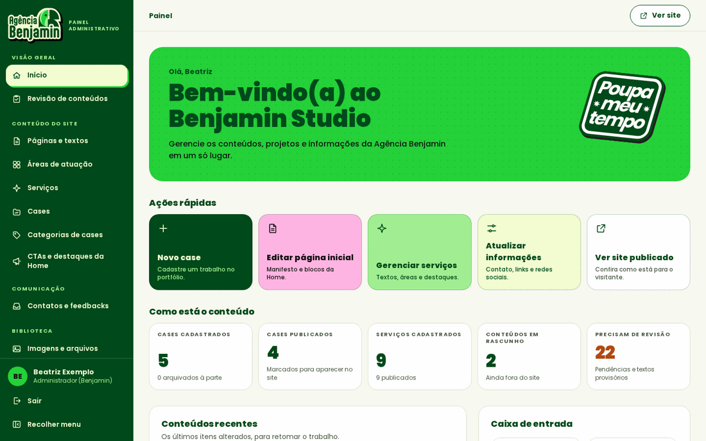
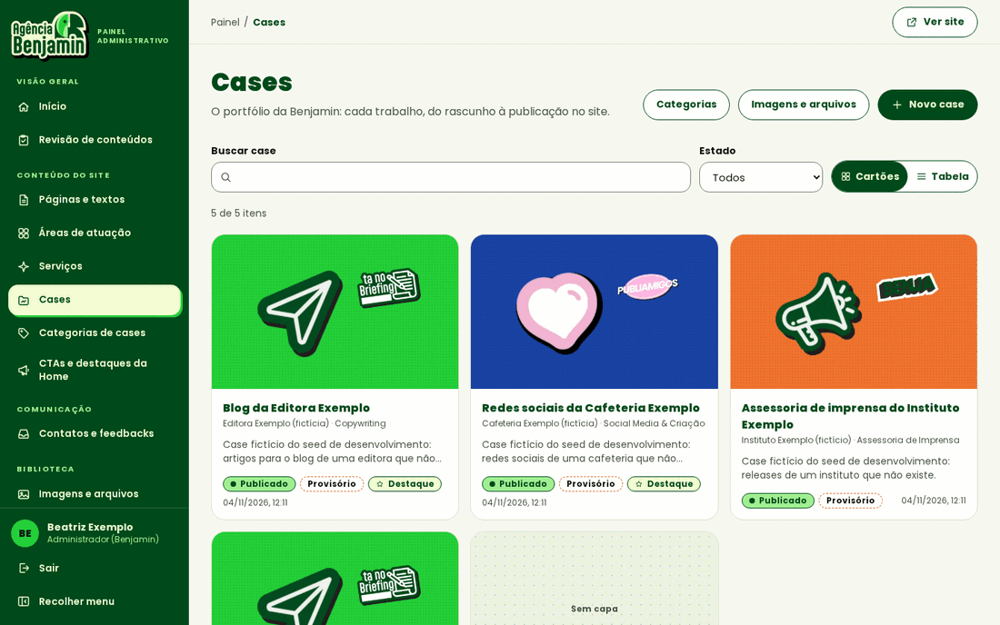
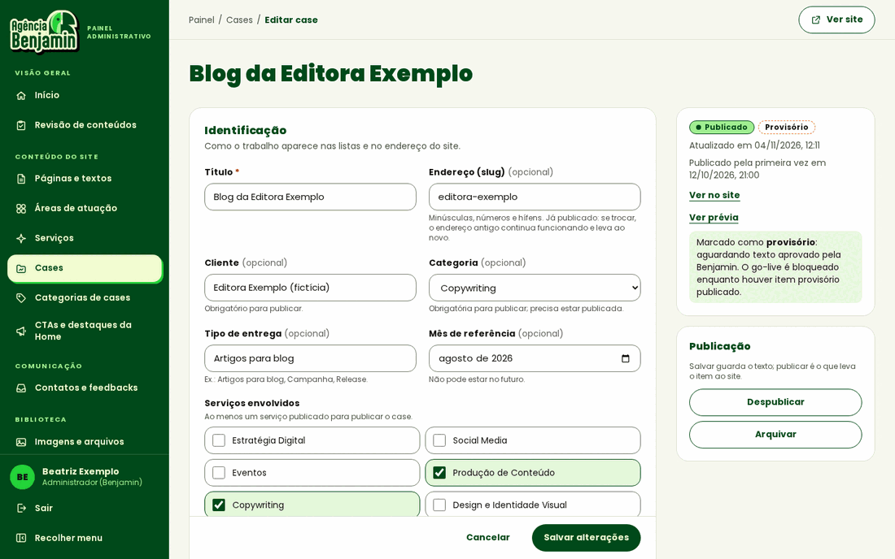
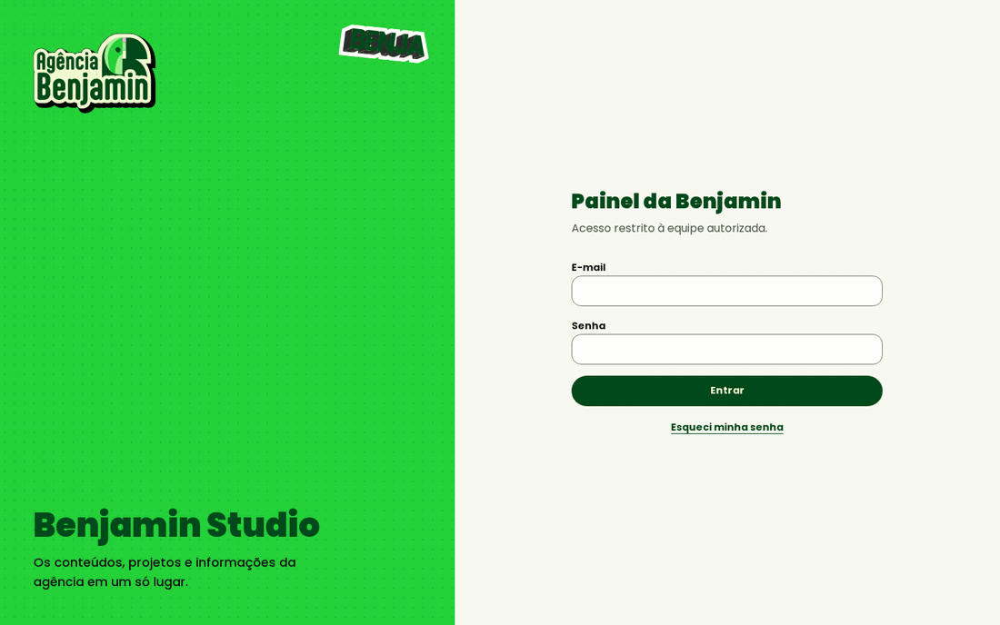
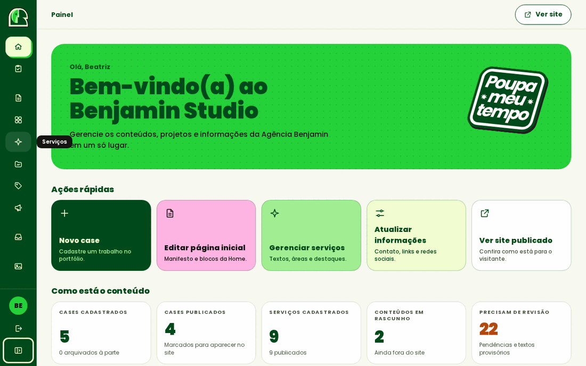
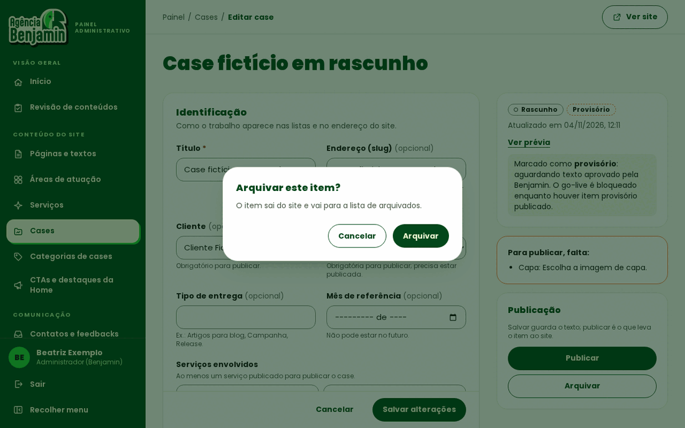
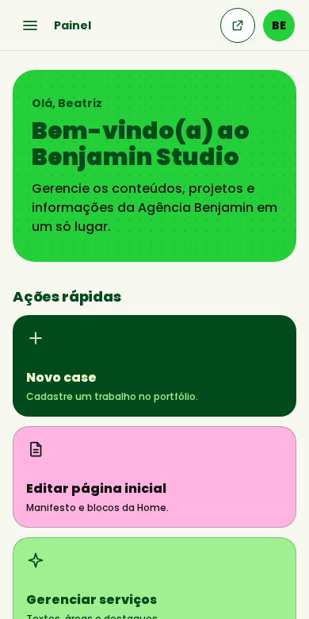
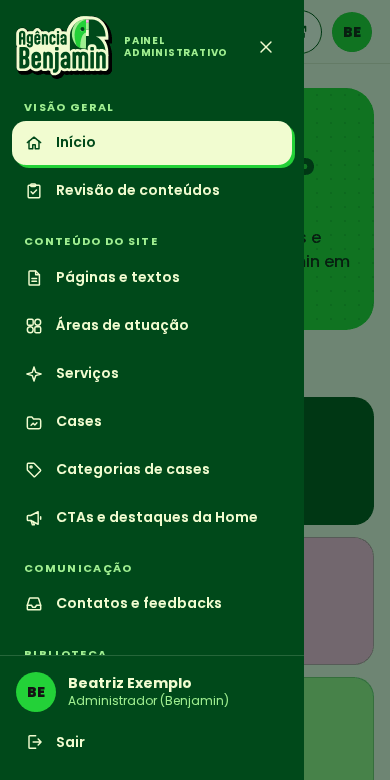
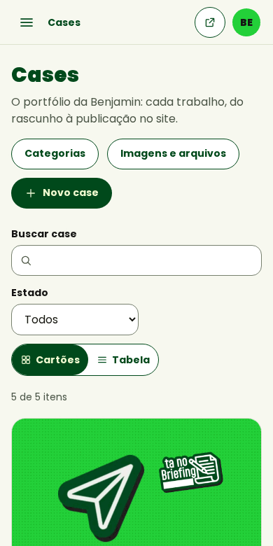

# Design system do painel (Benjamin Studio)

Como o painel administrativo é construído visualmente. As cores de marca seguem o
[Guia de Marca 2025](../../assets/brand/brandbook/brandbook-agencia-benjamin.pdf) e não foram alteradas. O site público não
usa nada daqui: os estilos de campo só valem dentro da classe `.studio`.

## Princípios

- **A marca aparece onde é decisão, não em todo lugar.** O campo verde-lima com retícula fica na abertura do início e
  nas telas de acesso, como nas capas do brandbook. O trabalho do dia a dia acontece sobre fundo claro.
- **A sombra dura é um destaque.** Ela vem do logotipo e dos stickers, e só aparece no item ativo do menu, no botão
  principal e nos cartões inteiros clicáveis, ao passar o mouse ou focar.
- **Nada fictício.** Todo número vem do banco. Módulo sem tela não aparece no menu. Indicador que o papel não pode ver
  não vira zero: ele some.
- **Estado em texto.** Selos e avisos dizem o que significam. A cor só reforça.

## Onde fica cada coisa

| O quê | Arquivo |
| ----- | ------- |
| Tokens, utilitários e aparência dos campos | `app/admin/studio.css` |
| Menu, grupos e trilha | `lib/config/admin-modules.ts` |
| Casca: menu lateral, gaveta, cabeçalho e perfil | `components/admin/panel-shell.tsx`, `components/admin/panel-menu.tsx` |
| Ícones de interface | `components/admin/ui/icons.tsx` |
| Avatar, aviso, painel, seção de formulário, estado vazio, indicador e espera | `components/admin/ui/primitives.tsx` |
| Janela de confirmação | `components/admin/ui/confirm-form.tsx` |
| Aviso de alteração não salva | `components/admin/ui/unsaved-guard.tsx` |
| Lista com busca, filtro e duas visões | `components/admin/cms/content-board.tsx` |
| Escolha de imagem com prévia | `components/admin/cms/media-picker.tsx` |
| Dados do início (regra pura e leitura) | `lib/domain/content/dashboard.ts`, `lib/server/cms/dashboard.ts` |

## Tokens

| Papel | Token | Valor |
| ----- | ----- | ----- |
| Fundo das telas | `studio-papel` | `#f7f8ef` |
| Realce (linha em foco, espera) | `studio-realce` | `#f0f4e0` |
| Divisórias | `studio-linha` | `#dde2cf` |
| Borda de campo (4,1:1 sobre branco) | `studio-controle` | `#77806e` |
| Texto secundário (7,8:1 sobre branco) | `studio-suave` | `#4b5546` |
| Número que pede atenção (5,4:1 sobre branco) | `benja-laranja-texto` | `#b34a0f` |
| Raios | `rounded-studio-sm/md/lg/xl` | 10, 14, 20 e 28 px |
| Sombra da marca | `shadow-studio-pop`, `shadow-studio-pop-lima` | 3 px, sem desfoque |
| Sombra de janela | `shadow-studio-flutuante` | Só em janela e menu aberto |
| Curva das transições | `ease-studio` | 140 a 200 ms |
| Largura do menu | `w-studio-menu`, `w-studio-menu-recolhido` | 272 e 80 px |

Os espaçamentos são os do Tailwind, em múltiplos de 4 px. O laranja da marca não serve para texto sobre branco (2,9:1),
então ele fica em bordas e em fundos, com texto escuro.

## Utilitários

| Classe | Uso |
| ------ | --- |
| `studio-card` | Superfície padrão de conteúdo |
| `studio-card-ativo` | Cartão inteiro clicável |
| `studio-btn` + `studio-btn-primario`, `-secundario`, `-sutil` ou `-perigo` | Botões e links com cara de botão |
| `studio-link` | Link dentro de texto ou de painel |
| `studio-rotulo` | Rótulo curto em caixa alta |
| `studio-titulo-secao` | Título de seção |
| `studio-tabela` | Tabela de lista |
| `studio-reticula` | Retícula da marca |

## Regras ao criar uma tela

1. Comece por `CmsHeader`, com título e uma frase dizendo para que a tela serve. A trilha vem do endereço: cadastre o
   módulo em `ADMIN_MODULES`, com `itemLabel` e `newLabel`.
2. Agrupe formulário longo com `FormSection`. Use os campos de `components/forms/fields.tsx`.
3. Salvar usa `CmsFormShell`, que já traz o aviso de alteração não salva e impede envio duplo.
4. Ação que tira algo do site ou apaga dado usa `ConfirmForm`. A janela só pergunta: quem decide é o servidor.
5. Esconder botão não protege nada. Cada página e cada ação continuam conferindo a permissão no servidor.
6. Nome de tela é para quem não programa: "Editar página inicial", nunca termos técnicos.

## A validar com a agência

- O nome **Benjamin Studio**, que aparece no início e nas telas de acesso.
- O uso dos stickers `poupa-meu-tempo` e `benja` nessas telas.
- Tamanho do símbolo no menu recolhido (44 px): o brandbook define mínimo para o logotipo (70 px), não para o símbolo.
- A fonte Aptly continua fora, porque depende de licença (LAY-06). Os títulos usam Poppins Black.

## Evidências

Capturas de 04/11/2026, em ambiente local e com dados fictícios.

| Início | Cases | Edição de case |
| ------ | ----- | -------------- |
|  |  |  |

| Login | Menu recolhido | Confirmação |
| ----- | -------------- | ----------- |
|  |  |  |

| Início no celular | Menu no celular | Cases no celular |
| ----------------- | --------------- | ---------------- |
|  |  |  |
