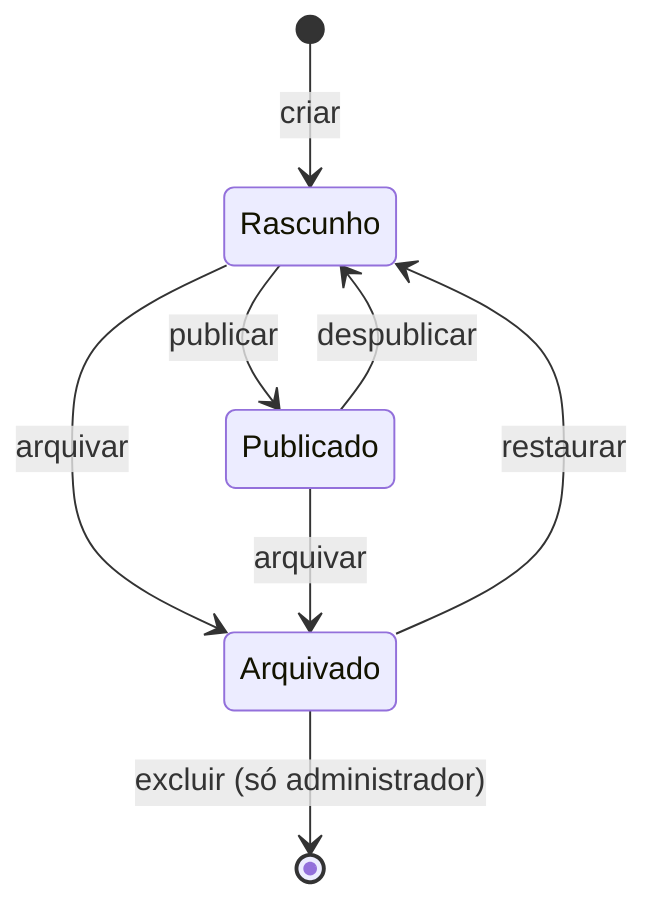

# Guia do painel (CMS)

Como a equipe da Agência Benjamin atualiza o site pelo painel, sem depender do NúcleoTech.
Acesso em `/admin` com a conta convidada (INT-08).

## Primeiros passos: entrar e sair do painel

### Receber o convite (só na primeira vez)

1. A coordenação da Benjamin indica quem deve ter acesso e o NúcleoTech envia um convite para o e-mail
   institucional da pessoa.
2. Abra o e-mail, clique no link e defina a sua senha na tela "Defina sua senha" (botão **Salvar senha**).
   Ninguém da equipe conhece ou recebe a sua senha.
3. Se o link disser "inválido ou expirou", peça um novo convite ao NúcleoTech.

### Entrar

1. Acrescente `/admin` ao endereço do site. A tela "Painel da Benjamin" pede e-mail e senha.
2. Preencha e clique em **Entrar**.
3. Confira no topo da tela o seu nome e o seu **papel** (Administrador, Editor ou Leitor).

| O que aparece                         | O que significa                          | O que fazer                                                           |
| ------------------------------------- | ---------------------------------------- | --------------------------------------------------------------------- |
| "Acesso pendente"                     | A conta existe, mas ainda não tem papel  | A coordenação da Benjamin pede ao NúcleoTech que atribua o papel      |
| "Sem permissão"                       | O seu papel não permite aquela área      | Volte ao início; se precisar da área, peça outro papel                |
| "Sua sessão expirou. Entre novamente" | A sessão acabou                          | Entre de novo; o que não foi salvo se perde                           |

### Esqueci a senha

Na tela de login, clique em **Esqueci minha senha**, informe o e-mail e clique em **Enviar link**. Abra o
e-mail, defina a nova senha e entre.

### Sair

Clique em **Sair**, no canto superior direito. Faça isso sempre que usar um computador compartilhado.
Não compartilhe a senha nem o link recebido por e-mail.

No início do painel, módulos marcados como "Em construção" (como contato e redes sociais) ainda não podem
ser editados por aqui.

## Editar e publicar, passo a passo

O fluxo é o mesmo para áreas, serviços, categorias e cases. O exemplo usa um serviço.

1. **Abrir.** No início, clique em **Serviços** e depois no item. Para criar, use **Novo serviço**: todo
   item novo nasce como Rascunho e não aparece no site.
2. **Editar.** Altere os campos. Se precisar de imagem, envie-a antes na **Biblioteca de mídia** (com
   texto alternativo) e escolha-a no formulário.
3. **Salvar.** Clique em **Salvar alterações**. Em rascunho, nada vai ao ar. Em item **já publicado**,
   salvar já muda o site.
4. **Conferir o que falta.** A lista "Para publicar, falta:", ao lado do formulário, mostra o que ainda
   precisa ser preenchido.
5. **Publicar.** Com a lista vazia, clique em **Publicar**. O item passa a aparecer no site.
6. **Conferir no site.** Abra a página pública do item (por exemplo, `/servicos/<endereço>`) e confira
   texto, imagem e links.
7. **Corrigir, se preciso.** Ajuste e salve de novo, ou clique em **Despublicar** para tirar o item do
   site (ele volta a Rascunho).

O painel não tem botão de pré-visualização: a conferência é feita na página pública depois de publicar.
Conteúdo novo que ainda não deve aparecer fica em Rascunho até a aprovação da Benjamin.

Se aparecer uma mensagem de erro, consulte "Mensagens comuns", mais abaixo.

## Estados de um conteúdo

| Estado | O que significa | Aparece no site? |
| ------ | --------------- | ---------------- |
| **Rascunho** | Em preparação. Todo item novo nasce assim | Não |
| **Publicado** | Visível no site e na API pública | Sim |
| **Arquivado** | Saiu do site e da lista principal; pode voltar como rascunho | Não |

- **Publicar** só funciona com o conteúdo completo. O painel mostra, ao lado do formulário, a
  lista "Para publicar, falta" com o que ainda precisa ser preenchido.
- **Editar algo publicado** mantém o item no site: ao salvar, o painel confere de novo se está
  completo e o site já mostra a versão nova.
- **Item arquivado** não é editável: restaure como rascunho primeiro.
- **Excluir** é definitivo e só existe para itens arquivados, feito por administrador.
- **Endereço (slug)** é a parte final do link (ex.: `/servicos/social-media`). Deixe em branco
  para o painel gerar a partir do nome (ou título, no case). Depois da primeira publicação:
  - **serviço e case**: o endereço pode mudar, e o antigo continua funcionando, levando ao novo;
  - **área e categoria**: o endereço não muda mais, porque o link já circulou.

  O endereço de um item que já foi publicado não pode ser usado por outro item, nem depois de
  excluído: quem tiver o link antigo nunca cai em outro conteúdo.

## O que cada papel pode fazer

| Papel | Ver | Criar e editar | Publicar, despublicar, arquivar | Excluir |
| ----- | --- | -------------- | ------------------------------- | ------- |
| Leitor | Sim | — | — | — |
| Editor | Sim | Sim | Sim | — |
| Administrador | Sim | Sim | Sim | Sim |

Matriz completa em [perfis e permissões](../seguranca/perfis-e-permissoes.md).

## Páginas e textos (`/admin/paginas`)

Cada rota do site (Home, Sobre, Áreas de atuação, Serviços, Cases, Contato e Privacidade) tem seções
fixas e pode ter uma página no painel. A lista mostra todas as rotas; **Criar conteúdo** abre a página
daquela rota, sempre como rascunho.

| Campo | Obrigatório para | Observação |
| ----- | ---------------- | ---------- |
| Título interno | salvar | Identifica a página no painel e na API |
| Descrição | — | Até 300 caracteres |
| Texto provisório | — | Nasce marcado. Desmarque só depois da aprovação da Benjamin: o site não mostra aviso ao visitante, mas o go-live fica bloqueado enquanto houver texto provisório publicado |
| Blocos | publicar | Ao menos um |

Os blocos são editados um de cada vez, com **Editar**, **Subir**, **Descer** e **Excluir**. Em página
publicada, salvar um bloco muda o site na hora. A última exclusão é recusada: despublique a página antes.

| Bloco | Onde | O que faz |
| ----- | ---- | --------- |
| Manifesto | Só na Home, um | **Substitui** o manifesto do topo da Home |
| Sobre a Benjamin | Só em Sobre, um | **Substitui** os textos de quem somos, proposta, modelo de atuação e FECAP, em Sobre e na Home |
| Texto | Qualquer página | Título opcional e parágrafos, um por linha (até 12) |
| Lista de destaques | Qualquer página | Um item por linha: `Título \| texto opcional` (até 12) |
| Nosso time | Qualquer página | Nome, cargo e foto da biblioteca, na ordem da tela. Publique só o que a pessoa autorizou. Sem esse bloco, a seção não existe no site. A foto fica gravada no bloco: se trocar a imagem na biblioteca, escolha de novo |
| Chamada para ação | Qualquer página | Título, texto, botão e destino (rota do site ou link https) |

Sem página publicada, o site continua com os textos atuais de cada seção. Despublicar ou arquivar a
página devolve esses textos. Contato, redes sociais e CTAs têm telas próprias (ADM-10 e ADM-11).

## Áreas de atuação (`/admin/areas`)

| Campo | Obrigatório para | Observação |
| ----- | ---------------- | ---------- |
| Nome | salvar | Até 120 caracteres |
| Endereço (slug) | salvar | Minúsculas, números e hífens; único entre as áreas |
| Resumo | publicar | 10 a 200 caracteres; aparece no card |
| Descrição | publicar | Mínimo de 20 caracteres |
| Destaques | — | Um por linha, até 12 |
| Ícone | — | Um dos 14 ícones oficiais do brandbook |
| Ordem | — | Menor aparece primeiro |

O vínculo entre área e serviço é feito no cadastro do serviço. Uma área **não pode ser arquivada
nem despublicada** se algum serviço publicado ficaria sem nenhuma área publicada — o painel lista
quais são.

## Serviços (`/admin/servicos`)

| Campo | Obrigatório para | Observação |
| ----- | ---------------- | ---------- |
| Nome | salvar | Até 120 caracteres |
| Endereço (slug) | salvar | Vira o link `/servicos/<slug>`; único entre os serviços |
| Resumo | publicar | 10 a 200 caracteres; aparece no card |
| Descrição | publicar | Mínimo de 20 caracteres; texto da página do serviço |
| Exemplos de entregas | — | Um por linha, até 12 |
| Áreas de atuação | publicar | Ao menos uma; áreas em rascunho não aparecem no site |
| Ícone | — | Um dos 14 ícones oficiais |
| Imagem | — | Escolhida na biblioteca de mídia; precisa de texto alternativo |
| Destaque na Home | — | Até 6 serviços publicados em destaque (acima disso o painel avisa) |
| Ordem | — | Menor aparece primeiro |

A página pública do serviço já traz o botão de contato com o serviço pré-selecionado no
formulário. Um serviço **não pode ser arquivado nem despublicado** se for o único serviço de algum
case publicado — o painel lista quais cases.

## Biblioteca de mídia (`/admin/midia`)

Envie aqui as imagens antes de usá-las em cases e serviços. Nos formulários, o link **Enviar imagem
para a biblioteca** abre esta tela e, depois do envio, volta para o item que você estava editando
(salve o que já digitou antes de sair).

| Regra | Valor |
| ----- | ----- |
| Formatos | JPG, PNG, WebP e AVIF até 5 MB; PDF até 10 MB. Arquivo maior é recusado antes do envio: reduza (para imagens, exporte em WebP). SVG não é aceito |
| Tamanho da imagem | Até 4000 px no maior lado; recomendado 2400 px de largura |
| Texto alternativo | Obrigatório (3 a 160 caracteres), exceto se a imagem for marcada como decorativa |

O arquivo é conferido pelo conteúdo, não só pela extensão: um arquivo renomeado é recusado.

### Detalhes de um arquivo

Na lista, **Detalhes** abre o arquivo, com três coisas:

- **Onde é usado:** os serviços, cases e páginas que usam o arquivo, em qualquer estado.
- **Texto alternativo:** quem edita mídia pode corrigir e clicar em **Salvar alterações**. Imagem em
  conteúdo publicado ou no bloco "Nosso time" não pode virar decorativa. Se o arquivo for foto do bloco,
  abra a página e salve o bloco de novo: ele guarda uma cópia do texto.
- **Excluir arquivo** (Administrador): só aparece se nenhum conteúdo usa o arquivo, inclusive rascunhos e
  arquivados. Quem tem a imagem em uso precisa trocá-la antes. A exclusão não tem volta: o arquivo sai da
  biblioteca e do armazenamento.

## Categorias de cases (`/admin/categorias`)

Nome e endereço bastam para publicar. Uma categoria **não pode ser despublicada nem arquivada**
enquanto houver case publicado nela, e **não pode ser excluída** enquanto qualquer case (até
rascunho ou arquivado) a usar — o painel lista quais.

## Cases (`/admin/cases`)

| Campo | Obrigatório para | Observação |
| ----- | ---------------- | ---------- |
| Título e endereço (slug) | salvar | O link fica `/cases/<slug>` |
| Cliente | publicar | |
| Categoria | publicar | Precisa estar publicada |
| Serviços envolvidos | publicar | Ao menos um serviço publicado |
| Resumo | publicar | 30 a 280 caracteres |
| Capa | publicar | Imagem da biblioteca com texto alternativo |
| Galeria | — | Até 20 imagens, na ordem de envio |
| Desafio, solução, resultados | — | Resultados só reais e autorizados |
| Links externos | — | Um por linha: `Rótulo \| https://endereço` (até 10). Para clipping de imprensa, acrescente veículo e data: `Matéria \| https://… \| Estadão \| 2026-09-15` |
| Mês de referência | — | Não pode estar no futuro |
| Equipe | — | Um nome por linha, só com autorização |
| Destaque na Home | — | Até 6 cases em destaque |

Dá para salvar o case aos poucos, enquanto o material da Benjamin chega: a lista "Para publicar,
falta" mostra primeiro os campos vazios e, depois de completos, as regras que dependem de outros
conteúdos (como a categoria estar publicada).

## Mensagens comuns

| Mensagem | O que fazer |
| -------- | ----------- |
| "Ainda falta conteúdo para publicar" | Complete os itens listados e publique de novo |
| "O conteúdo foi alterado por outra pessoa" | Outra pessoa salvou o mesmo item depois que você abriu a tela. Recarregue a página e refaça a alteração |
| "Esta operação deixaria páginas do site quebradas" | Resolva os itens listados (ex.: vincule o serviço a outra área) antes de arquivar |
| "Já existe um item com este endereço" | Escolha outro slug |
| "Não foi possível registrar a operação na auditoria" | Nada foi alterado. Tente de novo; se persistir, envie o código de atendimento ao NúcleoTech |

Toda publicação, despublicação, arquivamento e exclusão fica registrada na trilha de auditoria
com quem fez e quando (TECH-10).
