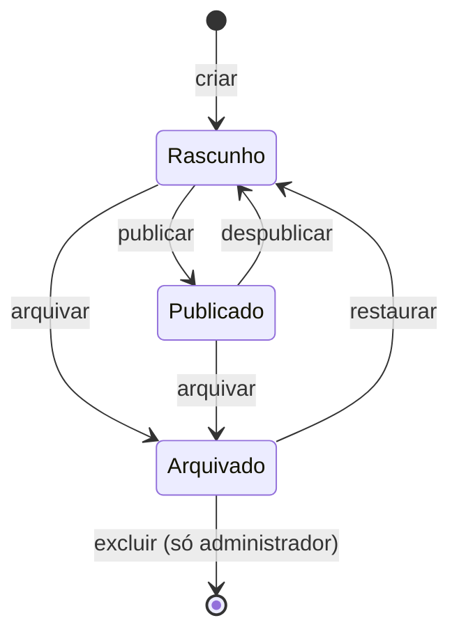

# Guia do painel (CMS)

Como a equipe da Agência Benjamin atualiza o site pelo painel, sem depender do NúcleoTech.
Acesso em `/admin` com a conta convidada (INT-08).

## Primeiros passos: entrar e sair do painel

### Receber o convite (só na primeira vez)

1. A coordenação da Benjamin indica quem deve ter acesso e o NúcleoTech envia um convite para o e-mail
   institucional da pessoa.
2. Abra o e-mail, clique no link e defina a sua senha na tela "Defina sua senha" (botão **Salvar senha**).
   Ninguém da equipe conhece ou recebe a sua senha.
3. Se o link disser "inválido ou expirou", peça um novo convite ao NúcleoTech.

### Entrar

1. Acrescente `/admin` ao endereço do site. A tela "Painel da Benjamin" pede e-mail e senha.
2. Preencha e clique em **Entrar**.
3. Confira no topo da tela o seu nome e o seu **papel** (Administrador, Editor ou Leitor).

| O que aparece                         | O que significa                          | O que fazer                                                           |
| ------------------------------------- | ---------------------------------------- | --------------------------------------------------------------------- |
| "Acesso pendente"                     | A conta existe, mas ainda não tem papel  | A coordenação da Benjamin pede ao NúcleoTech que atribua o papel      |
| "Sem permissão"                       | O seu papel não permite aquela área      | Volte ao início; se precisar da área, peça outro papel                |
| "Sua sessão expirou. Entre novamente" | A sessão acabou                          | Entre de novo; o que não foi salvo se perde                           |

### Esqueci a senha

Na tela de login, clique em **Esqueci minha senha**, informe o e-mail e clique em **Enviar link**. Abra o
e-mail, defina a nova senha e entre.

### Sair

Clique em **Sair**, no canto superior direito. Faça isso sempre que usar um computador compartilhado.
Não compartilhe a senha nem o link recebido por e-mail.

No início do painel, módulos marcados como "Em construção" (como usuários e papéis) ainda não podem ser usados
por aqui.

## Editar e publicar, passo a passo

O fluxo é o mesmo para áreas, serviços, categorias, cases e CTAs. O exemplo usa um serviço.

1. **Abrir.** No início, clique em **Serviços** e depois no item. Para criar, use **Novo serviço**: todo
   item novo nasce como Rascunho e não aparece no site.
2. **Editar.** Altere os campos. Se precisar de imagem, envie-a antes na **Biblioteca de mídia** (com
   texto alternativo) e escolha-a no formulário.
3. **Salvar.** Clique em **Salvar alterações**. Em rascunho, nada vai ao ar. Em item **já publicado**,
   salvar já muda o site.
4. **Conferir o que falta.** A lista "Para publicar, falta:", ao lado do formulário, mostra o que ainda
   precisa ser preenchido.
5. **Publicar.** Com a lista vazia, clique em **Publicar**. O item passa a aparecer no site.
6. **Conferir no site.** Abra a página pública do item (por exemplo, `/servicos/<endereço>`) e confira
   texto, imagem e links.
7. **Corrigir, se preciso.** Ajuste e salve de novo, ou clique em **Despublicar** para tirar o item do
   site (ele volta a Rascunho).

O painel não tem botão de pré-visualização: a conferência é feita na página pública depois de publicar.
Conteúdo novo que ainda não deve aparecer fica em Rascunho até a aprovação da Benjamin.

Se aparecer uma mensagem de erro, consulte "Mensagens comuns", mais abaixo.

## Estados de um conteúdo

| Estado | O que significa | Aparece no site? |
| ------ | --------------- | ---------------- |
| **Rascunho** | Em preparação. Todo item novo nasce assim | Não |
| **Publicado** | Visível no site e na API pública | Sim |
| **Arquivado** | Saiu do site e da lista principal; pode voltar como rascunho | Não |

- **Publicar** só funciona com o conteúdo completo. O painel mostra, ao lado do formulário, a
  lista "Para publicar, falta" com o que ainda precisa ser preenchido.
- **Editar algo publicado** mantém o item no site: ao salvar, o painel confere de novo se está
  completo e o site já mostra a versão nova.
- **Item arquivado** não é editável: restaure como rascunho primeiro.
- **Excluir** é definitivo e só existe para itens arquivados, feito por administrador.
- **Endereço (slug)** é a parte final do link (ex.: `/servicos/social-media`). Deixe em branco
  para o painel gerar a partir do nome (ou título, no case). Depois da primeira publicação:
  - **serviço e case**: o endereço pode mudar, e o antigo continua funcionando, levando ao novo;
  - **área e categoria**: o endereço não muda mais, porque o link já circulou.

  O endereço de um item que já foi publicado não pode ser usado por outro item, nem depois de
  excluído: quem tiver o link antigo nunca cai em outro conteúdo.

## O que cada papel pode fazer

| Papel | Ver | Criar e editar | Publicar, despublicar, arquivar | Excluir |
| ----- | --- | -------------- | ------------------------------- | ------- |
| Leitor | Sim | — | — | — |
| Editor | Sim | Sim | Sim | — |
| Administrador | Sim | Sim | Sim | Sim |

Contato, links e redes sociais são uma exceção: só o Administrador altera. Veja a seção própria, abaixo.

Leads e feedbacks têm dados pessoais: só o Administrador vê. O NúcleoTech (Super administrador), o
Editor e o Leitor recebem "Sem permissão". A lista de quem pode ver ainda aguarda a aprovação da Benjamin.

Matriz completa em [perfis e permissões](../seguranca/perfis-e-permissoes.md).

## Menu do painel

O menu fica à esquerda no computador. No celular e no tablet, use o botão **Abrir menu**, logo abaixo do
cabeçalho; ele fecha com **Fechar menu**, com a tecla Esc ou ao escolher um módulo. O item da tela atual
fica destacado.

- Cada pessoa vê só os módulos que o papel permite: Editor e Leitor não veem Leads, Usuários nem
  Auditoria. Isso é só o que aparece: cada tela e cada ação conferem de novo a permissão no servidor.
- **Em construção** marca módulo sem tela ainda, como usuários e papéis. Não é link e nada pode ser editado
  por ali.
- Pelo teclado, o primeiro Tab da página oferece **Pular para o conteúdo**, sem passar pelo menu.

O início do painel (`/admin`) mostra os mesmos módulos em cartões.

## Visão geral dos conteúdos (`/admin/conteudos`)

Reúne em uma tela páginas, áreas, serviços, categorias e cases: o que está publicado, o estado de cada
item, quando foi atualizado e o link para abrir. Use aqui para saber o que falta antes de publicar ou de
pedir aprovação.

**Precisa de revisão** lista, primeiro o que já está no site:

| O que aparece | O que significa | O que fazer |
| ------------- | --------------- | ----------- |
| "Para publicar, falta:" | Rascunho incompleto: a mesma lista que aparece ao lado do formulário | Complete quando o material chegar. Ninguém é obrigado a publicar |
| "No ar com pendências:" | Item publicado que não passaria na conferência hoje (por exemplo, a categoria dele saiu do ar) | Corrija o item, ou o conteúdo de que ele depende |
| "Avisos:" | Item publicado com algo a decidir: serviço sem área publicada, destaques acima do limite, página sem rota no site ou data de publicação futura | Avalie: o site segue de pé |
| "Textos provisórios, sem outra pendência" | Item marcado como provisório, sem outro problema. A lista começa recolhida; clique para abrir | Desmarque só depois da aprovação da Benjamin. Enquanto houver texto provisório publicado, o go-live fica bloqueado |

Ficam fora da fila: item publicado em dia, rascunho completo (na coluna **Revisão** aparece "Pronto para
publicar") e arquivado, que já saiu do site. Publicar continua sendo decisão de quem edita.

Editor e Administrador veem **Editar**; o Leitor vê **Ver**, que abre o item sem poder salvar. Se a tela
mostrar "Algo deu errado", o conteúdo não foi lido e a lista não diz nada sobre ele: tente de novo e, se
persistir, envie o código ao NúcleoTech.

## Páginas e textos (`/admin/paginas`)

Cada rota do site (Home, Sobre, Áreas de atuação, Serviços, Cases, Contato e Privacidade) tem seções
fixas e pode ter uma página no painel. A lista mostra todas as rotas; **Criar conteúdo** abre a página
daquela rota, sempre como rascunho.

| Campo | Obrigatório para | Observação |
| ----- | ---------------- | ---------- |
| Título interno | salvar | Identifica a página no painel e na API |
| Descrição | — | Até 300 caracteres |
| Texto provisório | — | Nasce marcado. Desmarque só depois da aprovação da Benjamin: o site não mostra aviso ao visitante, mas o go-live fica bloqueado enquanto houver texto provisório publicado |
| Blocos | publicar | Ao menos um |

Os blocos são editados um de cada vez, com **Editar**, **Subir**, **Descer** e **Excluir**. Em página
publicada, salvar um bloco muda o site na hora. A última exclusão é recusada: despublique a página antes.

| Bloco | Onde | O que faz |
| ----- | ---- | --------- |
| Manifesto | Só na Home, um | **Substitui** o manifesto do topo da Home |
| Sobre a Benjamin | Só em Sobre, um | **Substitui** os textos de quem somos, proposta, modelo de atuação e FECAP, em Sobre e na Home |
| Texto | Qualquer página | Título opcional e parágrafos, um por linha (até 12) |
| Lista de destaques | Qualquer página | Um item por linha: `Título \| texto opcional` (até 12) |
| Nosso time | Qualquer página | Nome, cargo e foto da biblioteca, na ordem da tela. Publique só o que a pessoa autorizou. Sem esse bloco, a seção não existe no site. A foto fica gravada no bloco: se trocar a imagem na biblioteca, escolha de novo |
| Chamada para ação | Qualquer página | Título, texto, botão e destino (rota do site ou link https) |

Sem página publicada, o site continua com os textos atuais de cada seção. Despublicar ou arquivar a
página devolve esses textos. Contato, redes sociais e CTAs têm telas próprias (ADM-10 e ADM-11).

## Áreas de atuação (`/admin/areas`)

| Campo | Obrigatório para | Observação |
| ----- | ---------------- | ---------- |
| Nome | salvar | Até 120 caracteres |
| Endereço (slug) | salvar | Minúsculas, números e hífens; único entre as áreas |
| Resumo | publicar | 10 a 200 caracteres; aparece no card |
| Descrição | publicar | Mínimo de 20 caracteres |
| Destaques | — | Um por linha, até 12 |
| Ícone | — | Um dos 14 ícones oficiais do brandbook |
| Ordem | — | Menor aparece primeiro |

O vínculo entre área e serviço é feito no cadastro do serviço. Uma área **não pode ser arquivada
nem despublicada** se algum serviço publicado ficaria sem nenhuma área publicada — o painel lista
quais são.

## Serviços (`/admin/servicos`)

| Campo | Obrigatório para | Observação |
| ----- | ---------------- | ---------- |
| Nome | salvar | Até 120 caracteres |
| Endereço (slug) | salvar | Vira o link `/servicos/<slug>`; único entre os serviços |
| Resumo | publicar | 10 a 200 caracteres; aparece no card |
| Descrição | publicar | Mínimo de 20 caracteres; texto da página do serviço |
| Exemplos de entregas | — | Um por linha, até 12 |
| Áreas de atuação | publicar | Ao menos uma; áreas em rascunho não aparecem no site |
| Ícone | — | Um dos 14 ícones oficiais |
| Imagem | — | Escolhida na biblioteca de mídia; precisa de texto alternativo |
| Destaque na Home | — | Até 6 serviços publicados em destaque. Acima disso o painel avisa e a Home mostra os 6 primeiros, pela ordem |
| Ordem | — | Menor aparece primeiro |

A página pública do serviço já traz o botão de contato com o serviço pré-selecionado no
formulário. Um serviço **não pode ser arquivado nem despublicado** se for o único serviço de algum
case publicado — o painel lista quais cases.

## Contato, links e redes sociais (`/admin/configuracoes`)

**Salvar vai direto ao ar.** Esta tela não tem rascunho nem botão de publicar: ao clicar em **Salvar e
colocar no ar**, o site muda para todos os visitantes. Confira os links antes de salvar.

Só o **Administrador** altera. Editor e Leitor abrem a tela em modo leitura; se algo precisar mudar, peçam à
coordenação da Benjamin.

| Campo | Regra | Onde aparece |
| ----- | ----- | ------------ |
| E-mail | Opcional. Um endereço válido | Rodapé e página de contato |
| Telefone | Opcional. Com DDD, só números, espaços, parênteses e hífen | Rodapé e página de contato |
| Endereço | Opcional. Até 200 caracteres | Rodapé e página de contato |
| Link do mapa | Opcional. Link completo começando com `https://`. Exige o endereço, porque abre a partir dele | Vira o link do endereço |
| Instagram, TikTok, LinkedIn | Opcionais. Link completo começando com `https://`, no site da própria rede | Ícones do rodapé e da página de contato |
| Slogan | Obrigatório. Até 120 caracteres | Rodapé |
| Descrição da agência | Obrigatória. De 50 a 300 caracteres | Rodapé e resumo do site nas buscas |

- **Campo em branco não aparece no site.** Sem endereço, o item some; sem mapa, o endereço aparece como
  texto, sem link; sem uma rede, o ícone dela some.
- **Link recusado:** o painel mostra o erro embaixo do campo e não muda nada no site. Só são aceitos links
  `https://`. Se copiou o link sem o começo (por exemplo, `instagram.com/benja`), inclua `https://www.`.
- **Duas pessoas na mesma tela:** quem salvar por último recebe "O conteúdo foi alterado por outra pessoa".
  Recarregue a página e refaça a alteração.
- **Quem alterou:** cada gravação fica na trilha de auditoria, com autor, data e os nomes dos campos
  alterados, sem guardar os valores.

O que **não** se edita aqui:

- **Manifesto e textos do Sobre:** ficam em **Páginas e textos**, com rascunho e publicação. Manter uma fonte
  só evita dúvida sobre qual texto vale.
- **Quem recebe os formulários do site:** é definido pelo NúcleoTech, fora do painel. Trocar o e-mail desta
  tela muda só o que aparece no site, e não o destino das mensagens.
- **Nome da agência:** também está no logotipo, no rodapé e em outros pontos fixos do site. Se precisar mudar,
  fale com o NúcleoTech.

Os dados oficiais de contato ainda dependem da definição da agência (CON-10). Esta tela só altera o que
estiver no site: preencher um campo aqui não conta como aprovação.

## Biblioteca de mídia (`/admin/midia`)

Envie aqui as imagens antes de usá-las em cases e serviços. Nos formulários, o link **Enviar imagem
para a biblioteca** abre esta tela e, depois do envio, volta para o item que você estava editando
(salve o que já digitou antes de sair).

| Regra | Valor |
| ----- | ----- |
| Formatos | JPG, PNG, WebP e AVIF até 5 MB; PDF até 10 MB. Arquivo maior é recusado antes do envio: reduza (para imagens, exporte em WebP). SVG não é aceito |
| Tamanho da imagem | Até 4000 px no maior lado; recomendado 2400 px de largura |
| Texto alternativo | Obrigatório (3 a 160 caracteres), exceto se a imagem for marcada como decorativa |

O arquivo é conferido pelo conteúdo, não só pela extensão: um arquivo renomeado é recusado.
Excluir arquivo e editar o texto alternativo ficam para o gerenciador completo (ADM-09).

## Categorias de cases (`/admin/categorias`)

Nome e endereço bastam para publicar. Uma categoria **não pode ser despublicada nem arquivada**
enquanto houver case publicado nela, e **não pode ser excluída** enquanto qualquer case (até
rascunho ou arquivado) a usar — o painel lista quais.

## Cases (`/admin/cases`)

| Campo | Obrigatório para | Observação |
| ----- | ---------------- | ---------- |
| Título e endereço (slug) | salvar | O link fica `/cases/<slug>` |
| Cliente | publicar | |
| Categoria | publicar | Precisa estar publicada |
| Serviços envolvidos | publicar | Ao menos um serviço publicado |
| Resumo | publicar | 30 a 280 caracteres |
| Capa | publicar | Imagem da biblioteca com texto alternativo |
| Galeria | — | Até 20 imagens, na ordem de envio |
| Desafio, solução, resultados | — | Resultados só reais e autorizados |
| Links externos | — | Um por linha: `Rótulo \| https://endereço` (até 10). Para clipping de imprensa, acrescente veículo e data: `Matéria \| https://… \| Estadão \| 2026-09-15` |
| Mês de referência | — | Não pode estar no futuro |
| Equipe | — | Um nome por linha, só com autorização |
| Destaque na Home | — | Até 6 cases em destaque. Acima disso a Home mostra os 6 primeiros, pela ordem |

Dá para salvar o case aos poucos, enquanto o material da Benjamin chega: a lista "Para publicar,
falta" mostra primeiro os campos vazios e, depois de completos, as regras que dependem de outros
conteúdos (como a categoria estar publicada).

## Leads e feedbacks (`/admin/leads`)

Tudo o que chega pelos formulários do site fica aqui, mesmo se o e-mail de aviso falhar. Só quem é
Administrador abre esta tela.

| Tipo | O que é | De onde vem |
| ---- | ------- | ----------- |
| Novo projeto | Pedido de quem quer contratar um trabalho | Contato, aba "Quero um projeto" |
| Contato institucional | Parcerias, imprensa, dúvidas, interesse em participar | Contato, aba "Fale com a gente" |
| Feedback | Avaliação de clientes, parceiros, alunos e comunidade. Pode ser anônimo | Página de feedback |

### Encontrar um envio

A lista mostra primeiro os mais novos, 20 por página. Use os filtros **Tipo**, **Status**, **Categoria**
e **Notificação** e clique em **Filtrar**; **Limpar** volta à lista completa. A categoria é o serviço
pedido, o assunto do contato ou o perfil de quem deu o feedback.

Não há busca por nome ou e-mail, porque esses dados ficariam gravados no endereço da página e no
histórico do navegador. Se a pessoa informar o protocolo (`AB-XXXXXX`, mostrado na tela de confirmação
e no e-mail de aviso), procure por ele na lista.

### Abrir e atender

1. Clique no **protocolo** para abrir o envio. Toda abertura fica registrada na trilha de auditoria, com
   quem abriu e quando.
2. Leia o conteúdo e responda pelo seu e-mail. O painel não envia resposta e não permite editar o que a
   pessoa escreveu.
3. Em **Atendimento**, escolha o novo status e clique em **Salvar status**.

| Tipo | Status disponíveis (proposta, aguardando aprovação da Benjamin) |
| ---- | --------------------------------------------------------------- |
| Novo projeto e contato | Novo → Em atendimento → Respondido → Arquivado |
| Feedback | Novo → Lido → Arquivado |

Se aparecer "O conteúdo foi alterado por outra pessoa", alguém mudou o status enquanto a sua tela estava
aberta: recarregue a página e veja se ainda precisa alterar.

### O e-mail de aviso chegou?

A coluna **Notificação** e o quadro no detalhe mostram a situação do e-mail enviado à equipe. Quando há
falha, um aviso aparece no topo da lista, com o link **Ver quais são**.

| Situação | O que significa | O que fazer |
| -------- | --------------- | ------------ |
| Enviada | O provedor aceitou o e-mail. Se a caixa de destino o devolver, o painel não fica sabendo | Nada |
| Pendente | O e-mail ainda não saiu; o reenvio automático tenta de novo | Se demorar, atenda por aqui |
| Falhou | O e-mail não chegou. O reenvio tenta até 5 vezes | **Atenda por aqui.** Depois das 5 tentativas não há novo reenvio: avise o NúcleoTech |
| Sem destinatário | Nenhum destinatário configurado neste ambiente, então nada foi enviado | Atenda por aqui. Em produção, avise o NúcleoTech |

Os destinatários de cada formulário são definidos pela Benjamin (CON-10) e ainda estão pendentes.

### Excluir a pedido da pessoa

Quando a pessoa pede a exclusão dos dados, ou no fim do prazo de retenção:

1. Mude o status para **Arquivado** e salve. O botão de excluir só aparece depois disso.
2. Clique em **Excluir definitivamente** e confirme. Não há como desfazer. A trilha de auditoria guarda
   quem excluiu e quando, sem o conteúdo.
3. **Apague também o e-mail de aviso** na caixa de quem recebeu: ele é uma cópia dos dados.

O canal e o responsável por esses pedidos ainda aguardam definição da Benjamin. Exportar para planilha,
corrigir dados e anonimizar um feedback não são feitos pelo painel: fale com o NúcleoTech.

### Cuidados

- Não encaminhe o conteúdo dos envios nem copie para planilhas ou conversas.
- O painel limpa da memória do navegador o que estava aberto quando você clica em **Sair**. Em computador
  compartilhado, saia sempre ao terminar.

## CTAs e destaques da Home (`/admin/ctas`)

CTA é o botão que leva o visitante ao próximo passo, como "Quero um projeto" ou "Ver cases". Texto e destino
são trocados aqui, sem mexer em código e sem novo deploy. O fluxo é o de sempre: o CTA nasce como rascunho,
só aparece no site depois de publicado, e despublicar tira o botão na hora.

| Campo | Obrigatório para | Observação |
| ----- | ---------------- | ---------- |
| Texto do botão | salvar | De 2 a 40 caracteres |
| Posição | salvar | Onde o botão aparece (quadro abaixo) |
| Tipo de destino | salvar | Muda o campo seguinte (quadro abaixo) |
| Ordem | — | Menor aparece primeiro **dentro da mesma posição**. O primeiro botão ganha o destaque de cor |

| Posição | Onde aparece | Sem nenhum botão publicado |
| ------- | ------------ | -------------------------- |
| Home: topo | Junto do manifesto, na primeira dobra | O topo fica só com o manifesto |
| Home: faixa final | Faixa "Tem um projeto em mente?", no fim da Home | A faixa inteira não aparece |
| Rodapé, página de serviço, página de case | **Ainda não aparecem no site.** Dá para deixar pronto, mas publicar não muda nenhuma página | — |

| Tipo de destino | Como escolher | Se o destino sair do site |
| --------------- | ------------- | ------------------------- |
| Página do site | Lista com as páginas fixas (Sobre, Serviços, Cases, Contato…) | — |
| Serviço, Case ou Área | Lista com os itens. O botão acompanha o item se o endereço dele mudar | O botão passa a levar à lista (Serviços, Cases ou Áreas) e o painel avisa. Nunca dá "página não encontrada" |
| Formulário de contato | Direto, ou com um serviço já marcado no formulário | Abre o formulário sem o serviço |
| Link externo | Link completo, começando com `https://` | — |

O painel recusa o que levaria o visitante a lugar errado:

- link sem `https://` ou com `javascript:`, espaços, usuário ou senha;
- página fora da lista. Para abrir um serviço ou case específico, use o tipo Serviço ou Case;
- botão da Home que levaria para a própria Home;
- destino que foi excluído: a lista "Para publicar, falta" pede outro. Enquanto isso, se o botão já estiver
  publicado, o site usa a lista como destino.

Ao lado do formulário, **Para onde o botão leva hoje** mostra o endereço que o visitante abre agora. Depois de
publicar, confira na Home.

### Destaques da Home

Não existe cadastro separado de destaque. Ele é marcado em cada item, na opção **Destacar na Home**:

- **Serviços em destaque**: no cadastro do serviço, em `/admin/servicos`;
- **Cases em destaque**: no cadastro do case, em `/admin/cases`.

A parte de baixo de `/admin/ctas` mostra o que está marcado, quantos estão no site e leva até cada item. Só
aparece na Home o que está publicado, até 6 de cada tipo. Sem nenhum destaque, a Home mostra um aviso no lugar
da lista, em vez de um espaço em branco.

### O que ainda não se edita por aqui

Os títulos e as descrições das seções Áreas, Serviços e Cases da Home (por exemplo, "Seis frentes, um mesmo
time.") ainda são fixos e dependem do NúcleoTech. Se uma sétima área for criada, avise para o título ser
ajustado.

## Mensagens comuns

| Mensagem | O que fazer |
| -------- | ----------- |
| "Ainda falta conteúdo para publicar" | Complete os itens listados e publique de novo |
| "O conteúdo foi alterado por outra pessoa" | Outra pessoa salvou o mesmo item depois que você abriu a tela. Recarregue a página e refaça a alteração |
| "Esta operação deixaria páginas do site quebradas" | Resolva os itens listados (ex.: vincule o serviço a outra área) antes de arquivar |
| "Já existe um item com este endereço" | Escolha outro slug |
| "Este botão já fica na Home e levaria para ela mesma" | Escolha outra página de destino para o CTA |
| "Não foi possível registrar a operação na auditoria" | Nada foi alterado. Tente de novo; se persistir, envie o código de atendimento ao NúcleoTech |

Toda publicação, despublicação, arquivamento, exclusão e alteração de contato e redes fica registrada na
trilha de auditoria com quem fez e quando (TECH-10).
