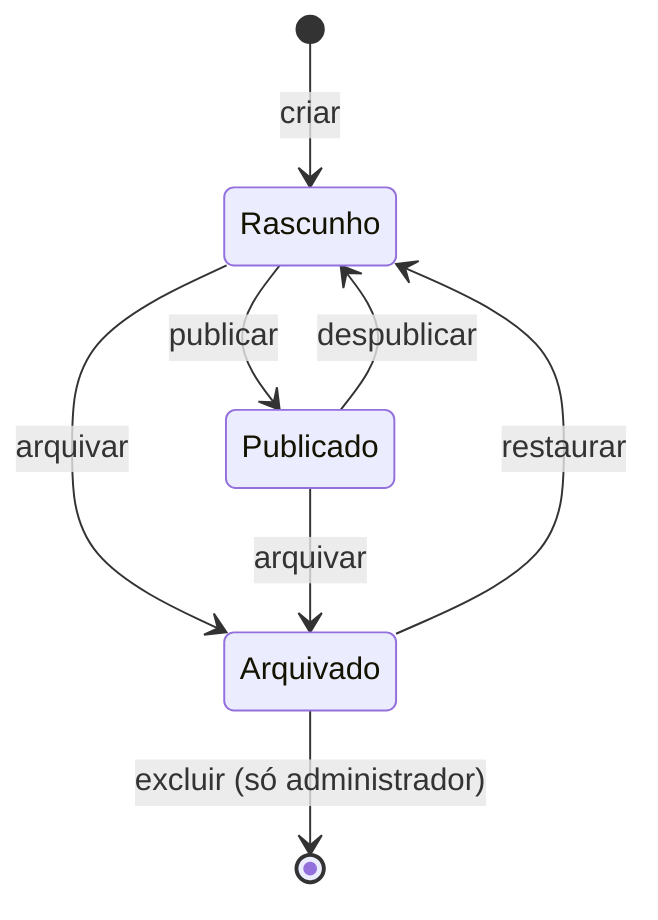

# Guia do painel (CMS)

Como a equipe da Agência Benjamin atualiza o site pelo painel, sem depender do NúcleoTech.
Acesso em `/admin` com a conta convidada (INT-08).

## Estados de um conteúdo

| Estado | O que significa | Aparece no site? |
| ------ | --------------- | ---------------- |
| **Rascunho** | Em preparação. Todo item novo nasce assim | Não |
| **Publicado** | Visível no site e na API pública | Sim |
| **Arquivado** | Saiu do site e da lista principal; pode voltar como rascunho | Não |

- **Publicar** só funciona com o conteúdo completo. O painel mostra, ao lado do formulário, a
  lista "Para publicar, falta" com o que ainda precisa ser preenchido.
- **Editar algo publicado** mantém o item no site: ao salvar, o painel confere de novo se está
  completo e o site já mostra a versão nova.
- **Item arquivado** não é editável: restaure como rascunho primeiro.
- **Excluir** é definitivo e só existe para itens arquivados, feito por administrador.
- **Endereço (slug)** é a parte final do link (ex.: `/servicos/social-media`). Deixe em branco
  para o painel gerar a partir do nome (ou título, no case); ele **não muda depois da primeira
  publicação**, porque o link já circulou.

## O que cada papel pode fazer

| Papel | Ver | Criar e editar | Publicar, despublicar, arquivar | Excluir |
| ----- | --- | -------------- | ------------------------------- | ------- |
| Leitor | Sim | — | — | — |
| Editor | Sim | Sim | Sim | — |
| Administrador | Sim | Sim | Sim | Sim |

Matriz completa em [perfis e permissões](../seguranca/perfis-e-permissoes.md).

## Áreas de atuação (`/admin/areas`)

| Campo | Obrigatório para | Observação |
| ----- | ---------------- | ---------- |
| Nome | salvar | Até 120 caracteres |
| Endereço (slug) | salvar | Minúsculas, números e hífens; único entre as áreas |
| Resumo | publicar | 10 a 200 caracteres; aparece no card |
| Descrição | publicar | Mínimo de 20 caracteres |
| Destaques | — | Um por linha, até 12 |
| Ícone | — | Um dos 14 ícones oficiais do brandbook |
| Ordem | — | Menor aparece primeiro |

O vínculo entre área e serviço é feito no cadastro do serviço. Uma área **não pode ser arquivada
nem despublicada** se algum serviço publicado ficaria sem nenhuma área publicada — o painel lista
quais são.

## Serviços (`/admin/servicos`)

| Campo | Obrigatório para | Observação |
| ----- | ---------------- | ---------- |
| Nome | salvar | Até 120 caracteres |
| Endereço (slug) | salvar | Vira o link `/servicos/<slug>`; único entre os serviços |
| Resumo | publicar | 10 a 200 caracteres; aparece no card |
| Descrição | publicar | Mínimo de 20 caracteres; texto da página do serviço |
| Exemplos de entregas | — | Um por linha, até 12 |
| Áreas de atuação | publicar | Ao menos uma; áreas em rascunho não aparecem no site |
| Ícone | — | Um dos 14 ícones oficiais |
| Imagem | — | Escolhida na biblioteca de mídia; precisa de texto alternativo |
| Destaque na Home | — | Até 6 serviços publicados em destaque (acima disso o painel avisa) |
| Ordem | — | Menor aparece primeiro |

A página pública do serviço já traz o botão de contato com o serviço pré-selecionado no
formulário. Um serviço **não pode ser arquivado nem despublicado** se for o único serviço de algum
case publicado — o painel lista quais cases.

## Biblioteca de mídia (`/admin/midia`)

Envie aqui as imagens antes de usá-las em cases e serviços. Nos formulários, o link **Enviar imagem
para a biblioteca** abre esta tela e, depois do envio, volta para o item que você estava editando
(salve o que já digitou antes de sair).

| Regra | Valor |
| ----- | ----- |
| Formatos | JPG, PNG, WebP, AVIF até 5 MB e PDF até 10 MB. O navegador envia os bytes diretamente ao Storage por URL assinada. SVG não é aceito |
| Tamanho da imagem | Até 4000 px no maior lado; recomendado 2400 px de largura |
| Texto alternativo | Obrigatório (3 a 160 caracteres), exceto se a imagem for marcada como decorativa |

O arquivo é conferido pelo conteúdo, não só pela extensão: um arquivo renomeado é recusado.
Excluir arquivo e editar o texto alternativo ficam para o gerenciador completo (ADM-09).

## Categorias de cases (`/admin/categorias`)

Nome e endereço bastam para publicar. Uma categoria **não pode ser despublicada nem arquivada**
enquanto houver case publicado nela, e **não pode ser excluída** enquanto qualquer case (até
rascunho ou arquivado) a usar — o painel lista quais.

## Cases (`/admin/cases`)

| Campo | Obrigatório para | Observação |
| ----- | ---------------- | ---------- |
| Título e endereço (slug) | salvar | O link fica `/cases/<slug>` |
| Cliente | publicar | |
| Categoria | publicar | Precisa estar publicada |
| Serviços envolvidos | publicar | Ao menos um serviço publicado |
| Resumo | publicar | 30 a 280 caracteres |
| Capa | publicar | Imagem da biblioteca com texto alternativo |
| Galeria | — | Até 20 imagens, na ordem de envio |
| Desafio, solução, resultados | — | Resultados só reais e autorizados |
| Links externos | — | Um por linha: `Rótulo \| https://endereço` (até 10). Para clipping de imprensa, acrescente veículo e data: `Matéria \| https://… \| Estadão \| 2026-09-15` |
| Mês de referência | — | Não pode estar no futuro |
| Equipe | — | Um nome por linha, só com autorização |
| Destaque na Home | — | Até 6 cases em destaque |

Dá para salvar o case aos poucos, enquanto o material da Benjamin chega: a lista "Para publicar,
falta" mostra primeiro os campos vazios e, depois de completos, as regras que dependem de outros
conteúdos (como a categoria estar publicada).

## Mensagens comuns

| Mensagem | O que fazer |
| -------- | ----------- |
| "Ainda falta conteúdo para publicar" | Complete os itens listados e publique de novo |
| "O conteúdo foi alterado por outra pessoa" | Outra pessoa salvou o mesmo item depois que você abriu a tela. Recarregue a página e refaça a alteração |
| "Esta operação deixaria páginas do site quebradas" | Resolva os itens listados (ex.: vincule o serviço a outra área) antes de arquivar |
| "Já existe um item com este endereço" | Escolha outro slug |
| "Não foi possível registrar a operação na auditoria" | Nada foi alterado. Tente de novo; se persistir, envie o código de atendimento ao NúcleoTech |

Toda publicação, despublicação, arquivamento e exclusão fica registrada na trilha de auditoria
com quem fez e quando (TECH-10).
