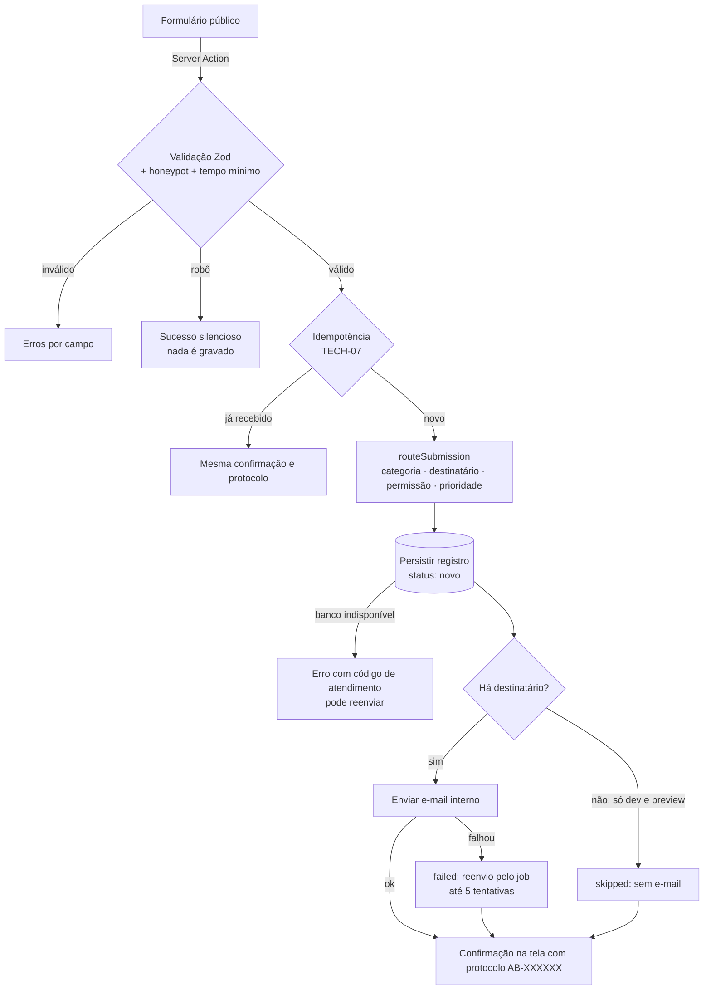

# Regras de captação e roteamento de leads, contato e feedback

| Campo           | Valor                                                                   |
| --------------- | ----------------------------------------------------------------------- |
| Issue           | TECH-06 (#107)                                                          |
| Responsável     | Vinícius Nishimura Reis (`@Vinishireis`)                                |
| Revisão técnica | Vinícius Binda (`@VinnizzZ`)                                            |
| Versão          | 1.3.0 — **implementada; fluxos aguardando aprovação da Agência Benjamin (§10)** |
| Data            | 09/11/2026 (forma do envio no banco: DB-06)                             |
| Depende de      | [FORM-01](matriz-de-campos.md), [SEG-01](../seguranca/tratamento-de-dados-formularios.md) |
| Código          | `lib/domain/forms/routing.ts`, `lib/domain/forms/inbox.ts`, `lib/server/forms/*`, `app/admin/(painel)/leads/*`, migrations `0400`, `20261102000300` e `20261109000100` + testes (§9) |

## 1. Separação dos fluxos

Os três tipos ficam na tabela `form_submissions`, separados pela coluna `kind`, com esquemas distintos
(FORM-01). Nunca se misturam: um feedback não aparece na lista de leads e vice-versa (RN-02).

| Tipo | Finalidade | Exemplo | Campos ([mapa completo](matriz-de-campos.md)) | Destinatário | Consulta |
| ---- | ---------- | ------- | --------------------------------------------- | ------------ | -------- |
| **Pedido comercial** (`lead`) | Pessoa ou empresa quer contratar um projeto | "Precisamos de social media para o lançamento" | Nome, e-mail e descrição do projeto; telefone, empresa e serviço são opcionais | `LEAD_NOTIFICATION_TO` | `lead:view` (`admin`) |
| **Contato geral** (`contact`) | Parcerias, imprensa, interesse em participar, dúvidas | "Sou jornalista e gostaria de uma entrevista" | Nome, e-mail, assunto e mensagem; telefone é opcional | `CONTACT_NOTIFICATION_TO` | `lead:view` (`admin`): também contém dados pessoais |
| **Feedback** (`feedback`) | Avaliação de clientes, parceiros, alunos e comunidade | "A palestra foi ótima" | Perfil e mensagem; nota, nome e pedido de retorno são opcionais; e-mail só com pedido de retorno | `FEEDBACK_NOTIFICATION_TO` | `feedback:view` (`admin`) |

Os três exigem a ciência do aviso de privacidade.

## 2. Fluxo de captação

## 3. Categorização

| Tipo | Categoria | Prioridade sugerida |
| ---- | --------- | ------------------- |
| `lead` | `lead:<slug-do-serviço>` ou `lead:nao-sei` | Alta |
| `contact` | `contact:<assunto>` (`parceria`, `imprensa`, `fazer-parte`, `duvida`, `outro`) | Alta para `imprensa`; normal nos demais |
| `feedback` | `feedback:<perfil>` (`cliente`, `parceiro`, `aluno`, `comunidade`, `outro`) | Alta quando pede retorno; normal nos demais |

- A categoria permite filtros no painel (FORM-09) e métricas futuras sem antecipar um CRM (FUT-01).
- **Serviço de interesse:** a validação confere o formato de slug e recusa texto livre. Depois, o
  servidor confere a lista de serviços do site: valor que não está nela não vira categoria, e o pedido
  entra como `lead:nao-sei`, com o valor enviado no conteúdo. Assim, um serviço que sai do ar com o
  formulário aberto não recusa o pedido, e ninguém cria categorias como `lead:urgente-diretoria`.
- **Nome e empresa:** ficam em uma linha, porque entram no assunto e em linhas fixas do e-mail interno.
- **Prioridade:** aparece no e-mail interno e não é gravada no banco no MVP.
- **Protocolo:** identifica o envio para as pessoas, derivado dos 6 primeiros caracteres do `id`. Não é
  chave única: a chave é o `id`.

## 4. Destinatários (configuração segura)

| Tipo | Variável | Fallback |
| ---- | -------- | -------- |
| `lead` | `LEAD_NOTIFICATION_TO` | — (obrigatória em homologação/produção) |
| `contact` | `CONTACT_NOTIFICATION_TO` | `LEAD_NOTIFICATION_TO` |
| `feedback` | `FEEDBACK_NOTIFICATION_TO` | `LEAD_NOTIFICATION_TO` |

- Valores definidos pela Benjamin (CON-10), cadastrados na Vercel por ambiente (ARC-05).
- **Nenhum e-mail fixo no código.** Homologação usa destinatário de teste da equipe.
- Pós-MVP: mover destinatários para configurações do CMS (`settings`, permissão `admin`).

## 5. Confirmação de recebimento

| Canal | MVP | Motivo |
| ----- | --- | ------ |
| Tela de sucesso com protocolo (`AB-XXXXXX`) | **Sim** | Imediato, sem custo e sem risco de abuso |
| E-mail automático ao visitante | **Não** (proposta, §10) | Endereço não verificado: formulário poderia ser usado para disparar e-mails a terceiros (abuso/spam) e consumiria a cota da Resend. Reavaliar com verificação/limite (FUT-03) |
| E-mail interno aos destinatários | **Sim** | Com `Reply-To` do visitante (exceto feedback sem pedido de retorno) |

## 6. Validação e falhas

Regra geral: **o registro vem antes do e-mail**. Depois de gravado, nenhuma falha de notificação chega
ao visitante nem apaga o envio. Os cenários completos estão em [TECH-07](idempotencia-e-falhas.md).

| Situação | O visitante vê | Registro | Notificação | Como a equipe descobre |
| -------- | -------------- | -------- | ----------- | ---------------------- |
| Campo inválido | Erro por campo, valores repreenchidos | — | — | — |
| Banco indisponível | Erro com código de atendimento; pode reenviar | — | — | Log `app.error.service_unavailable` |
| Banco recusa a forma de um envio validado (aplicação e banco divergiram, DB-06) | Erro com código de atendimento; o reenvio falha igual | — | — | Log `app.error.service_unavailable` com `23514` e o nome da restrição. `forms-sql.test.ts` impede a divergência ([dicionário §13](../banco/dicionario-de-dados.md)) |
| Destinatário inválido em qualquer lista, ou `LEAD_NOTIFICATION_TO` ausente, em homologação/produção | Nada: **o build falha** e a versão anterior continua no ar | — | — | Build aponta a variável (`FEEDBACK_NOTIFICATION_TO.0: Destinatário inválido.`) |
| Contato ou feedback sem lista própria | Sucesso com protocolo | Salvo | Vai para `LEAD_NOTIFICATION_TO` | — |
| Sem destinatário em desenvolvimento/preview | Sucesso com protocolo | Salvo, `skipped` | Não é enviada nem reenviada: esses ambientes não mandam e-mail real | Log `forms.notification.skipped` |
| Provedor fora do ar ou recusa o envio | Sucesso com protocolo | Salvo, `failed` | Job reenvia com espera crescente, até 5 tentativas | Aviso e coluna "Notificação" no painel (INT-07); log `forms.notification.failed` |
| Falha ao gravar o resultado da notificação | Sucesso com protocolo | Salvo, com a notificação como estava | Job tenta de novo; o `Idempotency-Key` evita e-mail repetido por 24 h | Log `forms.notification.status_update_failed` |
| Rede do visitante cai no envio | Aviso no formulário, com o que digitou; pode reenviar | Só se o POST chegou ao servidor; o reenvio não duplica | Como no envio normal | — |
| 5 tentativas esgotadas | (Já viu sucesso) | Mantido, `failed` | Sai da fila; os envios novos continuam sendo reenviados | Aviso e filtro no painel (INT-07); conferência semanal ([handoff](../operacao/handoff-e-manutencao.md)), com reenvio manual |
| E-mail aceito pelo provedor e devolvido pela caixa de destino | Sucesso com protocolo | Salvo, `sent` | **Não detectada no MVP** (sem webhook de devolução) | Teste de recebimento no lançamento (CA-15) |

O reenvio depende de duas configurações de produção: `CRON_SECRET`, cuja falta barra o build, e o
agendamento do job, que é [passo manual do provisionamento](../operacao/provisionamento-producao.md)
(GO-02) e **não** é verificado pelo código.

## 7. Status de atendimento (proposta, §10)

`novo` → `em_atendimento` → `respondido` → `arquivado` (lead/contato) · `novo` → `lido` → `arquivado`
(feedback). Status extensível para um futuro funil comercial (FUT-01), sem campos de CRM no MVP
(sem valor, sem etapa de negociação, sem responsável comercial).

O banco aceita os cinco valores para qualquer tipo. O painel (FORM-09) aplica a separação por tipo só na
aplicação (`statusOptions`), sem ordem obrigatória entre as etapas: enquanto as etapas não forem aprovadas,
isso não fixa no banco uma decisão pendente. Mudar as etapas é alterar uma lista em `lib/domain/forms/inbox.ts`.

## 8. Permissão de consulta

As regras valem no banco (RLS por `kind`) e na tela `/admin/leads` (FORM-09), que consulta com a sessão de
quem está logado, nunca com service role. Abrir um envio gera o evento; listar não, porque a lista só traz
nome, categoria, status e data.

| Ação | Papel | Regra no banco | Auditoria (TECH-10) |
| ---- | ----- | -------------- | ------------------- |
| Listar leads e contatos | `admin` | `lead:view` | — |
| Abrir lead ou contato | `admin` | `lead:view` | `lead.viewed` (id, tipo e categoria, sem conteúdo) |
| Listar feedbacks | `admin` | `feedback:view` | — |
| Abrir feedback | `admin` | `feedback:view` | `feedback.viewed` |
| Alterar status | `admin` | `lead:edit`/`feedback:edit`, **só a coluna `status`** | `lead.status_changed` nos três tipos, com o tipo real em `metadata.kind` (ver abaixo) |
| Excluir (pedido do titular/retenção), só depois de arquivar | `admin` | `lead:delete`/`feedback:delete` | `lead.deleted` · `feedback.deleted`, gravados antes da exclusão |
| Exportar leads | `admin` | `lead:export` | **Não construído:** FORM-09 não pede. Quando existir, `lead.exported` (quantidade, filtros) |

**Por que não há `feedback.status_changed`:** esta seção previa o evento em FORM-09, mas ele não está no
catálogo nem em `record_audit_event`, que recusaria a gravação. Criá-lo exige migration, e a tela não pode
depender de uma migration aplicada à parte. Fica `lead.status_changed` com `metadata.kind = "feedback"`.
Quando a migration vier, o evento novo entra no catálogo, no check do banco e neste documento juntos.

`super_admin`, `editor`, `viewer` e contas pendentes não leem nem alteram envios. O visitante não lê nem
grava direto: a gravação é do servidor, depois da validação.

## 9. Exemplos e evidências

| Critério | Exemplo | Onde está provado |
| -------- | ------- | ------------------ |
| **Positivo** | Pedido de vídeo vira `lead:audiovisual`, notifica o destinatário comercial, devolve protocolo e o `admin` consulta e altera o status | `jornada-lead.test.ts`, `formularios.test.ts`, `form_submissions_rls.test.sql` |
| | Pelo navegador: formulário público → lista → detalhe → status, com `lead.viewed` e `lead.status_changed` na trilha | `jornada-leads-cms.spec.ts` (FORM-09) |
| | Pedido com cada campo no limite (nome, empresa, e-mail de 254, serviço de 80, descrição de 3.000, origem de 200) chega inteiro ao banco real | `formularios.test.ts` (DB-06) |
| **Negativa de acesso** | `editor`, `viewer`, `super_admin` e conta pendente: 0 linhas e nada alterado. Visitante: `42501`. `admin` tentando reescrever `payload`, `kind`, `category` ou `notification_status`: `42501` | `formularios.test.ts` (Auth e RLS reais), `form_submissions_rls.test.sql` |
| | Evidência completa, com a API REST direta e entrada malformada | [SEG-04](../qualidade/seg-04-autorizacao-dados-pessoais.md) |
| | Envio inválido (e-mail, ciência, descrição curta, texto livre no serviço, contato sem assunto, retorno sem e-mail, honeypot, rápido demais) não grava no banco real nem dispara e-mail | `formularios.test.ts` (DB-06) |
| | Gravação forjada com a credencial do servidor (conteúdo em lista, categoria de outro tipo, protocolo forjado, origem sem barra, tentativas negativas): `23514`, nada gravado | `form_submissions_integridade.test.sql`, `formularios.test.ts` (DB-06) |
| **Borda** | Texto livre no serviço recusado; serviço fora do ar aceito | `schemas.test.ts` |
| | Slug que não está na lista vira `lead:nao-sei`, com o pedido aceito, mesmo se a consulta à lista falhar | `submission-service.test.ts` |
| | Quebra de linha em nome e empresa não forja linhas no e-mail | `schemas.test.ts` |
| | Feedback anônimo sem `Reply-To`; mesma mensagem em tipos diferentes não é tratada como duplicada | `jornada-lead.test.ts` |
| | 20 envios esgotados não bloqueiam o reenvio de um novo (S13) | `submission-service.test.ts`, `formularios.test.ts` |
| | Com só `feedback:view`, o `admin` vê feedback e não vê lead nem contato; com só `lead:view`, o inverso | `form_submissions_rls.test.sql` |
| | Destinatário inválido barra o build em modo produção | `env.test.ts` + build executado em 02/11/2026 |
| **Compatibilidade entre módulos** | Formulário → `schemas` → `routing` → `submission-service` → `SupabaseSubmissionStore` → RLS, com os três tipos no banco real; `viewResource` do roteamento igual à regra do banco; migration com upgrade e rollback | `formularios.test.ts`, `jornada-lead.test.ts`, `npm run test:migrations` |
| | Restrições do banco aceitam tudo o que a aplicação grava: protocolo, categoria de cada assunto e perfil, origem e tetos | `forms-sql.test.ts` (DB-06) |

Resultado em 02/11/2026, em banco local limpo: `npx supabase test db` com `Files=7, Tests=180, PASS`;
`npm run test:supabase` com 12 arquivos e 62 testes; `npm run test:migrations` com 11 rollbacks, `PASS`
em cada etapa.

Resultado em 09/11/2026 (DB-06), em banco local limpo: `npx supabase test db` com `Files=12, Tests=348, PASS`;
`npm run test:supabase` com 20 arquivos e 200 testes; `npm run test:migrations` com 16 rollbacks, `PASS` em cada etapa.

## 10. Aprovação com a Agência Benjamin

| Ponto | Situação |
| ----- | -------- |
| Separação entre pedido de projeto, contato e feedback | Pendente |
| Sem e-mail automático ao visitante, só o protocolo na tela (§5) | Pendente |
| Etapas de atendimento (§7) | Pendente |
| Pedidos e feedbacks visíveis só para administradores (§8) | Pendente |
| Mapa de campos ([FORM-01](matriz-de-campos.md)) | Pendente |
| Destinatário de cada formulário (CON-10) | Pendente |

**27/10/2026:** pedido de aprovação preparado para a agência (decisões 1 a 3). A situação de cada ponto muda para "Aprovado" quando a resposta chegar: registrar na
issue TECH-06 data, aprovadores e ajustes, e alterar código e documento no mesmo PR. O código
implementa a proposta para permitir testes, o que não equivale a aprovação.
