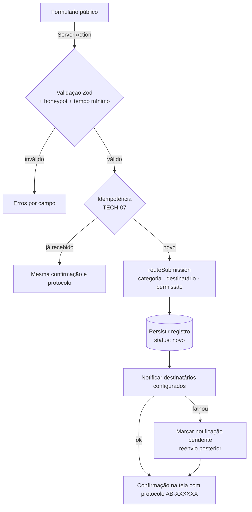

# Regras de captação e roteamento de leads, contato e feedback

| Campo           | Valor                                                                   |
| --------------- | ----------------------------------------------------------------------- |
| Issue           | TECH-06 (#107)                                                          |
| Responsável     | Vinícius Nishimura Reis (`@Vinishireis`)                                |
| Revisão técnica | Vinícius Binda (`@VinnizzZ`)                                            |
| Versão          | 1.0.0                                                                   |
| Data            | 13/10/2026                                                              |
| Depende de      | [FORM-01](matriz-de-campos.md), [SEG-01](../seguranca/tratamento-de-dados-formularios.md) |
| Código          | `lib/domain/forms/routing.ts` + testes                                  |

## 1. Separação dos fluxos

| Tipo | Quando usar | Exemplo | Registro | Consulta no painel |
| ---- | ----------- | ------- | -------- | ------------------ |
| **Pedido comercial** (`lead`) | Pessoa/empresa quer contratar um projeto | "Precisamos de social media para o lançamento" | Tabela de leads, status de atendimento | `lead:view` (`admin`) |
| **Contato geral** (`contact`) | Parcerias, imprensa, interesse em participar, dúvidas | "Sou jornalista e gostaria de uma entrevista" | Mesma tabela de envios, tipo `contact` | `lead:view` (`admin`) — também contém dados pessoais |
| **Feedback** (`feedback`) | Avaliação de clientes, parceiros, alunos e comunidade | "A palestra foi ótima" | Tabela de envios, tipo `feedback` | `feedback:view` (`admin`) |

Os três tipos têm esquemas distintos (FORM-01) e nunca se misturam: um feedback não aparece na
lista de leads e vice-versa (RN-02).

## 2. Fluxo de captação

## 3. Categorização

| Tipo | Categoria | Prioridade sugerida |
| ---- | --------- | ------------------- |
| `lead` | `lead:<slug-do-serviço>` ou `lead:nao-sei` | Alta |
| `contact` | `contact:<assunto>` (`parceria`, `imprensa`, `fazer-parte`, `duvida`, `outro`) | Alta para `imprensa`; normal nos demais |
| `feedback` | `feedback:<perfil>` (`cliente`, `parceiro`, `aluno`, `comunidade`, `outro`) | Alta quando pede retorno; normal nos demais |

A categoria permite filtros no painel (FORM-09) e métricas futuras sem antecipar um CRM (FUT-01).

## 4. Destinatários (configuração segura)

| Tipo | Variável | Fallback |
| ---- | -------- | -------- |
| `lead` | `LEAD_NOTIFICATION_TO` | — (obrigatória em homologação/produção) |
| `contact` | `CONTACT_NOTIFICATION_TO` | `LEAD_NOTIFICATION_TO` |
| `feedback` | `FEEDBACK_NOTIFICATION_TO` | `LEAD_NOTIFICATION_TO` |

- Valores definidos pela Benjamin (CON-10), cadastrados na Vercel por ambiente (ARC-05).
- **Nenhum e-mail fixo no código.** Homologação usa destinatário de teste da equipe.
- Pós-MVP: mover destinatários para configurações do CMS (`settings`, permissão `admin`).

## 5. Confirmação de recebimento

| Canal | MVP | Motivo |
| ----- | --- | ------ |
| Tela de sucesso com protocolo (`AB-XXXXXX`) | **Sim** | Imediato, sem custo e sem risco de abuso |
| E-mail automático ao visitante | **Não** | Endereço não verificado: formulário poderia ser usado para disparar e-mails a terceiros (abuso/spam) e consumiria a cota da Resend. Reavaliar com verificação/limite (FUT-03) |
| E-mail interno aos destinatários | **Sim** | Com `Reply-To` do visitante (exceto feedback sem pedido de retorno) |

## 6. Status de atendimento (painel)

`novo` → `em_atendimento` → `respondido` → `arquivado` (lead/contato) · `novo` → `lido` → `arquivado`
(feedback). Status extensível para um futuro funil comercial (FUT-01), sem campos de CRM no MVP
(sem valor, sem etapa de negociação, sem responsável comercial).

## 7. Permissão de consulta

| Ação | Papel | Auditoria (TECH-10) |
| ---- | ----- | ------------------- |
| Listar/abrir leads e contatos | `admin` | `lead.viewed` (id, sem conteúdo) |
| Exportar leads | `admin` | `lead.exported` (quantidade, filtros) |
| Listar/abrir feedbacks | `admin` | `feedback.viewed` |
| Alterar status | `admin` | `lead.status_changed` |
| Excluir (pedido do titular/retenção) | `admin` | `lead.deleted` |

## 8. Pendências

- Aprovação dos fluxos e do mapa de campos com a Benjamin (FORM-01).
- Destinatários reais (CON-10).
- Pedido de aprovação preparado em 27/10/2026 ([página para enviar à agência](https://claude.ai/artifact/4TJ8vhTDLW6PYfSfCAqLti), decisão 2):
  separação dos fluxos, etapas de atendimento e a proposta de não enviar e-mail automático ao
  visitante (§5).
