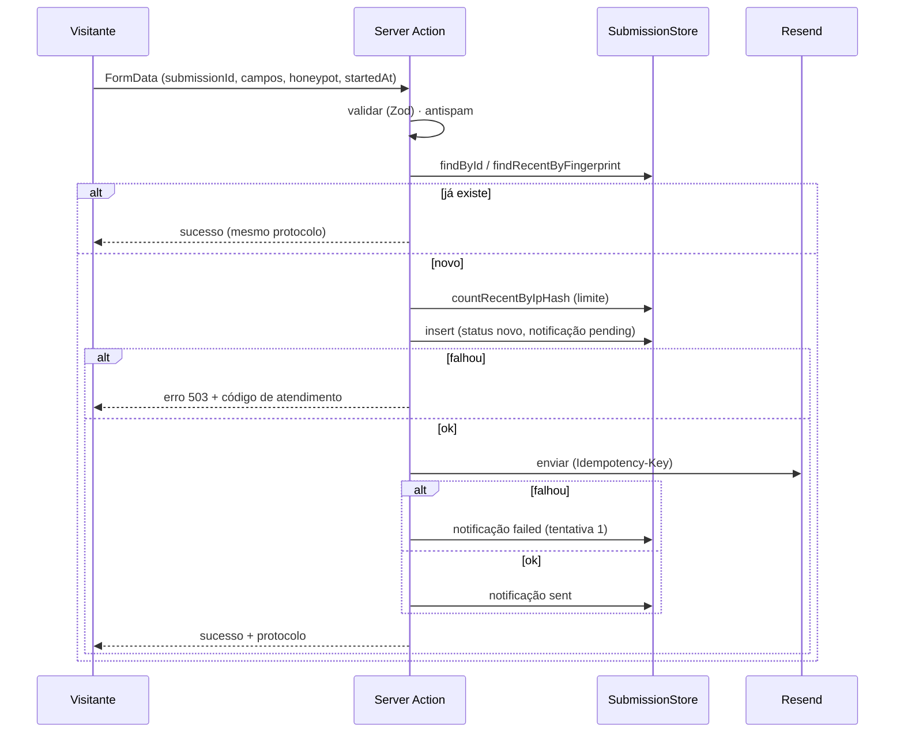

# Idempotência, reenvio seguro e tratamento de falhas dos formulários

| Campo        | Valor                                                                   |
| ------------ | ----------------------------------------------------------------------- |
| Issue        | TECH-07 (#108)                                                          |
| Responsável  | Vinícius Nishimura Reis (`@Vinishireis`)                                |
| Versão       | 1.0.0                                                                   |
| Data         | 13/10/2026                                                              |
| Depende de   | [TECH-06](captacao-e-roteamento.md), [TECH-02](../api/contratos.md)     |
| Código       | `lib/domain/forms/idempotency.ts`, `lib/server/forms/*` + `submission-service.test.ts` (cenários S1–S10) |
| Encaminhado a | FORM-03/04/05 (formulários), FORM-07 (antispam), FORM-08 (estados), DB-06/DB-07 (persistência) |

## 1. Garantias

1. **Validação sempre no servidor** — o navegador valida para ajudar, o servidor decide.
2. **Persistir antes de notificar** — o e-mail é consequência do registro, nunca o contrário.
3. **Nenhum lead válido é perdido silenciosamente** — falha de banco vira erro visível com
   código de atendimento; falha de e-mail fica pendente e é reenviada.
4. **Reenviar é seguro** — o mesmo envio nunca vira dois registros nem dois e-mails.
5. **Robôs não aprendem** — honeypot/tempo mínimo respondem como sucesso, sem gravar nada.

## 2. Chaves de idempotência

| Nível | Chave | Janela | Protege contra |
| ----- | ----- | ------ | -------------- |
| Identificador do envio | `submissionId` (UUID gerado ao abrir o formulário, enviado em campo oculto) + `unique` no banco | Permanente | Duplo clique, reenvio após timeout, corrida entre requisições |
| Conteúdo | HMAC(`tipo + e-mail + mensagem normalizada`) | 10 min | Página recarregada e enviada de novo com novo `submissionId` |
| Notificação | Header `Idempotency-Key: submission-<id>` na Resend | 24 h (provedor) | E-mail duplicado em reenvios |

## 3. Tabela de cenários

| # | Cenário | Resposta ao visitante | Registro | Notificação | Log |
| - | ------- | --------------------- | -------- | ----------- | --- |
| S1 | Envio válido | Sucesso + protocolo `AB-XXXXXX` | Criado (`novo`) | Enviada (`sent`) | `forms.submission.persisted`, `forms.notification.sent` |
| S2 | Campo inválido | Erro por campo, valores repreenchidos | — | — | `app.error.validation_failed` |
| S3 | Duplo clique / reenvio do mesmo `submissionId` | Sucesso com **mesmo** protocolo, `duplicate: true` | Inalterado | Não reenviada | `forms.submission.duplicate (by=id)` |
| S4 | Mesmo conteúdo, novo `submissionId`, em até 10 min | Sucesso com protocolo original | Inalterado | Não reenviada | `forms.submission.duplicate (by=fingerprint)` |
| S5 | Mesmo conteúdo após 10 min | Sucesso, novo protocolo | Novo registro | Enviada | `persisted` |
| S6 | Honeypot preenchido ou envio em < 3 s | Sucesso (silencioso) | — | — | `forms.submission.spam_suspected` |
| S7 | Banco indisponível | Erro "Serviço temporariamente indisponível" + código de atendimento; pode reenviar (mesmo `submissionId`) | — | — | `app.error.service_unavailable` |
| S8 | Resend falha | **Sucesso** (lead já está salvo) | Criado, `failed`, tentativas 1 | Reenviada pela rotina com backoff 1, 2, 4, 8 min (máx. 5) | `forms.notification.failed` |
| S9 | > 5 envios da mesma origem em 10 min | Erro "Muitas tentativas…" | — | — | `app.error.rate_limited` |
| S10 | Sem destinatário configurado | Sucesso | Criado, `skipped` | Não enviada (alerta no log) | `forms.notification.skipped` |
| S11 | Dois envios simultâneos do mesmo id | Ambos sucesso, um `duplicate` | Um registro (constraint única) | Uma | `persisted` |
| S12 | Produção sem armazenamento persistente configurado | Erro 503 | — | — | `app.error.service_unavailable` (nunca grava em memória fora do dev) |

S1–S10 são testes automatizados; S11 é garantido pela constraint `unique` e pelo tratamento de
`DuplicateSubmissionError`; S12 por `resolveStore()`.

## 4. Fluxo



## 5. Rotina de reenvio

`retryPendingNotifications()` processa até 20 registros `pending/failed` respeitando o backoff.
Agendamento proposto: Vercel Cron a cada 5 min chamando um Route Handler protegido por segredo
(`CRON_SECRET`), ou `pg_cron` no Supabase — implementação junto a FORM-06/DB-06.

## 6. Persistência (encaminhado a DB-06/DB-07)

Interface `SubmissionStore` (`lib/server/forms/types.ts`). Tabela sugerida:

```sql
create table public.form_submissions (
  id uuid primary key,                         -- submissionId (idempotência)
  protocol text not null,
  kind text not null check (kind in ('lead','contact','feedback')),
  category text not null,
  payload jsonb not null,                      -- dados validados (PII — RLS restrita)
  fingerprint text not null,
  ip_hash text,
  source_path text,
  status text not null default 'novo',
  notification_status text not null default 'pending'
    check (notification_status in ('pending','sent','failed','skipped')),
  notification_attempts integer not null default 0,
  last_notification_error text,
  created_at timestamptz not null default now(),
  updated_at timestamptz not null default now()
);
create index on public.form_submissions (fingerprint, created_at desc);
create index on public.form_submissions (ip_hash, created_at desc);
alter table public.form_submissions enable row level security;  -- sem policy para anon
```

A inserção pública acontece no servidor (Server Action) com credencial restrita; o visitante nunca
lê a tabela (TECH-08).
