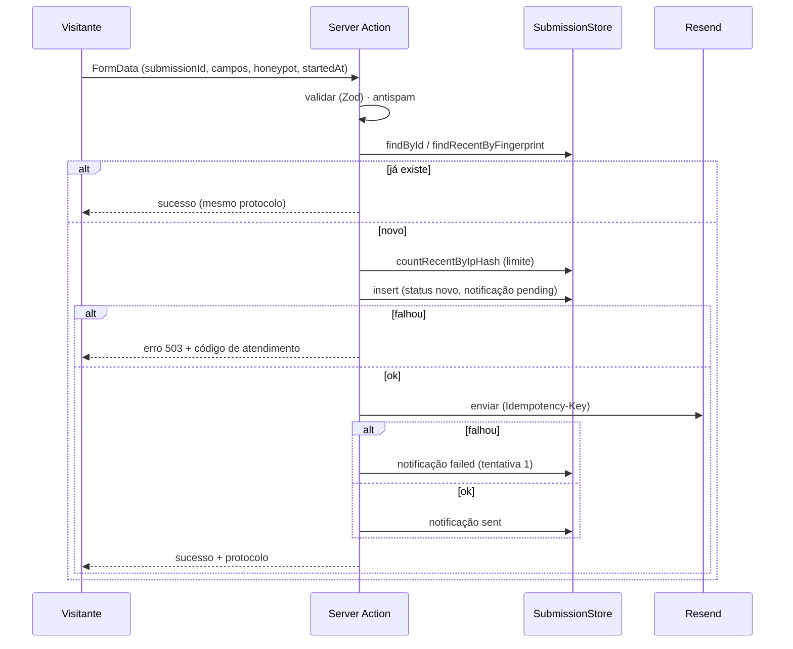

# Idempotência, reenvio seguro e tratamento de falhas dos formulários

| Campo        | Valor                                                                   |
| ------------ | ----------------------------------------------------------------------- |
| Issue        | TECH-07 (#108)                                                          |
| Responsável  | Vinícius Nishimura Reis (`@Vinishireis`)                                |
| Versão       | 1.2.0                                                                   |
| Data         | 04/11/2026                                                              |
| Depende de   | [TECH-06](captacao-e-roteamento.md), [TECH-02](../api/contratos.md)     |
| Código       | `lib/domain/forms/idempotency.ts`, `lib/server/forms/*` + `submission-service.test.ts` (cenários S1–S10, S13, S14 e S16), `components/forms/use-submission.ts` + `tests/e2e/formularios.spec.ts` (S14 e S15) |
| Encaminhado a | FORM-03/04/05 (formulários), FORM-07 (antispam), FORM-08 (estados), DB-06/DB-07 (persistência) |

## 1. Garantias

1. **Validação sempre no servidor** — o navegador valida para ajudar, com o mesmo esquema
   (`browser-validation.ts`), e o servidor decide. Erro só em campo técnico e honeypot preenchido não param
   no navegador: seguem para o servidor responder.
2. **Persistir antes de notificar** — o e-mail é consequência do registro, nunca o contrário.
3. **Nenhum lead válido é perdido silenciosamente** — falha de banco vira erro visível com
   código de atendimento; falha de e-mail fica pendente e é reenviada. Depois de salvar, nenhum erro
   chega ao visitante: nem da notificação, nem da gravação do resultado dela.
4. **Reenviar é seguro** — o mesmo envio nunca vira dois registros nem dois e-mails.
5. **Robôs não aprendem** — honeypot/tempo mínimo respondem como sucesso, sem gravar nada.

## 2. Chaves de idempotência

| Nível | Chave | Janela | Protege contra |
| ----- | ----- | ------ | -------------- |
| Identificador do envio | `submissionId` (UUID gerado ao abrir o formulário, enviado em campo oculto) + `unique` no banco | Permanente | Duplo clique, reenvio após timeout, corrida entre requisições |
| Conteúdo | HMAC(`tipo + e-mail + mensagem normalizada`) | 10 min | Página recarregada e enviada de novo com novo `submissionId` |
| Notificação | Header `Idempotency-Key: submission-<id>` na Resend | 24 h (provedor) | E-mail duplicado em reenvios |

## 3. Tabela de cenários

| # | Cenário | Resposta ao visitante | Registro | Notificação | Log |
| - | ------- | --------------------- | -------- | ----------- | --- |
| S1 | Envio válido | Sucesso + protocolo `AB-XXXXXX` | Criado (`novo`) | Enviada (`sent`) | `forms.submission.persisted`, `forms.notification.sent` |
| S2 | Campo inválido | Erro por campo, valores repreenchidos. Com JavaScript, sem POST | — | — | `app.error.validation_failed` (só quando chega ao servidor) |
| S3 | Duplo clique / reenvio do mesmo `submissionId` | Sucesso com **mesmo** protocolo, `duplicate: true` | Inalterado | Não reenviada | `forms.submission.duplicate (by=id)` |
| S4 | Mesmo conteúdo, novo `submissionId`, em até 10 min | Sucesso com protocolo original | Inalterado | Não reenviada | `forms.submission.duplicate (by=fingerprint)` |
| S5 | Mesmo conteúdo após 10 min | Sucesso, novo protocolo | Novo registro | Enviada | `persisted` |
| S6 | Honeypot preenchido ou envio em < 3 s | Sucesso (silencioso) | — | — | `forms.submission.spam_suspected` |
| S7 | Banco indisponível | Erro "Serviço temporariamente indisponível" + código de atendimento; pode reenviar (mesmo `submissionId`) | — | — | `app.error.service_unavailable` |
| S8 | Resend falha | **Sucesso** (lead já está salvo) | Criado, `failed`, tentativas 1 | Reenviada pela rotina com backoff 1, 2, 4, 8 min (máx. 5) | `forms.notification.failed` |
| S9 | > 5 envios da mesma origem em 10 min | Erro "Muitas tentativas…" | — | — | `app.error.rate_limited` |
| S10 | Sem destinatário configurado (só desenvolvimento e preview; em homologação e produção a falta barra o build, ver [TECH-06 §6](captacao-e-roteamento.md)) | Sucesso | Criado, `skipped` | Não enviada nem reenviada (alerta no log) | `forms.notification.skipped` |
| S11 | Dois envios simultâneos do mesmo id | Ambos sucesso, um `duplicate` | Um registro (constraint única) | Uma | `persisted` |
| S12 | Ambiente real sem armazenamento persistente configurado (seção 6) | Erro "Serviço temporariamente indisponível" + código de atendimento, com o texto digitado | — | — | `app.error.service_unavailable`, com `reason: submission_store_not_configured` |
| S13 | Notificação esgotou as 5 tentativas | (Já viu sucesso) | Mantido, `failed`, tentativas 5 | Sai da fila, sem bloquear os envios novos; reenvio manual ([handoff](../operacao/handoff-e-manutencao.md)) | `forms.notification.failed` |
| S14 | Envio sem JavaScript ou antes da hidratação (campos técnicos vazios) | Página recarrega com o resultado: confirmação, ou erro por campo com os valores repreenchidos | Criado, sem `source_path` | Enviada | `persisted`; sem o tempo mínimo (seção 7) |
| S15 | Rede cai, resposta se perde ou a plataforma responde com erro antes da aplicação | Aviso no próprio formulário, sem código de atendimento, com tudo o que foi digitado; pode reenviar com o mesmo `submissionId` | Criado só se o POST chegou ao servidor | Como S1 ou, no reenvio, S3 | Nenhum no servidor quando o POST não chega |
| S16 | Falha ao gravar o resultado da notificação | **Sucesso** (envio já salvo) | Criado, com a notificação como estava (`pending`) | Rotina tenta de novo; o `Idempotency-Key` evita e-mail repetido por 24 h | `forms.notification.status_update_failed` |

S1–S10, S13, S14 e S16 são testes automatizados, e S14 e S15 têm E2E em `tests/e2e/formularios.spec.ts`; S11 é garantido pela constraint `unique` e pelo tratamento de
`DuplicateSubmissionError`, testado no banco real (`formularios.test.ts`); S12 por `resolveStore()`, com
testes em `deps.test.ts`, `store-policy.test.ts` e `actions.test.ts`.

S15 é o motivo de o formulário hidratado chamar a action dentro de `try/catch`, no `onSubmit` de
`use-submission.ts`: no `useActionState`, a rejeição subia para o `error.tsx` e o visitante perdia o texto.
O `try/catch` não pode ficar em volta da action entregue ao `useActionState` (seção 7).

## 4. Fluxo



## 5. Rotina de reenvio

`retryPendingNotifications()` processa até 20 registros `pending/failed` que ainda têm tentativas,
do mais antigo ao mais novo, respeitando o backoff. Roda em `GET /api/internal/jobs/notificacoes`,
protegido por `CRON_SECRET` (obrigatório em produção). O agendamento é o Vercel Cron a cada 15 min,
[passo manual do provisionamento](../operacao/provisionamento-producao.md): não está em `vercel.json`,
e a espera real entre tentativas nunca é menor que esse intervalo.

## 6. Persistência (encaminhado a DB-06/DB-07)

Interface `SubmissionStore` (`lib/server/forms/types.ts`). Tabela sugerida:

```sql
create table public.form_submissions (
  id uuid primary key,                         -- submissionId (idempotência)
  protocol text not null,
  kind text not null check (kind in ('lead','contact','feedback')),
  category text not null,
  payload jsonb not null,                      -- dados validados (PII — RLS restrita)
  fingerprint text not null,
  ip_hash text,
  source_path text,
  status text not null default 'novo',
  notification_status text not null default 'pending'
    check (notification_status in ('pending','sent','failed','skipped')),
  notification_attempts integer not null default 0,
  last_notification_error text,
  created_at timestamptz not null default now(),
  updated_at timestamptz not null default now()
);
create index on public.form_submissions (fingerprint, created_at desc);
create index on public.form_submissions (ip_hash, created_at desc);
alter table public.form_submissions enable row level security;  -- sem policy para anon
```

A inserção pública acontece no servidor (Server Action) com credencial restrita; o visitante nunca
lê a tabela (TECH-08).

**Quando o armazenamento em memória é permitido.** Só em desenvolvimento e no preview da Vercel, onde os dados são
descartáveis (`allowsMemoryStore`, em `store-policy.ts`). Sem armazenamento persistente, o envio é recusado (S12)
quando:

- `NEXT_PUBLIC_SITE_ENV` é `production` ou `homologation`; ou
- `VERCEL_ENV` é `production`, **seja qual for** `NEXT_PUBLIC_SITE_ENV`.

A segunda regra existe porque `NEXT_PUBLIC_SITE_ENV` entra no build e vale `development` quando falta. Um deploy de
Production construído sem as variáveis caía em memória: o visitante recebia "Pedido recebido!" e protocolo, e o
dado se perdia junto com a instância da função, em violação à RN-04. Agora ele vê o erro com código de atendimento.
`VERCEL_ENV` é lida em tempo de execução e depende da opção de expor as variáveis de sistema da Vercel, ligada por
padrão. Sem ela a regra não dispara, por isso ela não substitui configurar o ambiente
([provisionamento](../operacao/provisionamento-producao.md)). `next build` e os testes locais, que rodam sem
`VERCEL_ENV`, não mudam.

## 7. Envio sem JavaScript e antes da hidratação (FORM-08)

**Como funciona.** O formulário usa `useActionState` com a Server Action: o HTML já traz os campos
`$ACTION_*`, e o navegador consegue fazer o POST sozinho. Por isso nada pode envolver a action antes de
entregá-la ao `useActionState`, ou o HTML perde esses campos.

**Por que há páginas estáticas para `/contato`.** `/contato` lê a URL (`tipo`, `servico`, `assunto`), então
o formulário chega por streaming, atrás do `Suspense`. Isso cria dois problemas sem JavaScript, ambos
reproduzidos no Next 16.4.4:

1. Sem o script do React, o conteúdo fica num `<div hidden>` e o visitante vê "Carregando formulário…" para sempre.
2. A resposta do POST em rota com Partial Prerendering é renderizada por `resume`, que não recebe o estado da
   action. O resultado não chega ao HTML, e a hidratação também não o aproveita.

Por isso `/contato/projeto` e `/contato/mensagem` têm o mesmo formulário em página totalmente estática,
como `/feedback`, onde a resposta do POST traz o resultado no HTML. O `permalink` do `useActionState` aponta
para elas, e o fallback de `/contato` leva a elas com `<noscript>`. Ficam fora do menu e do sitemap, com
`noindex`. Quem tem JavaScript continua em `/contato`, com abas e serviço pré-selecionado.

**Decisão sobre o antispam.** Os campos ocultos chegam vazios, e vazio vale como ausente. Sem `startedAt` o
tempo mínimo de 3 s não se aplica, e o servidor não tem como medi-lo: a página é pré-renderizada, então um
horário no HTML seria o mesmo para todos os visitantes. **Não é brecha nova**: `startedAt` sempre foi
opcional, e quem o omitia já ficava fora dessa regra. Honeypot, limite por origem e deduplicação por
conteúdo continuam valendo nesse caminho, com testes em `submission-service.test.ts`. Valor forjado
(`startedAt` não numérico, `sourcePath` sem barra) continua recusado.

**Limite conhecido.** Sem JavaScript o `submissionId` é gerado no servidor a cada POST, então a proteção
contra reenvio é só a deduplicação por conteúdo. Um duplo clique nesse caminho, com os dois POSTs simultâneos,
pode gravar dois registros: a impressão digital não tem `unique` no banco.

## 8. Riscos em aberto

Registrados em 04/11/2026 para decisão, sem correção nesta versão.

| Risco | Efeito para o visitante | O que decidir |
| ----- | ----------------------- | ------------- |
| **Sucesso falso do antispam.** Envio em menos de 3 s (preenchimento automático e clique rápido) ou honeypot preenchido pelo navegador ou gerenciador de senhas responde como sucesso (S6) | Vê "Pedido recebido!" com protocolo, e **nada é salvo nem notificado**. A única pista é o log `forms.submission.spam_suspected` | Guardar o envio suspeito para conferência, em vez de descartá-lo, ou pedir nova tentativa no caso do tempo mínimo |
| **Limite por IP em rede compartilhada.** O limite de 5 envios em 10 min soma os três formulários por IP (S9) | Na rede da FECAP, em que muitas pessoas saem pelo mesmo IP, o sexto envio em 10 min recebe "Muitas tentativas…", mesmo vindo de outra pessoa. O risco maior é o feedback pedido ao fim de um evento | Aumentar o limite, contar por formulário ou combinar IP com outro sinal |
