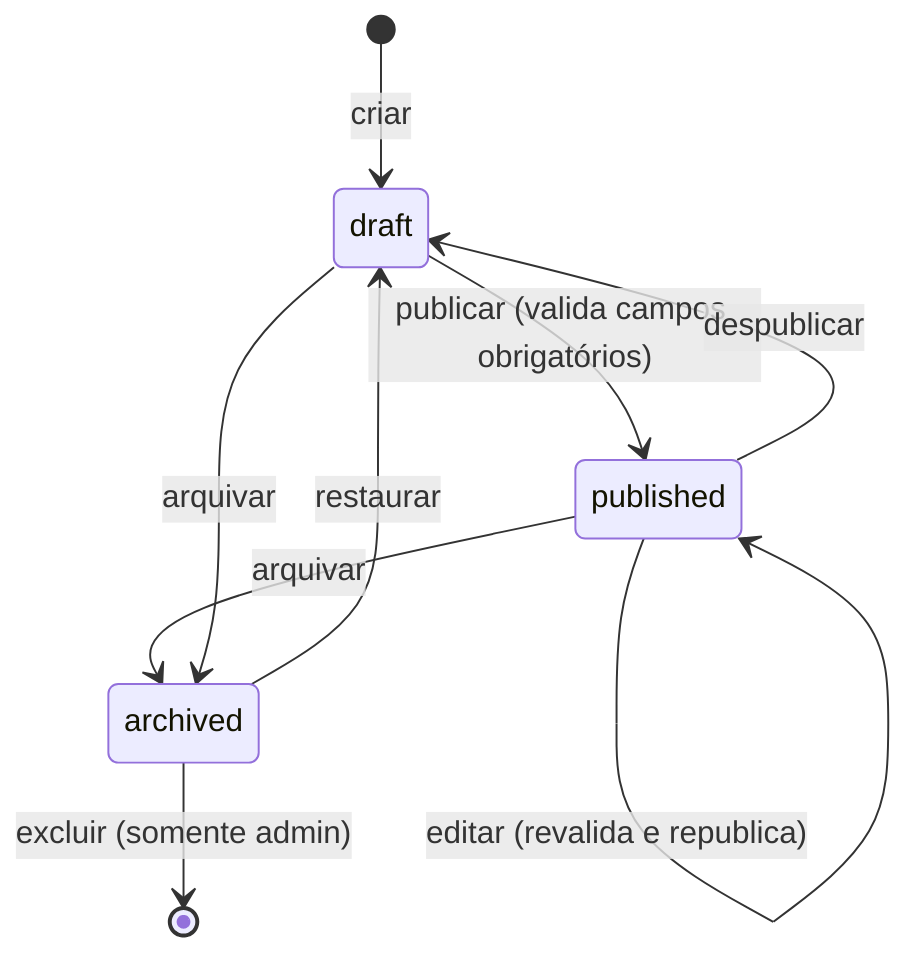

# Fluxo mínimo de rascunho e publicação

| Campo        | Valor                                                          |
| ------------ | -------------------------------------------------------------- |
| Issue        | ADM-12 (#88)                                                   |
| Responsável  | Vinícius Nishimura Reis (`@Vinishireis`)                       |
| Versão       | 1.0.0                                                          |
| Data         | 13/10/2026                                                     |
| Depende de   | [ADM-01 — perfis](../seguranca/perfis-e-permissoes.md)         |
| Detalhamento | Máquina de estados e invariantes em TECH-04                    |

## 1. Decisão

O MVP usa **três estados** para todo conteúdo editável (páginas, áreas, serviços, cases, categorias
e CTAs):

| Estado | Código | Visível no site? | Quem coloca nesse estado |
| ------ | ------ | :--------------: | ------------------------ |
| Rascunho | `draft` | Não | Criação; "Despublicar" |
| Publicado | `published` | **Sim** | "Publicar" (`editor`, `admin`, `super_admin`) |
| Arquivado | `archived` | Não | "Arquivar" (`editor`, `admin`, `super_admin`) |

O estado **"Em revisão"** citado no PRJ §23 fica fora do MVP: o relatório prevê publicação direta
pela equipe autorizada, e um workflow de aprovação está planejado em FUT-05.

## 2. Por que esses estados evitam divulgação acidental

1. Todo item **nasce como rascunho** — nada vai ao ar só por ter sido salvo.
2. **Publicar exige conteúdo completo**: os campos obrigatórios da entidade são validados no
   servidor antes da transição (ex.: case sem título, cliente ou resumo não publica).
3. **Editar um item publicado** aplica a mesma validação da publicação: não é possível salvar um
   item publicado incompleto. A alteração vai ao ar ao salvar, com aviso explícito no painel
   ("Esta alteração será publicada imediatamente") e registro na auditoria. Quem quiser trabalhar
   com calma usa "Duplicar como rascunho" ou "Despublicar".
4. **Site e APIs públicas só leem `published`** — a regra fica no repositório de conteúdo e na
   RLS do banco (defesa em profundidade).
5. **Pré-visualização** de rascunhos acontece apenas no painel, autenticada (ADM-14).

## 3. Fluxo

## 4. Consistência entre API, CMS e site

| Camada | Como usa os estados |
| ------ | ------------------- |
| Código (fonte única) | `lib/domain/content/publication-status.ts` — `PUBLICATION_STATUSES`, rótulos e cores de selo |
| Banco | Coluna `status` com `check (status in ('draft','published','archived'))` em todas as tabelas de conteúdo (DB-02/DBX-04) |
| CMS | Selos "Rascunho", "Publicado", "Arquivado"; filtros por estado; botões conforme transições permitidas |
| Site público | Lê somente `published` com `published_at <= agora` |
| API `/api/v1` | Mesmo filtro do site; nunca aceita `status` como parâmetro público |

## 5. Campos de controle (todas as entidades de conteúdo)

| Campo | Tipo | Regra |
| ----- | ---- | ----- |
| `status` | `draft \| published \| archived` | Padrão `draft` |
| `published_at` | `timestamptz` nulo | Preenchido na primeira publicação; mantido ao republicar |
| `archived_at` | `timestamptz` nulo | Preenchido ao arquivar; limpo ao restaurar |
| `updated_at` / `updated_by` | `timestamptz` / `uuid` | Atualizados em toda gravação |

## 6. Fora do MVP

- Agendamento de publicação (campo `published_at` futuro) — o filtro já respeita a data, mas o
  painel não expõe agendamento.
- Histórico de versões e restauração — avaliação em ADM-17.
- Aprovação editorial ("Em revisão") — FUT-05.
