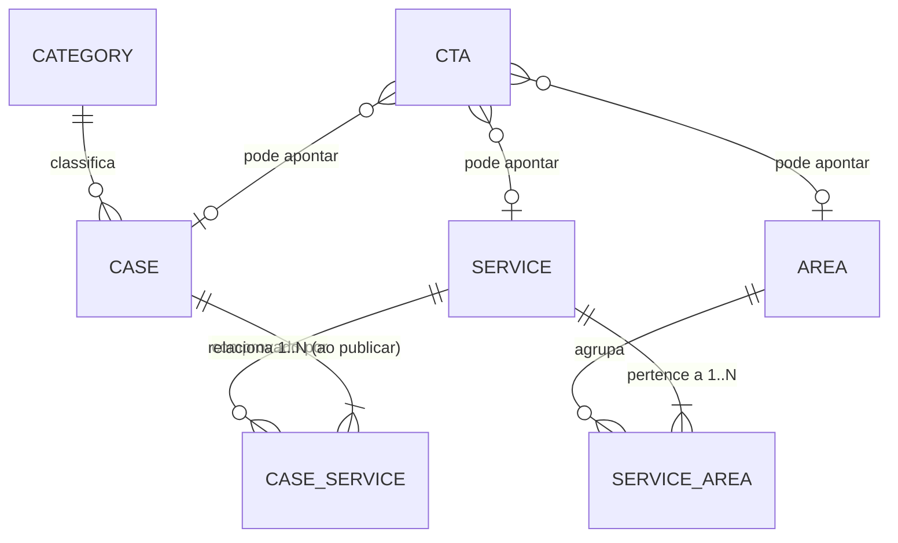

# Regras de integridade e relacionamento: áreas, serviços, cases e CTAs

| Campo           | Valor                                                                  |
| --------------- | ---------------------------------------------------------------------- |
| Issue           | TECH-05 (#56)                                                          |
| Responsável     | Vinícius Nishimura Reis (`@Vinishireis`)                               |
| Revisão técnica | Vinícius Binda (`@VinnizzZ`)                                           |
| Versão          | 1.0.0                                                                  |
| Data            | 13/10/2026                                                             |
| Código          | `lib/domain/content/{types,slug,visibility,integrity}.ts` + testes     |
| Insumo para     | DB-01/DB-02 (modelagem e constraints), ADM-06/07/08 (CRUDs), CASE-11   |

## 1. Modelo de relacionamentos

## 2. Matriz de cardinalidade

| Relação | Cardinalidade | Obrigatoriedade | Observação |
| ------- | ------------- | --------------- | ---------- |
| Serviço × Área | N:M | Serviço: ≥ 1 área sempre | Ex.: "Produção de Conteúdo" → Copywriting + Social Media |
| Case × Serviço | N:M | Case **publicado**: ≥ 1 serviço publicado | Rascunho pode ficar sem serviço |
| Case × Categoria | N:1 | Case **publicado**: categoria publicada | Categorias iniciais: Copywriting; Social Media & Criação; Assessoria de Imprensa |
| Case × Área | Derivada | — | Áreas do case = união das áreas dos seus serviços (não é gravada, evita inconsistência) |
| CTA × Destino | N:0..1 | Destino existente | Tipos: rota interna, link externo, serviço, case, área, contato (com serviço pré-selecionado) |

O modelo cobre as **6 áreas**, os **9 serviços** e **múltiplos cases** do relatório — verificado
pelo teste "aceita a estrutura do MVP" (`integrity.test.ts`).

## 3. Slugs

| Regra | Valor |
| ----- | ----- |
| Formato | `^[a-z0-9]+(?:-[a-z0-9]+)*$` (kebab-case, sem acento) |
| Tamanho | 3 a 80 caracteres |
| Unicidade | Por tipo de entidade (serviço e case podem ter o mesmo slug). Endereço antigo de outro item ou de item excluído também conta como usado (DB-08) |
| Reservados | `admin`, `api`, `novo`, `nova`, `editar`, `new`, `edit`, `preview`, `rascunho`, `todos`, `filtro`, `pagina` |
| Geração | `slugify(título)`; colisão recebe sufixo `-2`, `-3`… (`uniqueSlug`) |
| Alteração | Livre enquanto rascunho. Após a primeira publicação: serviço e case podem mudar, e o antigo responde 301 para o atual; área e categoria ficam fixas ([dicionário §10](../banco/dicionario-de-dados.md#10-slugs-e-urls-db-08)) |

## 4. Ordenação e destaques

- Toda listagem pública ordena por `order` (crescente) e, em empate, por nome/título (pt-BR).
- Home: no máximo **6 serviços** e **6 cases** em destaque (`featured`). Acima disso o CMS avisa (R11).

## 5. Conteúdo obrigatório para publicar

| Entidade | Campos obrigatórios ao publicar |
| -------- | ------------------------------- |
| Área | nome, slug, resumo (≤ 200), descrição |
| Serviço | nome, slug, resumo (≤ 200), descrição, ≥ 1 área |
| Categoria | nome, slug |
| Case | ver CASE-11 (título, cliente, categoria, ≥ 1 serviço, resumo, capa com `alt`) |
| CTA | rótulo (≤ 40), destino válido |
| Imagem | `alt` não vazio (exceto imagem decorativa marcada como tal) |

## 6. Regras verificadas (`findIntegrityIssues`)

| Código | Severidade | Regra |
| ------ | ---------- | ----- |
| R01 | Erro | Slug inválido |
| R02 | Erro | Slug duplicado no mesmo tipo |
| R03 | Erro | Serviço sem área |
| R04 | Erro | Referência a item inexistente (área, serviço, categoria, destino de CTA) |
| R05 | Aviso | Serviço publicado sem área publicada |
| R06 | Erro | Case publicado com categoria não publicada |
| R07 | Erro | Case publicado sem serviço publicado |
| R08 | Aviso | CTA publicado com destino não publicado (usa fallback) |
| R09 | Erro | Link externo sem `https` |
| R10 | Erro | Caminho interno fora das rotas públicas conhecidas |
| R11 | Aviso | Destaques acima do limite da Home |
| R12 | Erro | Imagem publicada sem texto alternativo |

**Erros** bloqueiam a publicação no CMS. **Avisos** aparecem para o editor, mas o site permanece
íntegro.

## 7. Arquivamento, exclusão e fallback de links

| Operação | Bloqueia quando | Avisa quando |
| -------- | --------------- | ------------ |
| Arquivar/excluir **categoria** | Há case publicado na categoria | — |
| Arquivar/excluir **área** | Algum serviço publicado ficaria sem área publicada | CTAs apontam para a área |
| Arquivar/excluir **serviço** | Algum case publicado ficaria sem serviço publicado | Vínculos com cases deixam de aparecer; CTAs apontam para o serviço |
| Arquivar/excluir **case** | — | CTAs apontam para o case |

- Exclusão definitiva só é permitida para itens **arquivados** e apenas por `admin`/`super_admin`.
- Excluir remove os vínculos N:M (cascade nas tabelas de junção); CTAs órfãos passam a falhar em R04
  e são sinalizados no CMS.
- **Fallback de links** (`resolveCtaHref`): destino não visível nunca gera 404 —

| Destino original | Fallback |
| ---------------- | -------- |
| Serviço | `/servicos` |
| Case | `/cases` |
| Área | `/areas` |
| Contato com serviço pré-selecionado | `/contato#formulario` |
| Rota interna inválida / link externo inválido | `/` |

- Listas de relacionados (ex.: "Cases deste serviço") mostram apenas itens visíveis.
- Acesso direto à URL de item não publicado retorna **404** (sem revelar que o item existe).

## 8. Como o banco deve refletir estas regras (para DB-01/DB-02)

| Regra | Constraint sugerida |
| ----- | ------------------- |
| Slug | `check (slug ~ '^[a-z0-9]+(-[a-z0-9]+)*$' and length(slug) between 3 and 80)` + `unique (slug)` por tabela |
| Estados | `check (status in ('draft','published','archived'))` |
| Publicado tem data | `check (status <> 'published' or published_at is not null)` |
| Serviço ≥ 1 área | Validação na aplicação + trigger `deferrable` opcional em `service_areas` |
| Junções | `service_areas(service_id, area_id)` e `case_services(case_id, service_id)` com `on delete cascade` |
| Categoria do case | FK `on delete restrict` (exclusão só após remover cases da categoria) |
