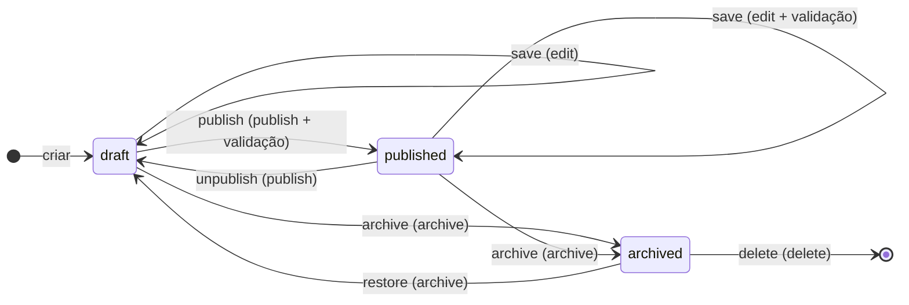

# Máquina de estados e invariantes de publicação do CMS

| Campo        | Valor                                                                    |
| ------------ | ------------------------------------------------------------------------ |
| Issue        | TECH-04 (#106)                                                           |
| Responsável  | Vinícius Nishimura Reis (`@Vinishireis`)                                 |
| Versão       | 1.0.0                                                                    |
| Data         | 13/10/2026                                                               |
| Depende de   | [ADM-12 — fluxo](fluxo-de-publicacao.md), [TECH-03 — RBAC](../seguranca/matriz-rbac.md) |
| Código       | `lib/domain/content/publication.ts` · testes `publication.test.ts`       |

## 1. Diagrama completo

Entre parênteses: permissão RBAC exigida (`COMMAND_PERMISSION`).

## 2. Tabela de transições

| Estado atual \ Comando | `save` | `publish` | `unpublish` | `archive` | `restore` | `delete` |
| ---------------------- | ------ | --------- | ----------- | --------- | --------- | -------- |
| `draft` | draft | published | ✖ | archived | ✖ | ✖ |
| `published` | published* | ✖ | draft | archived | ✖ | ✖ |
| `archived` | ✖ | ✖ | ✖ | ✖ | draft | removido |

\* "Salvar" um item publicado aplica a mesma validação da publicação e vai ao ar imediatamente
(decisão de ADM-12). ✖ = `INVALID_TRANSITION`.

## 3. Ordem de verificação (`transition()`)

1. **Transição existe?** senão `INVALID_TRANSITION` (409 na API).
2. **Papel permite?** senão `FORBIDDEN` (403).
3. **Destino é `published`?** valida campos obrigatórios; falha → `VALIDATION_FAILED` (422) com
   lista de problemas para o formulário do CMS.
4. Calcula campos de controle: `published_at` só é definido na **primeira** publicação;
   `archived_at` definido ao arquivar e limpo ao sair de arquivado.
5. A camada de servidor persiste, **registra auditoria** (TECH-10) e **invalida o cache** das
   páginas afetadas (TECH-09) — na mesma Server Action.

## 4. Invariantes

| # | Invariante | Garantia |
| - | ---------- | -------- |
| I1 | APIs e páginas públicas **jamais** retornam `draft` ou `archived` | `isPubliclyVisible()` no repositório + RLS `anon` só lê `published` |
| I2 | `published` ⇒ `published_at` preenchido | `transition()` + `check` no banco + `checkInvariants()` |
| I3 | `archived` ⇔ `archived_at` preenchido | `transition()` + `checkInvariants()` |
| I4 | Exclusão só a partir de `archived` | Tabela de transições |
| I5 | Nada é publicado incompleto (inclusive edição de item publicado) | `validateForPublish` em `publish` e `save` de publicado |
| I6 | Toda transição respeita a matriz RBAC | `COMMAND_PERMISSION` + `can()` |
| I7 | Toda transição é auditada | Server Action chama `recordAuditEvent` (TECH-10) |
| I8 | Toda transição que afeta o público invalida o cache | `invalidateContent()` (TECH-09) |
| I9 | Integridade entre entidades preservada | `assessRemovalImpact()` antes de `archive`/`delete` (TECH-05) |

## 5. Comportamentos específicos

| Situação | Comportamento |
| -------- | ------------- |
| Alteração em item publicado | Revalida e publica ao salvar; painel mostra aviso antes de confirmar |
| Links quebrados | Arquivar/excluir passa por `assessRemovalImpact`; links usam fallback (TECH-05) |
| Agendamento | **Não obrigatório no MVP.** `published_at` futuro já é respeitado pelo filtro público, mas o painel não expõe a opção |
| Visibilidade por API | `/api/v1/*` reutiliza o repositório público; o parâmetro `status` não é aceito publicamente |
| Pré-visualização | Rota autenticada do painel lê rascunho diretamente (ADM-14), nunca pelo cache público |
| Concorrência | Gravação usa `updated_at` como versão otimista; conflito → `CONFLICT` (409) e o editor recarrega |

## 6. Casos de teste de transição

Automatizados em `publication.test.ts` (13 testes):

- todas as combinações estado × comando fora da tabela retornam `INVALID_TRANSITION`;
- publicar define `published_at`; republicar preserva a data original;
- arquivar define `archived_at`; restaurar volta para rascunho e limpa a data;
- excluir só a partir de arquivado e só para `admin`/`super_admin`;
- `viewer` não salva nem publica; sessão sem papel é negada;
- `allowedCommands()` lista apenas os botões que o papel pode ver;
- publicar/salvar publicado com conteúdo incompleto retorna `VALIDATION_FAILED`;
- `checkInvariants()` detecta estados inconsistentes.

Casos que dependem de banco/servidor (QA-04): I1 via chave anônima, I7 registro de auditoria,
I8 conteúdo atualizado no site em até 60 s após publicar.
