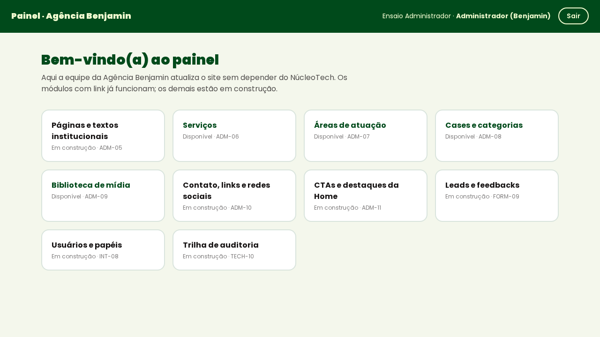
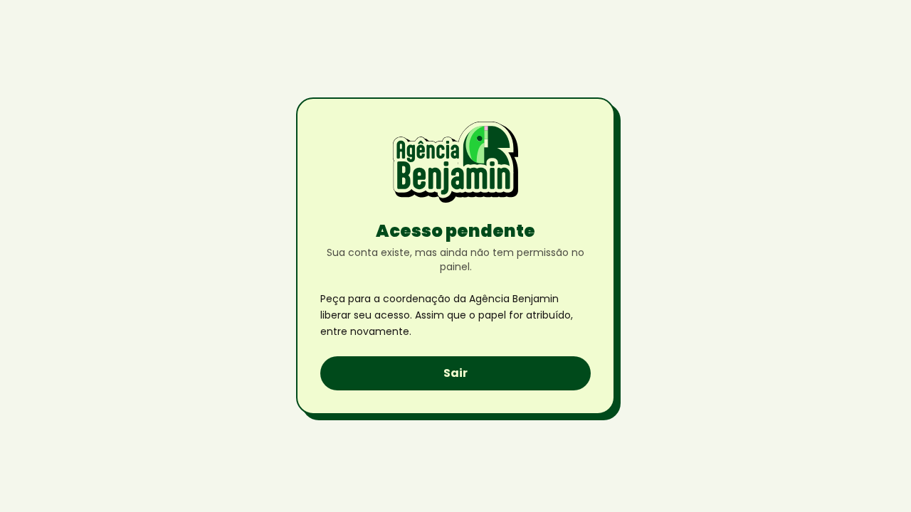

# Cadastro inicial de administradores da Agência Benjamin

| Campo        | Valor                                                                 |
| ------------ | --------------------------------------------------------------------- |
| Issue        | INT-08 (#174)                                                         |
| Responsável  | Vinícius Nishimura Reis (`@Vinishireis`)                              |
| Versão       | 1.1.0 — templates de e-mail e ensaio local (27/10/2026)               |
| Data         | 13/10/2026                                                            |
| Depende de   | ADM-02 (autenticação), ADM-03 (proteção), CON-10 (indicação dos representantes) |
| Ferramenta   | `scripts/provision-admin.mjs` (+ testes)                              |

## 1. Regras

1. **Ninguém compartilha senha.** A conta é criada por convite; a pessoa define a própria senha pelo
   link do e-mail (`/admin/nova-senha`).
2. Só pessoas **indicadas formalmente pela Benjamin** (CON-10) recebem convite — por comentário na
   issue INT-08 ou e-mail da coordenação da Benjamin.
3. Papel mínimo necessário (ADM-01): coordenação da Benjamin → `admin`; equipe que atualiza o site →
   `editor`; NúcleoTech → 1 `super_admin` + 1 backup.
4. Convite não aceito = sem senha = **sem acesso**. Conta com papel `pending` também não acessa.
5. Todo convite fica registrado na auditoria (`user.invited`).

## 2. Passo a passo

1. Receber a lista de nomes e e-mails institucionais da Benjamin (CON-10).
2. Em **homologação** primeiro (validação do fluxo), com as variáveis do ambiente:

   ```bash
   node --env-file=.env.hml scripts/provision-admin.mjs \
     --email nome@dominio --name "Nome Completo" --role admin --confirm hml
   ```

   Use `--dry-run` para conferir antes. O script exige `--confirm <ambiente>` igual ao ambiente das
   variáveis carregadas (`dev`, `preview`, `hml`, `prd`).
3. A pessoa abre o e-mail, define a senha e entra em `/admin/login`.
4. Confirmar com a pessoa que o painel abriu com o papel certo (nome e papel aparecem no topo).
5. Repetir em **produção** (`--confirm prd`) somente após o go/no-go (TECH-14), executado por quem
   tem acesso de produção (ARC-06).
6. Registrar na issue INT-08: nome, papel, ambiente e data — **sem** senha, link ou token.

## 3. Ajustes e desligamento

| Ação | Como |
| ---- | ---- |
| Mudar papel | Pelo painel (quando ADM/usuários existir) ou `select public.assign_role('<uuid>', 'editor')` com sessão de `super_admin`/`admin` — auditado |
| Desligar pessoa | `select public.set_profile_active('<uuid>', false)` no mesmo dia (GO-09) — sessões deixam de ter acesso na próxima requisição |
| Reenviar convite | Rodar o script novamente para o mesmo e-mail (o Supabase reenvia) |

## 4. Verificação (critério de aceite)

- [ ] Usuários autorizados entram no CMS em homologação e em produção.
- [ ] Convite não aceito não acessa (sem senha) e conta `pending` vê "Acesso pendente".
- [ ] Registro na issue sem nenhuma credencial.

## 5. Ensaio do fluxo completo — 27/10/2026 (Supabase local)

O convite depende de um e-mail cujo link leve o `token_hash` para `/admin/auth/callback`. O template
padrão do Supabase devolve o token no fragmento da URL (`#access_token`), que o servidor não lê, e
o repositório ainda não tinha os templates: o link cairia em "link inválido". Agora eles estão
versionados em `supabase/templates/` (convite e recuperação de senha) e ativados no
`supabase/config.toml`. Em homologação e produção, copiar o mesmo assunto e HTML em
**Authentication → Email Templates** do projeto.

Ensaio com duas contas fictícias (`--confirm dev`), e-mail real recebido no Mailpit local e
navegador:

| Passo | Resultado |
| ----- | --------- |
| `--dry-run` | Mostra o convite e o endereço de retorno, sem criar nada |
| Convite de um `admin` e de um `pending` | Contas criadas; cada convite gera um evento `user.invited` na auditoria |
| Tentar entrar antes de aceitar o convite | Recusado: "E-mail ou senha inválidos" (a conta ainda não tem senha) |
| E-mail recebido | Assunto "Convite para o painel da Agência Benjamin", link para `/admin/auth/callback?token_hash=…&type=invite&next=/admin/nova-senha` |
| Abrir o link e criar a senha | O `admin` entra no painel com nome e papel no topo; o `pending` vê "Acesso pendente" |
| Senha fraca | Recusada com a orientação "Combine letras e números." |

| `admin` depois de aceitar o convite | `pending` depois de aceitar o convite |
| ----------------------------------- | ------------------------------------- |
|  |  |

No ambiente local, o `site_url` do Supabase passou a ser `http://localhost:3000`, o mesmo endereço
do `next dev`/`next start`. Com `127.0.0.1`, o cookie de sessão gravado no retorno do convite não
valia no endereço para onde o app redireciona, e a pessoa caía no login.

**Situação:** ferramenta, templates e procedimento prontos e ensaiados; a execução real aguarda os
nomes e e-mails dos representantes (CON-10, no pedido de aprovação à Benjamin) e os ambientes
(GO-02).
