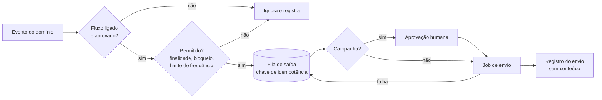

# Automações de comunicação e campanhas (pós-MVP)

| Campo        | Valor                                                                                        |
| ------------ | -------------------------------------------------------------------------------------------- |
| Issue        | FUT-03 (#204)                                                                                |
| Responsável  | Gustavo Duarte Güering (sugerido na issue; usuário do GitHub ainda a confirmar, GOV-06)      |
| Revisão      | A confirmar (o `ownership-por-issue.csv` indica Vinícius Nishimura Reis como backup)         |
| Versão       | 1.0.0 — **proposta de novo escopo (não faz parte do MVP)**                                   |
| Data         | 04/11/2026                                                                                   |
| Origem       | NT-ATA-2026-003 e NT-PRJ-2026-001; RN-08 do [mapa de requisitos](../requisitos/mapa-de-requisitos.md) |
| Base técnica | [Captação e roteamento](../formularios/captacao-e-roteamento.md) (TECH-06), [idempotência](../formularios/idempotencia-e-falhas.md) (TECH-07), [ciclo de vida de dados](../seguranca/ciclo-de-vida-dados-pessoais.md) (TECH-08), [auditoria](../seguranca/trilha-de-auditoria.md) (TECH-10) |
| Depende de   | [FUT-02](newsletter.md) para campanhas; [FUT-01](evolucao-crm.md) para fluxos por etapa comercial |

> As bases legais abaixo são sugestões técnicas: a decisão é institucional (SEG-02). **Nenhuma automação
> envia comunicação em massa sem aprovação humana registrada.**

## 1. Objetivo

Definir quais comunicações podem sair sozinhas a partir de eventos do site e da operação, com quais
gatilhos, para quem e com quais regras sobre os dados, para que a Benjamin responda mais rápido sem
transformar os dados de um formulário em lista de marketing.

## 2. O que o MVP já entrega (ponto de partida)

- **Um único fluxo automático:** o envio de formulário grava o registro e avisa os destinatários
  internos (`processSubmission`), com reenvio por um job protegido por `CRON_SECRET` (TECH-06, TECH-07).
  A falha do e-mail não perde o pedido.
- **Quem preencheu o formulário não recebe e-mail do sistema.** Vê o protocolo na tela.
- **Atendimento com status** (`novo`, `em_atendimento`, `respondido`, `lido`, `arquivado`), mas sem tela
  no painel ainda (FORM-09).
- **Trilha de auditoria não é fila de eventos.** Guarda identificadores para responsabilização, com
  catálogo fechado. Reaproveitá-la como gatilho misturaria finalidades.
- **Sem agendador declarado no repositório:** `vercel.json` não tem `crons`. O cron de 15 min é configurado
  no provisionamento, e crons frequentes exigem plano pago da Vercel (GO-02).
- **Finalidade limitada:** a TECH-08 (§2) diz que dados de formulário "não são reaproveitados para marketing".

## 3. Tipos de comunicação

A base legal e o que é permitido dependem do tipo. Um fluxo não muda de tipo sem nova aprovação.

| Tipo | Exemplo | Para quem | Base legal sugerida | Saída voluntária | Pode vir antes da FUT-02? |
| ---- | ------- | --------- | -------------------- | ---------------- | ------------------------- |
| Operacional interna | Lembrete de pedido sem andamento | Equipe da Benjamin | Não trata novo dado do titular além do atendimento | Por configuração | Sim |
| Transacional | Confirmação de recebimento | Quem enviou o formulário | A mesma do formulário (SEG-01 §2) | Não se aplica: é uma resposta única | Sim |
| Relacionamento | Pesquisa depois de um projeto | Cliente atendido | A validar caso a caso | Sim, com descadastro | Depende do CRM |
| Campanha | Edição de newsletter, novo case | Assinantes | Consentimento (FUT-02 §4) | Sim, um clique | **Não** |

## 4. Eventos, gatilhos e disparos propostos

| # | Fluxo | Evento ou gatilho | Disparo | Dados usados | Tipo | Depende de | Prioridade |
| - | ----- | ----------------- | ------- | ------------ | ---- | ---------- | ---------- |
| A1 | Confirmação de recebimento | Registro de `lead` ou `contact` gravado, fora de duplicado e de suspeita de spam | E-mail ao titular com o protocolo | E-mail, nome, protocolo | Transacional | Remetente (GO-03) | Média |
| A2 | Pedido sem andamento | `status = 'novo'` além do prazo definido (D5) | Aviso à equipe | Só contagem e protocolos | Operacional | FORM-09 | Alta |
| A3 | Resumo periódico | Agendado | Totais por tipo e serviço à equipe | Só agregados | Operacional | [FUT-06](analytics-avancado.md) IND-04 | Média |
| A4 | Feedback pede retorno | `feedback` com `allowContact = true` | Tarefa para a equipe; resposta humana | E-mail, nome | Operacional | FORM-09 | Média |
| A5 | Pesquisa após projeto | Oportunidade concluída | E-mail ao cliente, depois de revisão humana | E-mail, nome | Relacionamento | FUT-01 | Baixa |
| A6 | Boas-vindas | Assinatura confirmada | E-mail único ao assinante | E-mail, nome | Campanha | FUT-02 | Baixa |
| A7 | Novo case publicado | Publicação de um case | **Rascunho** de edição para revisão; o envio exige aprovação | Título e resumo do case | Campanha | FUT-02 | Baixa |

**Fora deste escopo:** WhatsApp e SMS (FUT-07 I8), réguas de venda, pontuação de leads, anúncios e
integração com CRM de mercado (FUT-07 I7).

## 5. Governança de dados

| Regra | Como vale | Conferência |
| ----- | --------- | ----------- |
| Finalidade | Cada fluxo declara finalidade, dados, tipo e base. Fluxo novo ou alterado passa por aprovação | Catálogo em código, com teste |
| Sem reaproveitamento | Dado de formulário nunca alimenta campanha. Só entra quem consentiu na FUT-02 | Teste: a fila de campanha só aceita assinante confirmado |
| Minimização | Avisos internos levam protocolo e link para o painel, sem repetir a mensagem do titular | Teste do conteúdo gerado |
| Opt-out | Lista de bloqueio única, consultada por **todo** fluxo que escreve a titular, salvo a resposta transacional única | Teste por fluxo |
| Frequência | Limite por pessoa e por período (D5) | Teste |
| Retenção | Registro de envio guarda identificador, fluxo, data e resultado. Sai junto do registro de origem ou no prazo da D6 | Rotina de retenção (TECH-08) |
| Logs | Sem e-mail, nome ou mensagem (`logger` mascara, ADR-0004) | `logger.test.ts` |
| Acesso | Só `admin` vê os registros de envio com dado pessoal; `super_admin` não vê por padrão | pgTAP |
| Auditoria | Ligar, desligar ou alterar um fluxo e aprovar uma campanha são eventos críticos | Teste do catálogo |
| Ambientes | Desenvolvimento e prévia não enviam; homologação só para a equipe; produção com dados reais que não saem de lá (ARC-06) | Variáveis por ambiente |
| Interrupção | Interruptor geral e por fluxo, sem deploy | E2E |
| Mapa de dados | SEG-01 e aviso de privacidade atualizados **antes** de ligar cada fluxo novo | Critério de entrada |

Aprovação por fluxo (preencher quando houver decisão; nada está aprovado):

| Fluxo | Finalidade validada | Base legal validada | Texto aprovado | Responsável pelo fluxo |
| ----- | -------------------- | -------------------- | -------------- | ---------------------- |
| A1 | ⏳ | ⏳ | ⏳ | A definir |
| A2 | ⏳ | ⏳ | ⏳ | A definir |
| A3 | ⏳ | ⏳ | ⏳ | A definir |
| A4 | ⏳ | ⏳ | ⏳ | A definir |
| A5 | ⏳ | ⏳ | ⏳ | A definir |
| A6 | ⏳ | ⏳ | ⏳ | A definir |
| A7 | ⏳ | ⏳ | ⏳ | A definir |

## 6. Proposta técnica (a validar)

| Camada | Mudança |
| ------ | ------- |
| Domínio | `lib/domain/communications/`: catálogo fechado de fluxos, tipos, regras de elegibilidade e chave de idempotência (fluxo + alvo + versão) |
| Banco | `communication_flows` (ligado, versão aprovada, quem aprovou), `communication_outbox` (fila) e `communication_log` (resultado, sem conteúdo), com RLS, rollback e pgTAP |
| Servidor | `lib/server/communications/`: quem gera o evento grava na fila; o job envia. A fila na mesma transação evita enviar sem ter gravado e perder o envio se o processo cair |
| Envio | Mesma interface de `notifier.send` usada nos formulários; falha com o mesmo recuo de TECH-07 |
| Agendamento | Route Handler protegido por segredo, chamado por Vercel Cron ou `pg_cron` (D7) |
| RBAC | Recurso novo `communication` (`view`, `edit`, `approve`), só `admin`. No mesmo PR: `rbac.ts`, seed e matriz (regra 5 da TECH-03) |
| Auditoria | `communication.flow_changed` e `communication.campaign_approved` críticos, no catálogo e no `check` de `audit_log` |
| Painel | Lista de fluxos com estado, último envio e falhas; aprovação de campanhas |
| Documentação | SEG-01, TECH-08, dicionário de dados, guia do painel, variáveis |

Cuidado no fluxo A1: mandar e-mail a quem digitou um endereço permite usar o formulário para atingir
terceiros. Ele vale só depois do honeypot, do tempo mínimo e do limite por origem, não envia em duplicado
e **não repete o texto digitado**, só o protocolo. O limite por endereço de destino seria novo.

## 7. Estimativa preliminar

| Bloco | Horas |
| ----- | ----- |
| Migration, RLS, RBAC, auditoria e pgTAP | 4–6 |
| Motor: catálogo, fila, job, idempotência e limites | 8–12 |
| Fluxos A1 a A4 | 6–9 |
| Painel de fluxos | 6–10 |
| Testes de governança, E2E e documentação | 6–8 |
| **Total** | **30–45 h** |
| A5, A6 e A7 | Reavaliar junto de FUT-01 e FUT-02 |

Feita por comparação com a FUT-05 (23–32 h) e a [FUT-02](newsletter.md) (42–60 h). Não foi medida em
código e deve ser revista pela coordenação. Se a Benjamin só quiser A1 e A2, um job simples pode bastar,
sem o motor, com custo bem menor: essa é a decisão D1.

## 8. Critérios de entrada (antes de começar)

- [ ] MVP publicado (GO-06) e tela de leads em uso (FORM-09).
- [ ] Remetente verificado em domínio institucional (GO-03, CON-11) e destinatários definidos (CON-10).
- [ ] Benjamin indica quais fluxos quer e quem responde por eles (D1, D2).
- [ ] Coordenação aprova o novo escopo e a estimativa (GOV-12, classificação "novo requisito").
- [ ] Validação institucional das finalidades, bases legais e textos (SEG-02).
- [ ] Para campanhas: FUT-02 implementada e com envio aprovado.
- [ ] Priorização no backlog pós-MVP.

## 9. Critérios de aceite da implementação

- [ ] Fluxo desligado não gera envio; ligar e desligar fica na auditoria.
- [ ] Evento repetido não envia duas vezes (chave de idempotência).
- [ ] Falha no envio não afeta o formulário nem a publicação que originou o evento.
- [ ] Endereço na lista de bloqueio não recebe relacionamento nem campanha.
- [ ] Dado de formulário sem consentimento não entra na fila de campanha (teste negativo).
- [ ] Campanha sem aprovação registrada não sai.
- [ ] Aviso interno não contém a mensagem do titular.
- [ ] Interruptor geral para todos os envios sem deploy.
- [ ] Em desenvolvimento e prévia, nada é enviado.

## 10. Riscos e decisões pendentes

| Risco | Mitigação |
| ----- | --------- |
| Uso de dado de formulário para marketing, contrariando a TECH-08 | Separação por tipo, com teste negativo e aprovação por fluxo |
| Formulário vira meio de enviar e-mail a terceiros (A1) | Anti-abuso antes do envio, sem texto do usuário, limite por destino |
| Automação ligada e esquecida, com texto ou destinatário desatualizado | Responsável por fluxo, última revisão visível e rotina de revisão no suporte ([GO-11](../operacao/suporte-e-evolucao.md)) |
| Agendador indisponível no plano contratado | Decisão D7 antes de começar |
| Lembrete inútil sem tela de atendimento | FORM-09 é critério de entrada |
| Reputação do domínio afetada por campanhas | Subdomínio e regras da FUT-02 §7 |

Decisões que dependem da Agência Benjamin, da FECAP e da coordenação:

- **D1.** Quais dos fluxos A1 a A7 a Benjamin quer, e em que ordem?
- **D2.** Quem responde por cada fluxo e aprova textos e campanhas?
- **D3.** A confirmação ao titular (A1) é desejada? Com qual texto?
- **D4.** Motor próprio ou ferramenta de mercado, caso a Benjamin já use uma?
- **D5.** Qual o prazo do lembrete de pedido sem andamento e o limite de mensagens por pessoa?
- **D6.** Por quanto tempo guardar o registro de envios?
- **D7.** Vercel Cron em plano pago ou `pg_cron` no Supabase? Com qual plano?
- **D8.** Há horários em que nada deve sair (noite, fim de semana, férias da agência)?

Nada desta proposta é implementado antes da aprovação acima. O MVP segue só com os avisos internos dos
formulários e isso não o bloqueia.
