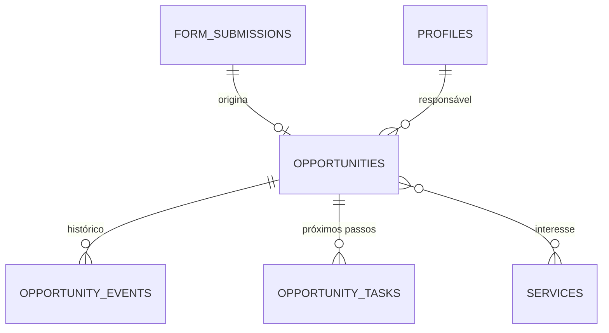

# Evolução do módulo de leads para CRM (pós-MVP)

| Campo        | Valor                                                                    |
| ------------ | ------------------------------------------------------------------------ |
| Issue        | FUT-01 (#202)                                                            |
| Responsável  | Vinícius Nishimura Reis (`@Vinishireis`)                                 |
| Versão       | 1.0.0 — **proposta de novo escopo (não faz parte do MVP)**               |
| Data         | 13/10/2026                                                               |
| Origem       | ATA §3 e §4.7; PRJ §26 ("não deve ser considerado parte obrigatória do MVP") |
| Base técnica | `form_submissions` (TECH-07), roteamento (TECH-06), RBAC (TECH-03), auditoria (TECH-10), retenção (TECH-08) |

## 1. Objetivo

Transformar os pedidos recebidos pelo site em **oportunidades acompanhadas** pela Benjamin: quem
está atendendo, em que etapa está, o que já foi conversado e o que virou projeto — sem planilhas
paralelas e respeitando a LGPD.

## 2. O que o MVP já entrega (ponto de partida)

- Leads, contatos e feedbacks separados, categorizados e com protocolo.
- Status de atendimento simples (`novo`, `em_atendimento`, `respondido`, `arquivado`).
- Consulta restrita a `admin`, auditoria de acesso, retenção definida.

## 3. Escopo proposto

| Funcionalidade | Descrição | Prioridade |
| -------------- | --------- | ---------- |
| Funil de oportunidades | Etapas configuráveis: Novo → Qualificação → Proposta → Negociação → Ganho / Perdido (com motivo) | Alta |
| Atribuição | Responsável pela oportunidade (integrante da Benjamin) e fila "sem dono" | Alta |
| Histórico | Linha do tempo por oportunidade: notas, mudanças de etapa, e-mails enviados (registro manual) | Alta |
| Tarefas e lembretes | Próximo passo com data; lista "para hoje" | Média |
| Vínculo com serviços e cases | Serviço(s) de interesse e case gerado quando o projeto é concluído | Média |
| Painel de indicadores | Leads por origem/serviço, taxa de conversão, tempo médio de resposta | Média |
| Exportação controlada | CSV por período (já previsto em TECH-08/TECH-10) | Baixa |

**Fora deste escopo:** automação de e-mails/newsletter (FUT-02/FUT-03), integração com CRMs de
mercado (avaliada em FUT-07), valor financeiro de propostas (a validar com a agência).

## 4. Modelo de dados (proposta)

- `opportunities` (id, submission_id, title, stage, owner_id, lost_reason, won_case_id, created_at, updated_at)
- `opportunity_events` (append-only: tipo, nota, autor, data)
- `opportunity_tasks` (descrição, prazo, responsável, concluída)
- Novos recursos RBAC: `opportunity:view|create|edit|manage` (`admin` + papel novo `comercial`, a definir).

## 5. LGPD e segurança

- Mesma base legal dos leads (procedimentos preliminares a contrato) — **revalidar** com SEG-02.
- Retenção: oportunidade perdida segue a retenção do lead (12 meses); ganha segue a política de contratos.
- Notas não podem conter dados sensíveis (orientação na interface + revisão periódica).
- Acesso restrito por papel, auditado (`opportunity.viewed`, `opportunity.stage_changed`).

## 6. Estimativa

| Bloco | Horas |
| ----- | ----- |
| Modelagem, migrations, RLS e RBAC | 12–16 |
| Funil (kanban) e detalhe com histórico | 24–32 |
| Atribuição, tarefas e lembretes | 12–16 |
| Indicadores | 10–14 |
| Testes (unidade, E2E) e documentação | 12–16 |
| **Total** | **70–94 h** (≈ 3–4 semanas com 2 pessoas em dedicação parcial) |

## 7. Aprovação necessária antes de implementar

- [ ] Benjamin confirma necessidade, etapas do funil e quem usará (papéis/quantidade).
- [ ] Coordenação aprova o novo escopo e a estimativa (GOV-12 — classificação "novo requisito").
- [ ] Validação institucional da base legal e retenção (SEG-02).
- [ ] Priorização no backlog pós-MVP.

**27/10/2026:** as perguntas sobre necessidade, quem usaria e etapas do funil foram incluídas no pedido
de aprovação à Benjamin ([página](https://claude.ai/artifact/4TJ8vhTDLW6PYfSfCAqLti), decisão 4), marcadas como "pode esperar": o CRM não
bloqueia o MVP.
