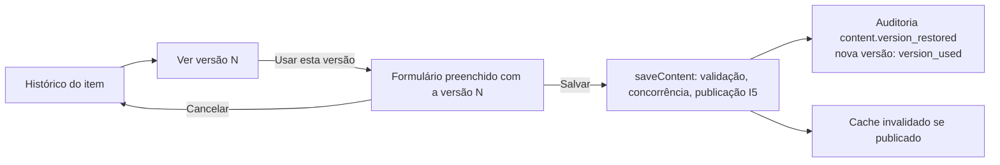

# Histórico e restauração de versões do CMS (pós-MVP)

| Campo        | Valor                                                                                        |
| ------------ | -------------------------------------------------------------------------------------------- |
| Issue        | FUT-04 (#205)                                                                                |
| Responsável  | Murilo Ribeiro Vasconcellos (`@murilovasconcellos`) · redação: Vinícius Nishimura Reis (`@Vinishireis`) |
| Versão       | 1.0.0 — **proposta de novo escopo (não faz parte do MVP)**                                   |
| Data         | 27/10/2026                                                                                   |
| Origem       | ATA §4.6 ("será avaliada a implementação de histórico de versões"); PRJ §24; [ADR-0007](../adr/0007-historico-de-versoes.md) (ADM-17) |
| Base técnica | Serviço de conteúdo do CMS (ADM-06/07/08), fluxo de publicação (TECH-04, ADM-12), auditoria (TECH-10), RBAC (TECH-03), backup (DB-10) |

## 1. Objetivo

Permitir que a equipe da Benjamin veja como um conteúdo do site estava antes, compare com o atual
e volte a uma versão anterior pelo próprio painel, sem pedir restauração de backup ao NúcleoTech e
sem abrir mão das validações, da auditoria e da atualização do site que o CMS já faz.

## 2. O que o MVP já entrega (ponto de partida)

- Auditoria de cada operação: `content.created`, `content.updated`, `content.published`,
  `content.unpublished`, `content.archived`, `content.restored` e `content.deleted`, com autor,
  papel, item e slug (`audit_log`, TECH-10).
- `updated_at`/`updated_by` em todas as tabelas de conteúdo e concorrência otimista: a segunda
  gravação de quem abriu o formulário antes é recusada (QA-04, CT-07).
- Exclusão só de item arquivado e só por `admin`; arquivar tira do site sem apagar (TECH-04).
- Backup diário do banco e da mídia, com restauração assistida (DB-10).

O que falta: o **conteúdo** anterior. A auditoria diz quem mudou e quando, mas não guarda o texto
que existia antes. Um resumo sobrescrito só volta por backup, e o backup restaura o banco inteiro.

## 3. O que muda em relação ao ADR-0007

O ADR-0007 foi escrito antes do CMS existir. Com o serviço de conteúdo construído, duas premissas
dele não se sustentam:

| ADR-0007 previa | Como o CMS funciona | Consequência para esta proposta |
| --------------- | ------------------- | ------------------------------- |
| Gravar a versão **ao publicar** | Editar um item publicado o mantém publicado: a alteração vai ao ar no "Salvar", sem novo "Publicar" (I5, `saveContent`) | Gravar uma versão a **cada gravação** que muda o conteúdo (criar e salvar). Mudanças só de estado (publicar, arquivar) já estão na auditoria e entram na linha do tempo a partir dela |
| Restaurar como **novo rascunho**, sem tocar no publicado | Cada item é **uma linha**; não existe cópia de trabalho separada da versão no ar | Usar uma versão **preenche o formulário** com o conteúdo dela; ao salvar, valem as mesmas regras de sempre (validação de publicação, concorrência, auditoria, cache). Para um item publicado, o aviso "a alteração será publicada imediatamente" continua valendo |
| "Restaurar" | "Restaurar" já é o comando que tira um item do arquivo e o devolve a rascunho | Na interface, o botão é **"Usar esta versão"**, e o evento de auditoria é novo: `content.version_restored` |

Uma cópia de trabalho separada (rascunho de item publicado) resolveria o "sem tocar no publicado",
mas muda o modelo de todas as tabelas e o fluxo de publicação inteiro. Fica fora desta proposta.

## 4. Escopo proposto

| Funcionalidade | Descrição | Prioridade |
| -------------- | --------- | ---------- |
| Linha do tempo do item | Versões (número, data, autor, estado na hora) intercaladas com os eventos de publicação da auditoria | Alta |
| Ver versão | Conteúdo da versão em modo leitura, com o nome dos campos como no painel | Alta |
| Usar esta versão | Abre o formulário de edição preenchido com a versão; nada muda até salvar | Alta |
| Comparar com a atual | Campo a campo: texto antes/depois; listas (serviços, galeria, links) com itens incluídos e removidos | Média |
| Retenção automática | Limpeza mensal das versões antigas (seção 6) | Média |
| Recriar item excluído | `admin` recria um item excluído a partir da última versão | Baixa (fase 2) |

**Entidades:** áreas, serviços, categorias e cases na primeira entrega, as que o painel já edita.
Páginas e blocos, CTAs e configuração entram quando ADM-05, ADM-10 e ADM-11 existirem: cada
entidade do CMS é uma `EntityDefinition` (`lib/server/cms/entities.ts`), e o histórico se apoia
nela, sem código específico por tipo.

**Fora deste escopo:** arquivos de mídia (são imutáveis no Storage e só podem ser excluídos sem uso;
voltam por backup), leads e formulários, desfazer agendamento de publicação, comparação palavra a
palavra.

## 5. Como funciona (proposta técnica)

### 5.1 O que é uma versão

A versão guarda a **entrada do formulário já validada**: o `I` da `EntityDefinition`, com campos,
slug, vínculos N:M (áreas do serviço, serviços do case) e ids da galeria e da capa. É o mesmo
formato que `inputSchema` aceita. Usar a versão é, portanto, passar esse objeto pelo mesmo
`safeParse` de uma gravação comum, e a versão nunca fura uma regra que o formulário aplicaria.

```sql
create table public.content_versions (
  id bigint generated always as identity primary key,
  entity text not null check (entity in ('area', 'service', 'category', 'case')),
  entity_id uuid not null,                       -- sem FK: a versão sobrevive à exclusão do item
  version integer not null check (version > 0),  -- 1, 2, 3… por item, atribuído no banco
  action text not null check (action in ('created', 'updated', 'version_used')),
  status public.publish_status not null,         -- estado do item na hora (a versão "foi ao ar"?)
  snapshot jsonb not null check (jsonb_typeof(snapshot) = 'object'),
  schema_version smallint not null default 1,    -- formato do snapshot, para ler versões antigas
  created_by uuid references auth.users (id) on delete set null,
  created_at timestamptz not null default now(),
  request_id text,
  unique (entity, entity_id, version)
);
```

- **Numeração:** um gatilho `before insert` atribui `max(version) + 1` do item sob
  `pg_advisory_xact_lock`, para duas gravações simultâneas não gerarem o mesmo número.
- **Imutável:** RLS permite `select` a quem tem `view` no recurso da entidade e `insert` a quem tem
  `create`/`edit`. Nenhuma política de `update` ou `delete`: só o job de retenção (service role)
  apaga.
- **Sem dado pessoal novo:** o snapshot contém o mesmo conteúdo institucional das tabelas; o autor
  fica em `created_by` (id), como em `updated_by`.

### 5.2 Gravação

Em `saveContent` (`lib/server/cms/content-service.ts`), depois do item, dos vínculos e da galeria e
antes da auditoria: `store.recordVersion({ entity, entityId, action, status, snapshot: input })`. O
método entra na interface `CmsStore`, com as duas implementações (Supabase e memória), e os testes
da matriz de publicação passam a conferir que cada gravação gerou exatamente uma versão.

O supabase-js não abre transação entre chamadas, então item e versão são gravados em sequência. Se a
versão falhar depois do item salvo, a gravação **não** é desfeita: perder uma versão é menos grave
que bloquear a edição. A falha vai para o log com `requestId` ([ADR-0004](../adr/0004-logs-e-tratamento-de-erros.md), ARC-09) e para a auditoria
(`metadata.versionRecorded: false`), e um alerta é configurado no monitoramento. A alternativa
atômica, mover a gravação inteira para uma função do Postgres, só vale se esse alerta disparar na
prática.

### 5.3 Usar uma versão



- Rotas: `/admin/<entidade>/<id>/historico` (lista) e `/historico/<n>` (versão, comparação e botão).
  "Usar esta versão" leva ao formulário de edição com `?versao=<n>`, preenchido no servidor a partir
  do snapshot, e com o `updated_at` **atual** como token de concorrência.
- A gravação vai pelo `saveContent` de sempre, com a marca `fromVersion: n`. A auditoria registra
  `content.version_restored` (crítico, `metadata: { entity, slug, version }`) no lugar de
  `content.updated`. O evento novo exige uma migration que amplia o `check` de `audit_log.event` e o
  catálogo em `lib/domain/audit/events.ts`.
- **Permissão:** `edit` do recurso, a mesma de editar. O `viewer` vê o histórico, mas não o botão.

Regras ao usar uma versão:

| Situação | Comportamento |
| -------- | ------------- |
| Item já publicado alguma vez e slug da versão diferente | Mantém o slug atual (travado após a primeira publicação) e avisa |
| Item arquivado | Pede "Restaurar" do arquivo antes, como na edição de hoje |
| Mídia ou serviço citado na versão foi excluído | Sai do preenchimento, e o aviso lista o que saiu |
| Serviço ou categoria citado está arquivado ou em rascunho | Preenche; se o item estiver publicado, a validação de publicação de sempre bloqueia o salvar ([R06](../negocio/integridade-de-conteudo.md)) |
| Snapshot em formato antigo (`schema_version` menor) | Convertido para o formato atual antes do preenchimento; o que não validar aparece como erro de campo, como num formulário comum |

## 6. Retenção e LGPD

- **Proposta:** todas as versões por 12 meses; depois disso, as 20 mais recentes de cada item. O
  job é mensal e auditado com `retention.executed`, o evento que a retenção de formulários já usa.
- **Volume:** um case ocupa de 2 a 6 KB no snapshot. Com uns 60 itens e 50 gravações por item ao
  ano, são cerca de 3 mil linhas e menos de 20 MB, irrelevante para o plano do Supabase.
- **Nomes de pessoas:** o campo `team` dos cases guarda nomes de integrantes. Se alguém pedir a
  remoção do próprio nome, o expurgo precisa alcançar também as versões. O procedimento entra no
  [ciclo de vida de dados pessoais](../seguranca/ciclo-de-vida-dados-pessoais.md) quando o
  histórico for implementado.

## 7. Estimativa

| Bloco | Horas |
| ----- | ----- |
| Migration, RLS, numeração, evento de auditoria e testes pgTAP | 4–6 |
| Gravação no serviço de conteúdo e nos dois stores, com testes | 5–7 |
| Histórico, visualização e comparação no painel | 8–10 |
| Usar esta versão (preenchimento, regras da seção 5.3) e testes | 5–7 |
| Job de retenção | 2–3 |
| Jornada E2E e documentação (guia do painel, dicionário de dados) | 2–3 |
| **Total** | **26–36 h** (≈ 1,5–2 semanas com 2 pessoas em dedicação parcial) |

A estimativa fica um pouco acima dos 24–32 h do ADR-0007 por causa da comparação e da retenção,
que o ADR não detalhava.

## 8. Critérios de entrada (antes de começar)

- [ ] MVP publicado (GO-06) e CMS em uso há pelo menos 2 semanas, sem mudança pendente no modelo
      das tabelas de conteúdo.
- [ ] Benjamin confirma a necessidade: quem usa versões, por quanto tempo precisa voltar e se a
      comparação campo a campo basta.
- [ ] Coordenação aprova o novo escopo e a estimativa (GOV-12, classificação "novo requisito").
- [ ] Definido se páginas, CTAs e configuração entram junto (dependem de ADM-05, ADM-10 e ADM-11).
- [ ] Priorização no backlog pós-MVP.

## 9. Critérios de aceite da implementação

- [ ] Toda criação e edição de área, serviço, categoria e case gera exatamente uma versão, com
      autor, data e estado do item.
- [ ] O histórico lista as versões e os eventos de publicação; o `viewer` vê, mas não usa.
- [ ] "Usar esta versão" preenche o formulário, e salvar valida, respeita a concorrência, audita
      `content.version_restored` e atualiza o site quando o item está publicado.
- [ ] Nenhuma versão pode ser alterada ou apagada por usuário do painel (RLS coberta por pgTAP).
- [ ] O job de retenção roda e fica auditado.
- [ ] Jornada E2E: editar um case publicado → usar a versão anterior → o site volta a mostrar o
      texto anterior.

## 10. Riscos

| Risco | Mitigação |
| ----- | --------- |
| Snapshot antigo incompatível com o formulário atual | `schema_version` e conversão antes do `safeParse`; erro de campo no lugar de falha silenciosa |
| Versão não gravada depois do item salvo | Log, auditoria com `versionRecorded: false` e alerta (seção 5.2) |
| Expectativa de "desfazer sem publicar" | Deixar claro no painel que usar uma versão de item publicado publica na hora, o mesmo aviso de editar |
| Crescimento da tabela | Retenção (seção 6) e índice por `(entity, entity_id, version desc)` |

## 11. Decisões pendentes

- Prazo de retenção: 12 meses mais as 20 versões mais recentes é proposta, a validar com a Benjamin
  e a coordenação.
- Recriar itens excluídos (fase 2) entra no mesmo ciclo?
- A comparação campo a campo atende ou a Benjamin precisa de destaque palavra a palavra?

Nada desta proposta é implementado antes da aprovação acima. O MVP segue com a opção C do
ADR-0007: auditoria, arquivamento antes da exclusão e backup.
