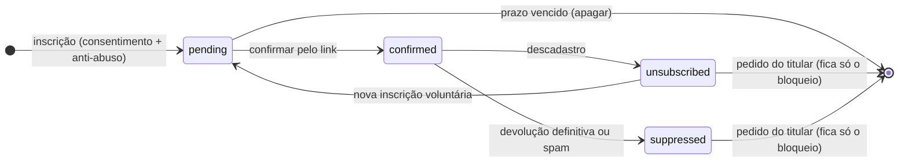

# Newsletter com gestão de assinantes (pós-MVP)

| Campo        | Valor                                                                                        |
| ------------ | -------------------------------------------------------------------------------------------- |
| Issue        | FUT-02 (#203)                                                                                |
| Responsável  | Gustavo Duarte Güering (sugerido na issue; usuário do GitHub ainda a confirmar, GOV-06)      |
| Revisão      | A confirmar (o `ownership-por-issue.csv` indica Vinícius Nishimura Reis como backup)         |
| Versão       | 1.0.0 — **proposta de novo escopo (não faz parte do MVP)**                                   |
| Data         | 04/11/2026                                                                                   |
| Origem       | NT-ATA-2026-003 e NT-PRJ-2026-001; RN-08 do [mapa de requisitos](../requisitos/mapa-de-requisitos.md); item I6 das [integrações externas](integracoes-externas.md) (FUT-07) |
| Base técnica | [Tratamento de dados](../seguranca/tratamento-de-dados-formularios.md) (SEG-01), [ciclo de vida](../seguranca/ciclo-de-vida-dados-pessoais.md) (TECH-08), [RBAC](../seguranca/matriz-rbac.md) (TECH-03), [auditoria](../seguranca/trilha-de-auditoria.md) (TECH-10), [idempotência](../formularios/idempotencia-e-falhas.md) (TECH-07), [domínio e DNS](../operacao/dominio-dns-https.md) (GO-03) |

> As bases legais e os prazos abaixo são sugestões técnicas para apoiar a decisão. A escolha é do
> controlador, com os responsáveis institucionais (SEG-02), e este documento não é parecer jurídico.
> **Nenhum disparo em massa acontece antes da aprovação institucional.**

## 1. Objetivo

Permitir que quem tiver interesse receba comunicações recorrentes da Benjamin por e-mail, com
consentimento próprio, descadastro em um clique e envio por domínio institucional, sem aproveitar os
dados de quem só preencheu um formulário e sem afetar a reputação do e-mail da agência.

## 2. O que o MVP já entrega (ponto de partida)

Não há newsletter nem lista de assinantes. O que existe e pode ser reaproveitado, ou que limita a proposta:

- **Três formulários, com finalidade única.** `form_submissions.kind` só aceita `lead`, `contact` e
  `feedback`. A TECH-08 (§2) diz que os dados "não são reaproveitados para marketing". Por isso, quem
  enviou um formulário **não** pode entrar na lista sem novo consentimento.
- **Aviso de privacidade em validação.** Lista só esses três formulários. A newsletter é uma nova
  finalidade e precisa constar nele antes de coletar qualquer dado (SEG-02, SEG-10).
- **Anti-abuso reaproveitável.** Honeypot, tempo mínimo, limite por origem com IP em HMAC e
  `submissionId` idempotente (TECH-07).
- **Resend só para aviso interno.** Hoje o e-mail avisa os destinatários internos dos formulários.
  O remetente (`NOTIFICATION_FROM`) ainda depende de um domínio verificado ([GO-03 §0](../operacao/dominio-dns-https.md)).
- **Domínio oficial pendente.** Enquanto o site estiver em `*.vercel.app` (CON-11), não há domínio
  próprio para SPF, DKIM e DMARC, o que por si só impede os envios.
- **Guardas prontas.** Toda tabela de `public` tem RLS, o catálogo de auditoria é fechado e `super_admin`
  não lê dados pessoais por padrão.

## 3. Escopo proposto

| Funcionalidade | Descrição | Prioridade |
| -------------- | --------- | ---------- |
| Inscrição | Formulário próprio: e-mail, nome opcional e consentimento específico, sem caixa marcada | Alta |
| Confirmação (opt-in duplo) | E-mail com link; a pessoa só vira assinante depois de confirmar | Alta |
| Descadastro em um clique | Link em toda mensagem e cabeçalho `List-Unsubscribe`, sem login | Alta |
| Lista de bloqueio | Quem saiu, teve devolução definitiva ou marcou como spam não recebe mais, mesmo se reimportado | Alta |
| Gestão no painel | `admin` consulta, busca e remove assinantes; acesso auditado | Média |
| Templates | Confirmação, boas-vindas, confirmação de descadastro e um modelo de edição | Média |
| Envio de edição | Aprovação registrada, envio de teste e envio à lista confirmada, **desligado por padrão** | Baixa (só depois da aprovação) |
| Segmentação por interesse | Temas escolhidos pela pessoa | Baixa |

**Fora deste escopo:** importar contatos de formulários ou planilhas (D9), comprar ou alugar listas,
automações disparadas por evento ([FUT-03](automacoes-de-comunicacao.md)), CRM
([FUT-01](evolucao-crm.md)) e métricas de abertura por pixel, salvo decisão D10.

## 4. Consentimento e base legal (a validar — SEG-02)

| Tema | Proposta | Referência na LGPD |
| ---- | -------- | ------------------- |
| Base legal | Consentimento específico para receber a newsletter | Art. 7º, I |
| Forma | Caixa desmarcada, com texto dizendo o que será enviado, por quem e com que frequência; separada do aceite do aviso de privacidade dos formulários | Art. 8º, § 4º (autorização genérica é nula) |
| Prova | Registrar versão do texto aceito, data e hora da inscrição e da confirmação e página de origem | Art. 8º, § 2º (o ônus é do controlador) |
| Revogação | Descadastro gratuito, em um clique, sempre disponível | Art. 8º, § 5º; art. 18, IX |
| Eliminação | Pedido do titular apaga o cadastro; fica só o bloqueio mínimo (D6) | Art. 16; art. 18, VI |
| Crianças e adolescentes | O público da FECAP inclui estudantes: definir se a inscrição exige declarar maioridade (D7) | Art. 14 |
| Operadores e transferência | Incluir o serviço de envio no aviso, com a menção de processamento fora do Brasil | Art. 33 |
| Direitos | Mesmo canal do encarregado previsto em SEG-01 §5, ainda não publicado | Art. 18 |

Dados coletados: e-mail (obrigatório) e nome (opcional). Telefone, empresa e cargo não entram, porque
não são necessários para enviar uma newsletter. O IP segue a regra atual: só em HMAC e só para limitar
abuso.

Retenção proposta para validar (D6): inscrição não confirmada é apagada depois de um prazo curto;
assinante fica até sair; ao sair, os dados são apagados e resta um hash do e-mail na lista de bloqueio,
mais a prova do consentimento pelo prazo que o controlador definir.

## 5. Fluxos de inscrição e descadastro

Regras:

- **Mesma resposta sempre.** "Se o endereço puder ser inscrito, enviaremos um e-mail": não revela quem
  já assina.
- **Link não muda estado sozinho.** Filtros de e-mail abrem links: o `GET` mostra uma página com botão,
  e só o `POST` confirma ou descadastra. A exceção é o `List-Unsubscribe-Post`, feito para isso (RFC 8058).
- **Tokens** aleatórios, guardados só em hash, com validade na confirmação e sem expirar no descadastro.
- **Reinscrição** só por ação da própria pessoa, com novo opt-in duplo.
- **Limite por origem** e por endereço, para o formulário não virar ferramenta de envio de e-mail a
  terceiros. O e-mail de confirmação não repete texto digitado no formulário.

## 6. Templates

| Template | Quando | Observações |
| -------- | ------ | ----------- |
| Confirmação | Após a inscrição | Só o botão de confirmar e o aviso "se não foi você, ignore" |
| Boas-vindas | Após confirmar | O que esperar e como sair |
| Descadastro confirmado | Após sair | Sem conteúdo promocional |
| Edição | Envio aprovado | Título, blocos de texto, imagem com `alt` e CTA |

Toda mensagem traz identificação da Agência Benjamin, o motivo de a pessoa estar recebendo, link para o
aviso de privacidade, link de descadastro e versão em texto puro. O visual segue o brandbook; o texto e
o endereço exibido são da agência (D8). Pixel de abertura e reescrita de links ficam desligados, salvo a
decisão D10, porque o aviso atual diz que não há rastreamento no site público.

## 7. Reputação do domínio de envio

| Ponto | Proposta |
| ----- | --------- |
| Domínio | Subdomínio só para a newsletter, separado do remetente dos formulários: uma queda na reputação não atinge os avisos de novos pedidos (D5) |
| Autenticação | SPF, DKIM e DMARC válidos antes do primeiro envio. O GO-03 §2 prevê DMARC `p=none`; endurecer depois de observar os relatórios |
| Dono | Conta e DNS em nome da instituição (padrão da FUT-07 §4). O domínio é da Benjamin (CON-11) |
| Aquecimento | Primeiros envios para poucos endereços, crescendo aos poucos. Volumes a definir com a ferramenta escolhida |
| Higiene | Só endereços confirmados. Devolução definitiva e denúncia de spam entram na lista de bloqueio por webhook assinado |
| Acompanhamento | Taxas de devolução e de denúncia a cada envio. Conferir os limites vigentes do Gmail e do Yahoo para remetentes em massa, que mudam |
| Interrupção | Interruptor que suspende envios sem deploy, e parada automática se a denúncia passar do limite definido |

## 8. Proposta técnica (a validar)

Duas formas de guardar a lista. A FUT-07 recomenda lista própria; a escolha é a decisão D4.

| Opção | A favor | Contra |
| ----- | ------- | ------ |
| **A. Lista no Supabase**, ferramenta só envia | Dados sob as regras atuais (RLS, auditoria, retenção, cópia semanal); troca de ferramenta sem migrar a lista | Mais construção: formulário, tokens e webhooks |
| **B. Lista na ferramenta** (Brevo, Mailchimp ou similar) | Pouco código; formulário, descadastro e reputação já resolvidos | Dado pessoal fora da plataforma; dependência; formulário de terceiro pode exigir script e mudar a CSP |

Para a opção A:

| Camada | Mudança |
| ------ | ------- |
| Domínio | `lib/domain/newsletter/`: schema da inscrição, estados e transições, regras de retenção (pura e testada) |
| Banco | Migration com `newsletter_subscribers`, `newsletter_consents` (versão do texto, datas, origem) e `newsletter_suppressions` (hash do e-mail); RLS sem leitura para `anon`, com rollback e pgTAP. **Não** usar `form_submissions`, cujo `check` limita os tipos e cuja retenção é outra |
| RBAC | Recurso novo `subscriber` (`view`, `delete`, `export`), só para `admin`; `send` à parte, com a D8. No mesmo PR: `rbac.ts`, seed de `role_permissions` e matriz (regra 5 da TECH-03) |
| Auditoria | `newsletter.subscriber_viewed`, `.subscriber_deleted`, `.exported`, `.edition_approved` e `.edition_sent` no catálogo e no `check` de `audit_log`, sem o e-mail em `metadata` |
| Servidor | `lib/server/newsletter/`: Server Action de inscrição; Route Handler de `List-Unsubscribe-Post`; webhook com assinatura conferida; envio atrás de variável desligada por padrão |
| Site | Rotas de confirmação e descadastro com `noindex`; ponto de inscrição (bloco ou rodapé), definido com a agência |
| Painel | Lista, busca por e-mail, remoção; tela de envio só depois da aprovação |
| Documentação | SEG-01, TECH-08, dicionário de dados, variáveis, guia do painel, aviso de privacidade |

Ambientes: desenvolvimento e prévia não enviam (`NOTIFY_PROVIDER=log`); homologação só para endereços da
equipe. A lista de produção nunca sai de produção (ARC-06, regra 4).

## 9. Estimativa preliminar

Para a opção A:

| Bloco | Horas |
| ----- | ----- |
| Migration, RLS, RBAC, auditoria e pgTAP | 6–8 |
| Inscrição, confirmação, descadastro e anti-abuso | 10–14 |
| Painel de assinantes | 8–12 |
| Integração com a ferramenta de envio e webhooks | 8–12 |
| Templates | 4–6 |
| Jornada E2E e documentação | 6–8 |
| **Total** | **42–60 h** |

Feita por comparação com a FUT-01 (70–94 h) e a FUT-05 (23–32 h). Não foi medida em código e deve ser
revista pela coordenação. Não inclui análise jurídica, escrita das edições, tempo da agência nem espera
pelo domínio. A opção B reduz os blocos de banco e inscrição, mas a integração depende da ferramenta.

## 10. Critérios de entrada (antes de começar)

- [ ] MVP publicado (GO-06).
- [ ] Benjamin confirma a necessidade, o público e quem produz e aprova as edições (D1, D8).
- [ ] Coordenação aprova o novo escopo e a estimativa (GOV-12, classificação "novo requisito").
- [ ] Validação institucional da base legal, da retenção e do novo texto do aviso (SEG-02, D2, D3, D6).
- [ ] Domínio oficial definido e sob controle da agência (CON-11, GO-03) e subdomínio escolhido (D5).
- [ ] Ferramenta escolhida, com conta institucional, custo conhecido e operador no aviso (D4).
- [ ] Priorização no backlog pós-MVP.

## 11. Critérios de aceite da implementação

- [ ] Inscrição sem marcar o consentimento é recusada; endereço já inscrito recebe a mesma resposta.
- [ ] Sem confirmar o link, o endereço não recebe nada além do e-mail de confirmação.
- [ ] Abrir o link de confirmação ou de descadastro sem clicar no botão não muda o estado.
- [ ] Toda mensagem tem descadastro por link e por cabeçalho; depois dele, nenhum novo envio.
- [ ] `anon` não lê as tabelas novas; `admin` lê com auditoria; `editor`, `viewer` e `super_admin` não leem (pgTAP).
- [ ] Devolução definitiva ou denúncia recebida por webhook bloqueia o endereço; webhook sem assinatura válida é recusado.
- [ ] Com a variável de envio desligada, nenhuma edição sai, em nenhum ambiente.
- [ ] Logs sem e-mail ou nome. Consentimento comprovável por versão e data.
- [ ] Depois de restaurar uma cópia, a lista de bloqueio é conciliada antes de qualquer envio.

## 12. Riscos e decisões pendentes

| Risco | Mitigação |
| ----- | --------- |
| Restaurar a cópia semanal "ressuscita" quem saiu nos últimos dias ([DB-10](../operacao/backup-e-recuperacao.md) aceita perder até 7 dias) | Conciliar com o bloqueio da ferramenta antes de enviar de novo; envios suspensos durante a recuperação |
| Formulário usado para enviar e-mail a terceiros | Limite por origem e por endereço; e-mail de confirmação sem texto do usuário |
| Reputação do domínio contamina os avisos de formulário | Subdomínio separado e opt-in duplo |
| Lista parada, sem edições (a Benjamin é uma agência experimental, com equipe que muda) | Responsável nomeado antes de começar (D8); reavaliar se não houver |
| Plano gratuito de Supabase ou da ferramenta não comporta | Conferir limites na decisão D4; o Supabase Free pausa com pouca atividade |
| Promessa do aviso de privacidade fica desatualizada | Atualização do aviso é critério de entrada |

Decisões que dependem da Agência Benjamin, da FECAP e da coordenação:

- **D1.** A Benjamin quer a newsletter? Para quais públicos, com que conteúdo e frequência?
- **D2.** Quem é o controlador dessa lista (FECAP, Benjamin) e quem responde como encarregado?
- **D3.** A base legal é o consentimento, como proposto?
- **D4.** Lista no Supabase (A) ou na ferramenta (B)? Qual ferramenta (Resend Broadcasts, Brevo,
  Mailchimp) e em nome de quem fica a conta?
- **D5.** Qual subdomínio de envio? Depende de CON-11.
- **D6.** Quais prazos: inscrição não confirmada, prova de consentimento e lista de bloqueio?
- **D7.** Menores de idade podem assinar? Se não, como declarar?
- **D8.** Quem escreve, quem aprova cada edição e qual remetente aparece?
- **D9.** Pedir consentimento a contatos existentes? A proposta é não importar ninguém.
- **D10.** Medir abertura e clique? Afeta o aviso de privacidade e a reputação.

Nada desta proposta é implementado antes da aprovação acima. O MVP segue sem newsletter e isso não o
bloqueia.
