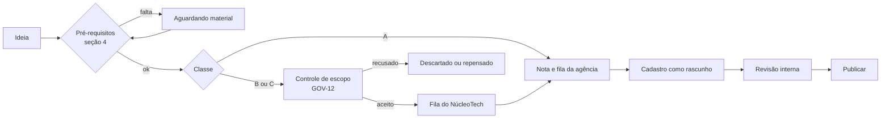

# Priorização de novas seções, conteúdos e cases (pós-MVP)

| Campo        | Valor                                                                                        |
| ------------ | -------------------------------------------------------------------------------------------- |
| Issue        | FUT-10 (#211)                                                                                |
| Responsável  | Agência Benjamin — Melissa Namie / Renan Hida (sugerido na issue)                            |
| Revisão      | A confirmar (o `ownership-por-issue.csv` indica Vinícius Nishimura Reis como backup)         |
| Versão       | 1.0.0 — **modelo para a agência preencher; proposta de novo escopo (não faz parte do MVP)**  |
| Data         | 04/11/2026                                                                                   |
| Origem       | NT-ATA-2026-003 e NT-PRJ-2026-001                                                            |
| Base técnica | [Guia do painel](../cms/guia-do-painel.md), [campos do case](../negocio/campos-do-case.md) (CASE-11), [integridade de conteúdo](../negocio/integridade-de-conteudo.md) (TECH-05), [fichas de conteúdo](../conteudo/README.md), [mídia](../adr/0005-armazenamento-de-midia.md) (ADR-0005) |

> **Este documento é um modelo, e a decisão é da Agência Benjamin.** O NúcleoTech descreve o que os
> editores permitem e propõe como comparar as ideias. As listas estão vazias de propósito: nenhum case,
> seção ou prioridade foi definido aqui.

## 1. Objetivo

Dar à Benjamin um jeito de decidir o que publicar depois do MVP sem depender de desenvolvimento na
rotina: saber, para cada ideia, se ela cabe nos editores atuais, se o material está pronto e autorizado, e
o que vem primeiro.

## 2. O que o MVP já entrega (ponto de partida)

O painel permite as ações abaixo sem desenvolvedor, conforme o [guia](../cms/guia-do-painel.md):

| O que a agência quer fazer | Onde | Limites atuais |
| -------------------------- | ---- | --------------- |
| Novo case | **Cases** | Exige cliente, categoria publicada, ao menos um serviço publicado, resumo de 30 a 280 caracteres e capa com texto alternativo. Galeria até 20 imagens, links até 10, equipe até 20 nomes. Até 6 em destaque na Home |
| Nova categoria de case | **Categorias** | Nome e endereço bastam; o endereço não muda depois de publicada |
| Novo serviço | **Serviços** | Resumo, descrição e ao menos uma área publicada. Até 6 em destaque na Home |
| Nova área | **Áreas de atuação** | Resumo e descrição; o endereço não muda depois de publicada. Atenção: Home, Sobre e Áreas têm "Seis" nos títulos, fixo no código. Uma sétima área cadastra sem problema, mas os títulos ficam errados e pedem um ajuste de classe B |
| Nova seção em uma rota que existe | **Páginas** | Blocos de Texto, Lista de destaques, Nosso time ou Chamada para ação, abaixo das seções fixas |
| Trocar o manifesto e os textos de Sobre | **Páginas** | Blocos Manifesto (só na Home) e Sobre a Benjamin (só em Sobre), um de cada |
| Imagens e PDFs | **Biblioteca de mídia** | JPG, PNG, WebP e AVIF até 5 MB; PDF até 10 MB; SVG não é aceito |
| Vídeo em um case | **Cases → Links externos** | Só por link: o painel não recebe arquivo de vídeo (ADR-0005) |

## 3. Classes de esforço

A primeira pergunta sobre uma ideia é em qual classe ela cai. Só a classe A é rotina da agência.

| Classe | Significado | Exemplos de tipo de pedido | Quem resolve | Entra por |
| ------ | ------------ | --------------------------- | ------------- | ---------- |
| **A. Só editor** | Cabe nos campos e blocos atuais | Novo case; novo serviço; bloco de texto na página Sobre; chamada para ação na página Serviços | Equipe da Benjamin | Esta priorização |
| **B. Ajuste técnico** | Usa o modelo atual, mas pede mudança pequena de código | Novo tipo de bloco; novo campo em um item; mudar a ordem das seções fixas; título que cita a quantidade de áreas | NúcleoTech | GOV-12 |
| **C. Novo escopo** | Muda estrutura ou integra terceiros | Nova rota ou endereço, como uma landing de campanha; blog; busca; envio de vídeo; feed de redes | NúcleoTech, com proposta | GOV-12 + FUT correspondente |

Limite que costuma surpreender: **não dá para criar uma página com endereço novo pelo painel.** Cada página
do CMS está presa a uma rota fixa (Home, Sobre, Áreas, Serviços, Cases, Contato, Privacidade). "Nova seção"
na classe A é sempre um bloco nessas rotas. Se muitos pedidos caírem aqui, vale abrir um item de classe C
em vez de improvisar.

Se muitos pedidos caírem na classe B, é sinal de que falta um bloco reaproveitável: o objetivo é trazer a
rotina para a classe A, e não atender um a um.

## 4. Pré-requisitos de qualquer item

Sem estes, o item não entra na fila, seja qual for a nota:

- [ ] **Autorização:** cliente citado, imagens e textos autorizados por escrito (como em CON-06 a CON-08).
- [ ] **Resultados reais:** números só se reais e autorizados. Sem eles, os campos ficam vazios e não aparecem.
- [ ] **Pessoas:** nomes na equipe ou em Nosso time, só com autorização de cada uma.
- [ ] **Relação institucional:** o item respeita a relação com a FECAP e o trabalho é da Benjamin (o
      NúcleoTech só aparece no crédito da plataforma).
- [ ] **Material completo:** tudo o que o painel exige para publicar (seção 2), mais texto alternativo das imagens.
- [ ] **Dado pessoal:** se o item coleta dados, passa por SEG-01 e SEG-02 antes, e deixa de ser classe A.

## 5. Critérios de priorização

Sugestão: nota de 1 a 3 em cada critério, e a agência pode trocar critérios e pesos (D2).

| Critério | 1 | 2 | 3 |
| -------- | - | - | - |
| Valor institucional | Interessa a poucos | Reforça algo que o site já mostra | Mostra algo novo e importante da agência |
| Oportunidade | Sem data | Ajuda em um momento próximo | Depende de um evento ou prazo fechado |
| Prontidão do material | Falta quase tudo | Falta pouco | Pronto para cadastrar |
| Esforço (inverso) | Classe C | Classe B | Classe A |

Prioridade = soma das notas. Empate: maior **Prontidão**, depois maior **Valor institucional**.

A nota não decide sozinha: serve para comparar, e a agência pode registrar por que passou um item à frente.
Classe B ou C entra na fila com a nota, mas só anda depois de aceita pelo controle de escopo (GOV-12).

## 6. Modelo para preencher

### 6.1 Lista de ideias

Preenchida pela agência. **Em branco: nada foi levantado ou priorizado nesta versão.**

| # | Item | Tipo (case, serviço, área, seção) | Classe (A/B/C) | Pré-requisitos OK? | Valor | Oportunidade | Prontidão | Esforço | Soma | Responsável na agência | Situação |
| - | ---- | ---------------------------------- | -------------- | ------------------ | ----- | ------------ | --------- | ------- | ---- | ----------------------- | -------- |
|   |      |                                    |                |                    |       |              |           |         |      |                         |          |

Situações sugeridas: `Ideia`, `Aguardando material`, `Pronto para cadastrar`, `Publicado`, `Descartado`.

### 6.2 Como ler um item preenchido (fictício)

Só para mostrar a conta. **"Item X" não existe nem é sugestão.**

| Item | Classe | Valor | Oportunidade | Prontidão | Esforço | Soma |
| ---- | ------ | ----- | ------------ | --------- | ------- | ---- |
| Item X (case) | A | 2 | 1 | 3 | 3 | 9 |

### 6.3 Registro de decisões

| Ciclo | Quem decidiu | Itens escolhidos | Itens adiados e motivo |
| ----- | ------------- | ----------------- | ----------------------- |
|       |               |                   |                         |

## 7. Fluxo sugerido

Depois de publicar, vale conferir o resultado no site e, se a medição existir, nos indicadores da
[FUT-06](analytics-avancado.md). Se a Benjamin aprovar uma etapa formal de revisão, ela é a
[FUT-05](https://github.com/NucleoTechFecap/landing-agencia-benjamin/issues/206).

## 8. Estimativa preliminar

| Bloco | Esforço |
| ----- | -------- |
| NúcleoTech: classe A | 0 h de desenvolvimento, que é o objetivo. Dúvida de uso vai pelo [suporte](../operacao/suporte-e-evolucao.md) |
| NúcleoTech: classes B e C | Estimadas item a item no GOV-12. Nenhuma foi estimada aqui, porque não há item |
| Agência: levantar, dar nota e decidir | Cabe à agência estimar |
| Agência: produzir material e cadastrar | Por item; depende de cada case ou seção |

## 9. Critérios de entrada (antes de começar)

- [ ] MVP publicado (GO-06), com o painel em uso pela agência e o guia entregue (GO-08).
- [ ] Conteúdo do MVP aprovado ou retirado (CON-04 a CON-08), para não competir na mesma fila.
- [ ] Agência indica quem mantém a lista e decide (D1).

## 10. Critérios de aceite

- [ ] A agência preencheu e aprovou a lista e os critérios (decisão registrada na seção 6.3).
- [ ] Nenhum item da classe A exige ajuda do NúcleoTech para ir ao ar.
- [ ] Itens B e C têm decisão de escopo registrada no GOV-12.
- [ ] Confirmado no Project que a tarefa segue fora do escopo obrigatório da primeira entrega.

## 11. Riscos e decisões pendentes

| Risco | Mitigação |
| ----- | --------- |
| Case publicado sem autorização do cliente | Pré-requisito da seção 4, em qualquer nota |
| Lista parada: ninguém mantém | Responsável definido em D1 e ciclo em D3 |
| Muitos pedidos viram classe B | Ver a seção 3: pedir um bloco reaproveitável |
| Conteúdo antigo fica desatualizado | Revisão do que já está publicado no mesmo ciclo (D4) |
| Item publicado sem revisão: o MVP publica direto | Revisão interna combinada ou FUT-05, se aprovada |

Decisões **da Agência Benjamin** (em branco nesta versão):

- **D1.** Quem mantém a lista e quem decide? ______
- **D2.** Os critérios e pesos da seção 5 servem, ou mudam? ______
- **D3.** Com que frequência a lista é revista? ______
- **D4.** O que já está publicado entra na revisão, e quando? ______
- **D5.** Quais itens e em que ordem? ______ (preencher na seção 6)

Nada aqui obriga a publicação de 04/11/2026, nem define o que entra depois dela sem decisão da agência.
