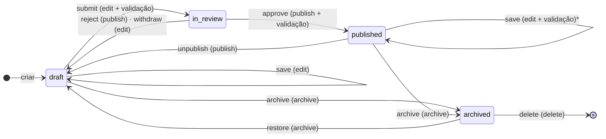

# Workflow editorial de revisão e aprovação do CMS (pós-MVP)

| Campo        | Valor                                                                                        |
| ------------ | -------------------------------------------------------------------------------------------- |
| Issue        | FUT-05                                                                                       |
| Responsável  | Julia Damásio (`@Juliadamassio`)                                                             |
| Revisão      | A confirmar (o `ownership-por-issue.csv` indica Vinícius Nishimura Reis, `@Vinishireis`)     |
| Versão       | 1.0.0 — **proposta de novo escopo (não faz parte do MVP)**                                   |
| Data         | 03/11/2026                                                                                   |
| Origem       | NT-ATA-2026-003 e NT-PRJ-2026-001 (PRJ §23, estado "Em revisão"); [fluxo de publicação](../negocio/fluxo-de-publicacao.md) (ADM-12, §1 e §6) |
| Base técnica | [Máquina de estados](../negocio/maquina-de-estados-publicacao.md) (TECH-04), [matriz RBAC](../seguranca/matriz-rbac.md) (TECH-03), [perfis](../seguranca/perfis-e-permissoes.md) (ADM-01), [auditoria](../seguranca/trilha-de-auditoria.md) (TECH-10) |

## 1. Objetivo

Permitir que a equipe da Benjamin separe **quem escreve** de **quem aprova**: um conteúdo passa por
uma etapa de revisão, com um aprovador identificado, antes de ir ao ar. Opcionalmente, o aprovador
define a data de publicação. A proposta preserva o que o CMS já garante: validação de campos
obrigatórios, autorização no servidor, auditoria e atualização do site.

## 2. O que o MVP já entrega (ponto de partida)

- Três estados: `draft`, `published` e `archived` (ADM-12). O estado "Em revisão" do PRJ §23 ficou
  de fora do MVP, com publicação direta pela equipe autorizada, e foi remetido a esta tarefa.
- O `editor` já pode criar, editar, publicar e arquivar (`VCEPA` na matriz RBAC). Publicar não exige
  segunda pessoa.
- Publicar e salvar item publicado passam por `validateForPublish` (invariante I5).
- Salvar um item `published` vai ao ar imediatamente, com aviso no painel.
- Toda transição é auditada (I7) e invalida o cache quando afeta o público (I8).
- O filtro público já respeita `published_at` no futuro, mas o painel não expõe agendamento.
- O ADM-01 (§5) deixa **pendente** com a Benjamin a pergunta "o `editor` pode publicar sem aprovação
  de um `admin`?" (proposta do MVP: sim).

O que falta: um estado intermediário, a separação entre enviar e aprovar, e o registro de quem
aprovou ou devolveu e por quê.

## 3. Escopo proposto

| Funcionalidade | Descrição | Prioridade |
| -------------- | --------- | ---------- |
| Estado `in_review` | Item enviado para revisão: não é público e não pode ser editado até ser aprovado ou devolvido | Alta |
| Enviar para revisão | `editor` envia um rascunho completo (mesma validação da publicação) | Alta |
| Aprovar | Aprovador publica o item; o autor do envio não aprova o próprio envio | Alta |
| Devolver com nota | Aprovador devolve o item a `draft` com um comentário obrigatório | Alta |
| Retirar do envio | O autor cancela o envio e volta o item a `draft` | Média |
| Fila de revisão | Lista no painel dos itens em `in_review`, com autor e data do envio | Média |
| Agendamento (opcional) | Ao aprovar, o aprovador informa uma data futura de publicação | Baixa |
| Notificação por e-mail | Avisar o aprovador de novo envio e o autor de aprovação/devolução | Baixa (depende de escolha de stack) |

**Fora deste escopo:** aprovação em mais de uma etapa; edição colaborativa simultânea; comentários
campo a campo; cópia de trabalho separada de item publicado (ver decisão D1); histórico de versões
([FUT-04](historico-de-versoes.md)).

## 4. Máquina de estados proposta

Entre parênteses: permissão RBAC exigida. \* Ver decisão D1.

| Estado atual \ Comando | `save` | `submit` | `approve` | `reject` | `withdraw` | `publish` | `unpublish` | `archive` | `restore` | `delete` |
| ---------------------- | ------ | -------- | --------- | -------- | ---------- | --------- | ----------- | --------- | --------- | -------- |
| `draft` | draft | in_review | ✖ | ✖ | ✖ | D2 | ✖ | archived | ✖ | ✖ |
| `in_review` | ✖ | ✖ | published | draft | draft | ✖ | ✖ | ✖ | ✖ | ✖ |
| `published` | published* | ✖ | ✖ | ✖ | ✖ | ✖ | draft | archived | ✖ | ✖ |
| `archived` | ✖ | ✖ | ✖ | ✖ | ✖ | ✖ | ✖ | ✖ | draft | removido |

✖ = `INVALID_TRANSITION`. `in_review` não aceita `save`: para mudar o texto, o item volta a
`draft` (devolvido ou retirado). Isso evita que o aprovador aprove uma versão diferente da que leu.
`publish` direto a partir de `draft` continua existindo apenas para quem a decisão D2 mantiver.

## 5. Permissões

Hoje `P` (publicar) pertence a `editor`, `admin` e `super_admin`. A proposta separa dois níveis:

| Comando | Permissão | `super_admin` | `admin` | `editor` | `viewer` |
| ------- | --------- | :-----------: | :-----: | :------: | :------: |
| `submit`, `withdraw` | `edit` | ✔ | ✔ | ✔ | ✖ |
| `approve`, `reject` | `publish` | ✔ | ✔ | ✖ (proposta) | ✖ |

Regras adicionais, na linha de `canAssignRole()`:

- quem enviou não aprova o próprio envio (`reviewer_id ≠ submitted_by`);
- `withdraw` só pelo autor do envio, ou por `admin`/`super_admin`;
- nota obrigatória em `reject`, com limite de tamanho.

Uma mudança nesta matriz é um PR único alterando `rbac.ts`, o seed SQL de `role_permissions` e a
matriz granular, como manda a regra 5 do TECH-03. O teste de consistência falha se divergirem.

## 6. Proposta técnica (a validar)

| Camada | Mudança |
| ------ | ------- |
| Domínio | Incluir `in_review` em `PUBLICATION_STATUSES` (`publication-status.ts`), com rótulo e cor de selo; novos comandos e transições em `publication.ts`; `COMMAND_PERMISSION` e `allowedCommands()` atualizados |
| Banco | Migration ampliando o `check (status in (...))` de **todas** as tabelas de conteúdo, com plano de rollback; colunas ou tabela para `submitted_by`, `submitted_at`, `reviewed_by`, `reviewed_at` e a nota de revisão |
| Auditoria | Eventos novos `content.submitted`, `content.approved`, `content.rejected` e `content.withdrawn` no catálogo fechado (`events.ts`) e no `check` de `audit_log.event`. Os de aprovação e devolução seriam críticos, como `content.published`. A nota **não** entra em `metadata` (lista permitida, risco de dado pessoal): fica na tabela de revisão |
| Servidor | Server Actions com `requirePermission()`, validação, auditoria e invalidação de cache apenas quando houver efeito público (`approve`) |
| Painel | Selo "Em revisão", botões conforme `allowedCommands()`, fila de revisão, campo de nota na devolução |
| Site e API | Nada muda: continuam lendo somente `published` com `published_at <= agora` (I1) |

Invariantes novas ou ajustadas:

| # | Invariante | Garantia |
| - | ---------- | -------- |
| I1 | APIs e páginas públicas jamais retornam `draft`, `in_review` ou `archived` | `isPubliclyVisible()` + RLS `anon` só lê `published` |
| I10 | `in_review` ⇒ `submitted_by` e `submitted_at` preenchidos | `transition()` + `check` no banco + `checkInvariants()` |
| I11 | Nada entra em `in_review` incompleto | `validateForPublish` no `submit` |
| I12 | `approve` exige papel com `publish` e aprovador diferente de `submitted_by` | `transition()` + `can()` |

## 7. Agendamento opcional

O filtro público já respeita `published_at` futuro. Para expor isso, o `approve` aceitaria uma data
opcional e gravaria `published_at` com ela. O item ficaria `published` e invisível até a data. Isso
exige decidir se o painel mostra um selo "Agendado" e se a data pode ser alterada depois.
Dependências: invalidação de cache na data (ADR-0006) e a regra "`published_at` só na primeira
publicação" da TECH-04, que precisaria ser revista. Por isso é a funcionalidade de menor prioridade.

## 8. Estimativa preliminar

| Bloco | Horas |
| ----- | ----- |
| Migration, RLS, seed de permissões e testes pgTAP | 4–6 |
| Domínio (estados, comandos, invariantes) e testes de transição | 4–6 |
| Server Actions, auditoria e testes dos dois stores | 4–6 |
| Painel: selo, botões, fila de revisão e nota | 8–10 |
| Jornada E2E e documentação (guia do painel, matriz, dicionário de dados) | 3–4 |
| **Total** | **23–32 h** |
| Agendamento (opcional) | +4–6 h |

Estimativa feita por comparação com a FUT-04 (26–36 h). Não foi medida em código e deve ser revista
pela coordenação.

## 9. Critérios de entrada (antes de começar)

- [ ] MVP publicado (GO-06) e CMS em uso, sem mudança pendente no modelo das tabelas de conteúdo.
- [ ] Benjamin confirma a necessidade e responde às decisões da seção 11.
- [ ] Coordenação aprova o novo escopo e a estimativa (GOV-12, classificação "novo requisito").
- [ ] Definido se o aviso por e-mail entra (depende da escolha de serviço de envio).
- [ ] Priorização no backlog pós-MVP.

## 10. Critérios de aceite da implementação

- [ ] Um `editor` envia um rascunho completo para revisão; incompleto retorna `VALIDATION_FAILED`.
- [ ] Item `in_review` não aparece no site nem na API (teste de I1 com chave anônima).
- [ ] Aprovação por outro papel autorizado publica o item, registra `content.approved` e atualiza o site.
- [ ] O autor do envio não consegue aprovar o próprio envio (`FORBIDDEN`).
- [ ] Devolução exige nota; o autor vê a nota ao reabrir o rascunho.
- [ ] A matriz RBAC, o seed e `rbac.ts` ficam consistentes (teste de consistência verde).
- [ ] Jornada E2E: editor envia → admin devolve com nota → editor corrige e reenvia → admin aprova → o site mostra o texto.

## 11. Riscos e decisões pendentes

| Risco | Mitigação |
| ----- | --------- |
| Salvar item publicado continua indo ao ar sem revisão e esvazia o workflow | Decisão D1; deixar o limite explícito no painel e no guia |
| Aprovador único (férias, desligamento) trava a publicação | Mais de um `admin`/`super_admin` com `publish`; ver ADM-01 §5 (quantidade de contas ainda pendente) |
| Nota de devolução com dado pessoal | Nota fora da auditoria, tamanho limitado, aviso no campo; ver [ciclo de vida de dados pessoais](../seguranca/ciclo-de-vida-dados-pessoais.md) |
| Migration em todas as tabelas de conteúdo | Plano de rollback e teste de `check` por tabela |

Decisões que dependem da Agência Benjamin e da coordenação:

- **D1.** O que acontece ao editar um item já publicado? (a) manter como hoje, indo ao ar ao salvar;
  (b) só `admin` salva item publicado, e o `editor` usa "Duplicar como rascunho"; (c) cópia de
  trabalho separada, que muda o modelo das tabelas e combina com a FUT-04.
- **D2.** O `editor` perde o `publish`? Se sim, o botão "Publicar" direto some para ele. Se não, o
  workflow vira opcional e a revisão é um passo que se escolhe usar.
- **D3.** Quem aprova: qualquer `admin`, um aprovador por tipo de conteúdo, ou nomes definidos pela Benjamin?
- **D4.** O agendamento entra nesta fase ou fica para outra?
- **D5.** Aviso por e-mail entra? Depende de escolha de serviço de envio, ainda não definida.
- **D6.** A Benjamin precisa de prazo máximo em revisão, com alerta?

Nada desta proposta é implementado antes da aprovação acima. O MVP segue com publicação direta pela
equipe autorizada (ADM-12).
