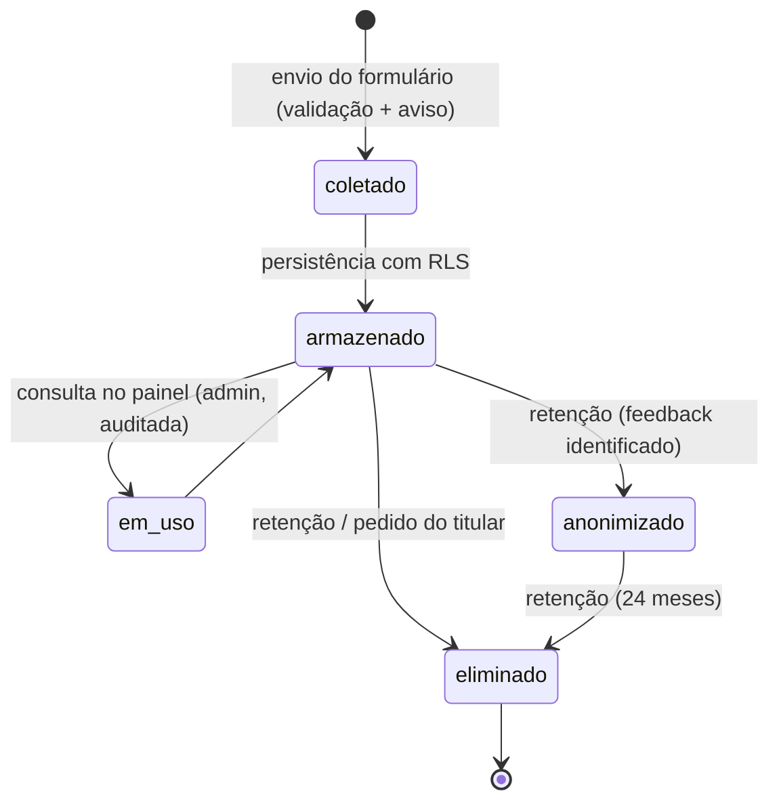

# Autorização, retenção e ciclo de vida de dados pessoais

| Campo           | Valor                                                                   |
| --------------- | ----------------------------------------------------------------------- |
| Issue           | TECH-08 (#109)                                                          |
| Responsável     | Vinícius Nishimura Reis (`@Vinishireis`)                                |
| Revisão técnica | Vinícius Binda (`@VinnizzZ`)                                            |
| Versão          | 1.0.0                                                                   |
| Data            | 13/10/2026                                                              |
| Depende de      | [SEG-01](tratamento-de-dados-formularios.md), [ADM-01](perfis-e-permissoes.md), [TECH-03](matriz-rbac.md) |
| Código          | `lib/domain/forms/retention.ts`, `lib/server/logger.ts` (mascaramento) |

> Traduz as decisões de LGPD em **regras técnicas implementáveis**. Não define base legal nem
> prazos finais: itens marcados com ⏳ dependem de aprovação institucional (SEG-02).

## 1. Ciclo de vida

## 2. Princípios aplicados (LGPD art. 6º)

| Princípio | Regra técnica |
| --------- | ------------- |
| Finalidade | Cada formulário tem finalidade única (SEG-01); dados não são reaproveitados para marketing |
| Adequação/necessidade | Campos mínimos (FORM-01); CPF, endereço e orçamento não são coletados |
| Livre acesso | Pedido do titular atendido pelo `admin` (SEG-01 §5) |
| Segurança | RLS, papéis, TLS, segredos fora do Git, logs sem PII |
| Prevenção | Honeypot/tempo mínimo/idempotência contra abuso; IP só como HMAC |
| Transparência | Aviso de privacidade linkado em todo formulário (SEG-02/SEG-03) ⏳ |
| Responsabilização | Trilha de acesso e de eliminação (TECH-10) |

## 3. Modelo de autorização

| Camada | Regra |
| ------ | ----- |
| Banco (RLS) | `anon`: somente `insert` controlado (via função), **sem** `select/update/delete`. `authenticated`: `select/update/delete` apenas com `has_permission('lead'|'feedback', ação)` |
| Servidor | Toda listagem/consulta/exportação chama `requirePermission("lead"|"feedback", ação)` |
| Papéis | Somente `admin` (Benjamin) lê/exporta. `super_admin` não lê por padrão (acesso emergencial = atribuição temporária de `admin`, auditada) |
| Service role | Usada só por rotinas operacionais (retenção, provisionamento); nunca em rotas públicas |
| Ambientes | Dados reais só em produção; dev/hml usam dados fictícios (ARC-06/ARC-11) |

## 4. Consulta restrita e exportação

| Operação | Regra |
| -------- | ----- |
| Listagem | Mostra nome, categoria, status e data; conteúdo completo só ao abrir o registro |
| Abrir registro | Gera evento de auditoria `lead.viewed`/`feedback.viewed` (sem conteúdo) |
| Exportação (eventual) | Somente `admin`, CSV com filtros aplicados, máximo 1 000 linhas por arquivo, evento `lead.exported` com quantidade e filtros; arquivo não fica armazenado na plataforma |
| Cópia por e-mail | Notificação interna contém os dados (destinatários restritos — CON-10); orientar destinatários a não encaminhar |

## 5. Retenção e descarte

Regras em código (`RETENTION_RULES`, `retentionActionFor`, `planRetention`, `anonymizeFeedback`):

| Registro | Prazo (desde o último andamento) | Ação | Status |
| -------- | -------------------------------- | ---- | ------ |
| Lead | 12 meses | Excluir | ⏳ |
| Contato | 6 meses | Excluir | ⏳ |
| Feedback identificado | 12 meses | Anonimizar (remove nome/e-mail) | ⏳ |
| Feedback anônimo | 24 meses | Excluir | ⏳ |
| Registro com *legal hold* | Suspenso | Manter | — |

**Plano de execução (implementável — detalhado em DBX-05):**

1. Rotina mensal (cron da Vercel → Route Handler protegido por segredo, ou `pg_cron` no Supabase)
   lista registros com `last_activity_at`.
2. `planRetention()` separa `delete`/`anonymize`.
3. Execução em transação, com `service_role`, registrando **apenas a contagem** e os IDs na
   auditoria (`retention.executed`).
4. Backups seguem a retenção do provedor; restauração de backup reaplica a rotina antes de
   reabrir o acesso.

## 6. Proteção de PII em logs e notificações

- `logger` mascara chaves e padrões sensíveis (e-mail, telefone, nome, mensagem, IP, tokens) — ARC-09.
- Eventos de auditoria guardam **identificadores**, nunca conteúdo de formulários (TECH-10).
- Erros exibidos ao usuário usam código de atendimento, sem eco dos dados enviados.

## 7. Incidente envolvendo dados pessoais

1. Conter: revogar chaves/sessões afetadas (ARC-05 §4) e bloquear o acesso.
2. Avaliar: quais registros, período e risco aos titulares.
3. Comunicar a coordenação e o controlador em até 24 h; o controlador decide sobre comunicação à
   ANPD e aos titulares (art. 48). ⏳
4. Registrar causa e ação corretiva no repositório (sem dados pessoais).

## 8. Pendências de aprovação institucional

- [ ] Prazos de retenção (seção 5).
- [ ] Bases legais e texto do aviso de privacidade (SEG-02).
- [ ] Responsável por pedidos de titulares e canal de contato.
- [ ] Fluxo de comunicação de incidentes (seção 7).
