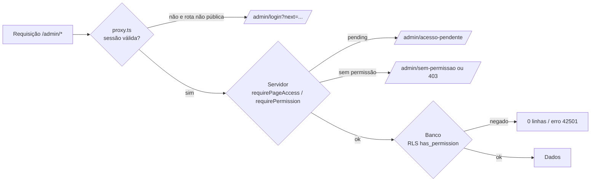

# Proteção de rotas, recursos e operações de escrita

| Campo        | Valor                                                                     |
| ------------ | ------------------------------------------------------------------------- |
| Issue        | ADM-03 (#79)                                                              |
| Responsável  | Vinícius Nishimura Reis (`@Vinishireis`)                                  |
| Versão       | 1.0.0                                                                     |
| Data         | 13/10/2026                                                                |
| Depende de   | [ADM-02 — autenticação](autenticacao.md), [TECH-03 — matriz RBAC](matriz-rbac.md) |
| Código       | `proxy.ts`, `lib/server/auth/guards.ts`, `app/admin/**`, `supabase/migrations/20261013000200_rbac_permissions.sql` |

## 1. Três barreiras independentes



| Barreira | Onde | O que garante |
| -------- | ---- | ------------- |
| 1. Proxy | `proxy.ts` (`/admin/:path*`) | Sem sessão → login (exceto `/admin/login`, `/admin/recuperar-senha`, `/admin/auth/callback`). Sem Supabase configurado → nega por padrão |
| 2. Servidor | `requirePageAccess()` em páginas; `requirePermission()` / `guardedAction()` em Server Actions e Route Handlers | Papel lido do banco a cada requisição; `pending` → aviso; sem permissão → 403 |
| 3. Banco | RLS com `public.has_permission(recurso, ação)`; funções `assign_role` e `set_profile_active` | Mesmo que uma checagem de servidor falhe, o banco recusa a operação |

## 2. Como proteger código novo

**Página do painel**

```tsx
export default async function CasesPage() {
  await requirePageAccess("case", "view", "/admin/cases");
  // ...
}
```

**Server Action de escrita**

```ts
"use server";
export async function archiveCase(input: { id: string; expectedUpdatedAt: string }) {
  return guardedAction("case", "archive", async (user) => {
    // validação, transição (TECH-04), gravação, auditoria (TECH-10), invalidação (TECH-09)
  });
}
```

**Route Handler protegido** — `await requirePermission("lead", "export")` dentro de `apiRoute()`.

**Tabela nova no Supabase (DB-02)** — RLS obrigatória na mesma migration:

```sql
alter table public.services enable row level security;
create policy "services: público lê publicados" on public.services
  for select to anon, authenticated using (status = 'published' and published_at <= now());
create policy "services: painel lê" on public.services
  for select to authenticated using (public.has_permission('service', 'view'));
create policy "services: cria" on public.services
  for insert to authenticated with check (public.has_permission('service', 'create'));
create policy "services: edita" on public.services
  for update to authenticated using (public.has_permission('service', 'edit'));
create policy "services: exclui" on public.services
  for delete to authenticated using (public.has_permission('service', 'delete') and status = 'archived');
```

**Menu e botões** — `can(user.role, recurso, ação)` apenas para esconder; nunca como proteção.

## 3. Banco (`20261013000200_rbac_permissions.sql`)

| Objeto | Função |
| ------ | ------ |
| `role_permissions` | 148 permissões, **geradas da matriz em código** (`node scripts/print-rbac-seed.mjs`); teste `rbac-sql.test.ts` falha se divergirem |
| `has_permission(resource, action)` | Usada em todas as policies do CMS e do Storage |
| `assign_role(target, role)` | Regras de `canAssignRole`: ninguém altera o próprio papel; `admin` só gerencia `editor`/`viewer`/`pending` |
| `set_profile_active(target, active)` | Desativa/reativa contas (desligamento — GO-09) com as mesmas regras |
| Bucket `media` | Público para leitura, limite 10 MB e tipos aceitos (ARC-10); upload/substituição/exclusão conforme `media:create/edit/delete` |

## 4. Evidências

| Verificação | Resultado |
| ----------- | --------- |
| `guards.test.ts` | N01 (sem sessão → login com retorno), N02 (401), N03 (pending → aviso), N04 (editor exclui → 403), N05 (editor abre leads → sem permissão), N08 (super_admin lê leads → 403), ação não executa sem permissão, redirecionamentos do Next relançados |
| `rbac-sql.test.ts` | Seed SQL = matriz em código |
| `redirect.test.ts` | Rotas públicas do painel e *open redirect* |
| Smoke local (build de produção, sem Supabase) | `/admin`, `/admin/cases`, `/admin/nova-senha`, `/admin/sem-permissao` → 307 para login com `next`; `/admin/login` e `/admin/recuperar-senha` → 200 |

Casos N11–N13 (papel forjado no cliente, `select` anônimo em leads, sessão expirada em escrita)
dependem do banco de homologação e estão no roteiro de QA-06.
