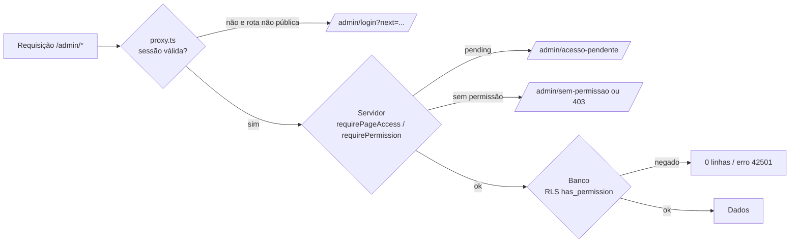

# Proteção de rotas, recursos e operações de escrita

| Campo        | Valor                                                                     |
| ------------ | ------------------------------------------------------------------------- |
| Issue        | ADM-03 (#79), SEG-06 (#100)                                               |
| Responsável  | Vinícius Nishimura Reis (`@Vinishireis`)                                  |
| Versão       | 1.1.0 — cabeçalhos e CSP (SEG-06)                                         |
| Data         | 13/10/2026 · revisão 04/11/2026                                           |
| Depende de   | [ADM-02 — autenticação](autenticacao.md), [TECH-03 — matriz RBAC](matriz-rbac.md) |
| Código       | `proxy.ts`, `next.config.ts`, `lib/domain/security/http-policy.ts`, `lib/server/auth/guards.ts`, `app/admin/**`, `supabase/migrations/20261013000200_rbac_permissions.sql` |

## 1. Três barreiras independentes



| Barreira | Onde | O que garante |
| -------- | ---- | ------------- |
| 1. Proxy | `proxy.ts` (`/admin/:path*`) | Sem sessão → login (exceto `/admin/login`, `/admin/recuperar-senha`, `/admin/auth/callback`). Sem Supabase configurado → nega por padrão |
| 2. Servidor | `requirePageAccess()` em páginas; `requirePermission()` / `guardedAction()` em Server Actions e Route Handlers | Papel lido do banco a cada requisição; `pending` → aviso; sem permissão → 403 |
| 3. Banco | RLS com `public.has_permission(recurso, ação)`; funções `assign_role` e `set_profile_active` | Mesmo que uma checagem de servidor falhe, o banco recusa a operação |

## 2. Como proteger código novo

**Página do painel**

```tsx
export default async function CasesPage() {
  await requirePageAccess("case", "view", "/admin/cases");
  // ...
}
```

**Server Action de escrita**

```ts
"use server";
export async function archiveCase(input: { id: string; expectedUpdatedAt: string }) {
  return guardedAction("case", "archive", async (user) => {
    // validação, transição (TECH-04), gravação, auditoria (TECH-10), invalidação (TECH-09)
  });
}
```

**Route Handler protegido** — `await requirePermission("lead", "export")` dentro de `apiRoute()`.

**Tabela nova no Supabase (DB-02)** — RLS obrigatória na mesma migration:

```sql
alter table public.services enable row level security;
create policy "services: público lê publicados" on public.services
  for select to anon, authenticated using (status = 'published' and published_at <= now());
create policy "services: painel lê" on public.services
  for select to authenticated using (public.has_permission('service', 'view'));
create policy "services: cria" on public.services
  for insert to authenticated with check (public.has_permission('service', 'create'));
create policy "services: edita" on public.services
  for update to authenticated using (public.has_permission('service', 'edit'));
create policy "services: exclui" on public.services
  for delete to authenticated using (public.has_permission('service', 'delete') and status = 'archived');
```

**Tela de dois recursos** — `/admin/leads` serve a `lead` e a `feedback`, e o tipo do registro só é conhecido
depois de lê-lo. `requireInboxPage()` entra com ao menos uma das permissões, e a RLS e o tipo real decidem cada
linha. Roda antes de validar o id, para não revelar se um registro existe.

**Menu e botões** — `can(user.role, recurso, ação)` apenas para esconder; nunca como proteção.

## 3. Banco (`20261013000200_rbac_permissions.sql`)

| Objeto | Função |
| ------ | ------ |
| `role_permissions` | 148 permissões, **geradas da matriz em código** (`node scripts/print-rbac-seed.mjs`); teste `rbac-sql.test.ts` falha se divergirem |
| `has_permission(resource, action)` | Usada em todas as policies do CMS e do Storage |
| `assign_role(target, role)` | Regras de `canAssignRole`: ninguém altera o próprio papel; `admin` só gerencia `editor`/`viewer`/`pending` |
| `set_profile_active(target, active)` | Desativa/reativa contas (desligamento — GO-09) com as mesmas regras |
| Bucket `media` | Público para leitura, limite 10 MB e tipos aceitos (ARC-10); upload/substituição/exclusão conforme `media:create/edit/delete` |

## 4. Evidências

| Verificação | Resultado |
| ----------- | --------- |
| `guards.test.ts` | N01 (sem sessão → login com retorno), N02 (401), N03 (pending → aviso), N04 (editor exclui → 403), N05 (editor abre leads → sem permissão), N08 (super_admin lê leads → 403), ação não executa sem permissão, redirecionamentos do Next relançados |
| `rbac-sql.test.ts` | Seed SQL = matriz em código |
| `redirect.test.ts` | Rotas públicas do painel e *open redirect* |
| Smoke local (build de produção, sem Supabase) | `/admin`, `/admin/cases`, `/admin/nova-senha`, `/admin/sem-permissao` → 307 para login com `next`; `/admin/login` e `/admin/recuperar-senha` → 200 |

Casos N09, N10, N11 e N13 têm prova de ponta a ponta, com Auth e RLS reais no Supabase local, em
[QA-06](../qualidade/qa-06-acesso-indevido.md), que percorre também todas as rotas e Server Actions do painel. N05, N08
e N12 têm prova em [SEG-04](../qualidade/seg-04-autorizacao-dados-pessoais.md). Falta repetir na homologação (GO-02).

Sem sessão, a Server Action para no proxy: o encaminhamento do Next para a tela da ação passa por ele, e a mesma chamada
por uma rota pública responde `{}`. Na prévia (ADM-14), a guarda roda dentro de `Suspense`: conta com sessão e sem papel
recebe HTTP 200 com o esqueleto e um redirecionamento na própria página, sem o item. Com o proxy retirado, as telas do painel respondem 200 com o esqueleto, sem nenhum
conteúdo: a segunda barreira segura, e o teste acusa a retirada (QA-06 §7).

## 5. Cabeçalhos de segurança e CSP (SEG-06)

Todas as respostas recebem os cabeçalhos abaixo, definidos em `next.config.ts`, inclusive 404 e os
redirecionamentos do proxy.

| Cabeçalho | Valor |
| --------- | ----- |
| `Content-Security-Policy` | Ver abaixo |
| `X-Frame-Options` | `DENY` (para navegadores sem `frame-ancestors`) |
| `X-Content-Type-Options` | `nosniff` |
| `Referrer-Policy` | `strict-origin-when-cross-origin` |
| `Permissions-Policy` | `camera=(), microphone=(), geolocation=(), payment=()` |
| `Strict-Transport-Security` | `max-age=63072000; includeSubDomains` |
| `X-Robots-Tag` | `noindex, nofollow` fora de produção e sempre em `/admin` |

### 5.1 A política

`buildContentSecurityPolicy()` (`lib/domain/security/http-policy.ts`) monta o valor. **`headers()` é
resolvido no build**: trocar `NEXT_PUBLIC_SUPABASE_URL` exige novo build, como já acontece com
`images.remotePatterns`.

| Diretiva | Valor em produção | Motivo |
| -------- | ----------------- | ------ |
| `default-src` | `'self'` | Base de tudo o que não tem diretiva própria |
| `script-src` | `'self' 'unsafe-inline'` | Limitação abaixo. Sem `'unsafe-eval'` |
| `style-src` | `'self' 'unsafe-inline'` | Atributos `style` do HTML do servidor (`next/image`, componentes) |
| `img-src` | `'self' data: <Supabase>` | O site passa por `/_next/image` (`'self'`); as miniaturas do painel vêm direto do Storage |
| `font-src` | `'self'` | `next/font` serve a Poppins do próprio site |
| `connect-src` | `'self' <Supabase>` | Envio direto de mídia ao Storage ([ADR-0005](../adr/0005-armazenamento-de-midia.md)). O navegador não abre Realtime, então não há `wss:` |
| `frame-src` | `'none'` | Vídeos entram como link, não como embed |
| `object-src` | `'none'` | Sem plugins |
| `base-uri` | `'self'` | Impede `<base>` injetado de redirecionar caminhos relativos |
| `form-action` | `'self'` | Server Actions são da própria origem |
| `frame-ancestors` | `'none'` | Ninguém enquadra o site (*clickjacking*) |
| `upgrade-insecure-requests` | Só em https | Num endereço `http://` (teste pela rede local, por exemplo), o navegador trocaria os recursos por https e o site não abriria |

`<Supabase>` é a origem de `NEXT_PUBLIC_SUPABASE_URL` do build. Variações por ambiente:

- **`next dev`:** acrescenta `'unsafe-eval'`, exigido pelo React em desenvolvimento.
- **Preview da Vercel (`VERCEL_ENV=preview`, inclui homologação):** acrescenta as origens que a
  [documentação da Vercel](https://vercel.com/docs/vercel-toolbar/managing-toolbar#using-a-content-security-policy)
  pede para a barra de ferramentas e os comentários. Em produção elas ficam de fora: a barra é só da
  equipe, e bloqueá-la não afeta o visitante. O projeto não usa Vercel Analytics nem Speed Insights;
  se passar a usar, eles são servidos pela própria origem.

### 5.2 Limitação: `'unsafe-inline'` em `script-src`

**A CSP não impede script inline injetado.** Se um XSS colocar `<script>` no HTML, a política não o
barra. A proteção contra isso continua sendo não gerar HTML a partir de texto: o React escapa, o site
não renderiza HTML do banco e o JSON-LD escapa `<`. Não é escolha de configuração, pelos motivos abaixo
(documentação do Next em `node_modules/next/dist/docs/01-app/02-guides/content-security-policy.md`):

| Alternativa | Por que não serve |
| ----------- | ----------------- |
| Nonce | "Partial Prerendering (PPR) is incompatible with nonce-based CSP": o shell estático é gerado no build e não recebe um nonce por requisição. Exigiria renderização dinâmica em todas as páginas, sem cache de CDN |
| Hash (SRI experimental) | Cobre arquivos `.js`. O payload do React vai em scripts inline, medidos em 41 no HTML de `/` e 31 no de `/sobre`, e varia com o conteúdo e com os trechos dinâmicos. A documentação registra "Cannot handle dynamically generated scripts" |
| Hash só do script de `motion-gate.tsx` | Um hash em `script-src` faz o navegador ignorar `'unsafe-inline'`, o que bloquearia o payload do React e a hidratação |

**O que a política garante mesmo assim:** nenhum script de outra origem, sem `eval`, nenhuma conexão ou
imagem de origem fora do site e do Supabase, nenhum `<base>`, `<object>` ou formulário apontando para
fora, e nenhum enquadramento do site. A saída de dados por navegação (`location = ...`) não é coberta
por CSP.

A política é efetiva, e não `Content-Security-Policy-Report-Only`, porque nada legítimo é bloqueado: as
páginas públicas e o painel carregaram sem violação no navegador, inclusive com o envio de mídia. Não há
endpoint de relatório (`report-to`): violação em produção só aparece no console de quem a encontrar.

### 5.3 O que mudou no código por causa dela

- **Zod sem sondagem de `eval`:** ao criar cada `z.object`, o Zod testa `new Function("")`. A CSP recusa,
  o Zod segue normalmente, mas o navegador registra a violação (apareceu em `/contato` e `/feedback`).
  `instrumentation-client.ts` liga o `jitless` antes do primeiro schema. A validação dá o mesmo
  resultado, e não foi preciso acrescentar `'unsafe-eval'`. Custo: 5 KB comprimidos a mais em toda
  página, porque esse arquivo roda em todas. No servidor nada muda.
- **Foto do bloco "Nosso time" de outro host:** as fotos vêm da biblioteca e, portanto, do Supabase do
  ambiente. Se o projeto Supabase for trocado, um bloco salvo com o endereço antigo mostra só o texto
  alternativo até ser salvo de novo, porque a origem antiga não está em `img-src`.

**Nova integração** (analytics, embed, fonte externa) exige acrescentar a origem na diretiva certa de
`http-policy.ts`. Não use `*`, `https:` ou `'unsafe-eval'`.

### 5.4 Verificação em homologação e produção (critério de SEG-06, pendente)

O CI e o E2E rodam em `http://localhost`; **este roteiro não foi executado em nenhum ambiente real.**
Repita em homologação e em produção e registre data e resultado na issue #100.

```bash
curl -sI https://<site>/ | grep -i -E 'content-security|strict-transport|x-frame|x-content-type|referrer|permissions'
curl -sI https://<site>/admin/login | grep -i -E 'content-security|x-robots'
```

- [ ] `script-src` em produção é exatamente `'self' 'unsafe-inline'`; em homologação, com `https://vercel.live`.
- [ ] `img-src` e `connect-src` trazem a origem do Supabase daquele ambiente, e não a de outro.
- [ ] Console sem violação em `/`, `/contato`, `/cases`, `/admin/login` e `/admin/midia`, logado.
- [ ] Envio de mídia pelo painel conclui e a miniatura aparece.
- [ ] Cookies `sb-*` com `HttpOnly`, `Secure` e `SameSite=Lax`, depois de login e depois de 1 h de sessão.
- [ ] Convite e recuperação de senha, pelo link do e-mail, chegam a `/admin/nova-senha`; "Sair" apaga os cookies.
- [ ] A barra da Vercel abre no Preview, sem violação de CSP; se não abrir, o site segue funcionando.
- [ ] Certificado e HSTS conforme [domínio e HTTPS](../operacao/dominio-dns-https.md).

### 5.5 Testes

`tests/e2e/seguranca-cabecalhos.spec.ts` confere os cabeçalhos em `/`, `/admin/login`, no redirecionamento
de `/admin` e em 404; percorre as rotas públicas e do painel escutando violações; e prova que a escuta
funciona, ao injetar recursos externos e exigir a violação de cada diretiva. `http-policy.test.ts` cobre
as variações por ambiente. O resto da suíte E2E também roda com a política ligada.
